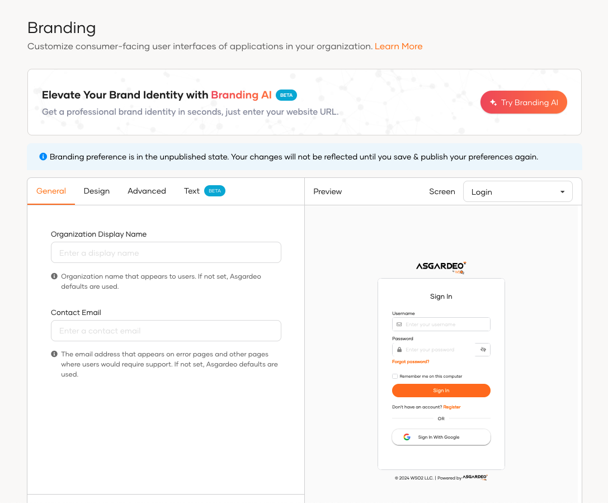
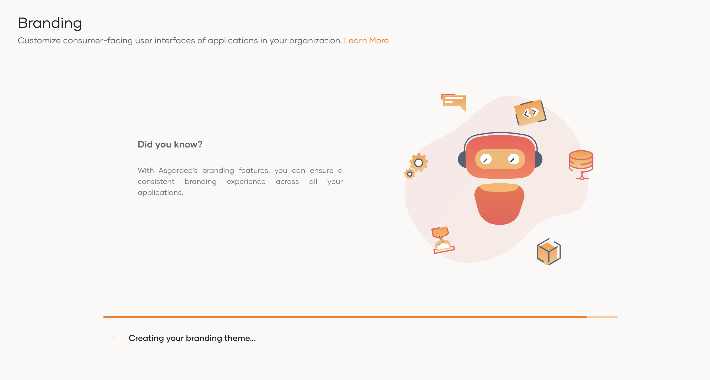
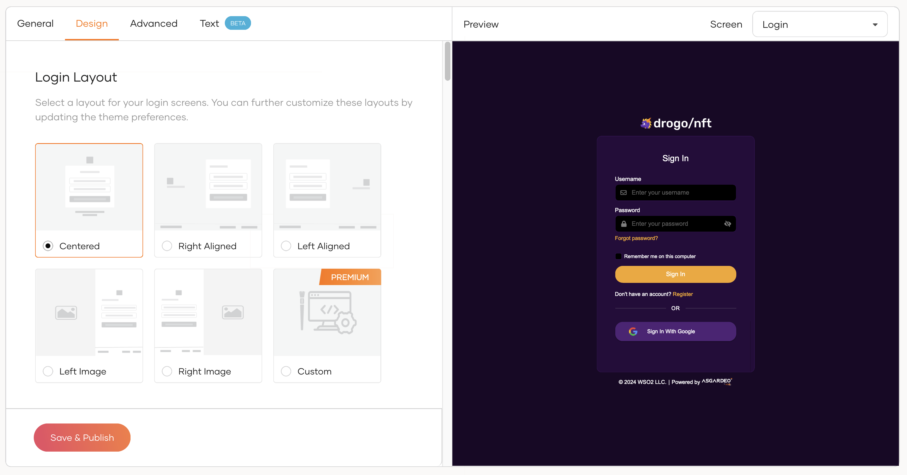

# Branding AI

AI-powered branding simplifies the process of creating a cohesive branding theme by using AI to analyze your website's existing visual elements. This innovative service automates the identification and application of design elements such as colors, fonts, and button styles, ensuring brand consistency and reducing manual effort.

By leveraging AI Branding, you can ensure that your the user prompted pages not only look great but also align perfectly with your brand's identity.

<Applies to="Self-hosted">

:::note[Enable AI-powered features]

To enable AI-powered features, WSO2 Identity Server requires a subscription key from the [WSO2 AI subscription portal](https://ai-subscriptions.wso2.com/). See the [guide](../../get-started/subscribe-to-ai-features.md) for step by step instructions.

:::

</Applies>

## Generate branding with Branding AI

To generate branding using Branding AI:

1. On the WSO2 Identity Platform Console, go to **Branding** > **Styles & Text**.

2. Click on **Try Branding AI**.

    

3. Enter the website URL you'd like to use as the basis for branding.

    

4. Press enter to automate branding for your organization based on the website you provided.

    The system will then process the website and start generating the branding theme.

    

## Review and customize generated branding

Once Branding AI processes your website, you'll find the branding **Design** tab populated with recommendations for the following **Theme Preferences**:

- Color palette derived from your website.
- Fonts and typography styles.
- Button styles and other UI elements.

You can further customize these branding guidelines by:

- Adjusting the color schemes to match your brand identity.
- Choosing alternative fonts that reflect your brand's personality.
- Modifying UI element styles to align with your brand's aesthetic.

By reviewing and customizing the generated branding, you can ensure that it perfectly aligns with your organization's unique identity and enhances your brand presence across all WSO2 Identity Platform interfaces.

## Apply branding

Once you've reviewed and customized the generated branding to your satisfaction, click **Save & Publish** to apply it across your organization's user interfaces.
