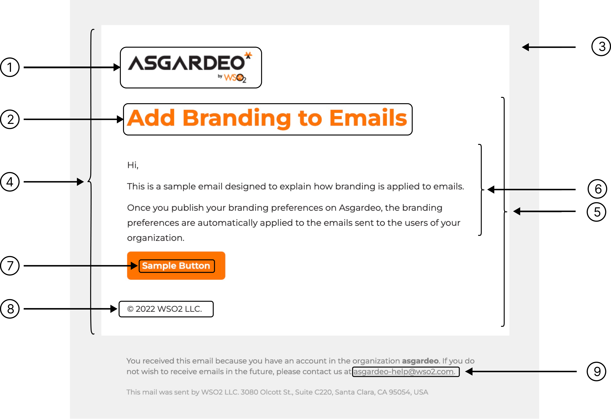
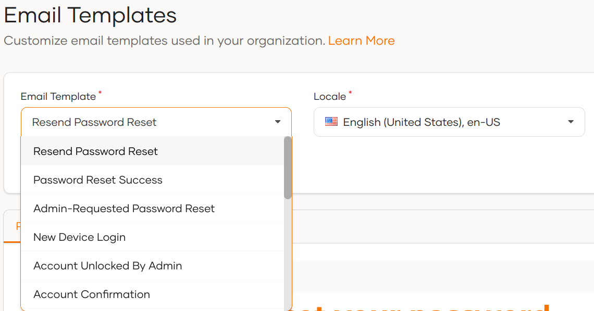

# Customize email templates

The following topics explain how you can customize email notifications that are sent to users of your WSO2 Identity Platform organization.

## Customize email branding

Once you publish your [branding preferences](configure-ui-branding.mdx#general-preferences) on WSO2 Identity Platform, the branding preferences are automatically applied to emails sent to the users of your organization.

<Applies to="WSO2 Cloud">

:::note

This feature was onboarded on 20th September 2022. Email template branding will not be applied to email templates of organizations created before this date.

If you need to apply organization branding to your emails, contact the WSO2 Identity Platform team at **asgardeo-help@wso2.com**.

:::

</Applies>

:::note[Email templates for B2B applications]

If you have set up [organizations](../organization-management/manage-organizations.mdx), refer [email template inheritance](../organization-management/inheritance-in-organizations/email-sms-templates-inheritance.mdx) to see how email templates are inherited.

:::

The branding variables that affect the email templates are as follows:

<table><tbody><tr><th></th><th>{"Template variable"}</th><th>{"Branding preference"}</th></tr><tr><td rowSpan={"2"}>{"1"}</td><td>{"Organization Logo"}</td><td>{"Design > Theme Preferences > Images > Logo URL"}</td></tr><tr><td>{"Logo alternative text"}</td><td>{"Design > Theme Preferences > Images > Logo Alt Text"}</td></tr><tr><td>{"2"}</td><td>{"Primary color"}</td><td>{"Design > Theme Preferences > Color Palette > Primary Color"}</td></tr><tr><td>{"3"}</td><td>{"Email background color"}</td><td>{"Design > Theme Preferences > Color Palette > Body Background > Main Background Color"}</td></tr><tr><td>{"4"}</td><td>{"Email body color"}</td><td>{"Design > Theme Preferences > Color Palette > Surface Background > Main Surface Background Color"}</td></tr><tr><td>{"5"}</td><td>{"Email font"}</td><td>{"Design > Theme Preferences > Font > Font Family"}</td></tr><tr><td>{"6"}</td><td>{"Email body font color"}</td><td>{"Design > Theme Preferences > Color Palette > Text Colors > Primary Text Color"}</td></tr><tr><td>{"7"}</td><td>{"Email button font color"}</td><td>{"Design > Theme Preferences > Buttons > Primary Button > Font Color"}</td></tr><tr><td>{"8"}</td><td>{"Copyright text"}</td><td>{"General > Copyright Text"}</td></tr><tr><td>{"9"}</td><td>{"Support email"}</td><td>{"General > Contact Email"}</td></tr></tbody></table>

## Customize email content

You can tailor the **subject**, **body**, and **footer** of email notifications to your preferences by following the steps below.

:::note

This feature is only available for the most frequently used email templates. You can customize [all available email templates](../../references/email-templates.mdx) using the [Email Templates API](../../apis/email-template.mdx) <small>(WSO2 Cloud)</small> / [Email Templates API](../../apis/email-templates-rest-api.mdx) <small>(Self-hosted)</small>.

:::

1. On the WSO2 Identity Platform, go to **Branding** > **Email Templates**.
2. Select the email template and the relevant locale that you wish to modify.

    :::note

    WSO2 Identity Platform gives you the option to automatically copy a template from one locale to another so that you don't have to create email templates from scratch. To do so, select a locale with an existing email template, switch over to the new locale and click confirm when the **Replicate content?** prompt appears.

    :::

    

3. Make your modifications in the **Content** tab and use the **Preview** tab for a real-time preview.

4. Click **Save** to publish your changes.

:::warning[Apply changes to user profiles]

To apply these changes to each user's profile in your organization:

1. Display the `local` attribute on the user's profile. Learn how to do so in [updating user attributes](/identity/guides/users/attributes/manage-attributes/#update-attributes).

2. Update the `local` attribute value with the [required locale code](/identity/guides/branding/localization-in-asgardeo/#supported-languages) <small>(WSO2 Cloud)</small> / [required locale code](localization.mdx#supported-languages) <small>(Self-hosted)</small>. The value should be updated by,

    - the admin, if the admin onboards the user to the organization.

    - the user, if the user self-registers to the organization.

:::

Alternatively, you can customize the content of email templates using the [Email Templates API](../../apis/email-template.mdx) <small>(WSO2 Cloud)</small> / [Email Templates API](../../apis/email-templates-rest-api.mdx) <small>(Self-hosted)</small> provided by WSO2 Identity Platform.

<Applies to="WSO2 Cloud">

## Customize email settings

You can customize the default settings set by WSO2 Identity Platform for email parameters such as `from address` and `replyTo` by contacting the WSO2 Identity Platform team at **asgardeo-help@wso2.com**.

</Applies>
