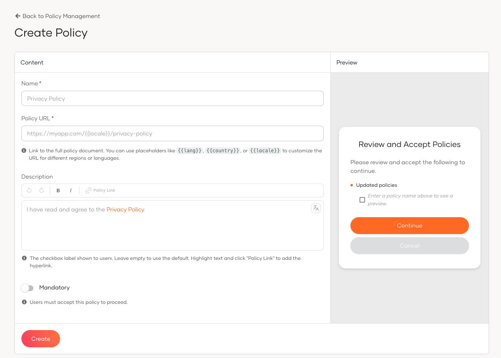
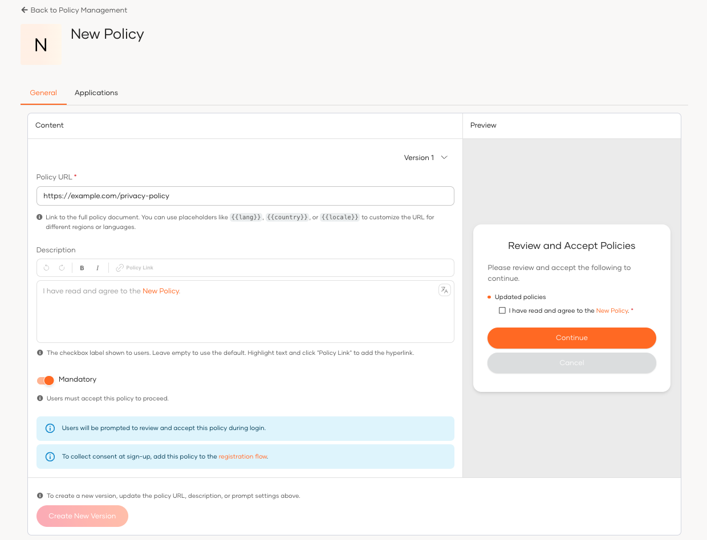
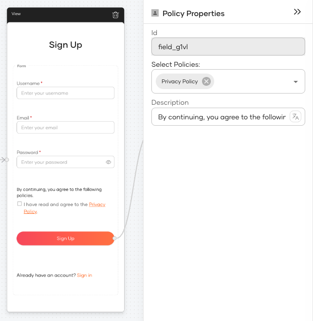
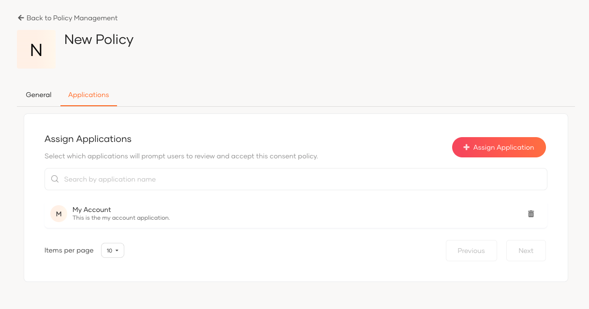
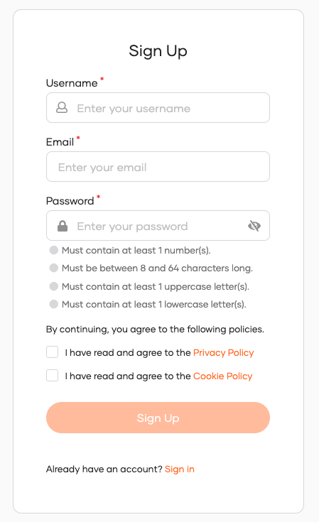
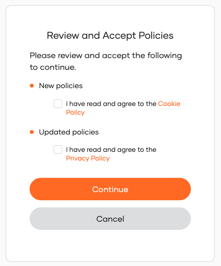

# Policy consent

Policy consent allows you to present users with legal agreements, such as a Privacy Policy or Terms of Service, and capture their explicit acceptance during registration and login flows.

<Applies to="Self-hosted">

<Prerequisites>

## Prerequisites

:::note

This feature is available from **update level 7.3.0.12** onwards. See the instructions on [updating WSO2 products](https://updates.docs.wso2.com/en/latest/).

:::

This feature requires the consent management v2 API to be enabled. See [Prerequisites](index.mdx#prerequisites) for the required `deployment.toml` configurations.

</Prerequisites>

</Applies>

## Overview

In WSO2 Identity Platform, policies are configured globally and apply across all applications in the organization.

Policy consent is primarily collected during **registration** and **ask-password** flows by adding the **Policy Consent** widget to the flow in the Flow Builder. Policies can also be configured to prompt users during the **login flow** (see [Configure policies for the login flow](#configure-policies-for-the-login-flow)).

## Add a policy

WSO2 Identity Platform includes two built-in policies, **Privacy Policy** and **Terms of Service**, which are linked to the corresponding URLs in your [branding configuration](../branding/configure-ui-branding.mdx). These default policies can only be configured when branding is enabled. You can also create additional custom policies regardless of the branding configuration.

To add a policy:

1. On the WSO2 Identity Platform Console, go to **Login and Registration** > **Policy Management**.
2. Click **New Policy**.
3. Provide the following details:

    | Field | Description |
    |-------|-------------|
    | **Name** | A unique name for the policy (e.g., *Cookie Policy*). |
    | **Policy URL** | The URL of the hosted policy document. You may use the placeholders ``, ``, and `` to serve locale-specific versions (e.g., `https://myapp.com//privacy-policy`). |
    | **Description** | The checkbox label shown to users on the consent screen. If left empty, a default label is used. To hyperlink any word or phrase to the policy URL, highlight it in the editor and click **Policy Link**. Supports rich text and i18n keys in the format ``. |
    | **Mandatory** | When enabled, users must accept this policy to proceed. When disabled, the policy is optional. |

    The **Preview** panel on the right updates in real time as you fill in the form.

4. Click **Create**. In the dialog that appears, select whether existing users should be prompted to accept this policy at their next login by checking **Prompt at next login**.
5. Click **Confirm**.

:::note

Policies are automatically inherited by sub-organizations.

:::

## Manage policy versions

Each time you save changes to a policy, WSO2 Identity Platform creates a new version automatically. Use the version selector on the policy page to review the full version history.

To create a new version:

1. On the WSO2 Identity Platform Console, go to **Login and Registration** > **Policy Management**.
2. Open the policy you want to update.
3. On the **General** tab, update the **Policy URL**, **Description**, or **Mandatory** setting as needed.
4. Click **Create New Version**. The **Save as New Version** dialog appears.
5. Check **Prompt at next login** if existing users should be re-prompted to accept this version at their next login.
6. Click **Confirm**.

The **Prompt at next login** setting controls re-prompt behavior:

- **Enabled**: Users who have not yet accepted this version will be prompted at their next login (subject to application-level configuration).
- **Disabled**: Existing users are not re-prompted at login. Only users going through registration or ask-password flows will see the updated version.

:::note

If a user has not yet consented to any version that has **Prompt at next login** enabled, they will be prompted at login, regardless of whether the latest version has this setting enabled.

:::

## Add the policy consent widget to a flow

To collect policy consent during registration or ask-password, add the **Policy Consent** widget from the **Components** panel in the Flow Builder.

1. On the WSO2 Identity Platform Console, navigate to your application and go to **Login Flow**.
2. Select the **Registration** or **Ask Password** flow.
3. From the **Components** panel, drag the **Policy Consent** widget into the flow.
4. In the widget's properties panel, configure the following:

    | Property | Description |
    |----------|-------------|
    | **Select Policies** | Choose which policies to display in this widget. You can select one or more policies from the list. |
    | **Description** | The header text shown to users above the policy checkboxes. Supports i18n keys. |

## Configure policies for the login flow

To prompt users to accept a policy at login, configure it at both levels described below. A user will be shown the policy at login only when **both** conditions are met:

1. The policy version has **Prompt at next login** enabled.
2. The application is configured to show the policy during login.

To configure the application-level setting:

1. On the WSO2 Identity Platform Console, go to **Login and Registration** > **Policy Management**.
2. Open the policy you want to configure.
3. Go to the **Applications** tab.
4. Click **+ Assign Application** and select the applications that should prompt users to accept this policy at login.

To remove an application, click the delete icon next to it in the list.

:::note

Policy consent during login is not supported for federated users or app-native authentication flows.

:::

## Delete a policy

1. On the WSO2 Identity Platform Console, go to **Login and Registration** > **Policy Management**.
2. Click on the policy you want to delete.
3. Scroll to the **Danger Zone** and click **Delete Policy**.
4. Confirm the deletion.

:::note

A policy cannot be deleted if any user has already given consent to it.

:::

## What the user sees

**During registration or ask-password:**

The consent screen appearance depends on how you configure the **Policy Consent** widget in the Flow Builder. This includes which policies are shown and the header description displayed to the user. The following is a sample consent screen:

**During login:**

When a user logs in to a configured application, WSO2 Identity Platform checks for policy versions marked with **Prompt at next login**. If the user has not yet accepted such a version, the policy consent screen appears before login completes. Policies are grouped into:

- **New policies** – policies the user has never consented to.
- **Updated policies** – policies the user already accepted but that have a newer version requiring consent.

## What's next

<LinkCards>

- [Manage consents](../user-self-service/manage-consents.mdx) – Users can view and revoke their policy consents from MyAccount.
- [Preference management consent](preference-management-consent.mdx) – Capture user preferences for specific data uses.

</LinkCards>
