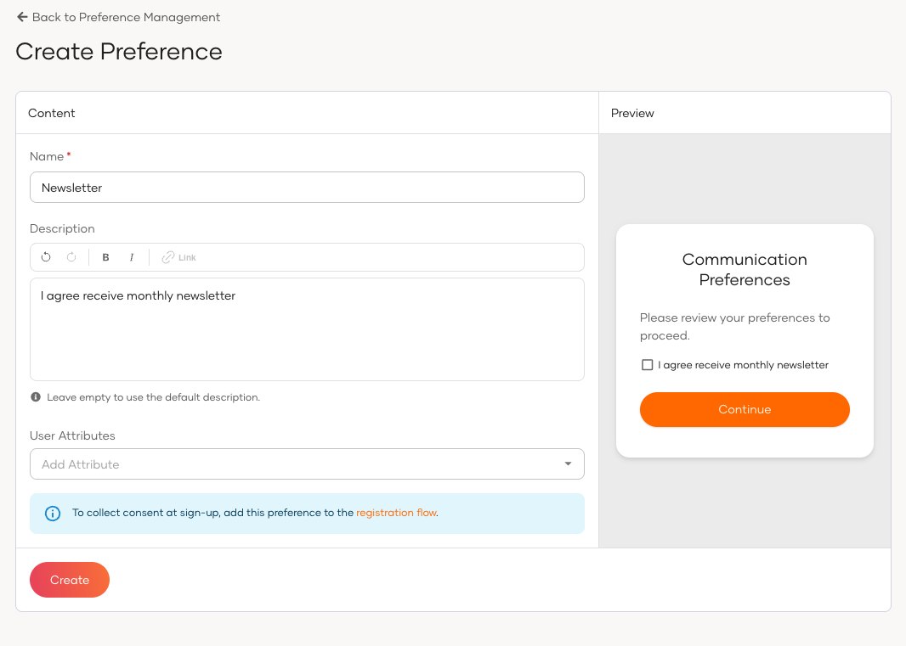
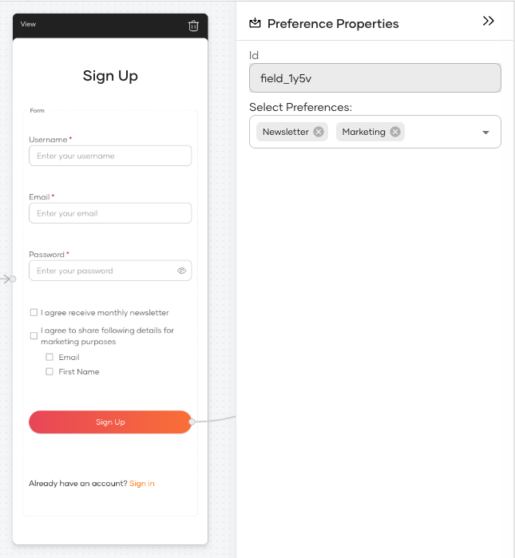
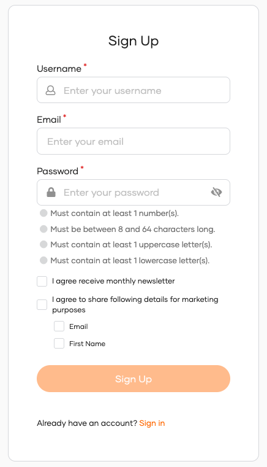

# Preference management consent

Preference management consent allows you to request user consent during registration for specific uses of their data, such as marketing communications, analytics, or third-party data sharing.

<Applies to="Self-hosted">

<Prerequisites>

## Prerequisites

:::note

This feature is available from **update level 7.3.0.12** onwards. See the instructions on [updating WSO2 products](https://updates.docs.wso2.com/en/latest/).

:::

This feature requires the consent management v2 API to be enabled. See [Prerequisites](index.mdx#prerequisites) for the required `deployment.toml` configurations.

</Prerequisites>

</Applies>

## Overview

In WSO2 Identity Platform, preferences are configured globally and apply across all applications in the organization.

Preference consent is collected during **registration** and **ask-password** flows by adding the **Preference Management** widget to the flow in the Flow Builder. Preferences are not shown during the login flow.

Preferences are always **optional**. Users can freely opt in or out. A preference can include one or more **user attributes**, allowing users to consent to each attribute individually within a single preference.

## Add a preference

1. On the WSO2 Identity Platform Console, go to **Login and Registration** > **Preference Management**.
2. Click **New Preference**.
3. Provide the following details:

    | Field | Description |
    |-------|-------------|
    | **Name** | A unique name for the preference (e.g., *Newsletter Subscription*). |
    | **Description** | (Optional) Text displayed to users on the consent screen. |
    | **User Attributes** | (Optional) One or more user attributes associated with this preference. Users can opt in or out of each attribute individually. |

4. Click **Create**.

:::note

Preferences are automatically inherited by sub-organizations.

:::

## Add the preference management widget to a flow

To collect preference consent during registration or ask-password, add the **Preference Management** widget in the Flow Builder. It can be added in two ways:

- **As a component** – drag it from the **Components** panel into an existing view in the flow.
- **As a step** – add it as a new step in the flow.

1. On the WSO2 Identity Platform Console, navigate to your application and go to **Login Flow**.
2. Select the **Registration** or **Ask Password** flow.
3. Add the **Preference Management** widget to the flow:

    - To add as a component, drag the widget from the **Components** panel into an existing view:

        

    - To add as a step, click **Add Step** in the flow and select the **Preference Management** widget from the list.

4. In the widget's properties panel, configure the following:

    | Property | Description |
    |----------|-------------|
    | **Select Preferences** | Choose which preferences to display in this widget. You can select one or more preferences from the list. |
    | **Description** | The header text shown to users above the preference options. |

:::note

For policy consent, use the **Policy Consent** widget instead. Both widgets can be added independently to the same flow.

:::

## Delete a preference

1. On the WSO2 Identity Platform Console, go to **Login and Registration** > **Preference Management**.
2. Click on the preference you want to delete.
3. Scroll to the **Danger Zone** and click **Delete Preference**.
4. Confirm the deletion.

:::note

A preference cannot be deleted if any user has already given consent to it.

:::

## What the user sees

During registration or ask-password, users see a screen listing all configured preferences. Each preference has a main opt-in toggle. If the preference includes user attributes, individual checkboxes are shown for each, allowing granular selection.

## What's next

<LinkCards>

- [Manage consents](../user-self-service/manage-consents.mdx) – Users can view and revoke their preference consents from MyAccount.
- [Policy consent](policy-consent.mdx) – Capture acceptance of legal agreements such as privacy policies and terms of service.

</LinkCards>
