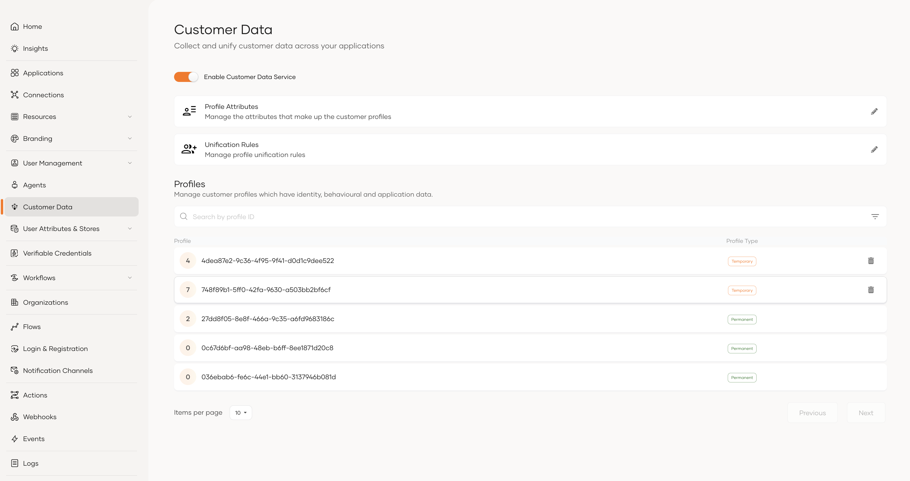
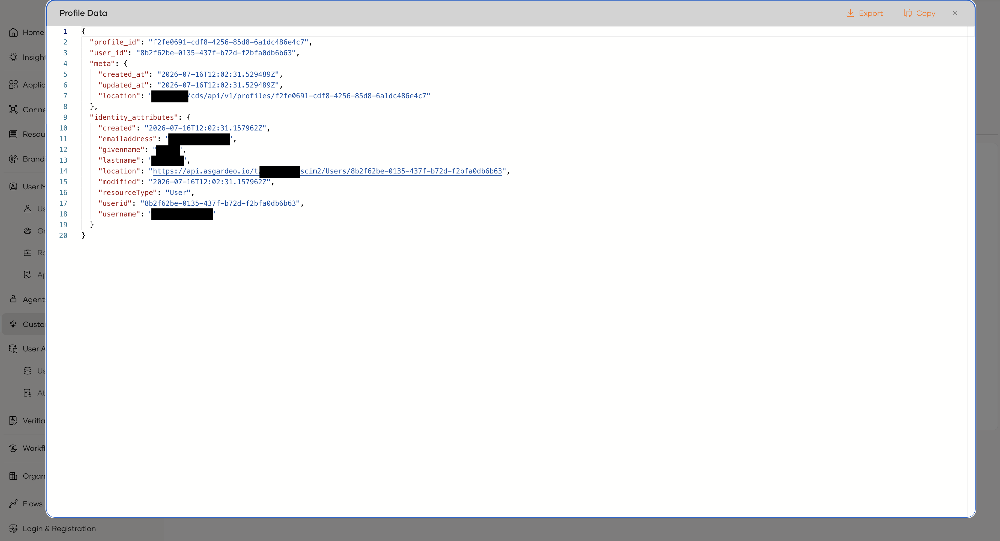

# Profiles

A **profile** is the central entity in the Customer Data Service. It represents a single person's collected data, their identity attributes, behavioral traits, and per application data unified across all interactions.

---

## Temporary and permanent profiles

Profiles are either **temporary** (anonymous) or **permanent** (identified).

### Temporary profile

- Created when an anonymous user first interacts (e.g. visits a website)
- Has no `user_id`
- Accumulates behavioral data during the anonymous session

### Permanent profile

- Has a `user_id`, which is set when the user logs in or is created in WSO2 Identity Platform
- Acts as the master record for that identity
- May have one or more temporary profiles merged into it over time

---

## Profile structure

| Field | Description |
|---|---|
| `profile_id` | System generated UUID. Immutable. |
| `user_id` | The user's ID from WSO2 Identity Platform. Empty on anonymous profiles. |
| `identity_attributes` | Attributes sourced from the identity system (e.g. email, phone, name). Keyed by attribute name. |
| `traits` | Behavioral or preference data (e.g. download count, segment tags). |
| `application_data` | Per-application data, keyed by the application's ID. |
| `meta.created_at` | When the profile was created. Read-only. |
| `meta.updated_at` | When the profile was last modified. Read-only. |
| `merged_from` | References to profiles that were unified into this one. |
| `merged_to` | Set on child profiles, points to the master profile they were merged into. |

---

## Related

- [Profile attributes](profile-attributes.mdx)
- [Unification rules](unification-rules.mdx)
