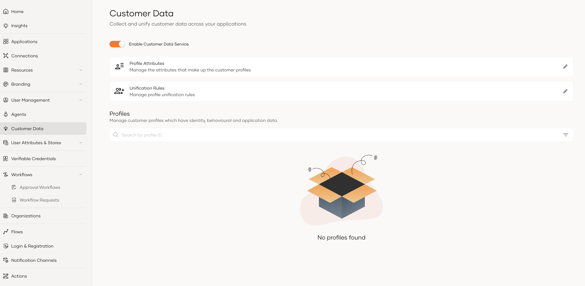

<h1>Enable customer data service</h1>

The Customer Data Service is disabled by default. Enable it for your organization from the **Customer Data** page in the console.

## Enable customer data service

1. On the console, go to **Customer Data** in the left navigation pane.
2. Turn on the **Enable Customer Data Service** toggle.

Once enabled, the page shows the profiles collected for your organization, along with the **Profile Attributes** and **Unification Rules** configurations.

## Disable customer data service

To turn the feature off again,

1. On the console, go to **Customer Data** in the left navigation pane.
2. Turn off the **Enable Customer Data Service** toggle.

Existing profile, attribute, and unification rule data is preserved while the feature is disabled.

## Next steps

- Learn what a [Profile](concepts/profiles.mdx) is and how anonymous activity gets attached to a user.
- Review the [Profile attributes](concepts/profile-attributes.mdx) defined for your organization.
- Configure [Unification rules](concepts/unification-rules.mdx) that decide when two profiles should be merged.
