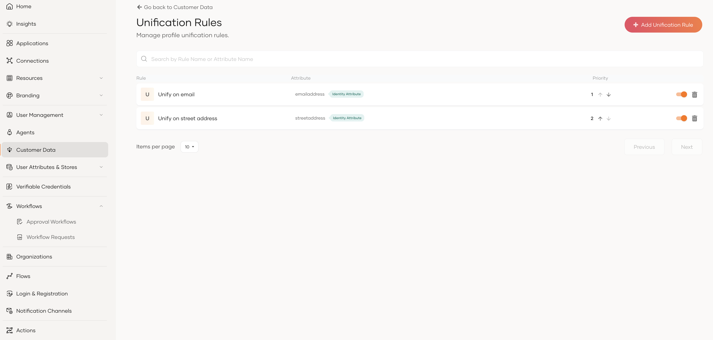
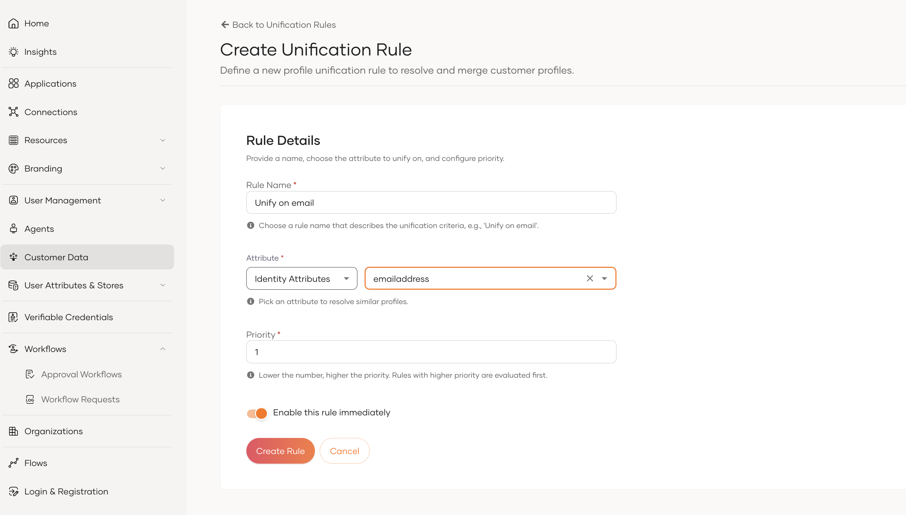

# Manage unification rules

Unification rules tell the Customer Data Service when two profiles should be recognized as the same person and merged. Manage them from the **Customer Data** page in the console, under **Unification Rules**.

For a conceptual overview see [Unification rules](../concepts/unification-rules.mdx).

---

## View unification rules

1. From the console, go to **Customer Data** and select **Unification Rules**.
2. The list shows every rule defined for your organization, ordered by priority. The lowest priority number is evaluated first.

---

## Create a rule

1. Click **Add Unification Rule**.
2. Fill in:
    - **Rule name** — human-readable name.
    - **Attribute** — the profile attribute to match on. Select the scope (e.g. `Identity Attributes`) and the attribute (e.g. `emailaddress`).
    - **Priority** — lower numbers are evaluated first.
    - **Enable this rule immediately** — select this option to apply the rule when you create it.
3. Click **Create Rule**.

---

## Reorder a rule

Use the up and down arrows in the **Priority** column to change the order in which rules are evaluated.

Reordering a rule does **not** retroactively merge or un-merge existing profiles — it only affects future unification runs.

---

## Disable a rule

Turn off the toggle of the rule in the list and confirm. The rule is skipped during evaluation but stays in the list and keeps its priority.

---

## Delete a rule

1. Click the delete icon of the rule in the list.
2. Confirm the deletion.

Existing merges already recorded under this rule are not reversed.

---

## Related

- [Unification rules](../concepts/unification-rules.mdx) — concepts and field reference.
- [Profile attributes](../concepts/profile-attributes.mdx) — the attribute set rules can match on.
