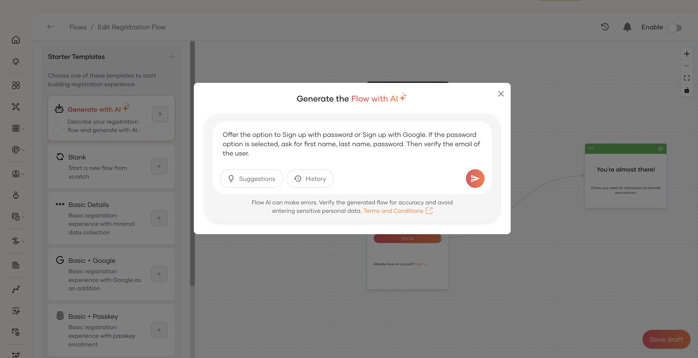

# Flow AI

AI-powered flow building simplifies the process of creating complex user journeys by using AI to translate your requirements into functional flows. This automates the setup of registration and recovery flows based on plain language descriptions, reducing manual configuration effort.

By leveraging Flow AI, you can ensure that your user interactions are optimized for both security and user experience without needing deep knowledge of the underlying flow configuration syntax.

<Applies to="Self-hosted">

:::note[Enable AI-powered features]

To enable AI-powered features, WSO2 Identity Server requires a subscription key from the [WSO2 AI subscription portal](https://ai-subscriptions.wso2.com/). See the [guide](../../get-started/subscribe-to-ai-features.md) for step by step instructions.

:::

</Applies>

## Generate flow with Flow AI

To generate a flow using Flow AI:

1. On the WSO2 Identity Platform Console, go to **Flows**.

2. Select the flow type you wish to configure (e.g., **Self Registration**, **Password Recovery**, etc.).

3. Click on the **Generate with AI** option.

    

4. Enter a description of the flow you want to create.
   
    For example: "Create a registration flow that collects the user's first name, last name, and email address, and requires email OTP verification."

5. Press **Enter** or click the generate button to build the flow.

    The system will analyze your description and automatically construct the flow components on the canvas.

## Review and customize generated flow

Once Flow AI processes your input, the **Flow Builder** canvas will be populated with a complete flow diagram, including:

- Required steps for the user journey.
- Input fields mapped to user attributes.
- Verification steps if requested.

You can further customize this generated flow by:

- Adding or removing [widgets](build-a-flow.md#widgets) to enhance functionality.
- Modifying [components](build-a-flow.md#components) to change field properties or labels.
- Reordering steps to better suit your user experience requirements.

By reviewing and customizing the generated flow, you can ensure that it perfectly satisfies your organization's security policies and business rules.

## Enable flow

Once you've reviewed and customized the generated flow to your satisfaction, use the **Enable** toggle in the Flow Builder to make the flow active for your users.
