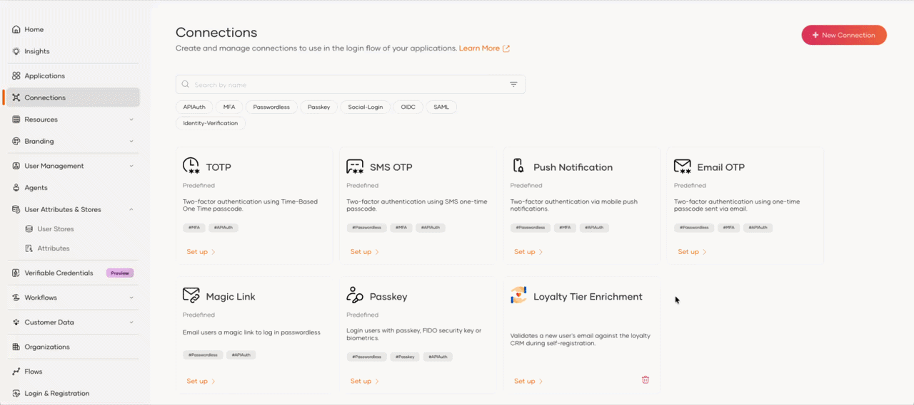
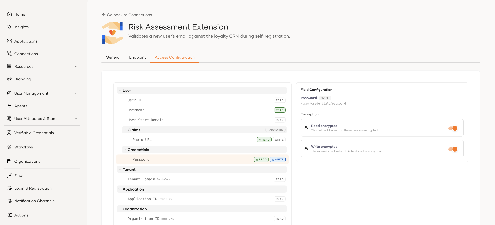
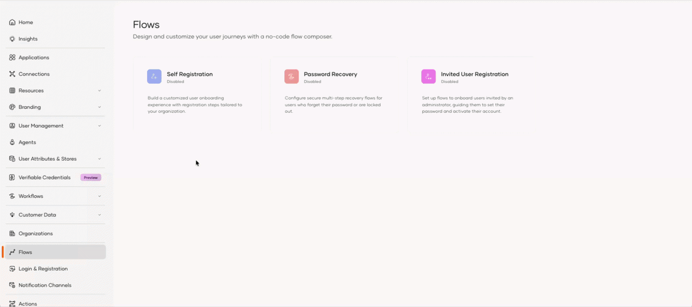
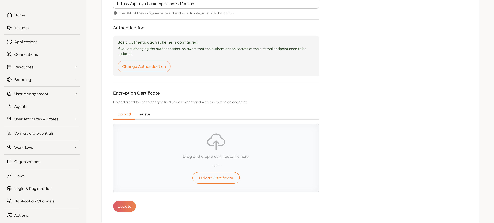

# Flow extension configuration

This guide walks you through registering an external service as a flow extension, creating the attributes it returns, configuring attribute access, and adding the extension to a flow.

## Sample use case

Imagine an organization that runs a loyalty program in an external CRM. When a new customer self-registers, the organization wants to:

- Validate the customer's email address against the CRM to confirm they are a recognized member.
- Pull the customer's existing **loyalty tier** (for example, Silver, Gold, or Platinum) from the CRM and store it on their new account, so downstream applications can offer tier-based benefits immediately.

A flow extension makes this possible:

1. The customer enters their email and other details in the **Self Registration** flow.
2. WSO2 Identity Platform invokes the loyalty service endpoint, **exposing** the customer's email address and the application ID.
3. The CRM looks up the customer and responds with their member identifier and loyalty tier.
4. WSO2 Identity Platform writes these values back into the flow as `identifier` and `tier` claims.
5. The account is created with the loyalty tier already populated, ready for use by connected applications.

This enriches the user's profile with trusted data from a system of record at the moment of registration, with no manual data entry required.

## Build the flow

To use a flow extension, you first register it as a connection and then invoke it from a flow.

### Step 1 – Create a new flow extension

To register your external service as a flow extension:

1. On the WSO2 Identity Platform Console, go to **Connections**.

2. Click **New Connection** and select **Create Flow Extension**.

3. Provide the basic details for the extension:

    - **Name** (required): A unique name to identify this flow extension.
    - **Description**: A short description of what the extension does.
    - **Icon URL**: A URL pointing to an icon that represents this flow extension.

4. Click **Next**.

5. In the **Endpoint** field (required), enter the URL of the external endpoint to integrate with this extension.

6. Under **Authentication**, select the **Authentication Scheme** (required) that WSO2 Identity Platform uses to authenticate to your endpoint, and provide the required credentials. The supported schemes are **None**, **Basic**, **Bearer**, **API Key**, and **Client Credential**.

7. (Optional) Under **Encryption Certificate**, upload a certificate to encrypt field values exchanged with the extension endpoint. WSO2 Identity Platform uses this certificate to encrypt the values it sends to your endpoint. To learn how encryption works, see [configure field encryption](flow-extension-configuration.md#step-4-configure-field-encryption).

<video autoplay loop muted playsinline width="auto">
    <source src="/identity/assets/img/guides/flows/flow-extension-encryption-certificate.mp4" type="video/mp4" />
    Your browser does not support this content.
</video>

### Step 2 – Create the attributes returned by your endpoint

The flow extension writes the values returned by your endpoint into the flow as user attributes (claims). Before you can map these values, the corresponding attributes must exist in WSO2 Identity Platform.

In the loyalty example, the endpoint returns a member **identifier** and a **tier**. The `email` attribute already exists as a default attribute, but `identifier` and `tier` are not available by default, so you need to add them as custom attributes.

For each value your endpoint returns that doesn't already exist as an attribute:

1. On the WSO2 Identity Platform Console, go to **User Attributes & Stores** > **Attributes**.

2. Add a new custom attribute (for example, `identifier` and `tier`).

For detailed steps, see [Add custom attributes](../users/attributes/user-attributes/manage-attributes.md#add-custom-attributes).

### Step 3 – Configure the flow extension

Once the extension and its attributes exist, configure which attributes WSO2 Identity Platform exposes to your endpoint and which attributes it writes back from the response.

1. On the WSO2 Identity Platform Console, go to **Connections** and select the flow extension you created.

2. Click **Set Up** and go to the **Access Configuration** tab.

3. Under **Claims**, click **+ Add Entry** to add each attribute the extension uses, and set its access level. Use **Read** for attributes sent to your endpoint and **Write** for attributes it returns. For the loyalty example, mark `email` and `applicationId` as **Read**, and `identifier` and `tier` as **Write**.

4. Click **Update** to save the configuration.

The flow extension is now ready to be added to a flow.

#### Attribute access levels

Most attributes accept both **Read** and **Write**. The following are the exceptions:

| Attribute | Available access | Notes |
| --------- | ---------------- | ----- |
| Attributes marked with a **Read-Only** badge | Read | WSO2 Identity Platform owns these values, so their **Write** control is disabled. |
| Username | Read and Write | Applied in the **Self Registration** flow only. In **Password Recovery** and **Invited User Registration**, WSO2 Identity Platform omits the username from the request and ignores any change your endpoint returns. |
| Identity attributes | Read and Write | WSO2 Identity Platform maintains these itself, so writing one can cause unexpected behavior. |

### Step 4 – Configure field encryption

For sensitive attributes, you can encrypt the values exchanged with your endpoint on a per field basis.

- **Read (sent to your endpoint):** WSO2 Identity Platform encrypts the values it sends using an encryption certificate. If you didn't upload one when creating the extension, see [manage the encryption certificate](#manage-the-encryption-certificate).
- **Write (returned by your endpoint):** your endpoint encrypts the values it returns and WSO2 Identity Platform decrypts them. No certificate is required.

For the wire format your endpoint must handle, see [work with encrypted values](flow-extension-external-service.md#work-with-encrypted-values).

To mark a field as encrypted:

1. On the **Access Configuration** tab, select the field you want to encrypt. The **Field Configuration** panel opens.

2. Under **Encryption**, turn on the toggles you need:

    - **Read encrypted**: WSO2 Identity Platform sends this field to your endpoint encrypted. Available once the field is marked as **Read**.
    - **Write encrypted**: Your endpoint returns this field's value encrypted. Available once the field is marked as **Write**.

3. Click **Update** to save the configuration.

Fields marked as encrypted show a lock icon on their **Read** and **Write** indicators.

:::note

If you remove a field's **Read** or **Write** access, its corresponding encryption setting clears automatically.

:::

### Step 5 – Add the flow extension to the flow

Add the extension to the Self Registration flow so that WSO2 Identity Platform invokes it while a user registers.

1. On the WSO2 Identity Platform Console, go to **Flows**, and click the **Self Registration** card. Click the Basic Details template to add it to the canvas.

2. From the **Steps** panel, drag and drop a **Flow Extension View** onto the canvas, then wire it into the flow:

    - Delete the existing connection from the Email OTP view to the green **End** node.
    - Draw a new connection from the **Continue** button of the Email OTP view to the Flow Extension View.
    - Draw a final connection from the Flow Extension View to the **End** node.

3. With the Flow Extension View selected, click the gear icon (⚙️) to open the execution properties, and select the flow extension you created from the **Connection** dropdown.

4. Click **Save Draft** to save all changes, then turn the toggle on the top right corner of the Flow Builder **ON** to publish the flow.

New users who self-register now pass through the flow extension, and the values returned by your endpoint are written to their account before the account is created.

## Manage the encryption certificate

You can add, replace, or remove the encryption certificate of an existing flow extension:

1. On the WSO2 Identity Platform Console, go to **Connections** and select the flow extension.

2. Click **Set Up** and go to the **Settings** tab.

3. Under **Encryption Certificate**:

    - If no certificate is configured, upload one using the certificate form.
    - If a certificate is already configured, click **Clear** to remove it. To replace it, upload a new certificate after clearing the existing one.

4. Click **Update** to save the changes.

:::note

For security reasons, WSO2 Identity Platform never displays a certificate after you upload it. The Console only indicates whether a certificate is configured.

:::
