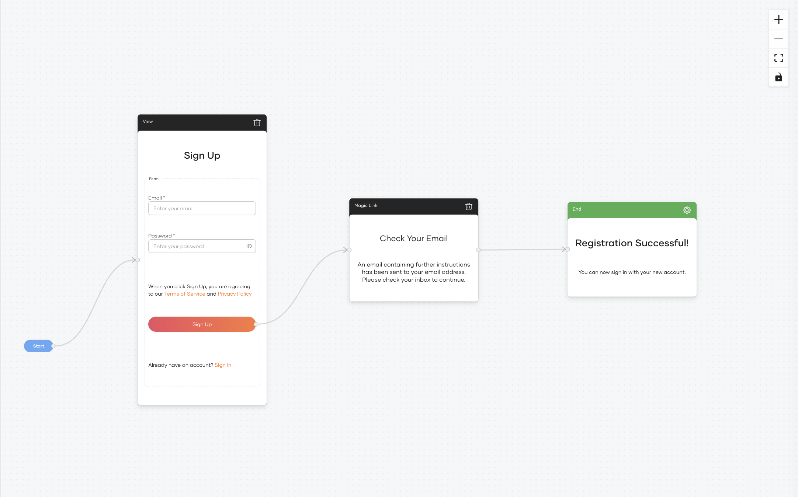
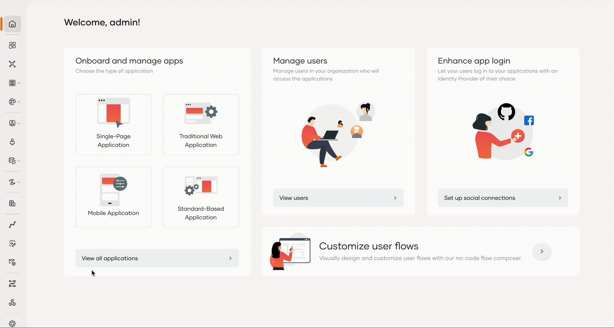
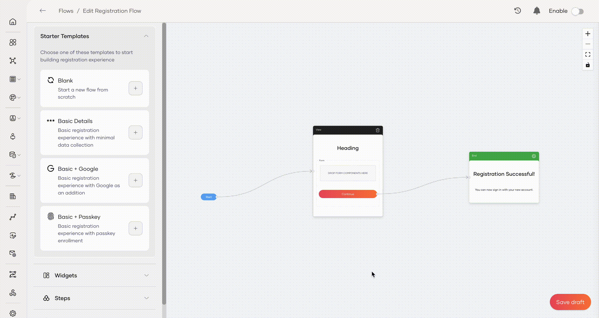
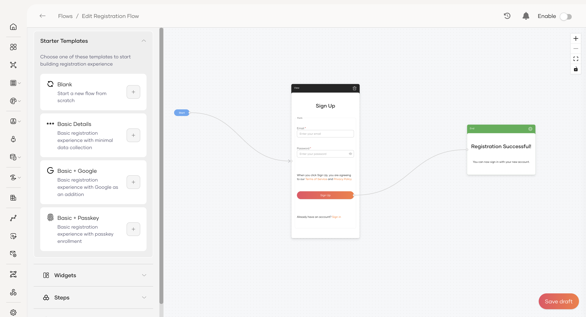
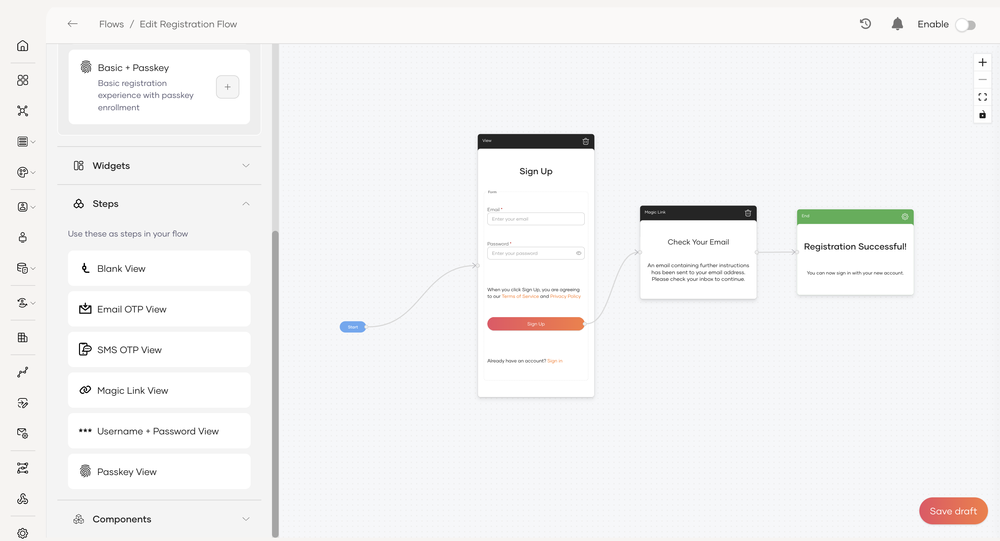
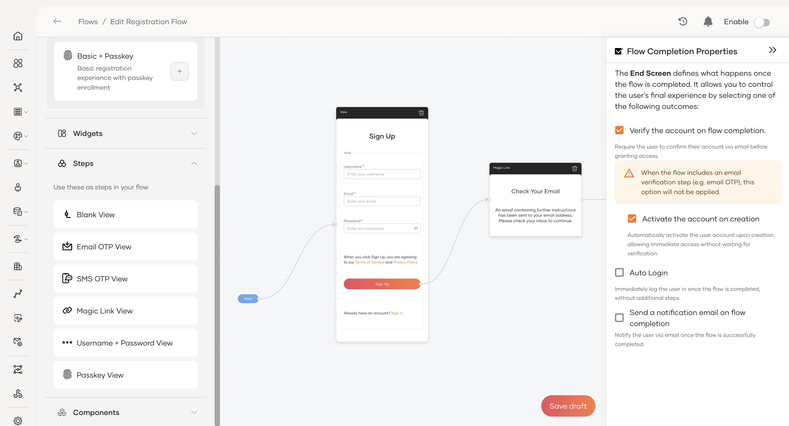

# Self registration

Self-registration allows new users to create an account within an organization without needing admin intervention. The flow can include steps to collect user details, verify identity, and set credentials before the account becomes active.

In the **Flow Builder**, you can create a self-registration journey in two ways:

- **Use a starter template** – Load a ready made flow and customize it to your needs.

- **Build from scratch** – Take full control by designing every step yourself.

## Sample use case

Imagine a scenario where the self-registration form is simplified to only request essential user details. For added security, the flow verifies the user's email address using a Magic Link before the account becomes active.

The flow works as follows:

 1. The user enters their email and password.
 2. WSO2 Identity Platform sends a **Magic Link** to the user's email address.
 3. The user clicks the link to verify their email address.
 4. WSO2 Identity Platform creates the user's account.

This ensures that only users with a valid email address can self-register, helping to prevent fake or fraudulent sign-ups.

## Build the flow

To build the sample use case, start with the Basic Details template and adjust it to use Magic Link verification.

Follow the steps below to configure this flow.

<Steps>

### Navigate to self registration flow {/* #step-1--navigate-to-self-registration-flow */}

To load the template,

1. On the WSO2 Identity Platform console, navigate to Flows.

2. Click on the **Self Registration** card. This loads the Basic Details template onto the canvas by default.

### Load the template {/* #step-2--load-the-template */}

If the template isn't loaded automatically, click the `+` button next to the **Basic Details** template to load it onto the canvas.

### Tidy the form {/* #step-3--tidy-the-form */}

Simplify the form to collect only the essentials for this registration flow.

- In the Sign Up view, select and delete any fields that aren't required, keeping only **Email** and **Password**.

- Remove the Email OTP view.

### Insert the Magic Link verification step {/* #step-4--insert-the-magic-link-verification-step */}

Insert the Magic Link verification step between the initial sign-up and the successful completion.

1. From the Steps panel, drag and drop a **Magic Link View** onto the canvas.
2. Delete the existing connection from the Sign Up button to the green End node.
3. Draw a new connection from the Sign Up button to the Magic Link View. The button's action will automatically update to Navigation.
4. Draw a final connection from the Verify button (inside the Magic Link step) to the End node.

### Configure the flow completion {/* #step-5--configure-the-flow-completion */}

The **End** node determines what the user experiences upon successful registration.
**Customize the success message:**

1. Click on the green **End** node on the canvas.
2. Edit the title (for example, "Registration Successful!") and the description text to customize the message shown to the user upon completion.

**Set the completion properties:**

1. With the **End** node selected, click the gear icon (⚙️) to open the [Flow Completion Properties](#flow-completion-properties).
2. Configure the desired outcomes:
   - **Auto Login:** Immediately logs the user in once the flow is completed, without requiring them to enter their credentials again.

### Enable the flow {/* #step-6--enable-the-flow */}

Once the flow has been fully configured and is ready for users:

1. Click **Save Draft** to save all changes.
2. On the top-right corner of the Flow Builder, turn the toggle **ON** to publish the flow.

New users will now go through the simplified registration process with mandatory email verification using a Magic Link.

With these changes, new users will only provide the essentials **Email** and **password** and must verify their email via Magic Link before completing registration.

</Steps>

## Add a connection-based sign-up option

You can let users register through an external identity provider by adding a connection widget to the flow. The following connections are supported:

- [Google](../authentication/social-login/add-google-login.mdx)
- [Apple](../authentication/social-login/add-apple-login.mdx)
- [Facebook](../authentication/social-login/add-facebook-login.mdx)
- [Microsoft](../authentication/social-login/add-microsoft-login.mdx)
- [GitHub](../authentication/social-login/add-github-login.mdx)

To add a connection to the self-registration flow:

1. Register the connection under **Console** > **Connections** by following the setup guide linked above for the provider you want to use.

2. 

<Applies to="WSO2 Cloud">

In the connection settings, set the authorized redirect URL to: `https://accounts.asgardeo.io/t/{tenant-domain}/accounts/register`

</Applies>

<Applies to="Self-hosted">

In the connection settings, set the authorized redirect URL to: `https://{is_host}/t/{tenant-domain}/accounts/register`

</Applies>

3. Open the **Self Registration** flow in the Flow Builder.

4. From the **Widgets** panel, drag the `Continue with {Provider}` widget onto the canvas.

5. Draw a connection from the widget's button to the next step (for example, the End node for immediate completion, or a follow-up step such as profile completion).

6. Save and enable the flow.

## Reference

This section provides details on the configuration options available in the Self Registration flow.

### Flow completion properties

The Flow Completion Properties, configured on the End node, define the final actions that occur after a user successfully registers.

- **Verify the account on flow completion:** Requires the user to confirm their account via an email link before they can sign in. Use this option to ensure the user has access to the email they provided.

    :::info

    This option won't be applied if the flow already includes a verification step (like Magic Link or Email/SMS OTP).

    :::

- **Activate the account on creation:** Automatically activates the user account, allowing immediate access without a separate verification step.

- **Auto Login:** If enabled, the user is automatically logged into their account immediately after successfully completing the registration flow.

- **Send a notification email on flow completion:** When enabled, the user will receive an email confirming that their account has been successfully created.
