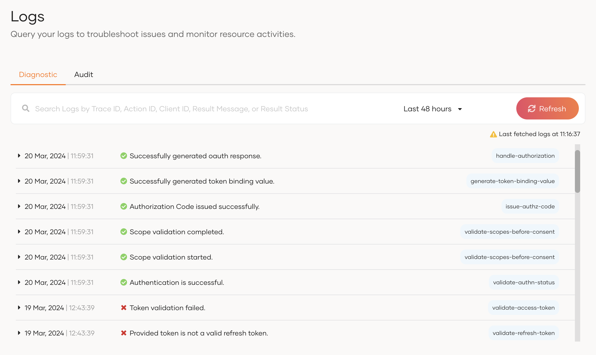
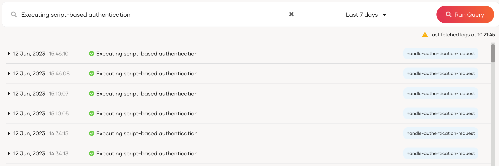
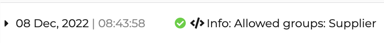
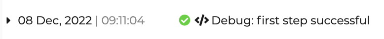
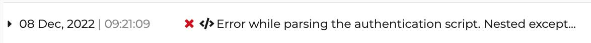
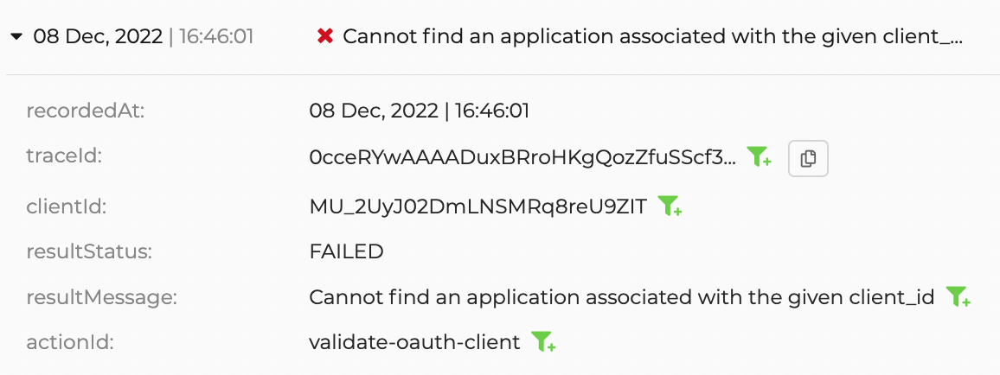
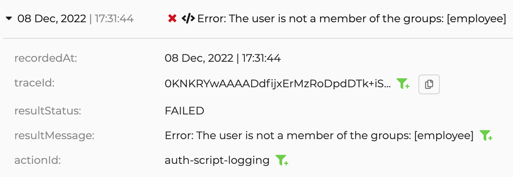

# Diagnostic logs

Diagnostic logs in WSO2 Identity Platform are designed to help developers diagnose and troubleshoot issues that occur when using WSO2 Identity Platform features such as onboarding applications, and configuring authentication flows. Furthermore, support engineers can also use logs to troubleshoot user issues.

## Access diagnostic logs

To access diagnostics logs:

1. On the WSO2 Identity Platform Console, go to **Log**

2. Switch to the **Diagnostic** tab.

    

By default, the console displays logs that occurred in the last 15 minutes.

### Search for logs

You can use the search bar to search for logs based on the Trace ID, Action ID, Client ID, Result Message or the Result Status. Learn more about these parameters in the [structure of logs](#structure-of-logs) section.

For example, the diagram below shows the results for a search based on the Result Message.



## Add custom logs to authentication scripts

In addition to the logs generated by WSO2 Identity Platform, organization administrators can define their own logs when [setting up conditional authentication](../authentication/conditional-auth/index.md) scripts. This is helpful when you need additional information to troubleshoot an application issue.

:::note

Custom logs are marked by the **&lt;/>** icon in the logs portal.

:::

There are three types of custom logs that you can define in conditional authentication as explained below.

### Info logs

Info logs are used to log additional information related to a flow. You can define info logs using the utility function `Log.info()`.

For example, an application developer sets up the following info log in the conditional authentication script to verify which user groups are allowed to log in.

```java
.....
var allowedGroups = ['Supplier'];
Log.info('Allowed groups: ' + allowedGroups.toString());
.....
```

Once a user attempts to log in, this information is logged in the logs portal as shown below.



<br />

### Debug logs

Debug logs can be used to check the status of a condition defined in the conditional authentication script. You can define debug logs using the utility function `Log.debug()`.

For example, an application developer sets up a debug log in the conditional authentication script to determine whether the first step of a login attempt succeeded.

```java
...
executeStep(1, {
    onSuccess: function (context) {
        Log.debug('first step successful'); 
    }
})
...
```

Once a user succeeds the first login step, the debug log appears in the logs portal as shown below.



<br />

### Error logs

Conditional authentication scripts can generate two types of error logs in the logs portal.

- Application errors that occur due to syntax errors in the conditional authentication script.

    For example, your conditional authentication script may have a syntax error that the editor does not flag as shown below.

    ```java
    .....
    var allowedGroups = ['Supplier'];
    Log.info('Allowed groups: ' + allowedGroups.toString());
    .....
    ```

    Once a user attempts to log in, the error is logged in the logs portal as shown below.

    

    <br />

- Custom errors that you define using the utility function `Log.error()`.

    For example, an application developer sets up an error log in the conditional authentication script to identify when a user outside the allowed user groups tries to log in.

    ```java
    var allowedGroups = ['Supplier'];
    ...
    executeStep(1, {
    onSuccess: function (context) {
        var user = context.currentKnownSubject;
        var isMember = isMemberOfAnyOfGroups(user, allowedGroups);
        if(!isMember){
            Log.error(user.username + ' is not a member of the groups: ' + allowedGroups.toString());
        } }
    })
    ...
    ```

    Once an unauthorized user attempts to log in, the error is logged in the logs portal as shown.

    

    <br />

## Structure of logs

The following table explains some of the common properties found in WSO2 Identity Platform logs.

<table>
    <thead>
        <th>Property</th>
        <th>Description</th>
    </thead>
    <tbody>
        <tr>
            <td>id</td>
            <td>Unique ID for each log event</td>
        </tr>
        <tr>
            <td>recordedAt</td>
            <td>Timestamp at which the event occurs</td>
        </tr>
        <tr>
            <td>traceId</td>
            <td>Unique ID to correlate the log event to a specific request</td>
        </tr>
        <tr>
            <td>flowId</td>
            <td>Unique ID to correlate the log event to a specific flow</td>
        </tr>
        <tr>
            <td>input</td>
            <td>Parameters applicable for the action. This can be either request parameters or method parameters or request headers.</td>
        </tr>
        <tr>
            <td>resultStatus</td>
            <td>Status of the action. Either <code>Success</code> or <code>Failed</code></td>
        </tr>
        <tr>
            <td>resultMessage</td>
            <td>Description of the result status. E.g. reason for the failure.</td>
        </tr>
        <tr>
            <td>actionId</td>
            <td>A unique ID to identify a specific action performed by the system.</td>
        </tr>
        <tr>
            <td>configurations</td>
            <td>System configurations relevant to the action (This can be UI / organization / system level configurations).</td>
        </tr>
    </tbody>
</table>

## Sample scenarios

The following scenarios describe how you can use logs to troubleshoot some common issues that occur when using WSO2 Identity Platform.

### Application onboarding

Follow the steps below to observe an application error log due to incorrect client credentials.

1. [Onboard an application](../../get-started/start-integrating-apps/index.md) to WSO2 Identity Platform but provide incorrect client credentials when configuring the application.

2. Attempt to log in to the application with a user account. An error will occur in the application.

3. Go to the logs portal on the WSO2 Identity Platform Console and observe the following error log.

    

### Conditional authentication

Follow the steps below to observe an application error log due to not meeting the conditions of an authentication script.

1. [Onboard an application](../../get-started/start-integrating-apps/index.md) to WSO2 Identity Platform.

2. Restrict login to anyone outside the `employee` group using [group-based access control](../authentication/conditional-auth/group-based-template-access-control.md).

3. Define a [custom error log](#error-logs) in the authentication script.

4. Log in to the application with a user account not belonging to the <code>employee</code> group. An error will occur in the application.

5. Go to the logs portal on the WSO2 Identity Platform Console and observe the following error log.

    
