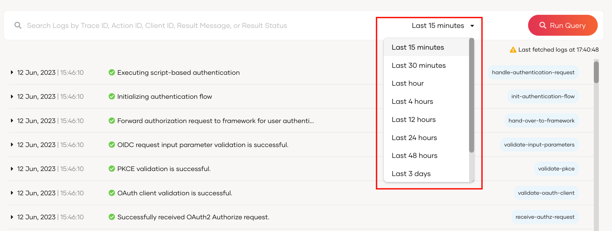
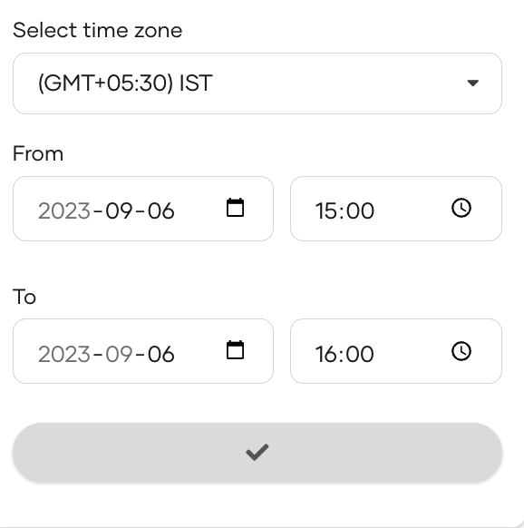
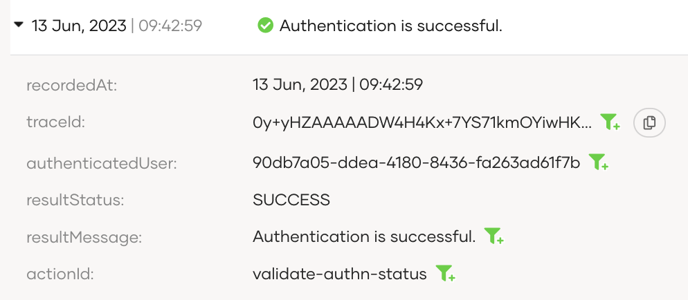
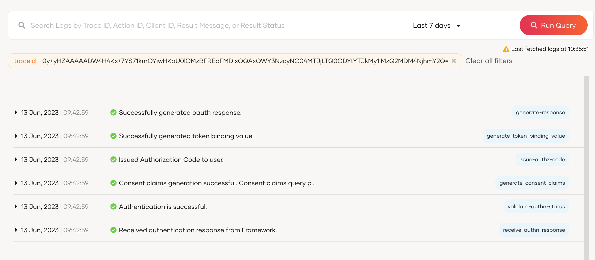

# Logs in WSO2 Identity Platform

Logging is essential for maintaining system integrity and security. Two main types of logs are utilized:

- [Diagnostic logs](diagnostic-logs.mdx) help developers troubleshoot issues related to application onboarding and authentication flow configurations,

- [Audit logs](audit-logs/index.mdx) track critical state changes within WSO2 Identity Platform resources for security enhancement and incident investigation purposes.

## Analyze logs

You can access logs in WSO2 Identity Platform by navigating to **Logs** on the WSO2 Identity Platform Console. The logs portal looks as below.

You can analyze logs by combining one or more of the following filters:

### Filter logs by time
You can change the timeframe of the logs by clicking the dropdown next to the search bar.

:::note

By default, the console displays logs that occurred in the last 15 minutes.

:::

Besides the given timeframes, you can select a custom time range by following the steps below.

1. Scroll down to the bottom of the timeframe dropdown and select **Custom Time Range**.
2. Provide your desired time zone and the time range.
3. Click the button to submit.

    

### Filter logs

When you expand a log in WSO2 Identity Platform by clicking on it, you will get the following view.

Click the **filter icon** next to one or more of the log parameters and WSO2 Identity Platform will narrow the search based on those parameter values.

For example, if you would like to view logs related to a request, click the filter icon next to the relevant traceId and click **Run Query** to filter out all the related logs.

## Remote Log Publishing

WSO2 Identity Platform allows you to securely publish both audit and diagnostic logs to external servers for long-term storage and analysis. You can configure separate publishers for audit and diagnostic logs with custom settings for each. Learn more about setting up [Remote Log Publishing](remote-log-publish.mdx).
