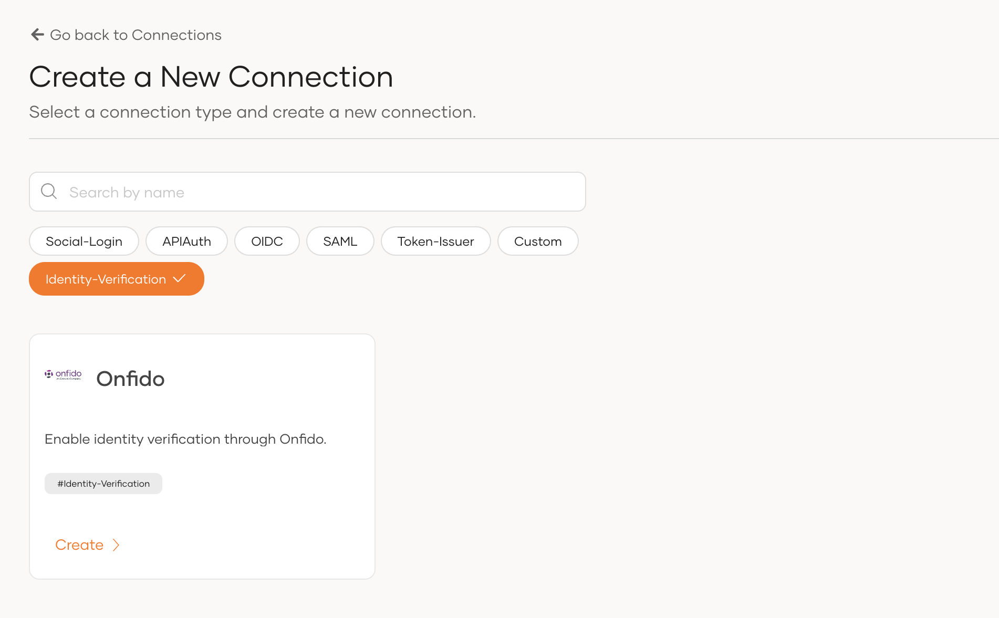
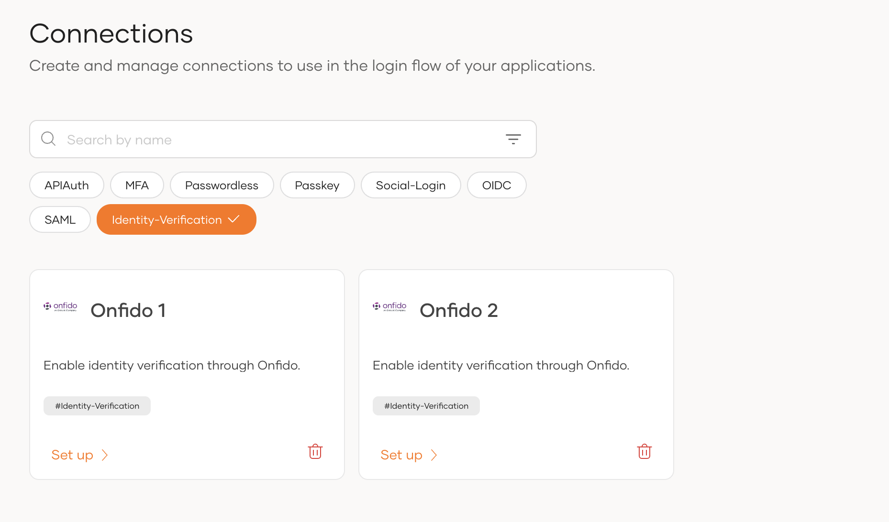
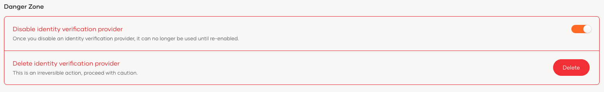
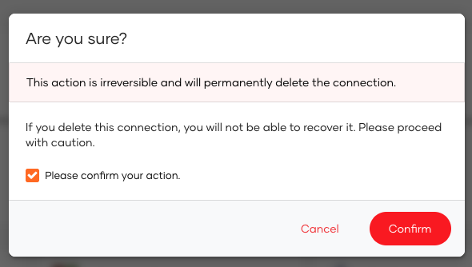

# Configure an Identity Verification Provider

Identity verification Providers (IDVP) lets you confirm the identity of users by checking legal documents such as passports, national identification cards, and driver's licenses. WSO2 Identity Platform allows you to add Identity Verification Providers and specify various details that help you link the IDVP to WSO2 Identity Platform. To properly configure the IDVPs, you must specify all information required to perform identity verification.

This guide walks you through adding and configuring IDVPs based on your requirements.

## Register an Identity Verification Provider

Follow the steps below to add an IDVP to WSO2 Identity Platform:

1. On the WSO2 Identity Platform Console, go to **Connections**.

2. Click **New Connection** and select the **Identity-Verification** filter tag.

    

3. Select and set up your preferred IDVP:

    

    <Applies to="WSO2 Cloud">

    - [Identity verification with Onfido](add-identity-verification-with-onfido.mdx)

    </Applies>

    

    <Applies to="Self-hosted">

    - [Identity verification with Onfido](https://github.com/wso2-extensions/identity-verification-onfido/blob/main/docs/config.md)

    </Applies>

    

## Manage your Identity Verification Provider

This section provides instructions on how to manage the created IDVPs.

### View an Identity Verification Provider

To view the list of IDVPs added to the WSO2 Identity Platform:

1. On the WSO2 Identity Platform Console, go to **Connections**.

2. Select **Identity-Verification** filter tag to filter out the created IDVPs.
   

### Edit an Identity Verification Provider

An administrator can update an IDVP via the WSO2 Identity Platform Console.

To edit an IDVP:

1. On the WSO2 Identity Platform Console, go to **Connections**.

2. Find the IDVP and click **Set up**.
   

3. Update the information on the IDVP.

4. Click **Update** to save.

### Disable an Identity Verification Provider

An administrator can disable/enable an IDVP via the WSO2 Identity Platform Console.

To disable an IDVP:

1. On the WSO2 Identity Platform Console, go to **Connections**.

2. Find the IDVP and click **Set up**.
    

3. Disable the **Disable identity verification provider** toggle at the bottom of the **General tab**.
    

:::note

You can re-enable the IDVP by switching the **Disable identity verification provider** toggle on.

:::

### Delete an Identity Verification Providers

An IDVP can be deleted by administrators. Once an IDVP is deleted, the action is irreversible.

To delete an IDVP:

1. On the WSO2 Identity Platform Console, go to **Connections**.

2. Find the IDVP and click **Delete icon**.
    

3. Select the checkbox to confirm your action. 
    

4. Click **Confirm**.
