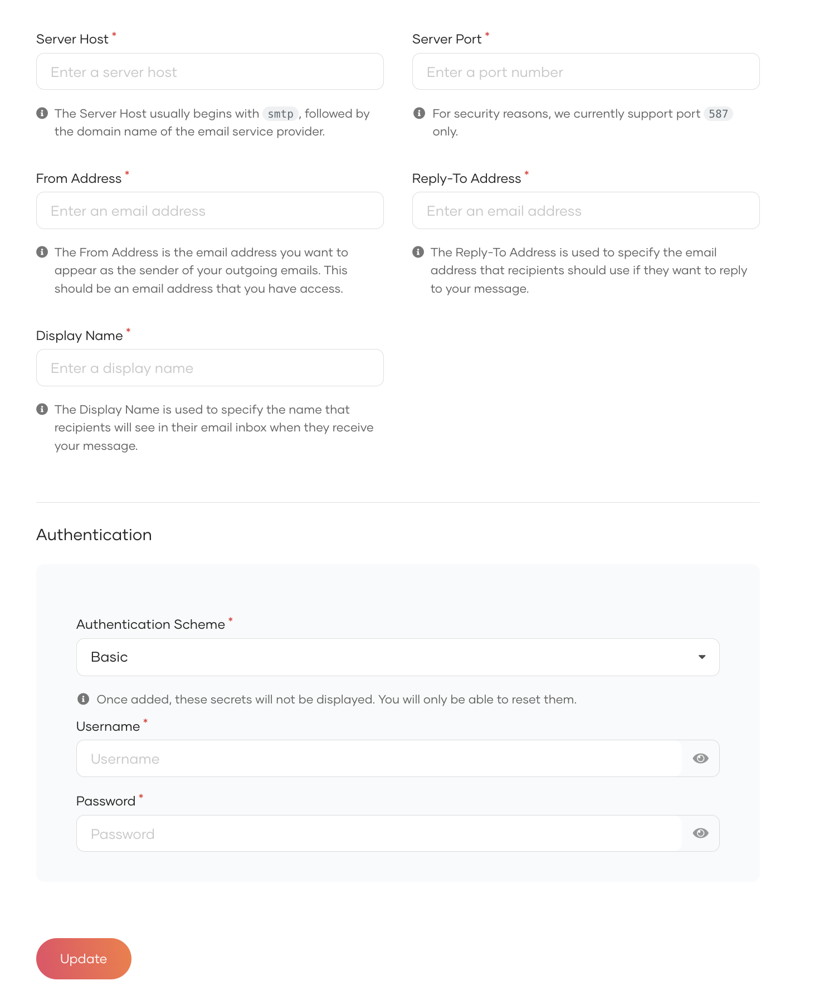
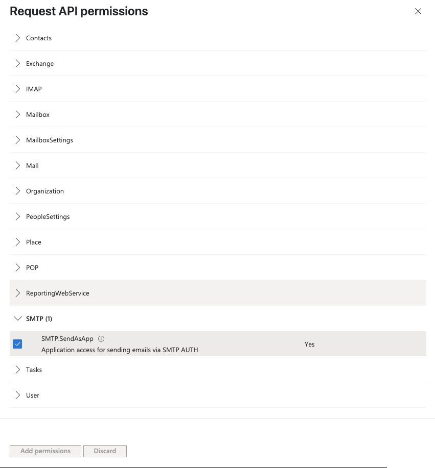
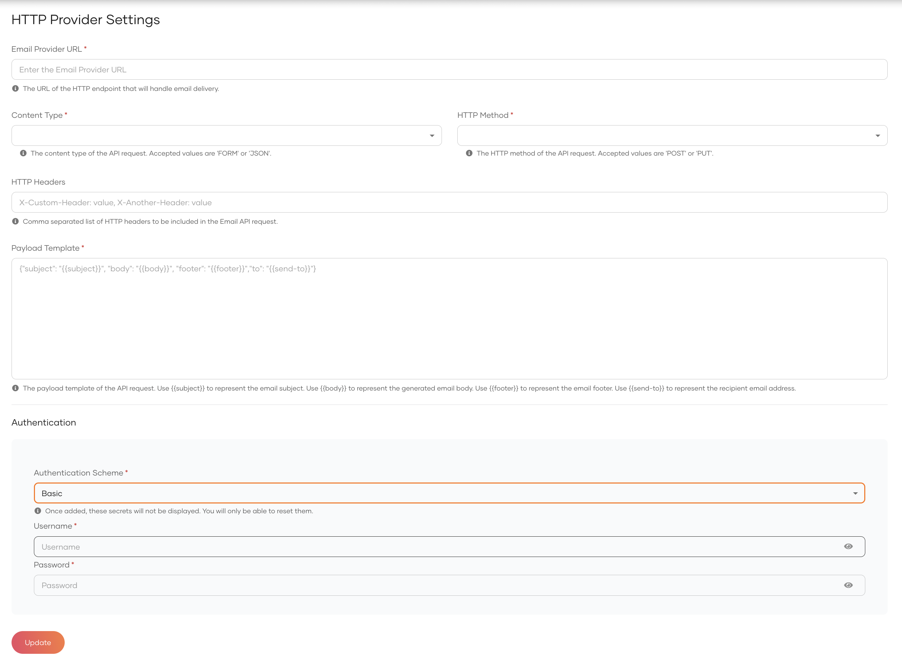
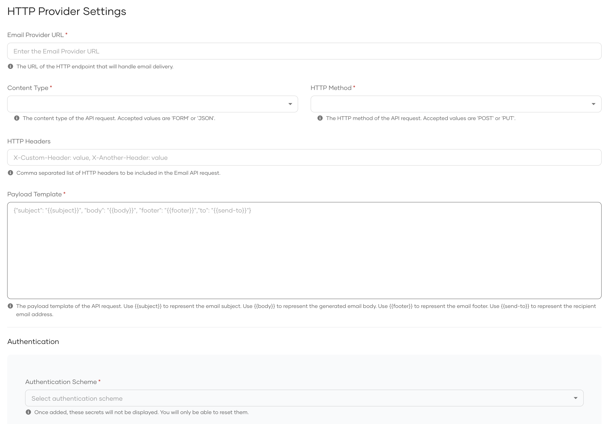

<Applies to="WSO2 Cloud">

# Configure Email Provider

This document explains the steps to configure WSO2 Identity Platform to send emails during multiple email-related customer identity and access management tasks such as [email OTP](../authentication/mfa/add-emailotp-login.mdx), email notifications, and account recovery.

WSO2 Identity Platform supports SMTP-based and HTTP-based email providers. To learn how to configure each email provider per organization, please see the relevant section.

## Configure SMTP based email provider

1. On the WSO2 Identity Platform Console, go to **Notification Channels** > **Email Provider**.
2. Click the **SMTP** tab, provide the required details.

   

3. Click **Update**.

### Supported providers

<details>
<summary>Configuring Gmail as the email provider</summary>

If you use a Gmail account as the **from_address**, you must create an [App Password](https://support.google.com/accounts/answer/185833?visit_id=637943607149528455-3801902236&p=InvalidSecondFactor&rd=1).
   After you get an **App Password** from Google, update the `password`.

</details>

<details>
<summary>Configuring Microsoft 365 Exchange Online as the email provider</summary>


## Before you start

- You must have a [Microsoft 365](https://www.microsoft.com/en-us/microsoft-365) account with an active subscription.
- Ensure your Microsoft 365 subscription is licensed to send emails through Exchange Online.
   - You need at a minimum a paid subscription to Microsoft Business Basic plan to use the SMTP Auth for Exchange Online. 
- Emails will be sent from WSO2 Identity Platform to your SMTP provider. Your ports should be open and allow inbound 
  connections from specific WSO2 Identity Platform IP addresses.

## Configure Microsoft 365

### Application Configuration and Permissions

  1. Register a Azure Active Directory Application resource if you currently do not have one.
  2. Navigate to your Active Directory Application resource. 
  3. Select Services > App registrations, and then select the application you will be using to send emails.
  4. Configure the required application permissions by navigating to Manage > API permissions.
     Please refer [Application permissions for SMTP](https://learn.microsoft.com/en-us/exchange/client-developer/legacy-protocols/how-to-authenticate-an-imap-pop-smtp-application-by-using-oauth#add-the-pop-imap-or-smtp-permissions-to-your-microsoft-entra-application)

     

### Register service principals in Exchange

- Please refer [Register service principals in Exchange](https://learn.microsoft.com/en-us/exchange/client-developer/legacy-protocols/how-to-authenticate-an-imap-pop-smtp-application-by-using-oauth#register-service-principals-in-exchange).

### Enable SMTP AUTH for specific mailboxes

- Please refer [Enable SMTP AUTH for specific mailboxes](https://learn.microsoft.com/en-us/exchange/clients-and-mobile-in-exchange-online/authenticated-client-smtp-submission#use-the-microsoft-365-admin-center-to-enable-or-disable-smtp-auth-on-specific-mailboxes).

### Retrieve required email provider configurations

- Navigate to the **Application Overview** of your Azure Active Directory Application and retrieve the [Application (client) ID](https://learn.microsoft.com/en-us/azure/healthcare-apis/register-application#application-id-client-id).
- Navigate to Manage > Certificates & secrets and collect the Value to create an [application secret](https://learn.microsoft.com/en-us/azure/healthcare-apis/register-application#certificates--secrets).
- Navigate to Overview > Endpoints and copy the **OAuth 2.0 token endpoint (v2)** URL.

### Configure SMTP settings in WSO2 Identity Platform

- Go to **Notification Channels** > **Email Provider**.
- Provide the From email address and other relevant details. Click on **Client Credentials** from the Authentication type dropdown.
- Provide the required details retrieved from the previous step.

   NOTE: The scope required for Microsoft 365 Exchange Online is `https://outlook.office365.com/.default` and the token endpoint URL should be in the format of `https://login.microsoftonline.com/{tenant_id}/oauth2/v2.0/token`.

   

- Click **Update** to save the configurations.

</details>

## Configure HTTP based email provider

Integrate with a custom email service by sending email data to an external HTTP endpoint. When an email is triggered, WSO2 Identity Platform constructs a request using the configured payload template and delivers it to the specified URL.

1. On the WSO2 Identity Platform Console, go to **Notification Channels** > **Email Provider**.
2. Click the **HTTP** tab, provide the required details and click **Update**.

    

    <table><tbody><tr><th>{"Name"}</th><th>{"Description"}</th><th>{"Example"}</th></tr><tr><td>{"Email Provider URL"}</td><td>{"URL of the Email gateway where the payload should be published."}</td><td><code>{"https://api.example.com/api/v1"}</code></td></tr><tr><td>{"Content Type"}</td><td>{"Content type of the payload. Possible values are "}<code>{"JSON"}</code>{" or "}<code>{"FORM"}</code></td><td><code>{"JSON"}</code></td></tr><tr><td>{"HTTP Method"}</td><td>{"HTTP method that should be used when publishing the payload to the provider URL. Possible values: "}<code>{"PUT"}</code>{", "}<code>{"POST"}</code>{"."}</td><td><code>{"POST"}</code></td></tr><tr><td>{"HTTP Headers"}</td><td>{"Custom static headers need to be passed. If multiple headers need to be passed, they should be comma separated. (Optional)"}</td><td><code>{"x-csrf: true, x-abc: some-value"}</code></td></tr><tr><td>{"Payload Template"}</td><td>{"How the payload template should be. "}<br />{"Placeholders:"}<br /><code>{"{{subject}}"}</code>{" - Subject of the Email. "}<br /><code>{"{{body}}"}</code>{" - Generated body of the Email. "}<br /><code>{"{{footer}}"}</code>{" - Footer of the Email. "}<br /><code>{"{{send-to}}"}</code>{" - Email address that this email should be sent to."}</td><td>{"Example JSON payload template: "}<br /><code>{"{“subject”: “{{subject}}”, “body”: “{{body}}”, “footer”: “{{footer}}”, “to”: “{{send-to}}”}"}</code><br /><br />{"("}<code>{"{{subject}}"}</code>{" , "}<code>{"{{body}}"}</code>{" "}<code>{"{{footer}}"}</code>{" and "}<code>{"{{send-to}}"}</code>{" will be replaced with the corresponding values at the runtime.)"}</td></tr><tr><td>{"Authentication"}</td><td>{"Authentication settings for the HTTP-based email provider. Select the preferred authentication scheme and enter the required authentication properties."}</td><td>{"Authentication Scheme "}<code>{"Basic"}</code>{" with username and password."}</td></tr></tbody></table>

</Applies>


<Applies to="Self-hosted">

# Configure Email Provider

This document explains the steps to configure WSO2 Identity Server to send emails during multiple email-related customer identity and access management tasks such as [email OTP](../authentication/mfa/add-emailotp-login.mdx), email notifications, and account recovery.


WSO2 Identity Server supports SMTP-based and HTTP-based email providers. To learn how to configure each email provider please see the relevant section.


## Global Configurations of Email Provider

Follow the steps given below to enable the email sender globally for all tenants in WSO2 Identity Server.

### Configure SMTP based email provider globally

1. Shut down the server if it is running.
2. Add the following properties to the `deployment.toml` file in the `<IS_HOME>/repository/conf` folder to configure the email provider.

    ```toml
    [output_adapter.email]
    from_address= "wso2iamtest@gmail.com"
    auth_type= "BASIC"
    username= "wso2iamtest"
    password= "Wso2@iam70"
    hostname= "smtp.gmail.com"
    port= 587
    enable_start_tls= true
    enable_authentication= true
    signature = "ABC.com"
    ```

    <table><tbody><tr><th>{"Property"}</th><th>{"Description"}</th></tr><tr><td><code>{"from_address"}</code></td><td>{"This is the mail address from where you want to send the notification. It can be any working mail address."}</td></tr><tr><td><code>{"auth_type"}</code></td><td>{"Authentication type to use when sending the email. WSO2 Identity Server supports "}<code>{"BASIC"}</code>{" and "}<code>{"CLIENT_CREDENTIAL"}</code>{" authentication types. "}<br />{" For "}<code>{"BASIC"}</code>{" you need to configure "}<code>{"username"}</code>{" and "}<code>{"password"}</code>{". "}<br />{" For "}<code>{"CLIENT_CREDENTIAL"}</code>{" you need to configure "}<code>{"client_id"}</code>{", "}<code>{"client_secret"}</code>{", "}<code>{"token_endpoint"}</code>{" and "}<code>{"scopes"}</code>{". Support for the "}<code>{"CLIENT_CREDENTIAL"}</code>{" authentication type is available for Microsoft 365 Exchange Online."}</td></tr><tr><td><code>{"username"}</code></td><td>{"Provide the username of the SMTP account. "}<br />{" Username of the mail you have provided in "}<strong>{"from_address"}</strong>{"."}</td></tr><tr><td><code>{"password"}</code></td><td>{"Provide the password of the SMTP account. "}<br />{" Password of the mail you have provided in "}<strong>{"from_address"}</strong>{"."}</td></tr><tr><td><code>{"client_id"}</code></td><td>{"Provide the password of the SMTP account. "}<br />{" Password of the mail you have provided in "}<strong>{"from_address"}</strong>{"."}</td></tr><tr><td><code>{"host"}</code></td><td>{"The SMTP server to connect to."}</td></tr><tr><td><code>{"port"}</code></td><td>{"This is the SMTP server port to connect to if the connect() method does not explicitly specify one. Defaults to 25."}</td></tr><tr><td><code>{"enable_start_tls"}</code></td><td>{"If true, this enables using the "}<code>{"STARTTLS"}</code>{" command (if enabled before issuing any login commands. Note that an appropriate trust store must be configured so that the client will trust the server's certificate. Defaults to "}<code>{"true"}</code>{"."}</td></tr><tr><td><code>{"enable_authentication"}</code></td><td>{"If true, attempt to authenticate the user using the AUTH command. Defaults to "}<code>{"true"}</code>{"."}</td></tr><tr><td><code>{"signature"}</code></td><td>{"Specifies the display name for the \"From\" email address. For example, \"ABC Company\" results in `\"ABC Company\" "}{"<mail@address.tld>"}{"`. "}<br /><br />{"If you don't set this property, the display name becomes "}<code>{"null"}</code>{" and the system falls back to your SMTP server settings. For example, some servers use the "}<code>{"username"}</code>{" as the display name."}<br /><br />{"To send an email with no display name and show only the email address, set this value to an empty string: "}<code>{"signature = \"\""}</code></td></tr></tbody></table>

    :::tip

    For information about the SMTP, see the [JavaMail SMTP documentation](https://javaee.github.io/javamail/docs/api/com/sun/mail/smtp/package-summary.html).

    :::

    :::info

    - If you use a Gmail account as the **from_address**, you must create an [App Password](https://support.google.com/accounts/answer/185833?visit_id=637943607149528455-3801902236&p=InvalidSecondFactor&rd=1).
     After you get an **App Password** from Google, update the `password`.
    - If your password contains special characters (example: `<`, `>`, `&`), you will run into errors when running the server. To avoid errors, update the `password` parameter as follows:
    ```toml
    password= "<![CDATA[xxxx]]>"
    ```

    :::

3. Save the configurations and start the server.


### Configure HTTP based email provider globally

1. Shut down the server if running.
2. Update the content of the `EmailPublisher.xml` file in the `<IS_HOME>/repository/deployment/server/eventpublishers` folder with below content and update the properties based on the provider you are using.


      ```xml
      <?xml version="1.0" encoding="UTF-8" standalone="no"?>
      <eventPublisher xmlns="http://wso2.org/carbon/eventpublisher" name="EmailPublisher" statistics="disable" trace="disable">
          <from streamName="id_gov_notify_stream" version="1.0.0"/>
          <mapping customMapping="enable" type="json">
              <inline>{"source": "{{subject}}", "content": "{{body}}", "footer": "{{footer}}", "to": "{{send-to}}"}</inline>
          </mapping>
          <to eventAdapterType="http">
              <property name="http.headers">X-Version: 1, Header-1: Value-1</property>
              <property name="http.client.method">POST</property>
              <property name="http.url">https://example.com.email.provider </property>
              <property name="http.authType">CLIENT_CREDENTIAL</property>
              <property name="http.clientId">clientID</property>
              <property name="http.clientSecret">clientSecret</property>
              <property name="http.tokenEndpoint">https://example.com/oauth2/token</property>
              <property name="http.scopes">email_send_scope</property>
          </to>
      </eventPublisher>
      ```


    The `<mapping>` element's `<inline>` tag defines the email payload template. Use the following placeholders, which are replaced with actual values at runtime:

    | Placeholder | Description |
    |---|---|
    | `{{subject}}` | Subject of the email. |
    | `{{body}}` | Generated body content of the email. |
    | `{{footer}}` | Footer of the email. |
    | `{{send-to}}` | Recipient email address. |

    The `<to eventAdapterType="http">` element accepts the following properties:

    <table><tbody><tr><th>{"Property"}</th><th>{"Description"}</th></tr><tr><td><code>{"http.headers"}</code></td><td>{"Custom static HTTP headers to include in every request sent to the email provider. Multiple headers should be comma-separated. (Optional)"}</td></tr><tr><td><code>{"http.client.method"}</code></td><td>{"HTTP method to use when sending the request to the provider URL. Supported values: "}<code>{"POST"}</code>{", "}<code>{"PUT"}</code>{"."}</td></tr><tr><td><code>{"http.url"}</code></td><td>{"The URL of the HTTP-based email provider endpoint where the payload will be delivered."}</td></tr><tr><td><code>{"http.authType"}</code></td><td>{"Authentication type to use when calling the provider URL. Supported values: "}<br />{" "}<code>{"BASIC"}</code>{" — requires "}<code>{"http.username"}</code>{" and "}<code>{"http.password"}</code>{". "}<br />{" "}<code>{"CLIENT_CREDENTIAL"}</code>{" — requires "}<code>{"http.clientId"}</code>{", "}<code>{"http.clientSecret"}</code>{", "}<code>{"http.tokenEndpoint"}</code>{", and "}<code>{"http.scopes"}</code>{". "}<br />{" "}<code>{"BEARER"}</code>{" — requires "}<code>{"http.accessToken"}</code>{". "}<br />{" "}<code>{"API_KEY"}</code>{" — requires "}<code>{"http.apiKeyHeader"}</code>{" and "}<code>{"http.apiKeyValue"}</code>{". "}<br />{" "}<code>{"NONE"}</code>{" — no authentication."}</td></tr><tr><td><code>{"http.username"}</code></td><td>{"Username for "}<code>{"BASIC"}</code>{" authentication."}</td></tr><tr><td><code>{"http.password"}</code></td><td>{"Password for "}<code>{"BASIC"}</code>{" authentication."}</td></tr><tr><td><code>{"http.clientId"}</code></td><td>{"Client ID of the OAuth 2.0 application used for "}<code>{"CLIENT_CREDENTIAL"}</code>{" authentication."}</td></tr><tr><td><code>{"http.clientSecret"}</code></td><td>{"Client secret of the OAuth 2.0 application used for "}<code>{"CLIENT_CREDENTIAL"}</code>{" authentication."}</td></tr><tr><td><code>{"http.tokenEndpoint"}</code></td><td>{"Token endpoint URL used to get an access token for "}<code>{"CLIENT_CREDENTIAL"}</code>{" authentication."}</td></tr><tr><td><code>{"http.scopes"}</code></td><td>{"Comma-separated list of OAuth 2.0 scopes to request when obtaining an access token for "}<code>{"CLIENT_CREDENTIAL"}</code>{" authentication."}</td></tr><tr><td><code>{"http.accessToken"}</code></td><td>{"Static bearer token used for "}<code>{"BEARER"}</code>{" authentication."}</td></tr><tr><td><code>{"http.apiKeyHeader"}</code></td><td>{"Name of the HTTP header used to pass the API key for "}<code>{"API_KEY"}</code>{" authentication."}</td></tr><tr><td><code>{"http.apiKeyValue"}</code></td><td>{"Value of the API key used for "}<code>{"API_KEY"}</code>{" authentication."}</td></tr></tbody></table>


## Tenant Specific Configurations of Email Provider

:::info

- Super tenant email provider cannot be configured via the WSO2 Identity Server console. You need to configure the email provider in the `deployment.toml` file as mentioned above.

:::

Follow the steps given below to enable the email sender per tenant.

### Configure SMTP based email provider per tenant


1. On the WSO2 Identity Server Console, go to **Notification Channels** > **Email Provider**.
2. Click the **SMTP** tab and provide the required details.

   

3. Click **Update**.
4. Since these configurations apply during the tenant loading process, [configure tenant loading and unloading for your tenant](../multitenancy/configure-the-tenant-loading-policy.mdx).


### Configure HTTP based email provider per tenant

1. On the WSO2 Identity Server Console, go to **Notification Channels** > **Email Provider**.
2. Click the **HTTP** tab and provide the required details.

   

3. Click **Update**.


## Supported SMTP based email providers

<details>
<summary>Configuring Gmail as the email provider</summary>

If you use a Gmail account as the **from_address**, you must create an [App Password](https://support.google.com/accounts/answer/185833?visit_id=637943607149528455-3801902236&p=InvalidSecondFactor&rd=1).
  After you get an **App Password** from Google, update the `password`.

If your password contains special characters (example: `<`, `>`, `&`), you will run into errors when running the server. To avoid errors, update the `password` parameter as follows:
```toml
password= "<![CDATA[xxxx]]>"
```

</details>

<details>
<summary>Configuring Microsoft 365 Exchange Online as the email provider</summary>


## Before you start

- You must have a [Microsoft 365](https://www.microsoft.com/en-us/microsoft-365) account with an active subscription.
- Ensure your Microsoft 365 subscription is licensed to send emails through Exchange Online.
   - You need at a minimum a paid subscription to Microsoft Business Basic plan to use the SMTP Auth for Exchange Online. 
- Emails will be sent from WSO2 Identity Server to your SMTP provider. Your ports should be open and allow inbound 
  connections from specific WSO2 Identity Server IP addresses.

## Configure Microsoft 365

### Application Configuration and Permissions

  1. Register a client application in Microsoft Entra ID if you currently do not have one.
  2. Navigate to your registered Application resource. 
  3. Select Services > App registrations, and then select the application you will be using to send emails.
  4. Configure the required application permissions by navigating to Manage > API permissions.
     Please refer [Application permissions for SMTP](https://learn.microsoft.com/en-us/exchange/client-developer/legacy-protocols/how-to-authenticate-an-imap-pop-smtp-application-by-using-oauth#add-the-pop-imap-or-smtp-permissions-to-your-microsoft-entra-application)

     

### Register service principals in Exchange

- Please refer [Register service principals in Exchange](https://learn.microsoft.com/en-us/exchange/client-developer/legacy-protocols/how-to-authenticate-an-imap-pop-smtp-application-by-using-oauth#register-service-principals-in-exchange).

### Enable SMTP AUTH for specific mailboxes

- Please refer [Enable SMTP AUTH for specific mailboxes](https://learn.microsoft.com/en-us/exchange/clients-and-mobile-in-exchange-online/authenticated-client-smtp-submission#use-the-microsoft-365-admin-center-to-enable-or-disable-smtp-auth-on-specific-mailboxes).

### Retrieve required email provider configurations

- Navigate to the **Application Overview** of your Azure Active Directory Application and retrieve the [Application (client) ID](https://learn.microsoft.com/en-us/azure/healthcare-apis/register-application#application-id-client-id).
- Navigate to Manage > Certificates & secrets and collect the Value to create an [application secret](https://learn.microsoft.com/en-us/azure/healthcare-apis/register-application#certificates--secrets).
- Navigate to Overview > Endpoints and copy the **OAuth 2.0 token endpoint (v2)** URL.

### Configure SMTP settings in WSO2 Identity Server

- Go to **Notification Channels** > **Email Provider**.
- Provide the From email address and other relevant details. Click on **Client Credentials** from the Authentication type dropdown.
- Provide the required details retrieved from the previous step.

   NOTE: The scope required for Microsoft 365 Exchange Online is `https://outlook.office365.com/.default` and the token endpoint URL should be in the format of `https://login.microsoftonline.com/{tenant_id}/oauth2/v2.0/token`.

   

- Click **Update** to save the configurations.

</details>

</Applies>
