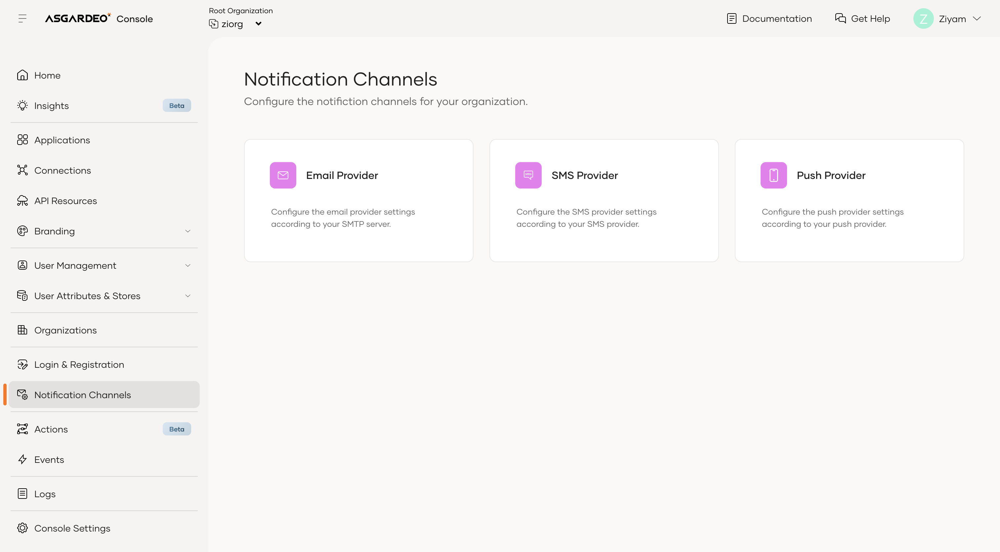
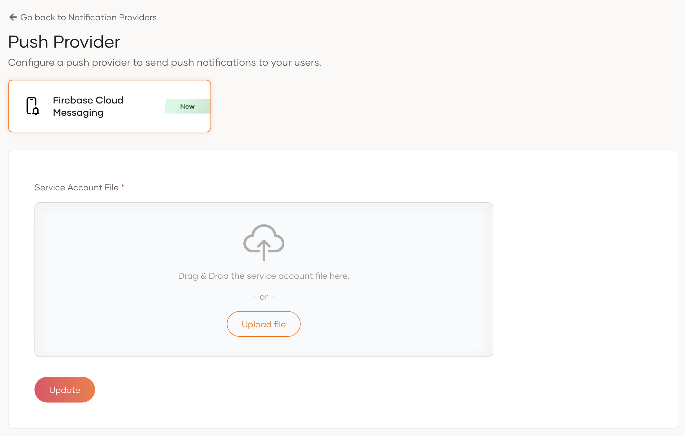
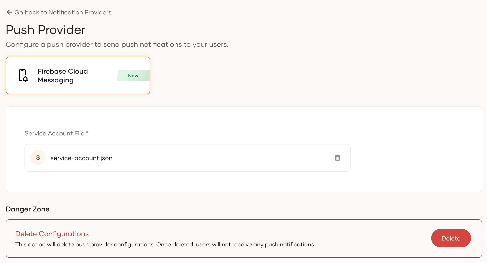
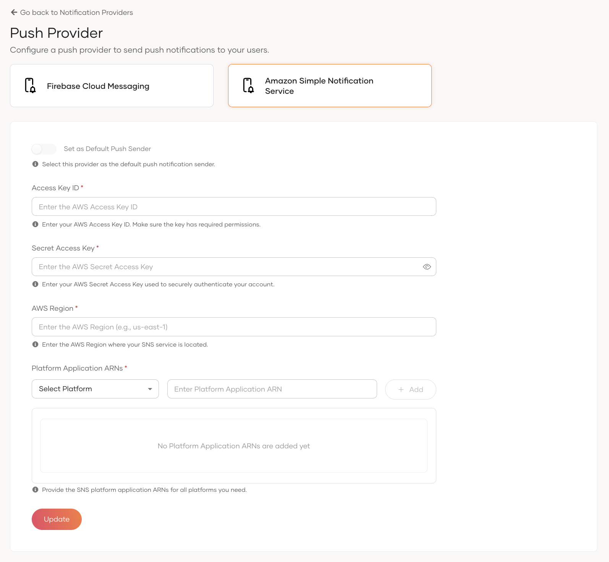
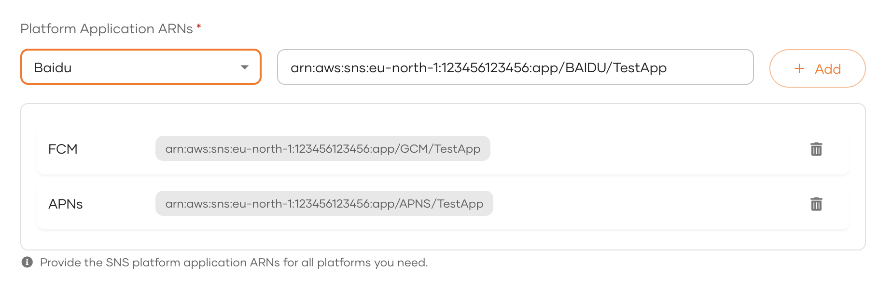
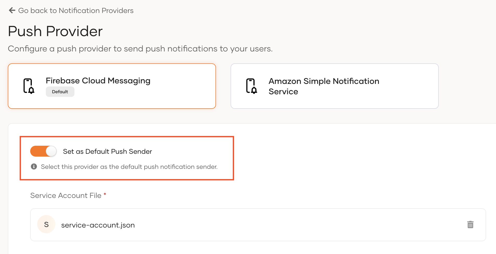

# Configure push provider

To use push notification-based authentication, you need to configure at least one push notification provider in WSO2 Identity Platform. <DeploymentValue cloud="WSO2 Identity Platform supports **Firebase Cloud Messaging (FCM)** as a push notification provider." selfHosted="WSO2 Identity Server supports **Firebase Cloud Messaging (FCM)** and **Amazon Simple Notification Service (SNS)** as push notification providers." />

:::note

You can configure **multiple providers** and keep them active at the same time. During enrollment, the device will send the preferred push provider in the registration request. Once successfully registered, WSO2 Identity Platform will send push notifications via the device's registered push provider.

You can also mark one provider as the **default push provider**.

:::

The following list shows the platforms that each provider supports.

- **FCM**: Android, iOS (APNs), and web.
- **Amazon SNS**: Android, iOS (APNs), Amazon Fire OS (ADM), Baidu Cloud Push, Windows Phone (MPNS), and Windows (WNS).

## Configure the push provider

1. On the WSO2 Identity Platform Console, go to **Notification Channels** and select **Push Providers**.

      

2. Select the tab for the provider you want to configure and follow the steps in the relevant section below.

### Configure Firebase Cloud Messaging (FCM)

1. Select the **Firebase** tab.

2. Upload the `service-account.json` file that you downloaded from Firebase when you created your Firebase project.

      

3. Click **Update** to save your changes.

      

:::note

Firebase Cloud Messaging can send push notifications to iOS devices through Apple Push Notification Service (APNs). However, you need to configure APNs separately to send push notifications to iOS devices. For more information, [refer to the Firebase documentation](https://firebase.google.com/docs/cloud-messaging/ios/client).

:::

### Configure Amazon Simple Notification Service (SNS)

1. In the AWS Management Console, create a platform application for each platform you plan to support (for example, FCM or APNs). For instructions, see [Mobile push notifications](https://docs.aws.amazon.com/sns/latest/dg/sns-mobile-application-as-subscriber.html) in the AWS documentation.

2. Create an IAM user and attach a policy that grants the following permissions. For guidance on creating IAM users and attaching policies, see the [AWS IAM documentation](https://docs.aws.amazon.com/IAM/latest/UserGuide/introduction.html).

    - `sns:CreatePlatformEndpoint` — register devices with SNS
    - `sns:GetEndpointAttributes` — retrieve device endpoint details
    - `sns:SetEndpointAttributes` — update device endpoint registrations
    - `sns:DeleteEndpoint` — unregister devices from SNS
    - `sns:Publish` — send push notifications to device endpoints

    :::note

    IAM users are global by default. If desired, you can limit the scope of these permissions to a specific AWS Region by defining the region in the policy's Resource ARN.

    :::

3. Select the **Amazon SNS** tab on the Push Providers page.

      

4. Enter the **AWS Access Key ID**, **AWS Secret Access Key**, and **AWS Region** of the IAM user you created.

5. Add the platform application ARN for each platform you created:

    1. Select the platform from the **Select Platform** dropdown.
    2. Paste the platform application ARN in the text field.
    3. Click **+ Add**.
    4. Repeat for each platform.

      

6. Click **Update** to save your changes.

:::note

Choose an **AWS region** where Amazon SNS is available and geographically close to **your WSO2 Identity Platform** deployment. This reduces latency between WSO2 Identity Platform and Amazon SNS.
Because Amazon SNS acts as a push notification hub and the platform, such as FCM or APNs, delivers the final notification to the device, choosing a region close to your user base does not provide a significant latency advantage.

:::

## Configure the default push provider

When a device does not specify a push provider in its registration request, WSO2 Identity Platform registers the device with the default push provider. This is useful for maintaining backward compatibility with older versions of your authenticator application that do not include provider information in the registration payload.

To set a provider as the default:

1. Select the tab of the provider you want to set as the default.

2. Enable the **Default** toggle.

      

:::warning

Amazon SNS requires additional metadata, such as the `platform` field, in the registration request. For more information, see [Build your own push authenticator app](../../references/tutorials/build-your-own-push-authenticator-app.mdx). Therefore, even if Amazon SNS is configured as the default provider, the registration payload must still include the required metadata.

:::

:::note

If you configure **only one provider** and do not explicitly set a default provider, WSO2 Identity Platform uses that provider for legacy registration payloads. In that case, WSO2 Identity Platform registers the device with the configured provider. However, we recommend that you still mark the provider as the default if you need legacy payload support.

:::
