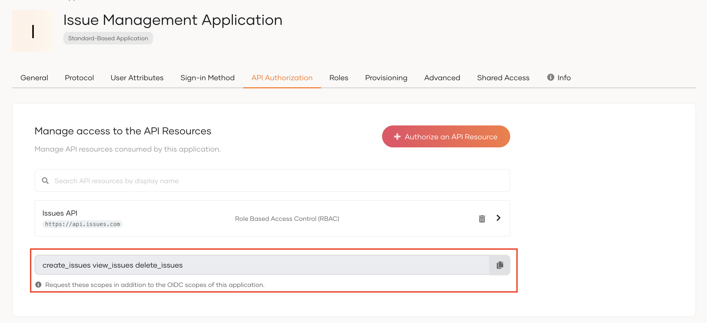

# Authorize applications to API resources

Organizations inherit the following API resources from the root organization:

- Default organization API resources defined by WSO2 Identity Platform.
- API resources created in the root organization.

For your applications to access these API resources, you need to authorize the applications to the required API resources. To do so:

1. On the WSO2 Identity Platform Console, go to **Organizations** and switch to your desired organization.
2. In the organization, go to **Applications** and select your desired application.
3. Go to the **API Authorization** tab and click **Authorize API Resources**.
4. Authorize the required API resources to the application.

## Try it out

Follow the steps given below to try out the RBAC flow:

:::note

Note that we are using WSO2 Identity Platform's [B2B Guardio insurance application](try-a-b2b-use-case.mdx) for this scenario.

:::

To request scopes for the user:

1. Add the new scopes to the `APIScope` parameter of the `config.js` file of the sample application. You need to request these new scopes in addition to the OIDC scopes of your application.

    To get the scopes:

    1. On the WSO2 Identity Platform Console, log in to the organization(root).
    2. Go to **Applications** and select your application.
    3. Copy the scopes listed at the end of the **API Authorization** section.

        

        <Applies to="WSO2 Cloud">

        

        </Applies>

        

        <Applies to="Self-hosted">

        

        </Applies>

        

    :::tip

    When you add scopes to the configuration file, add them as comma-separated values.

    :::

2. Access the application URL.
3. Try to log in as a user with a group and permission to access the API resource.

    If you have disabled `Skip login consent` in your application's settings, upon successful login, you will see the permission (scopes) allowed for the user on the user consent page.
    Click **Allow**. You will now be redirected to the application.

4. You will be able to see the assigned permissions on the `allowedScopes` parameter of the authentication response.

:::note[If you are switching organizations]

If the user switches organization to another organization, the scopes will be updated according to the roles assigned to the user in the switched organization.

:::
