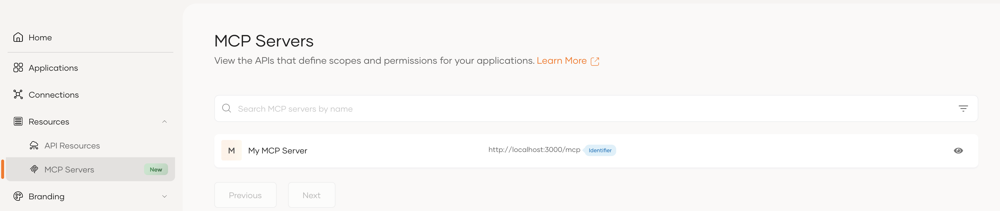

# Authorize access to MCP servers

In an organizational hierarchy, an MCP server registered in the **root organization** is automatically inherited by every **child organization** down the hierarchy. Each child organization can see the server and authorize access to it, without registering it again.

---

## How inheritance works

- A child organization inherits the MCP server definition along with its scopes, so it can authorize its own agents and applications against the server.
- Inheritance covers existing child organizations and any created later, keeping configuration consistent as the hierarchy grows.
- Inheritance is automatic. A child organization never registers, shares, or subscribes to the server; it can only authorize access.

---

## Authorize access to inherited MCP servers

Authorization for inherited MCP servers follows the standard MCP authorization model. To control how applications and agents get access, see:

- [Securing MCP servers](../agentic-ai/mcp/mcp-server-authorization.md)
- [Setting up MCP clients](../agentic-ai/mcp/register-mcp-client-app.md)

:::note

Your platform (**root organization**) registers a *Knowledge Base* MCP server. A business (**child organization**) inherits it and authorizes its own agents to access it.

:::

What's next?

Learn how to [share agents with organizations](share-agents.md) so they can act within child organizations and call inherited MCP servers.

