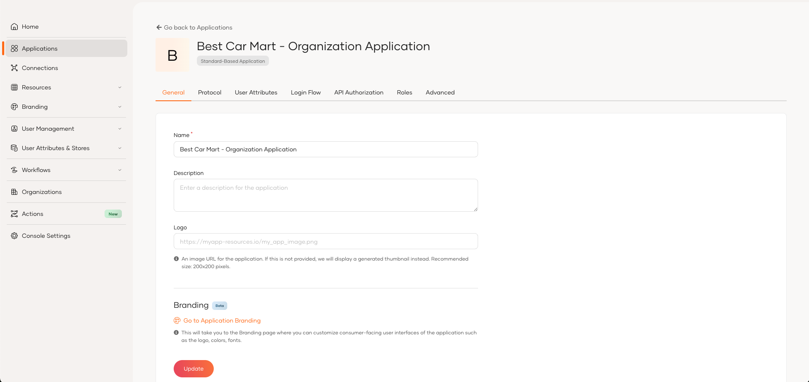

# Create an application in an organization

Organization administrators can create and mange applications directly within their organizations. These applications can access and consume the organization’s API resources. To create an application, it must meet the following conditions:

- Use OAuth2.

- Use only the following grant types: authorization code, client credentials, password, and refresh token.

- Use a standard-based application or an M2M application template.

:::note

By default, applications created within an organization use the root organization's token issuer. As an organization administrator, you can change this behavior and configure an application to use either the root organization's token issuer or your organization’s own token issuer.

For more information on the use cases to select the token issuer, see [Selecting the appropriate token issuer for organization applications](select-token-issuer-for-organization-apps.md).

:::

You can use either the Console or the API to create an application in an organization.

<Tabs>
<TabItem value="tab-0" label="Using the Console">

To create an application,

1. On the WSO2 Identity Platform Console, go to **Organizations** and switch to your desired organization.

2. In the organization, go to **Applications**.

    

3. Click **Add Application** and use either the **Standard-Based Application** or **M2M Application** template to create your application.

</TabItem>
<TabItem value="tab-1" label="Using the API">

To create an application,

1. Get a bearer token with the `internal_org_application_mgt_create` scope. Learn more about [accessing organization APIs](../../apis/organization-apis/authentication.md)

2. Use the [Application management REST API](../../apis/organization-apis/organization-application-mgt.md#tag/Applications/operation/createApplication) to create an application in an organization.

</TabItem>
</Tabs>

## Edit an application

You can find the created applications in the **Application** section of your organization's Console. You can use the Console to make the following changes to these applications.

- Protocol level configurations
- User attributes related configurations
- Login Flow configurations
- API Authorization for organization application
- Role management for organization application
- Advanced configurations

