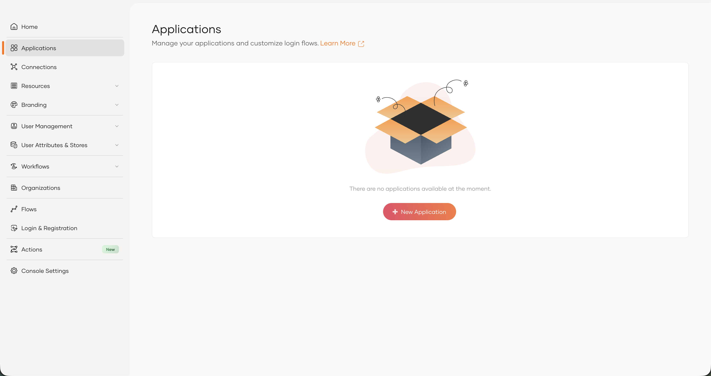
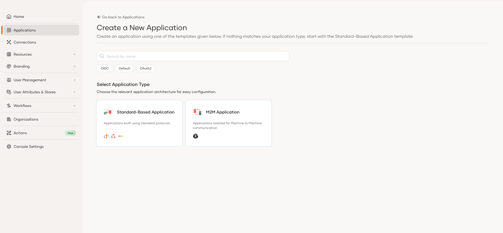
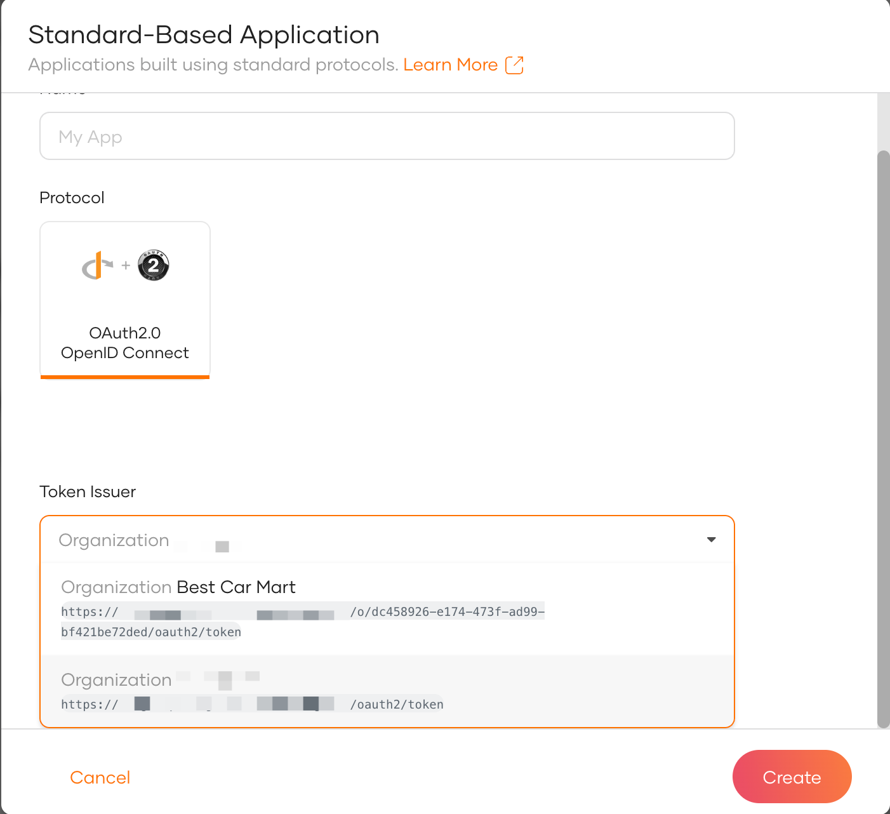
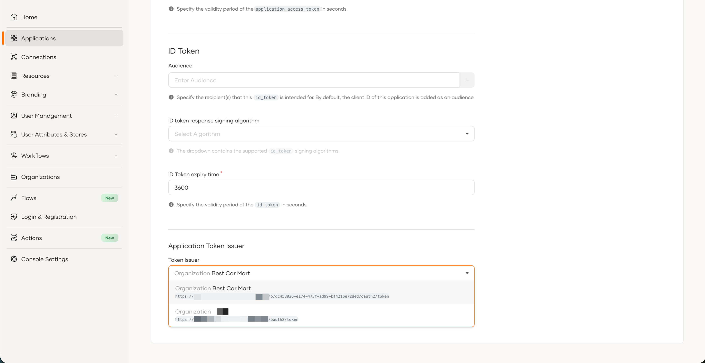

# Configure the token issuer for an organization application

By default, applications created within an organization use the root organization's token issuer. As an organization administrator, you can change this behavior and configure an application to use either the root organization's token issuer or your organization’s own token issuer.

The following guides explain how to configure the token issuer when creating a new application or updating an existing application.

For more information on organization applications, see [Create an application in an organization](organization-applications.mdx).

## Set the token issuer when creating an application

<Tabs>
<TabItem value="tab-0" label="Using the Console">

To create an application with a specific token issuer,

1. On the WSO2 Identity Platform Console, go to **Organizations** and switch to your desired organization.

2. In the organization, go to **Applications**.

    

3. Click **Add Application** and use either the **Standard-Based Application** or **M2M Application** template to create your application.

    

4. Enter a name in the **Name** field and select the required issuer from the **Token Issuer** dropdown.

    

5. Click **Create** to create the application.

</TabItem>
</Tabs>

## Update the token issuer for an existing application

<Tabs>
<TabItem value="tab-0" label="Using the Console">

To update the token issuer for an existing application,

1. On the WSO2 Identity Platform Console, switch to the desired organization and go to **Applications**.

2. Select the application you want to update and click the edit icon.

3. Go to the **Protocol** tab and select the required issuer from the **Token Issuer** dropdown.

    

4. Click **Update** to save the changes.

</TabItem>
</Tabs>
