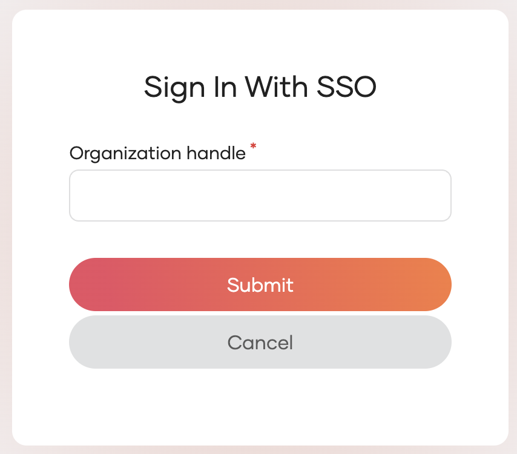
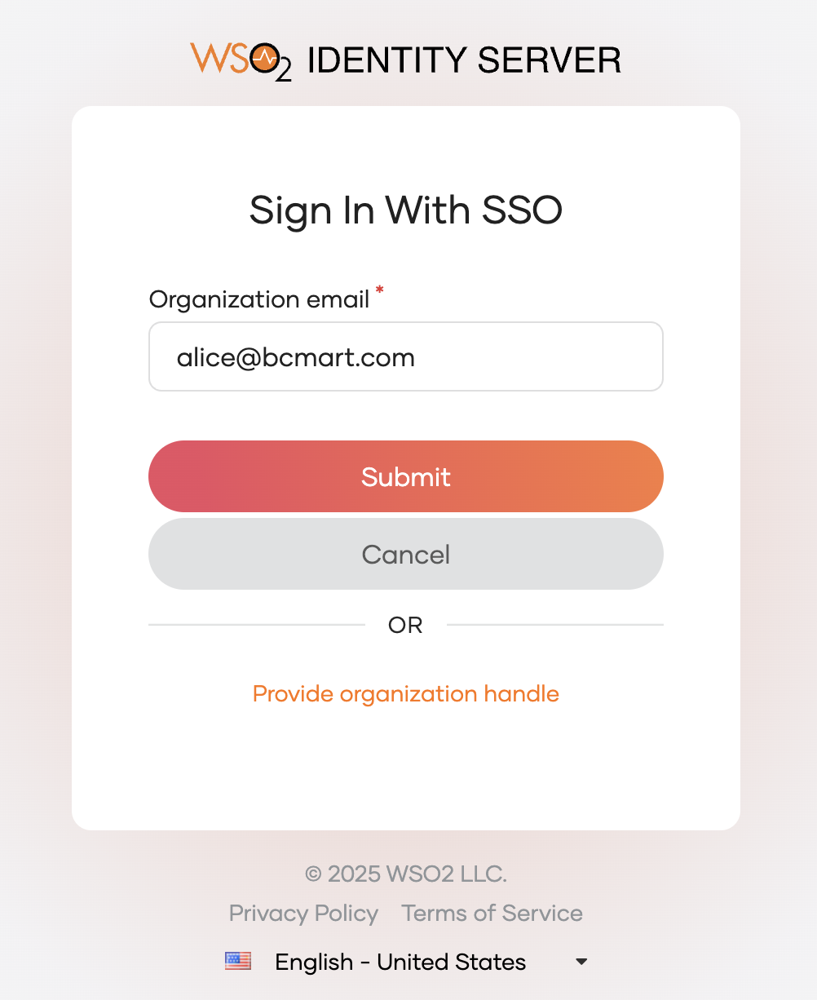
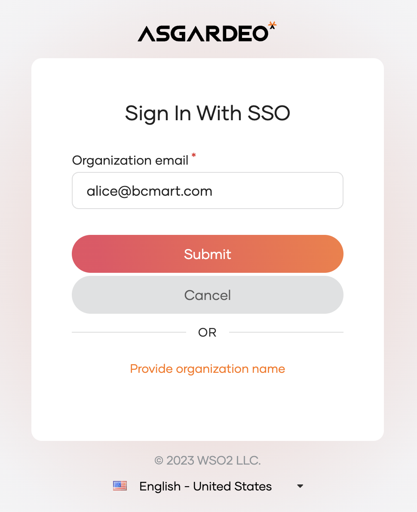

# Organization discovery

B2B applications need seamless login experiences. WSO2 Identity Platform supports **organization discovery** to identify users' organizations and route them to the correct login page.

This guide explains the organization discovery flow, the available discovery types, and how to integrate them into your applications.

:::note

This guide covers organization discovery under the **enhanced organization authentication** model. If your application uses the legacy federation-based approach, see [Organization login - legacy approach](../organization-login/legacy-approach.md) for the discovery mechanisms specific to that model.

:::

---

## Organization discovery page

After the user clicks **Sign in with SSO**, they are redirected to the organization discovery page where they identify their organization.


By default, users are prompted to enter the **organization handle** — a human-readable, unique identifier for the organization.




### Available discovery types

WSO2 Identity Platform supports the following discovery types:


<Applies to="Self-hosted">

| Discovery Type                    | Use Case                                                  |
|-----------------------------------|-----------------------------------------------------------|
| **Organization Handle-Based**     | Route users using the organization handle, a human-readable, unique identifier. |
| **Organization Name-Based**       | Route users using the organization name. |
| **Organization ID-Based**         | Route users using the organization ID. Suitable for server-side integrations. |
| **Email Domain-Based**            | Automatically identify organizations from email domains. Ideal for corporate email addresses. |
| **Custom Attribute-Based**        | Enable advanced discovery options using custom attributes. |

</Applies>


---


<Applies to="Self-hosted">

## Configure default parameter for organization discovery

You can set the default discovery parameter for organization discovery across your server or for your root organization. This configuration determines which parameter users provide during SSO login. It affects the user experience.

### Server-wide configuration

Add the following configuration to your deployment configuration file:

```toml
[organization_discovery]
default_param = "orgHandle"
```

**Available options**:

- `"orgHandle"` (recommended): Users provide the organization handle
- `"orgName"`: Users provide the organization name

### Root organization configuration

Use the following API to configure the default parameter for your root organization only:

```bash
curl --location --request PUT 'https://localhost:9443/api/server/v1/organization-configs/discovery' \
--header 'Content-Type: application/json' \
--header 'Accept: application/json' \
--header 'Authorization: Basic YWRtaW46YWRtaW4=' \
--data '{
    "properties": [
        {
            "key": "defaultParam",
            "value": "orgHandle"
        },
        {
            "key": "<another_property_key>",
            "value": "<another_property_value>"
        }
    ]
}'
```

**Note**: By default, the system uses `"orgHandle"` for better user experience with human-readable identifiers. You can change it to `"orgName"` if organization names are easier for users to remember.

### User experience impact

Configure `default_param` to control what users enter during Single Sign-On (SSO).

**When `default_param = "orgHandle"`** (recommended):

Users select **Sign In With Single Sign-On (SSO)** to sign in. They get redirected to the default SSO option. Users should provide the **organization handle**.

When you enable email domain discovery, the UI shows the default prompt option as follows:



**When `default_param = "orgName"`**:

Users provide the **organization name** instead.

When you enable email domain discovery, the UI shows the default prompt option as follows:



</Applies>


---

## Directly access the organization

To route users directly to their organization's login page without showing the discovery page, include an organization discovery parameter in the initial authentication request. WSO2 Identity Platform resolves the organization from the parameter and routes the user to that organization's login page automatically.


<Tabs>
<TabItem value="tab-0" label="Organization Handle">


Add `orgHandle=<organization_handle>` to the authentication request.

<Tabs>
<TabItem value="tab-0" label="OIDC">


```bash
https://<HOST_NAME><ORGANIZATION_PATH_PARAM>/oauth2/authorize?
client_id=<client_id>
&redirect_uri=<redirect_url>
&scope=<scopes>
&response_type=code
&orgHandle=<organization_handle>
```

</TabItem>
<TabItem value="tab-1" label="SAML">


```bash
https://<HOST_NAME><ORGANIZATION_PATH_PARAM>/samlsso?
spEntityID=<app_entity_id>
&orgHandle=<organization_handle>
```

</TabItem>
</Tabs>

**Example**: For an organization with handle `"abc.com"`, add `orgHandle=abc.com` to the request.

</TabItem>
</Tabs>


<Tabs>
<TabItem value="tab-0" label="Organization Name">


Add `org=<organization_name>` to the authentication request.

<Tabs>
<TabItem value="tab-0" label="OIDC">


```bash
https://<HOST_NAME><ORGANIZATION_PATH_PARAM>/oauth2/authorize?
client_id=<client_id>
&redirect_uri=<redirect_url>
&scope=<scopes>
&response_type=code
&org=<organization_name>
```

</TabItem>
<TabItem value="tab-1" label="SAML">


```bash
https://<HOST_NAME><ORGANIZATION_PATH_PARAM>/samlsso?
spEntityID=<app_entity_id>
&org=<organization_name>
```

</TabItem>
</Tabs>

**Example**: For an organization named `"ABC Builders"`, add `org=ABC+Builders` to the request.

</TabItem>
<TabItem value="tab-1" label="Organization ID">


Add `orgId=<organization_id>` to the authentication request.

<Tabs>
<TabItem value="tab-0" label="OIDC">


```bash
https://<HOST_NAME><ORGANIZATION_PATH_PARAM>/oauth2/authorize?
client_id=<client_id>
&redirect_uri=<redirect_url>
&scope=<scopes>
&response_type=code
&orgId=<organization_id>
```

</TabItem>
<TabItem value="tab-1" label="SAML">


```bash
https://<HOST_NAME><ORGANIZATION_PATH_PARAM>/samlsso?
spEntityID=<app_entity_id>
&orgId=<organization_id>
```

</TabItem>
</Tabs>

</TabItem>
<TabItem value="tab-2" label="Email Domain">


Add `login_hint=<user_email>` to the authentication request. WSO2 Identity Platform extracts the domain and matches it to a configured organization.

<Tabs>
<TabItem value="tab-0" label="OIDC">


```bash
https://<HOST_NAME><ORGANIZATION_PATH_PARAM>/oauth2/authorize?
client_id=<client_id>
&redirect_uri=<redirect_url>
&scope=<scopes>
&response_type=code
&login_hint=<user_email>
```

</TabItem>
<TabItem value="tab-1" label="SAML">


```bash
https://<HOST_NAME><ORGANIZATION_PATH_PARAM>/samlsso?
spEntityID=<app_entity_id>
&login_hint=<user_email>
```

</TabItem>
</Tabs>

See [Email domain-based discovery](#email-domain-based-discovery) for configuration details.

</TabItem>
</Tabs>

---

## Email domain-based discovery

Automatically identify organizations based on user email domains. This method routes users to their organization's login page without requiring them to specify the organization name or ID.

**How it works**: WSO2 Identity Platform extracts the domain from the user's email address. Then it matches the domain to a configured organization.

How to configure email domain discovery: [Email Domain-Based Discovery](./email-domain-based-organization-discovery.md)
