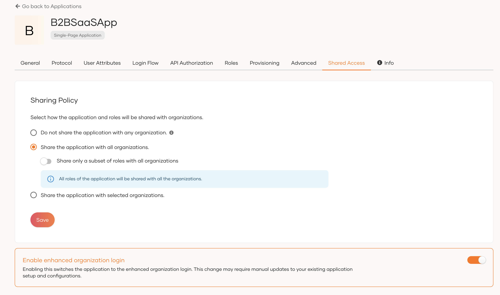
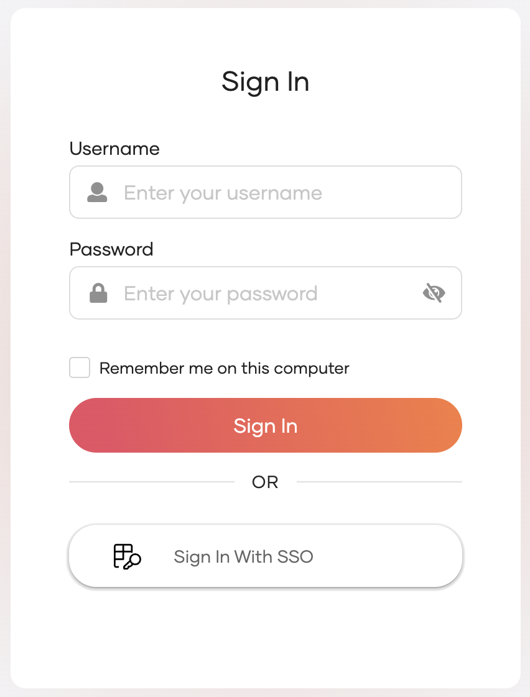

# Organization-based login

WSO2 Identity Platform supports B2B application login, allowing users of your partner or customer organizations to log in using their own organization's identity. This section covers organization-based login using the **enhanced organization authentication** model.

:::note[Before you begin]

This guide covers the **enhanced organization authentication** model. To verify that your application is using this approach:

1. On the WSO2 Identity Platform Console, go to **Applications** and select your B2B application.
2. Go to the **Shared Access** tab.
3. Check whether **Enhanced Organization Authentication** is enabled.



If **Enhanced Organization Authentication** is not enabled, your application is using the legacy approach. See [Organization login - legacy approach](legacy-approach.md).

:::

---

## Start organization login

Two methods are available for starting organization login.

### Method 1: Start from the root organization endpoint

Send the authentication request to the root organization's endpoint. WSO2 Identity Platform will prompt users to identify their organization when the **Sign in with SSO** option is selected during the login flow.



<Tabs>
<TabItem value="tab-0" label="OIDC">


```bash
https://<HOST_NAME>/t/<root_org_handle>/oauth2/authorize?
client_id=<client_id>
&redirect_uri=<redirect_url>
&scope=<scopes>
&response_type=code
```

</TabItem>
<TabItem value="tab-1" label="SAML">


```bash
https://<HOST_NAME>/t/<root_org_handle>/samlsso?
spEntityID=<app_entity_id>
```

</TabItem>
</Tabs>

:::tip


You can route users directly to their organization by including an organization discovery parameter in the request — such as `orgHandle`, `org` (organization name), `orgId` (organization ID), or an email domain hint. See [Organization discovery](../organization-discovery/organization-discovery.md).

:::
    

### Method 2: Start from the direct organization path

Send the authentication request directly to the organization's endpoint using the root organization handle and the accessing organization's ID.

<Tabs>
<TabItem value="tab-0" label="OIDC">


```bash
https://<HOST_NAME>/t/<root_org_handle>/o/<org_id>/oauth2/authorize?
client_id=<client_id>
&redirect_uri=<redirect_url>
&scope=<scopes>
&response_type=code
```

</TabItem>
<TabItem value="tab-1" label="SAML">


```bash
https://<HOST_NAME>/t/<root_org_handle>/o/<org_id>/samlsso?
spEntityID=<app_entity_id>
```

</TabItem>
</Tabs>

Replace `<root_org_handle>` with the handle of your root organization and `<org_id>` with the accessing organization's ID.
