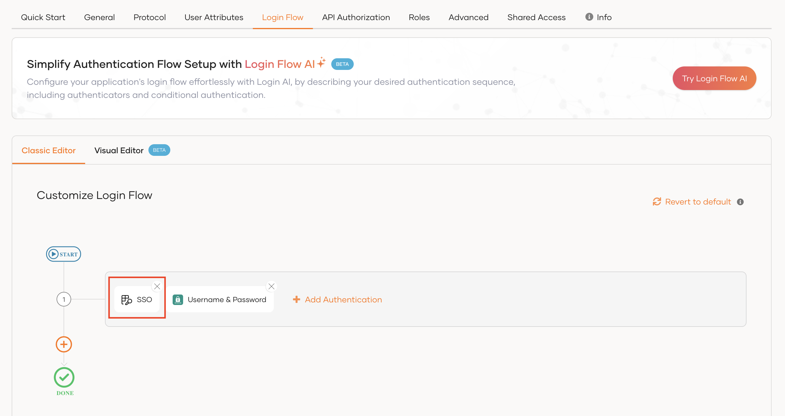
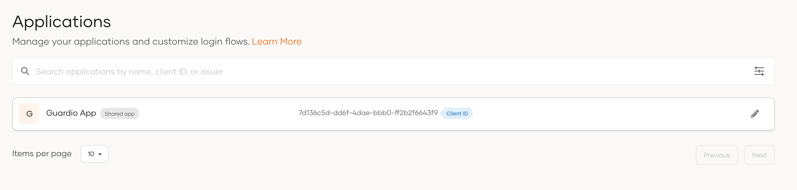
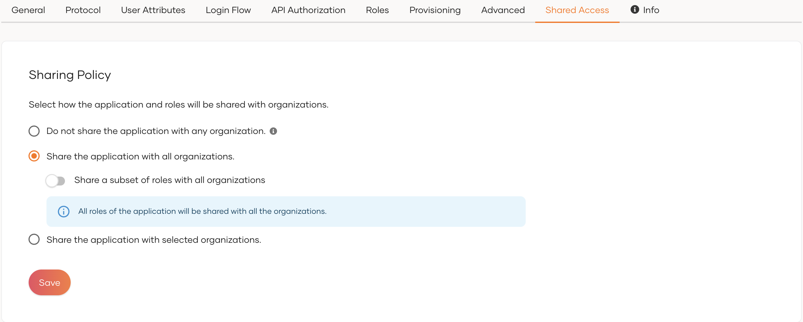
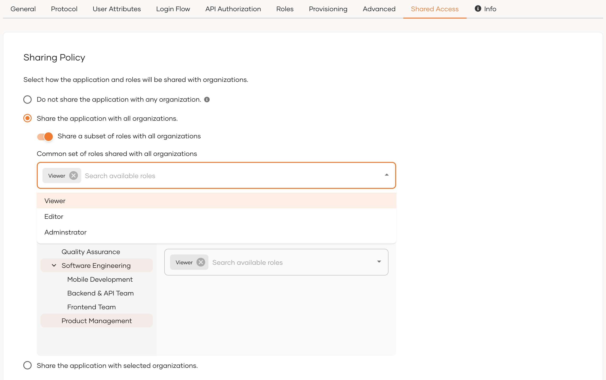
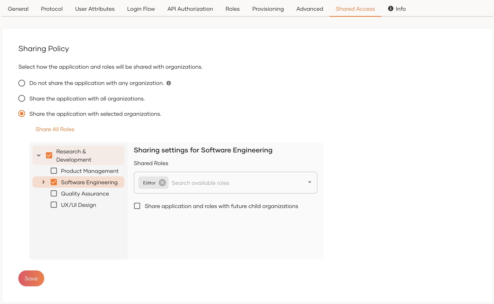
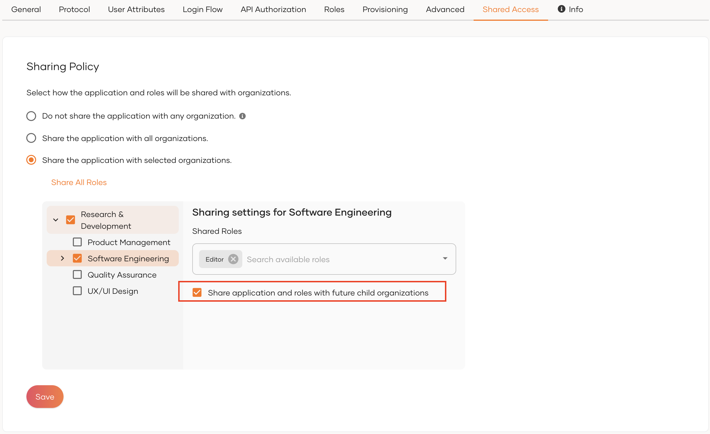
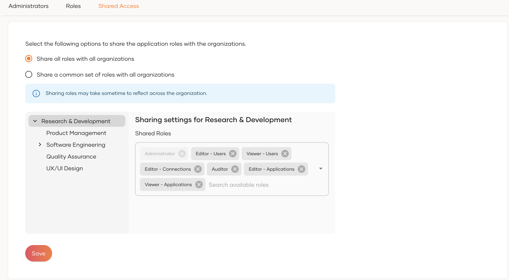
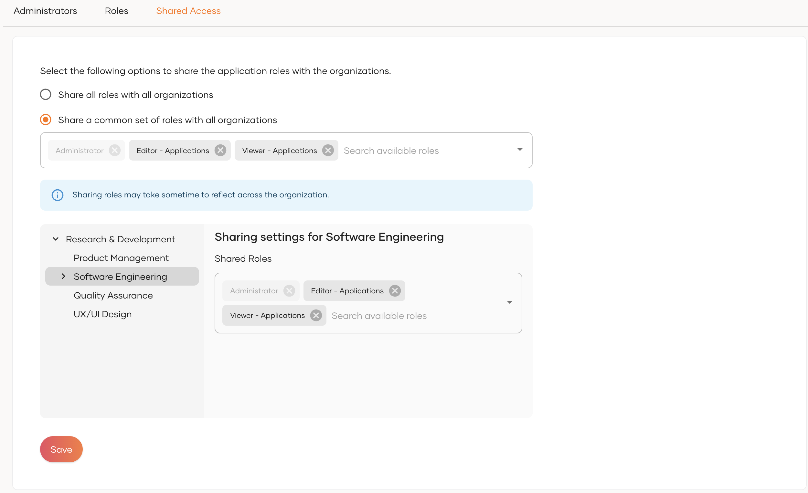

# Share applications with organizations

Share **root organization applications** with child organizations. This gives organization users access to these applications.

By sharing applications with organizations, users of that organization can log in to the application.

Share these application types with organizations:

- [**Registered applications**](#share-a-registered-application) - Applications you register in WSO2 Identity Platform

- [**My Account portal**](#share-the-my-account-portal) - Self-service portal for root organization users

- [**Admin Console**](#share-console-application) - Management console for root organization administrators

:::note

WSO2 Identity Platform shares the Admin Console by default. You control which roles to share with it.

:::

## Share a registered application

Share registered applications with their **bound roles**. This gives organization users access to specific application features.

**Why share applications?** Enable organization users to access your applications so they can perform their business tasks within their organization context.

Learn about [application and role management](../users/manage-roles.mdx) in WSO2 Identity Platform.

Follow these steps to share a registered application:

1. Log in to the **root organization** on the WSO2 Identity Platform Console.

2. Navigate to **Applications**.

3. Select the application you want to share.

4. Click the **Shared Access** tab.

5. Choose your sharing method:

    [Option 1: Share with all organizations](#share-application-with-all-organizations)

    [Option 2: Share with selected organizations](#share-application-with-selected-organizations)

6. Click **Update** to save your configurations.

7. Go to the **Protocol** tab of the application and under **Allowed grant types**, ensure the following [grant types](../../references/grant-types.mdx) are selected.

    - Client Credential
    - Code
    - Organization Switch

    :::note


    The `Organization Switch` grant will only be visible after you have shared the application with one or more organizations.

    :::

8. Click **Update** to save the changes.

:::tip


Once you have shared the application with an organization, check if the following settings are in place for the application.

- For registered applications, ensure the **SSO** authenticator is added to the login flow of the application. This adds the **Sign in with SSO** option to the application login screen so that organization users can log in using their credentials. Check its availability in the **Login Flow** tab of the application.

    

- Ensure the application is available in the organization. To check this, switch to the organization and verify that the application is listed in the **Applications** section.

    

- While in the organization, select the shared application and ensure the username and password authenticator is enabled in the login flow. The organization users can then use the **Sign In with SSO** option to log in using their credentials.

:::

### Share application with all organizations

Enable sharing for **all existing and future organizations**. New organizations automatically inherit shared access.



**Why use this option?** When application's access is needed for all organizations without any restrictions.

#### Advanced mode

Share **specific roles only** with all organizations:

1. Enable `Share a subset of roles with all organizations`

2. Select the roles you want to share



**Why use advanced mode?** This gives you precise control over application access. You select which roles to share initially, and these become the default for all organizations. Later, you can customize access by adding or removing specific roles for individual organizations.

### Share application with selected organizations

Enable sharing for **specific organizations only**. This gives you granular control over application access.



**Why use this option?** Control exactly which organizations access your application and which roles they receive.

Select **specific organizations** and choose which roles to share with each. Keep these rules in mind:

- Share with **parent organizations first** before sharing with child organizations
- Child organizations can only access roles available in their parent organization

#### Sharing options

You have two ways to configure role sharing for selected organizations:

##### Option 1: Share all roles

Click **Share All Roles** to automatically share every role with selected organizations.

##### Option 2: Enable inheritance

Enable **Share application and roles with future child organizations** to automatically share with new child organizations under your selected organization.



**Why use inheritance?** New child organizations get access without manual configuration.

:::warning


If you remove a role that has been shared already, it will remove that role from the organizations it was shared with. This action cannot be undone. So be cautious when removing roles.

:::

## Share the My Account Portal


The My Account portal is the self-service portal provided by WSO2 Identity Platform for users of the root organization. Through the portal, root organization users have access to services such as updating user information, registering biometrics for authentication and more. By sharing the portal with child organizations, you enable child organization users to access all My Account services within the context of their respective organizations.

Once shared, the My Account portal will be available for organization users through the following link:

```bash
<ROOT_ORG_URL>/o/{organization-id}<MYACCOUNT_PATH>
```

:::note


- Learn more about the [My Account portal](../user-self-service/configure-self-service-portal.mdx)
- If you decide not to share the My Account portal with customer/partner organizations, be sure to
    - remove any references to the My Account portal from your email templates. See [customizing email templates](../branding/customize-email-templates.mdx) for instructions.
    - set up an access URL for your B2B application so that once users complete password reset flows, they are redirected to it instead of the My Account portal.

:::

To share the My Account portal with organizations,

1. Login to the root organization on the WSO2 Identity Platform Console.

2. Go to **Applications** and on the top of the page, select the **Settings** icon corresponding to **My Account**.

3. Go to its **Shared Access** tab, which has the same configuration options as registered application sharing.

    - Select **Share with all organizations** for the application to be shared with all existing organizations and new organizations you may create in the future. Refer [Share application with all organizations](#share-application-with-all-organizations) for more details.

    - Select **Share with only selected organizations** and select the relevant organizations. Refer [Share application with selected organizations](#share-application-with-selected-organizations) for more details.

4. Click **Update** to save the changes.


## Share Console application

1. Navigate to **Console Settings**.

2. Go to **Shared Access** tab.

3. Choose your sharing method:

    By default, WSO2 Identity Platform shares the **Console application with all organizations** using all available roles.

    

    **Why use this default?** All organizations get consistent access to Console features without any restriction

    **Console advanced mode**

    Share **specific roles only** with all organizations:

    1. Select the second option **Share a common set of roles with all organizations**

    2. Choose which roles to share across organizations

    

    **Why use advanced mode?** Control which Console features organizations can access through specific roles. Selected roles share with all organizations by default. Later, you can customize access by adding or removing specific roles for individual organizations.

4. Click **Save** to save the changes.

:::warning


    If you remove a role that has been shared already, it will remove that roles from the organizations it was shared with. This action cannot be undo. So be cautious when removing roles.

:::
