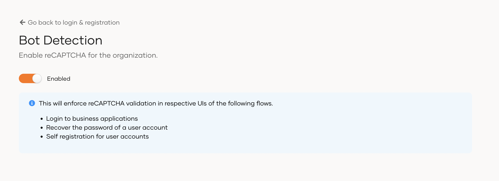

# Configure bot detection

WSO2 Identity Platform uses [reCAPTCHA](https://developers.google.com/recaptcha/) to detect bots that attempt unauthorized login or other types of internet abuse. This is a free service provided by Google that verifies whether a user is a human or a robot. It comes in the form of a widget.

When bot detection is enabled, WSO2 Identity Platform enforces reCAPTCHA validation in the following scenarios:

- User login
- User password recovery
- User self-registration

To configure reCAPTCHA:

1. On the WSO2 Identity Platform Console, go to **Login & Registration**.
2. Under **Login Security**, click **Bot Detection**.
3. Turn the toggle on or off to enable or disable reCAPTCHA for your organization.

    
