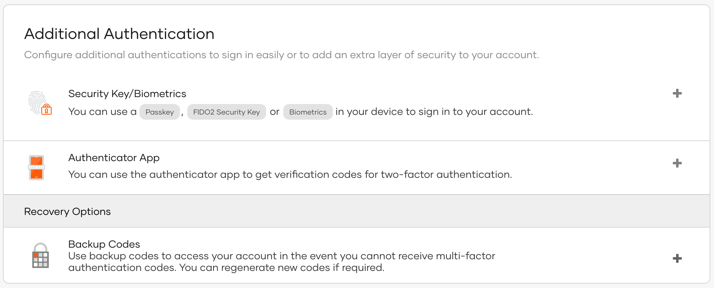
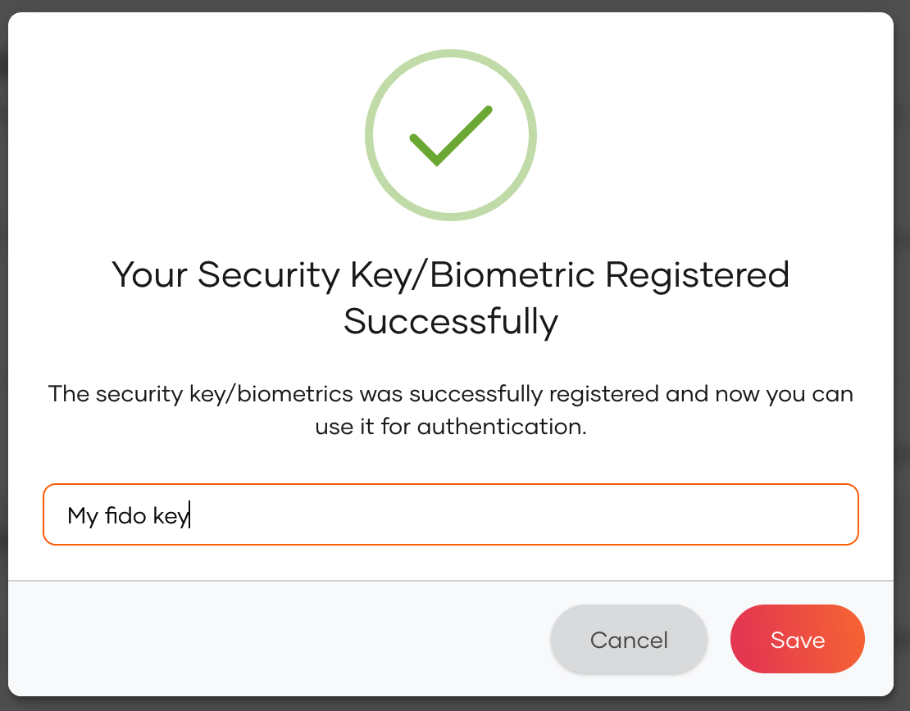

# Enroll passkeys

Application users can use the My Account portal to enroll their passkeys for [passwordless login](../authentication/passwordless-login/add-passwordless-login-with-passkey.md).

1. In the user's My Account portal, go to **Security** > **Additional Authentication**.

    

2. Click the **+** icon next to **Passkey** and follow the instructions given by the browser.

3. Once it's done, you will get the following prompt.

    

4. Provide a name for your device and click **Save**.
