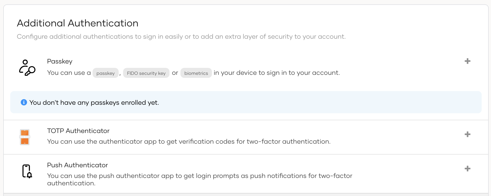
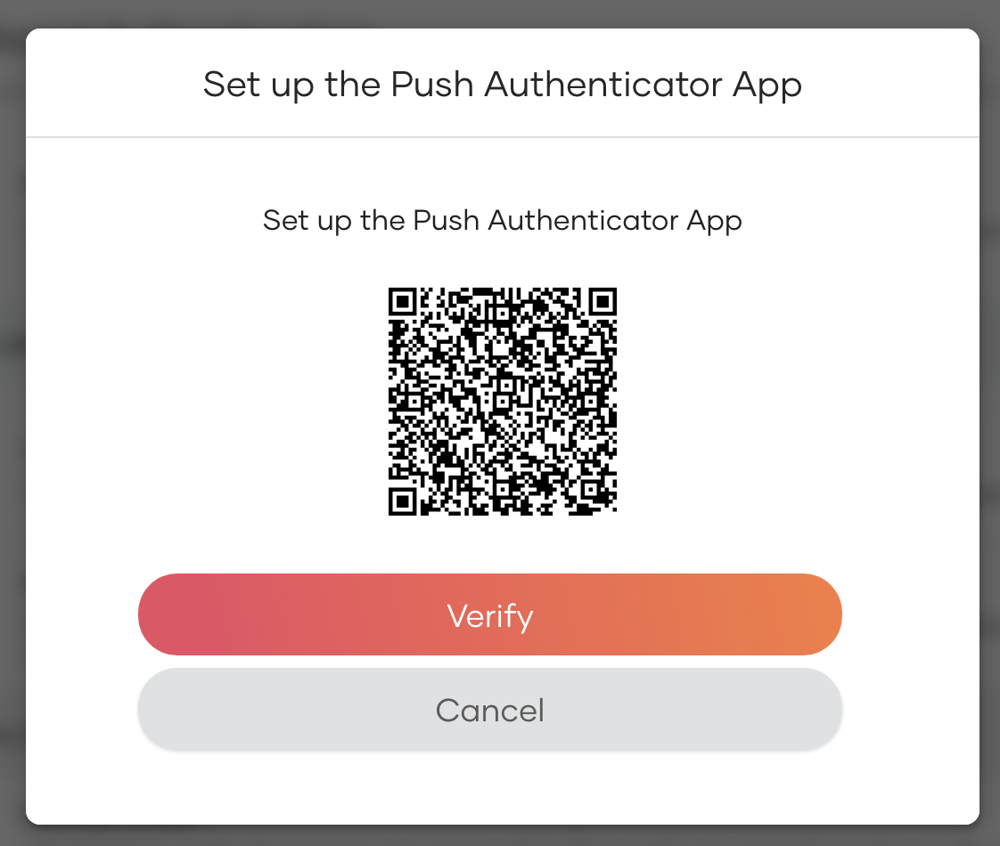
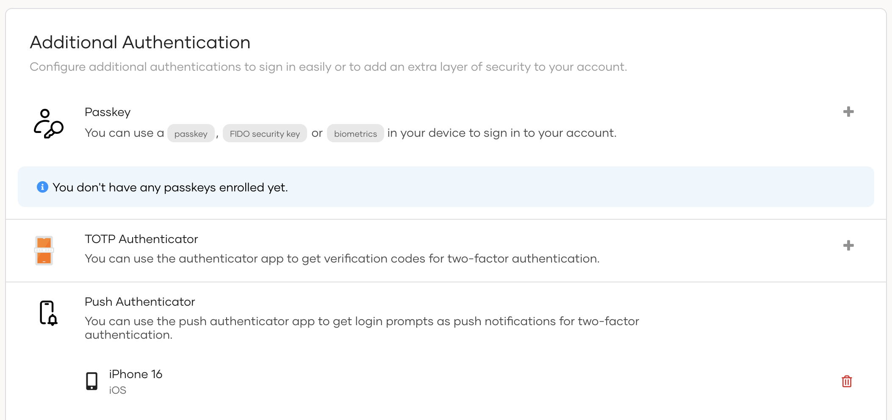

# Enroll a Push Notification Device

Application users can use the My Account portal to register their device to receive push notifications. This guide explains how to register a push notification device using the My Account portal.

:::note

A user can only maintain one push notification device at a time.

:::

1. In the user's My Account portal, go to **Security** > **Additional Authentication**.

    

2. Click the **+** icon next to **Push Authenticator** to add a new device.

3. Scan the QR code with your mobile device using your Push Authenticator app to register the device.

    

4. Once the device is registered through the app is successful, click **Verify** to check if the device is registered successfully in WSO2 Identity Platform.

5. If device registration is successful in WSO2 Identity Platform, the registered device will be displayed in the **Push Authenticator** section.

    
