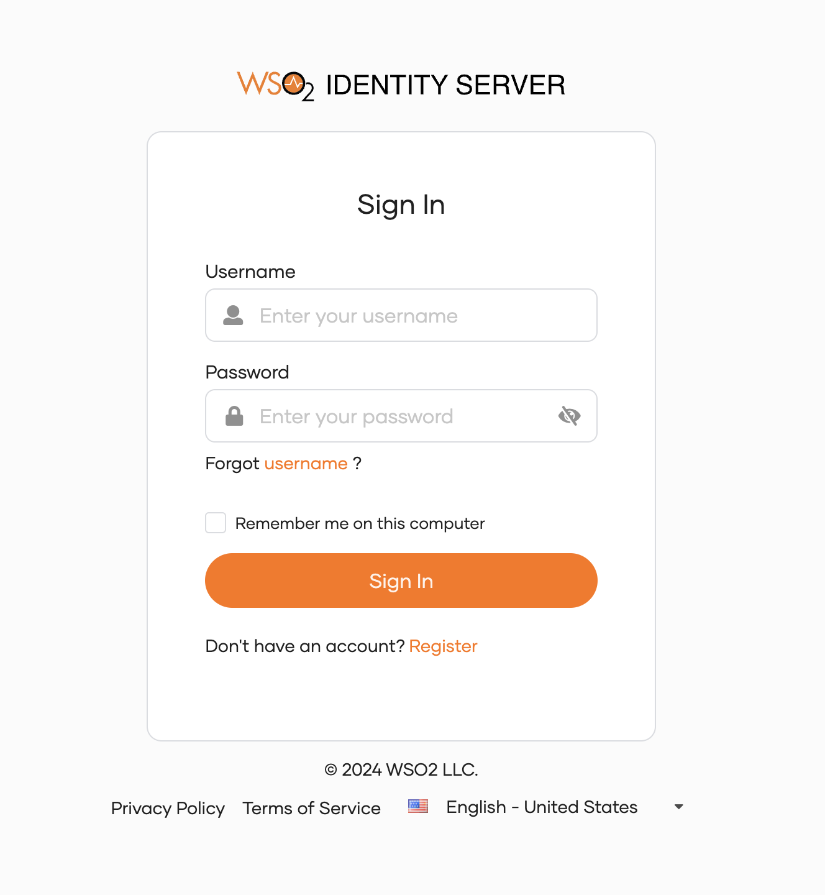
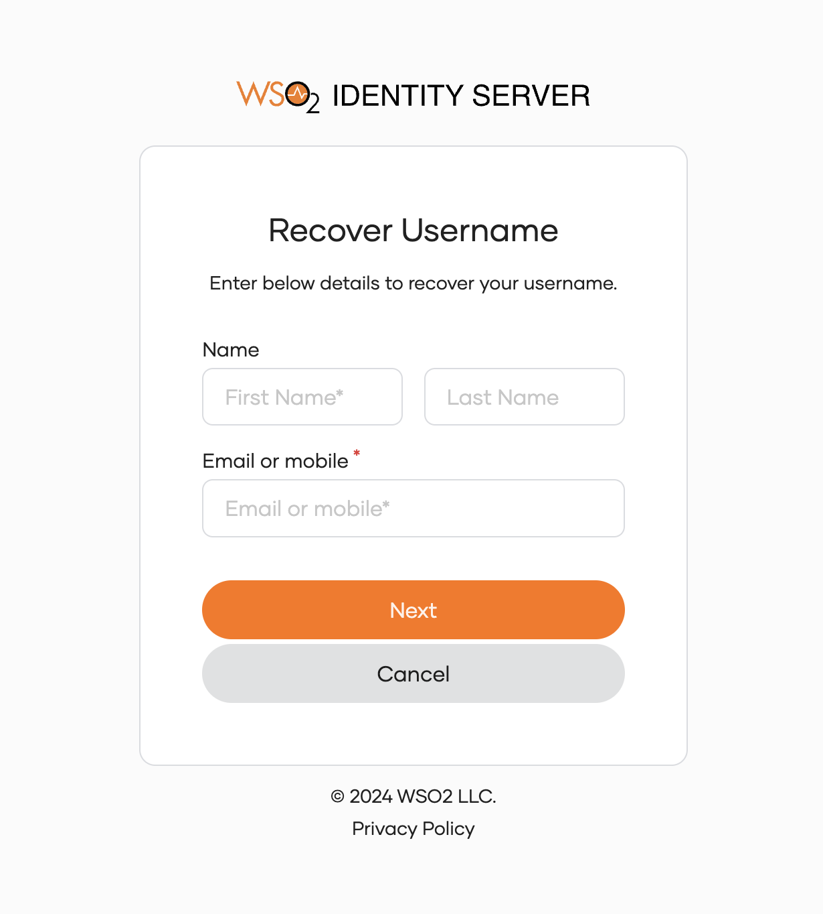
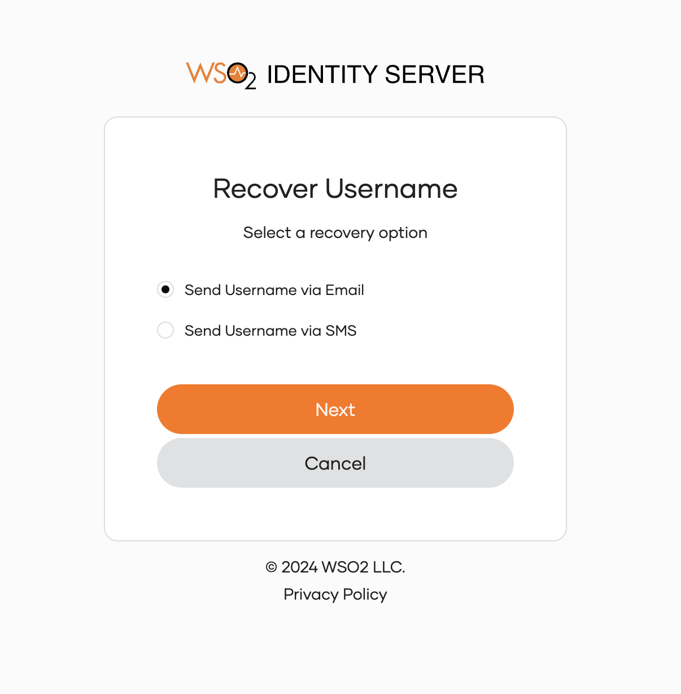
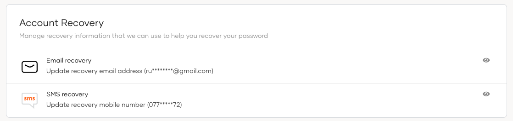

# Username recovery for users

Users may recover a forgotten username from an application sign-in page by following the steps below.

<Prerequisites title="Before you begin">

Administrators should [enable username recovery](../account-configurations/account-recovery/username-recovery.mdx) for users of the organization.

</Prerequisites>

## Recover a forgotten username

To recover the username, the user should follow these steps.

1. Go to a login page via a business application or the [My Account portal](/identity/guides/user-self-service/customer-self-service-portal/).

    

2. Click **Forgot username?**

3. Enter the information for the account you’re trying to recover, then click **Next**.

    

4. Select your preferred channel to receive username recovery information, then click **Next**.

    

5. You can now view the username recovery information in your email or mobile, as selected in the previous step.

## Check password recovery channel information
Users can also check the email address and mobile number to which their username recovery information is sent.

1. In the My Account portal, navigate to **Security** > **Account Recovery**.

    

2. Click the eye icon of the relevant row, to check the recovery email address or the recovery mobile.

3. Click **Done**.
