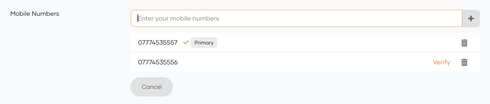
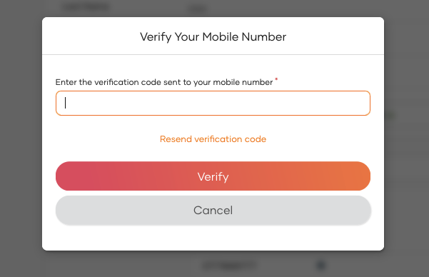

# Enable mobile number verification on update

Mobile number verification ensures that when a user updates their primary mobile number, an SMS OTP is sent to the new number for verification. The primary mobile number remains unchanged until the new one is successfully verified. If you have enabled [multiple mobile numbers per user](/identity/guides/users/attributes/manage-attributes/#assign-multiple-email-addresses-and-mobile-numbers-to-a-user), users can maintain several verified mobile numbers and designate one as the primary mobile number.

:::note

- This feature can be invoked via a PUT/PATCH request to the SCIM 2.0 /Users endpoint or /Me endpoint.
- The verification on update capability is **only** supported for the `Mobile` (`http://wso2.org/claims/mobile`) 
and `Verified Mobile Numbers` (`http://wso2.org/claims/verifiedMobileNumbers`) claims.
- An SMS OTP verification is not triggered if the mobile number to be updated is the same as a previously verified mobile number of the user.

:::

<Prerequisites>

## Prerequisites

- Configure your preferred SMS provider in WSO2 Identity Platform. For detailed instructions, see [Configure SMS providers](../../notification-channels/configure-sms-provider.mdx).

- If required, enable [support for multiple mobile numbers](/identity/guides/users/attributes/manage-attributes/#assign-multiple-email-addresses-and-mobile-numbers-to-a-user) for users.

- Update [mobile number verification settings](user-attribute-change-verification.mdx).

</Prerequisites>

## Try it out

Follow the guides below to try out different mobile number update scenarios.

### Update the primary mobile number

If you only support a single mobile number and wish to update the mobile number of a user,

1. On the WSO2 Identity Platform Console, go to **User Management** > **Users**.

2. Select a user account and go to its **Profile** tab.

3. Under **Mobile**, update the user's mobile number.

4. Click **Update** to save the changes. An SMS OTP will be sent to the specified mobile number for verification. The user needs to enter the SMS OTP to verify the mobile number.

Alternatively, you may update the mobile number via a PATCH operation to the 

<Applies to="WSO2 Cloud">

[SCIM 2.0 Me endpoint](../../../apis/scim2-me.mdx)

</Applies>


<Applies to="Self-hosted">

[SCIM 2.0 Me endpoint](../../../apis/scim2-me-rest-apis.mdx)

</Applies>

 as shown below.

:::note


<Tabs>
<TabItem value="tab-0" label="Request format">

```
curl -X PATCH
https://<HOST_NAME>/scim2/Me \
-d '{
    "schemas":["urn:ietf:params:scim:api:messages:2.0:PatchOp"], 
    "Operations":[{
        "op":<operation>, 
        "value":
            { "mobileNumbers":[{"type":"mobile", "value":<new_mobile>}]}
        }]
    }' \
--header "Content-Type:application/json"
--header "Authorization: Bearer <access_token>"
```

</TabItem>
<TabItem value="tab-1" label="Sample request">


```curl
curl -X PATCH
https://<HOST_NAME_EXAMPLE>/scim2/Me \
-d '{
    "schemas":["urn:ietf:params:scim:api:messages:2.0:PatchOp"],
    "Operations":[{
        "op":"replace",
        "value":
            { "phoneNumbers":[{"type": "mobile", "value":"0123456789"}]}
        }]
    }' \
--header "Content-Type:application/json"
--header "Authorization: Bearer <access_token>"
```

</TabItem>
</Tabs>
---
**Sample Response**
```
{
    "emails": [
        "bobsmith@abc.com"
    ],
    "meta": {
        "location": "https://<HOST_NAME_EXAMPLE>/scim2/Users/6d433ee7-7cd4-47a3-810b-bc09023bc2ce",
        "lastModified": "2020-10-12T13:35:24.579Z",
        "resourceType": "User"
    },
    "schemas": [
        "urn:ietf:params:scim:schemas:core:2.0:User",
        "urn:ietf:params:scim:schemas:extension:enterprise:2.0:User",
        "urn:scim:wso2:schema"
    ],
    "roles": [
        {
            "type": "default",
            "value": "Internal/everyone"
        }
    ],
    "name": {
        "givenName": "Bob",
        "familyName": "Smith"
    },
    "id": "6d433ee7-7cd4-47a3-810b-bc09023bc2ce",
    "userName": "bob123",
    "phoneNumbers": [
        {
            "type": "mobile",
            "value": "0111111111"
        }
    ],
    "urn:ietf:params:scim:schemas:extension:enterprise:2.0:User": {
        "pendingMobileNumber": "0123456789"
    }
}
```

:::

Upon receiving the response outlined above, the user will receive an SMS notification prompting them to verify their 
updated mobile number. Once verified, the `Mobile` claim (`http://wso2.org/claims/mobile`) 
will be updated to reflect the new mobile number.

:::note

If you directly update the primary `Mobile` claim directly, the change will not be reflected in the  
`Verified Mobile Numbers` (`http://wso2.org/claims/verifiedMobileNumbers`) claim after verification.

:::

### Update the verified mobile numbers list

If you have enabled support for multiple mobile numbers, a user can have several verified mobile numbers and a single primary mobile number.

To verify a mobile number, 

1. On the WSO2 Identity Platform My Account, go to **Personal Info** tab.

2. Under **Mobile Numbers**, click the verify icon on an unverified mobile number of the user.

A verification code will be sent to your mobile number.



An SMS OTP will be sent to the specified mobile number for verification. The user needs to provide the OTP to verify the mobile number.
 
Alternatively, you may update the mobile numbers via a PATCH operation to the 

<Applies to="WSO2 Cloud">

[SCIM 2.0 Me endpoint](../../../apis/scim2-me.mdx)

</Applies>


<Applies to="Self-hosted">

[SCIM 2.0 Me endpoint](../../../apis/scim2-me-rest-apis.mdx)

</Applies>

 as shown below.

:::note


<Tabs>
<TabItem value="tab-0" label="Request format">


```curl
curl -X PATCH
https://<HOST_NAME>/scim2/Me \
-d '{
    "schemas":["urn:ietf:params:scim:api:messages:2.0:PatchOp"],
    "Operations":[{
        "op":<operation>,
        "value":{"urn:scim:wso2:schema": {"verifiedMobileNumbers": <list_of_mobile_numbers>}}
        }]
    }' 
--header "Content-Type:application/json"
--header "Authorization: Bearer <access_token>"
```

</TabItem>
<TabItem value="tab-1" label="Sample request">


```curl
curl -X PATCH
https://<HOST_NAME_EXAMPLE>/scim2/Me \
-d '{
    "schemas":["urn:ietf:params:scim:api:messages:2.0:PatchOp"],
    "Operations":[{
        "op":"replace",
        "value":{"urn:scim:wso2:schema": {"verifiedMobileNumbers": "0111111111,0123456789"}}
        }]
    }' 
--header "Content-Type:application/json"
--header "Authorization: Bearer <access_token>"
```

</TabItem>
</Tabs>

---
**Sample Response**
```
{
    "emails": [
        "bobsmith@abc.com"
    ],
    "meta": {
        "location": "https://<HOST_NAME_EXAMPLE>/scim2/Users/6d433ee7-7cd4-47a3-810b-bc09023bc2ce",
        "lastModified": "2020-10-12T13:35:24.579Z",
        "resourceType": "User"
    },
    "schemas": [
        "urn:ietf:params:scim:schemas:core:2.0:User",
        "urn:ietf:params:scim:schemas:extension:enterprise:2.0:User",
        "urn:scim:wso2:schema"
    ],
    "roles": [
        {
            "type": "default",
            "value": "Internal/everyone"
        }
    ],
    "name": {
        "givenName": "Bob",
        "familyName": "Smith"
    },
    "id": "6d433ee7-7cd4-47a3-810b-bc09023bc2ce",
    "userName": "bob123",
    "phoneNumbers": [
        {
            "type": "mobile",
            "value": "0111111111"
        }
    ],
    "urn:scim:wso2:schema": {
        "mobileNumbers": "0111111111",
        "verifiedMobileNumbers": "0111111111",
    },
    "urn:ietf:params:scim:schemas:extension:enterprise:2.0:User": {
        "pendingMobileNumber": "0123456789"
    }
}
```

:::

Upon receiving the response outlined above, the user will receive an SMS notification prompting them to verify their 
updated mobile number. Once verified, the `Verified Mobile Numbers` claim (`http://wso2.org/claims/verifiedMobileNumbers`) 
will be updated to reflect the new mobile number.  If a primary mobile number has not been configured, 
the verified mobile number will also be set as the primary mobile number.


## Validate the verification code

When going through the mobile number verification process, users can enter the SMS OTP in the provided prompt and click **Verify** to verify the mobile number.



Alternatively, the validation-code API can be used to submit the SMS OTP as shown below.


<Applies to="Self-hosted">

### By a non-privileged user

Users can verify the SMS OTP by executing the following API request.

</Applies>


:::note


<Tabs>
<TabItem value="tab-0" label="Request format">


```curl
curl -X POST https://<HOST_NAME>/api/identity/user/v1.0/me/validate-code 
-H "Authorization: Bearer <access_token>"
-H "Content-Type: application/json" \
-d '{ "code": "<validation_code>",
      "properties": []
    }'
```

</TabItem>
<TabItem value="tab-1" label="Sample request">


```curl
curl -X POST https://<HOST_NAME_EXAMPLE>/api/identity/user/v1.0/me/validate-code 
-H "Authorization: Bearer <access_token>"
-H "Content-Type: application/json" \
-d '{ "code": "1234",
      "properties": []
    }' 
```

</TabItem>
</Tabs>
---
**Response**
```
"HTTP/1.1 200 Accepted"
```

:::


<Applies to="Self-hosted">

### By a privileged user

Privileged users can verify the SMS OTP on behalf of a user by executing the following API request.

:::note


<Tabs>
<TabItem value="tab-0" label="Request format">


```curl
curl -X POST https://localhost:9443/api/identity/user/v1.0/validate-code
-H "Authorization: Bearer <access_token>"
-H "Content-Type: application/json" \
-d '{ "code": "<validation_code>",
      "properties": []
    }'
```

</TabItem>
<TabItem value="tab-1" label="Sample request">


```curl
curl -v -k -X POST https://localhost:9443/api/identity/user/v1.0/validate-code 
-H "Authorization: Bearer <access_token>"
-H "Content-Type: application/json" \
-d '{ "code": "1234",
      "properties": []
    }' 
```

</TabItem>
</Tabs>
---
**Response**
```
"HTTP/1.1 200 Accepted"
```

:::

</Applies>


## Resend the verification code

Users can request for a new SMS OTP code by simply clicking the `Resend verification code` button in the shown prompt 


Alternatively, the resend-code API can be used to resend the SMS OTP as shown below.


<Applies to="Self-hosted">

### By a non-privileged user

Users can request a new SMS OTP by using the following API request.

</Applies>


:::note


<Tabs>
<TabItem value="tab-0" label="Request format">


```curl
curl -X POST https://<HOST_NAME>/api/identity/user/v1.0/me/resend-code 
-H "Authorization: Bearer <access_token>"
-H "Content-Type: application/json" \
-d '{ "properties": [{
        "key": "RecoveryScenario", 
        "value": "<recovery_scenario>"
      }]
    }'
```

</TabItem>
<TabItem value="tab-1" label="Sample request">


```curl
curl -X POST https://<HOST_NAME_EXAMPLE>/api/identity/user/v1.0/me/resend-code 
-H "Authorization: Bearer <access_token>"
-H "Content-Type: application/json" \
-d '{ "properties": [{
        "key": "RecoveryScenario", 
        "value": "MOBILE_VERIFICATION_ON_UPDATE"
      }]
    }' 
```

</TabItem>
</Tabs>

The verification scenario should be specified in the `properties` parameter of the request body as follows:

- `MOBILE_VERIFICATION_ON_UPDATE`: Used when verifying a newly updated mobile number for a user. 
- `MOBILE_VERIFICATION_ON_VERIFIED_LIST_UPDATE`: Used when updating the list of verified mobile numbers for a user.
---

**Response**
```
"HTTP/1.1 201 Created"
```

:::


<Applies to="Self-hosted">

### By a privileged user

Privileged users can resend an SMS OTP on behalf of a user using the following API request.

:::note


<Tabs>
<TabItem value="tab-0" label="Request format">


```curl
curl -X POST https://localhost:9443/api/identity/user/v1.0/resend-code 
-H "Authorization: Bearer <access_token>"
-H "Content-Type: application/json" \
-d '{ 
      "user": {
        "username": <USERNAME>,
        "realm": <REALM>"
    },
      "properties": [{
        "key":"RecoveryScenario",
        "value":<recovery_scenario>
        }]
    }'
```

</TabItem>
<TabItem value="tab-1" label="Sample request">


```curl
curl -X POST https://localhost:9443/api/identity/user/v1.0/resend-code
-H "Authorization: Bearer <access_token>"
-H "Content-Type: application/json" \
-d '{ 
      "user": {
        "username": "bob",
        "realm": PRIMARY"
    },
      "properties": [{
        "key":"RecoveryScenario",
        "value":"MOBILE_VERIFICATION_ON_UPDATE"
        }]
    }'
```

</TabItem>
</Tabs>

The verification scenario should be specified in the request body as follows:

- `MOBILE_VERIFICATION_ON_UPDATE`: Used when verifying updated primary mobile number.
- `MOBILE_VERIFICATION_ON_VERIFIED_LIST_UPDATE`: Used when updating the list of verified mobile numbers.

---
**Response**
```
"HTTP/1.1 201 Created"
```

:::

</Applies>
