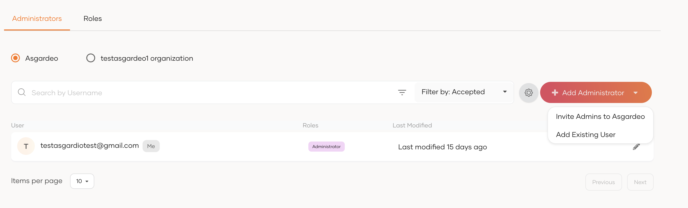
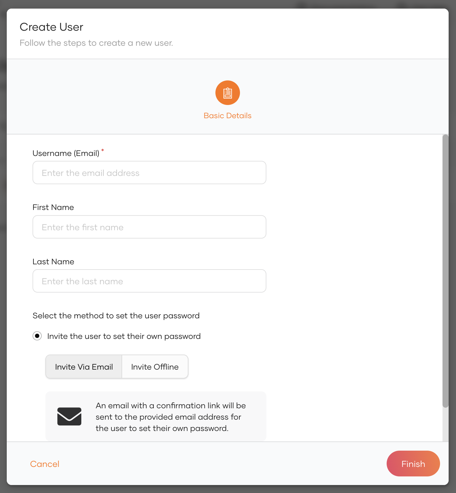

<Applies to="WSO2 Cloud">

# Manage administrators

This guide walks you through the steps of managing an administrator account. If you are the owner or an existing administrator in the organization, you can onboard new administrators or delete existing administrator accounts.

:::note

You cannot manage the user profiles of other administrators or update their passwords from the WSO2 Identity Platform Console. Administrators must manage their own profiles and passwords using the [My Account portal](../your-identity-platform/identity-platform-self-service.md).

:::

## Onboard an administrator

There are two ways to onboard an administrator:

- An administrator can onboard new administrators by [sending an email invitation](#invite-an-external-administrator).
- An administrator can [assign administrative privileges to existing users](#assign-admin-privileges-to-users).

### Invite an external administrator

Existing administrators can onboard other administrators by sending them email invitations to join the organization. To do so,

1. On the WSO2 Identity Platform Console, go to **Console Settings** > **Administrators**.

2. Click **Add Administrator** and provide the following details.

    :::note

    If you have enabled the option to [assign admin privileges to users](#assign-admin-privileges-to-users), you may proceed to invite external admins by clicking *Add Administrator* > *Invite Admins to WSO2 Identity Platform*.

    :::


    <table>
        <tr>
            <th>Email Address</th>
            <td>The invitation will be sent to this email address. Additionally, this email address will be used as the username of this administrator. Usernames are always unique to an organization. Once created, they cannot be modified.</td>
        </tr>
        <tr>
            <th>Role</th>
            <td>The <b>Administrator</b> role is assigned by default. For details on the available user roles and the permissions assigned to them, see [WSO2 Identity Platform User Roles](../../references/user-management/user-roles.md).</td>
        </tr>
    </table>


3. Click **Invite** to send the invitation.

The external administrator can join the organization by accepting the invitation and setting a password for the new administrator account.

### Assign admin privileges to users

This option has to be enabled for the organization. If enabled, administrators can assign the administrator role to existing non-privileged users.

To enable this option,

1. On the WSO2 Identity Platform Console, go to **Console Settings** > **Administrators**.

2. Click the settings icon next to **Add Administrator** to open the **Administrator Settings** page.

3. Turn on the **Enable users to manage the organization** toggle.

4. Go back to the **Administrators** tab and click **Add Administrator** to see a list with two options as follows:

    

To assign users the administrator role, 

1. On the **Console Settings** > **Administrators** page, click **+Add Administrator > Add Existing User**.
2. Select the user's username and the **Administrator** role and click **Add**.

The new administrator can now access the WSO2 Identity Platform Console using the following URL:

```
https://console.asgardeo.io/t/{organization_name}
```

:::note

Currently, only privileged users onboarded from the internal user store and remote user stores can log in to the WSO2 Identity Platform Console.

:::

## View administrators
To view the administrators of your organization:

On the WSO2 Identity Platform Console, go to **Console Settings > Administrators**. You will see the list of administrators presented in two tabs as follow.

<table>
    <tr>
        <th>WSO2 Identity Platform</th>
        <td>This includes administrators whose identity is managed by WSO2 Identity Platform.</td>
    </tr>
    <tr>
        <th><i>\{organization_name\}</i> organization</th>
        <td>This includes administrators whose identity is managed by the <code>\{org_name\}</code> organization.</td>
    </tr>
</table>

## Delete an administrator

:::warning[Before you begin]


- If you delete an exiting user who was assigned to the administrator role, you will only be revoking the administrator privileges from that user. Deleting this administrator does not delete the user account.
- If you delete other administrators, you will be deleting the user account from the organization. This action is irreversible.

:::

To delete an administrator:

1. On the WSO2 Identity Platform Console, click **Console Settings** > **Administrators**.
2. Click **Delete** for the administrator you want to remove.
3. Select the checkbox to confirm your action.
4. Click **Confirm**.

</Applies>


<Applies to="Self-hosted">

# Manage administrators

This guide walks you through the steps of managing an administrator account. If you are the owner or an existing administrator in the organization, you can add new administrators or delete existing administrator accounts.

## Add an administrator

Administrators of your organization can follow the steps below to add another administrator:

1. On the WSO2 Identity Server Console, go to **User Management** > **Users**.

2. Click **Add User** and provide the required details.

    

3. Click **Next**.

4. Review the summary and click **Finish**.

5. On the WSO2 Identity Server Console, go to **Console Settings**. 

6. Click **Add Administrator**.

7. Select the relevant user as the **username**.

8. Select the **Administrator** role.

9. Click **Add**.

:::note

The created administrator will be listed in the **Console Settings** page under the **Administrators** tab.


:::

## Delete an administrator

!!! warning Before you begin
    When you delete an administrator, you will only be revoking the administrator privileges from the user. Deleting this administrator does not delete the user account. If you want to delete the user account, see [Delete a user](manage-users.md#delete-a-user).

To delete an administrator:

1. On the WSO2 Identity Server Console, click **Console Settings**.
2. Click **Delete** for the administrator you want to remove.
3. Select the checkbox to confirm your action.
4. Click **Confirm**.

</Applies>
