<Applies to="WSO2 Cloud">

# Manage users

This guide walks you through the process of managing a user account. An owner or an administrator can manage user accounts.

## Onboard users

WSO2 Identity Platform provides multiple ways to onboard users to your organization. You can add users individually or in bulk using a CSV file. You can also allow users to self-register.

To learn more about onboarding users, see [Onboard users](onboard-users.md).

## Filter users

Administrators can filter users based on their account status from the WSO2 Identity Platform Console.

To filter users by account status:

1. On the WSO2 Identity Platform Console, go to **User Management** > **Users**.
2. Click the **Account Status** dropdown and select the relevant filter criteria:

    - **Locked**: Users with locked accounts.
    - **Disabled**: Users with deactivated accounts.
    - **Pending password reset**: Users who haven't updated their passwords after an administrator-initiated password reset.
    - **Pending initial password setup**: Users who haven't set their passwords after an administrator-initiated account creation.
    - **Pending email verification**: Users who haven't verified their primary email addresses.
    - **Pending mobile verification**: Users who haven't verified their primary mobile numbers.

    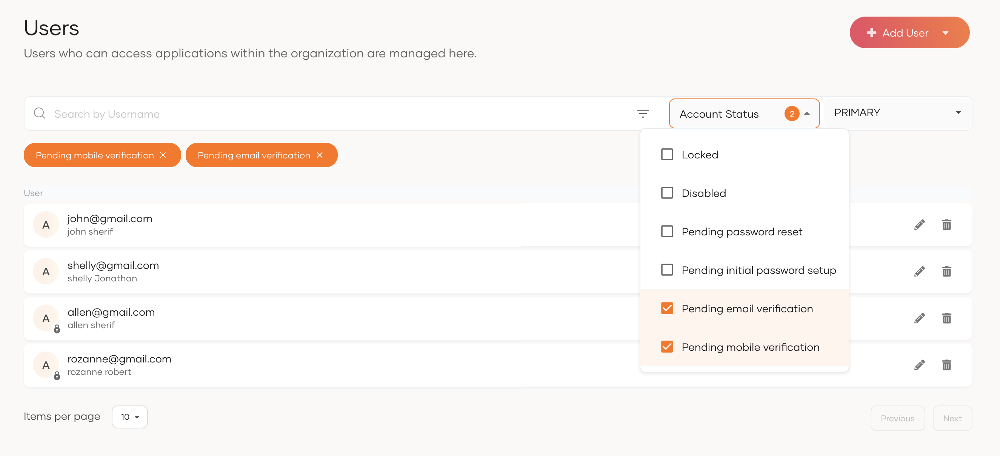

## Assign groups
A user can be assigned to different [groups](manage-groups.md) in the organization. Groups can be used to restrict the user's access to resources.

To assign users to groups:

1. On the WSO2 Identity Platform Console, go to **User Management** > **Users**.
2. Click **Edit** for the user.
3. Go to **Groups** and assign groups.

    :::note

    The **Groups** tab for a user account will only appear after you create one or more groups in the organization. Learn how to [create a group](manage-groups.md#create-new-group)

    :::

    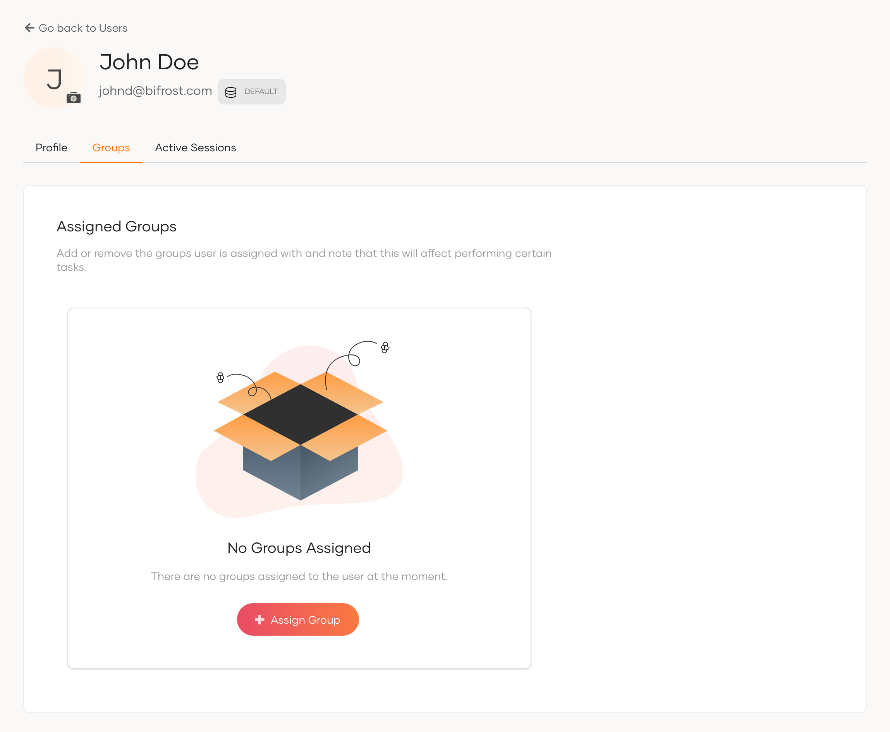

## Manage user profiles

A user profile consists of attributes that represent the details of the user such as username, email address, contact information, other custom attributes, etc.

:::note

Administrators in the organization can configure the list of attributes that should be available in a user profile. See [Manage attributes](/identity/guides/users/attributes/manage-attributes/) for details.

:::

### View profile details

Administrators can view the user profile of any user as follows:

1. On the WSO2 Identity Platform Console, go to **User Management** > **Users**.

    :::note

    If you have connected a remote user store, and want to filter the users in your remote user store, select your user store from the drop-down menu.

    :::

2. Select the user to view the profile.

    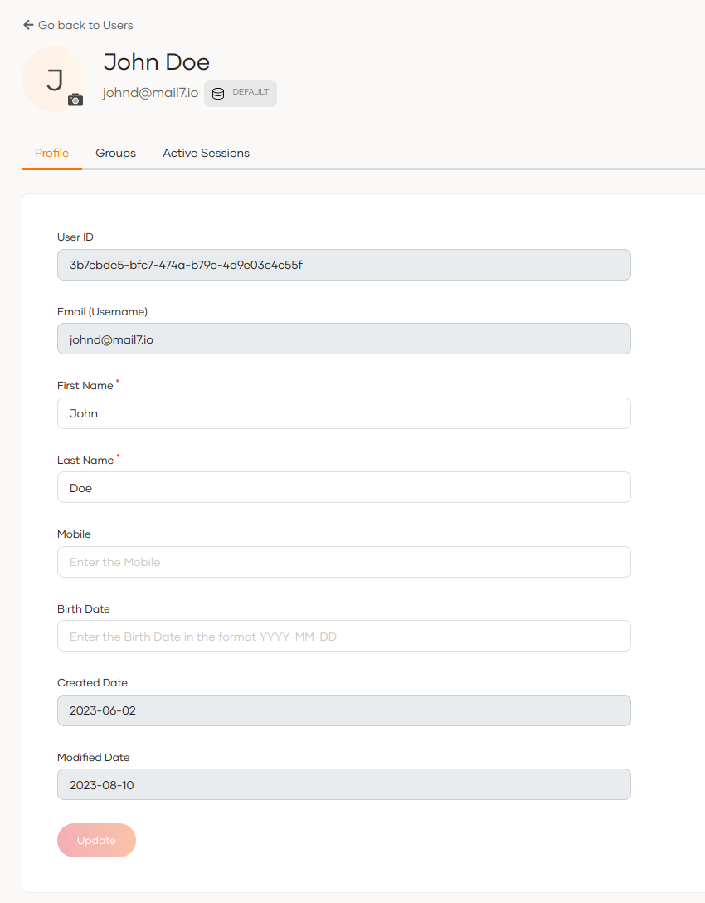

### Update the profile

An administrator can update the profile of a user via the WSO2 Identity Platform Console.

To update the user profile:

1. On the WSO2 Identity Platform Console, go to **User Management** > **Users**.
2. Find the user's account and click **Edit**.
3. Update the information on the user profile.

    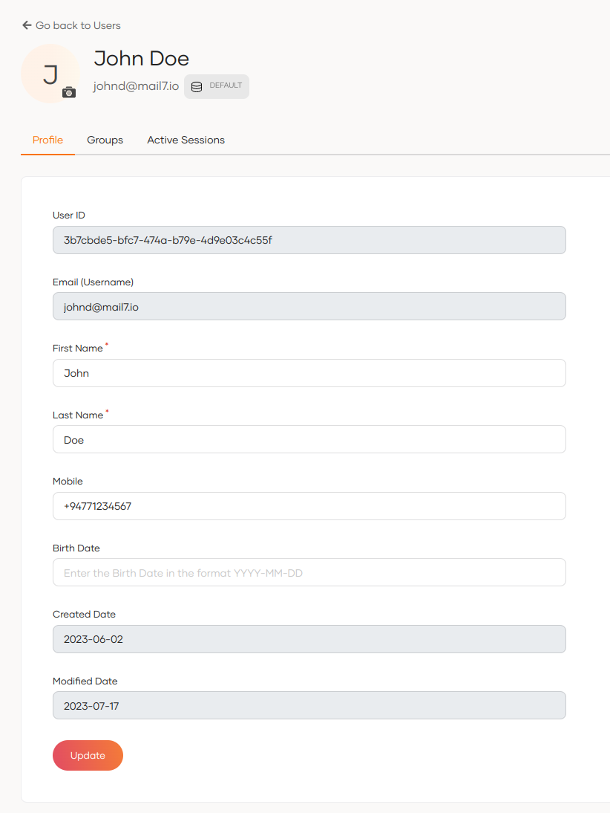

4. Click **Update** to save.

## Share user with organizations

An administrator can share a user with an organization or multiple organizations via the WSO2 Identity Platform Console.

To share a user with organizations:

1. On the WSO2 Identity Platform Console, go to **User Management** > **Users**.
2. Find the user's account and click **Edit**.
3. Go to the **Shared Access** tab.
4. Select the appropriate sharing option:

    - **Do not share user with any organization**: The user will not be shared with any organizations.
    - **Share user with all organizations**: The user is shared with all current and future organizations. When the user is shared, administrators can also configure which roles should be assigned to the user in the shared organizations.

        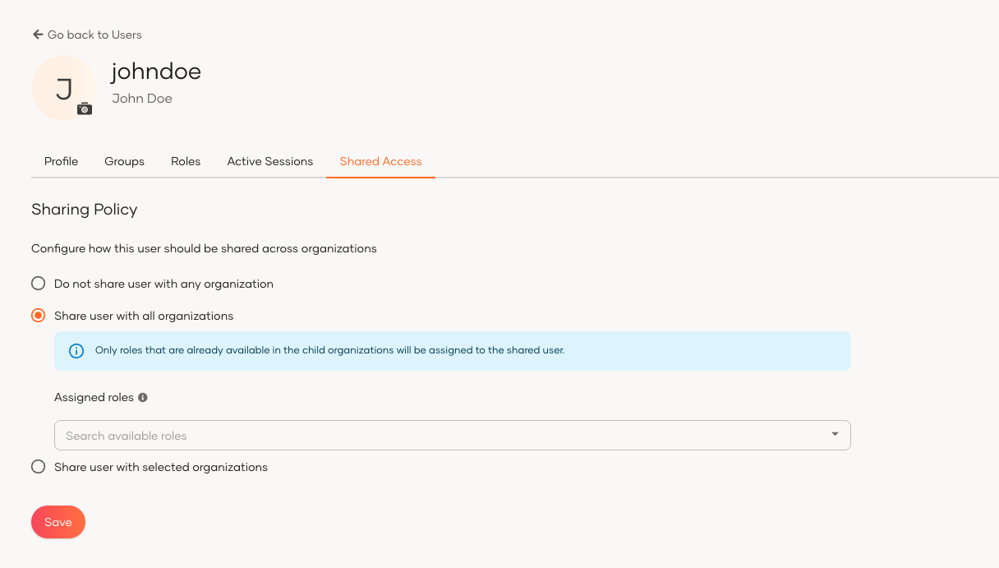

    - **Share user with selected organizations**: The user is shared with a specific set of existing organizations, but not with future child organizations. Administrators can configure which roles should be assigned to the user in the shared organizations.

5. Once selected and configured, click **Save**.

## Resend invitation links and codes

Administrators can resend expired invitation links or verification codes to users. This applies when users need to:

- Complete registration
- Reset passwords through an admin-initiated password reset
- Confirm their account
- Verify their email address

### Use the Console

To resend links or codes through the Console:

1. Navigate to the user's profile in **User Management** > **Users**.

2. Click the **Resend** link in the warning message at the top of the user's profile.

    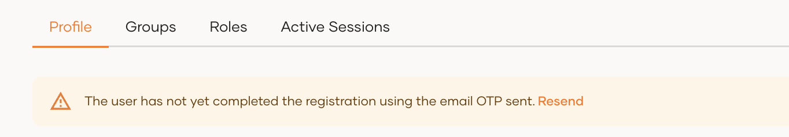

    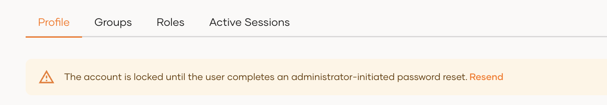

### Use the API

You can also use the **resend-code API** to resend links or codes programmatically.

:::note


<Tabs>
<TabItem value="tab-0" label="Request format">


```curl
curl -X 'POST' \
'https://api.asgardeo.io/t/{organization_name}/api/identity/user/v1.0/resend-code' \
-H 'accept: application/json' \
-H 'Authorization: Bearer <access_token>' \
-H 'Content-Type: application/json' \
-d '{
    "user": {
        "username": "<username>",
        "realm": "<realm>"
    },
    "properties": [
        {
            "key": "RecoveryScenario",
            "value": "<recovery_scenario>"
        }
    ]
    }'
```

</TabItem>
<TabItem value="tab-1" label="Sample request">


```curl
curl -X 'POST' \
'https://api.asgardeo.io/t/{organization_name}/api/identity/user/v1.0/resend-code' \
-H 'accept: application/json' \
-H 'Authorization: Bearer <access_token>' \
-H 'Content-Type: application/json' \
-d '{
    "user": {
        "username": "jane",
        "realm": "DEFAULT"
    },
    "properties": [
        {
            "key": "RecoveryScenario",
            "value": "ASK_PASSWORD"
        }
    ]
    }'
```

</TabItem>
</Tabs>

:::

#### Recovery scenarios

Specify the **recovery scenario** in the `properties` parameter of the API request:

- **`ASK_PASSWORD`**: User needs to set up their initial password using the setup link.
- **`ASK_PASSWORD_VIA_EMAIL_OTP`**: User needs to complete registration using an email OTP.
- **`ASK_PASSWORD_VIA_SMS_OTP`**: User needs to complete registration using an SMS OTP.
- **`ADMIN_FORCED_PASSWORD_RESET_VIA_EMAIL_LINK`**: User needs to reset password via an admin-forced email link.
- **`ADMIN_FORCED_PASSWORD_RESET_VIA_OTP`**: User needs to reset password via an admin-forced OTP sent through email.
- **`EMAIL_VERIFICATION`**: User needs to verify their email using the setup link.
- **`EMAIL_VERIFICATION_OTP`**: User needs to verify their email using an email OTP.
- **`SELF_SIGN_UP`**: User needs to confirm their account using the email link.

:::note

- Provide the username without the user store domain prefix
- Specify the relevant user store domain name in the `realm` parameter


---
**Response**
```
"HTTP/1.1 201 Created"
```

:::


## Set a user's password

Administrators can set a user's password if the user is unable to set the password via the initial setup email link shared during user creation.

To set the password:

1. Click **Set password** at the bottom of the user's profile.

    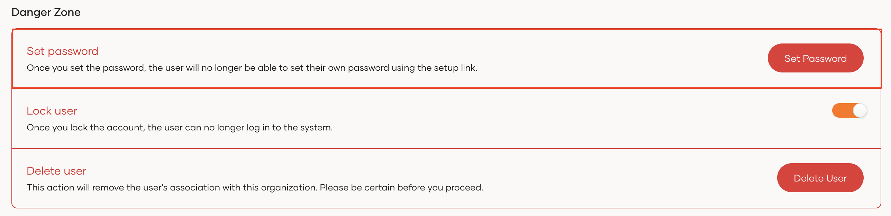

2. Type the new password.

    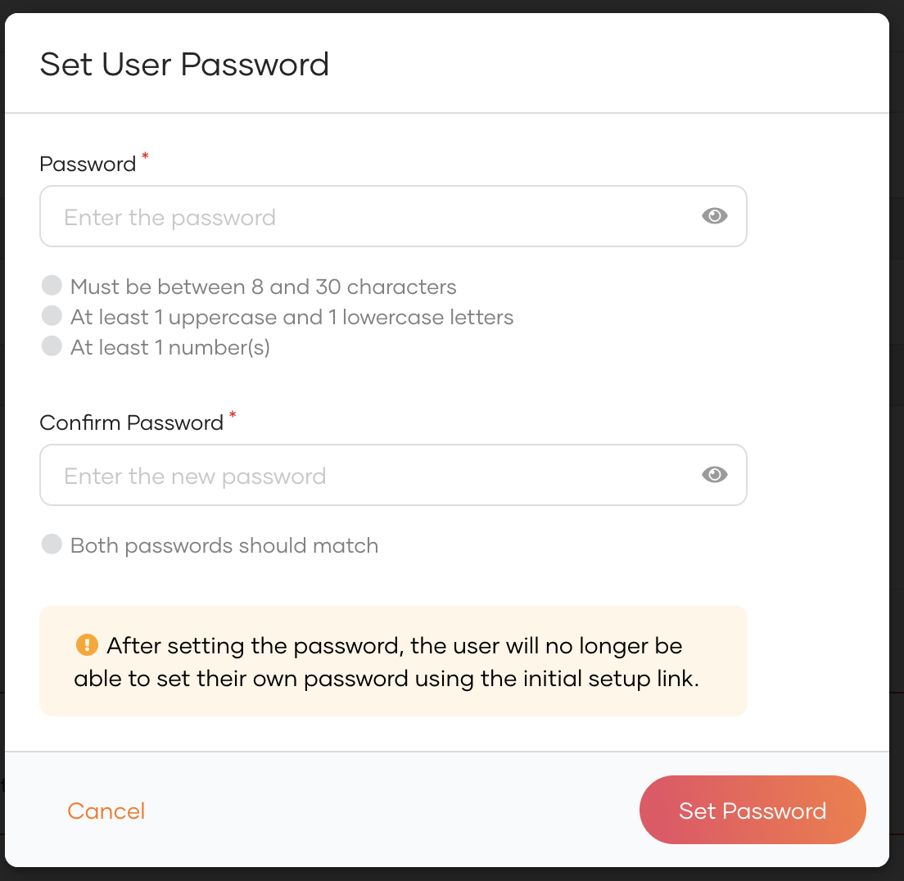

3. Click **Set Password**.

    :::note

    Once the administrator set the password, the user's account will get unlocked.

    :::

## Reset the user's password

Administrators can reset a user's password or initiate the password reset process from the WSO2 Identity Platform Console.

To reset the password:

1. Click **Reset password** at the bottom of the user's profile.

    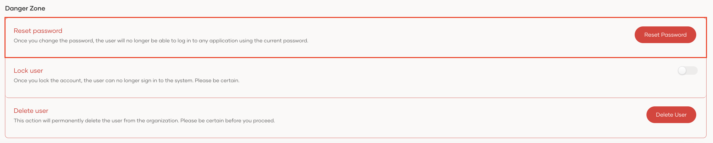

2. Select a method to reset the user password:

    - **Invite user to set their own password:**
        If this option is selected, a password reset request can be sent to the user via email. The user can then use the instructions in the email to reset the password.

    - **Set a temporary password for the user:**
        If this option is selected, the owner or an administrator can set a temporary password for the user.

        :::note

        If the user is in pending admin forced password reset, once the admin resets the password,
        the account will get unlocked.

        :::

    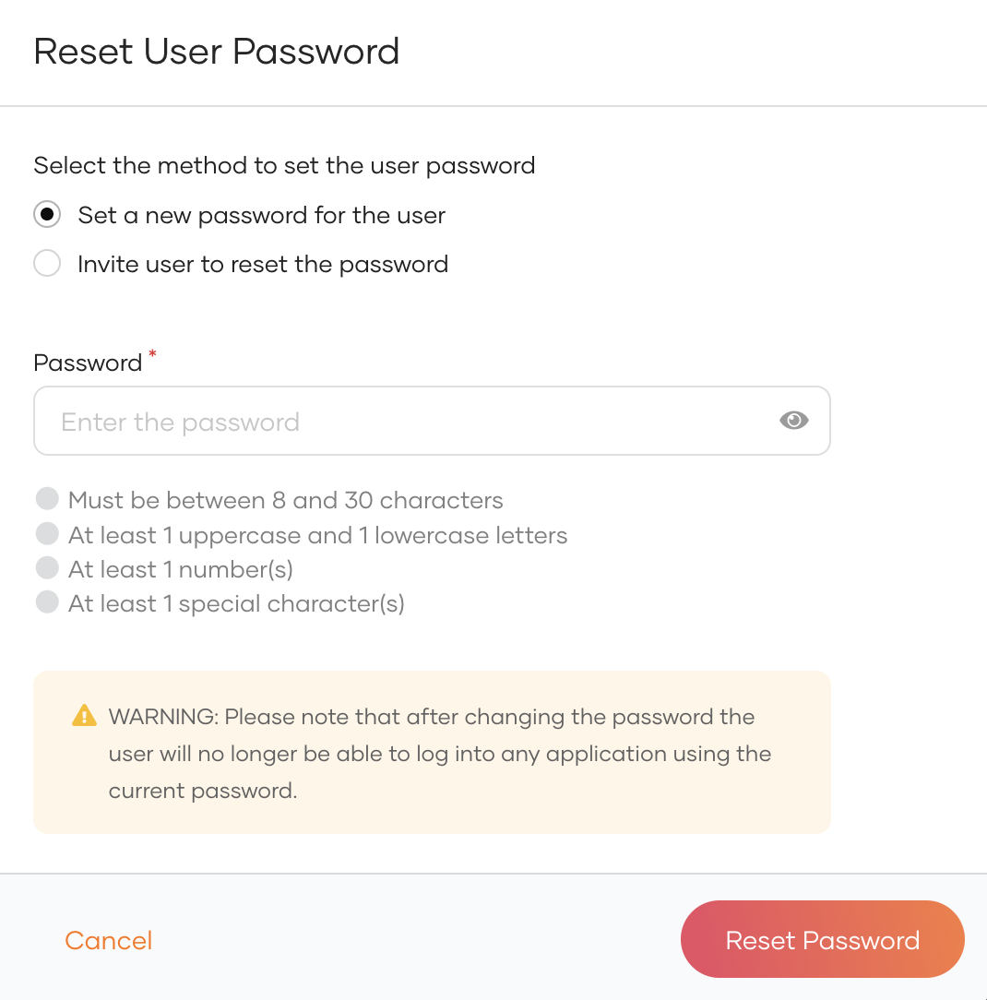

3. Click **Reset Password**.

### Using the API

You can also use WSO2 Identity Platform's [SCIM API](../../apis/scim2/index.md#tag/Users-Endpoint/operation/patchUser) to initiate the admin initiated password recovery flow.

1. [Get an access token](/identity/apis/authentication/#get-an-access-token) with the `internal_user_mgt_update` scope.

2. Use the obtained access token to execute the following cURL.

    ```curl
    curl --location --request PATCH 'https://api.asgardeo.io/t/<org_name>/scim2/Users/ <user_id>' \
    --header 'Content-Type: application/json' \
    --header 'Authorization: Bearer <access_token>' \
    --data '{
       "schemas": [
          "urn:ietf:params:scim:api:messages:2.0:PatchOp",
          "urn:scim:wso2:schema"
       ],
       "Operations": [
          {
                "op": "add",
                "value": {
                   "urn:scim:wso2:schema": {
                      "forcePasswordReset": true
                   }
                }
          }
       ]
    }'
    ```

Upon successful execution of the cURL the user will receive an email to reset their password.

## Lock a user account

To temporarily prevent a user from logging into applications or the self-service My Account portal, you can lock their account.

To lock a user account:

1. On the WSO2 Identity Platform Console, go to **User Management** > **Users** and select the user.
2. In the **Danger Zone**, turn the **Lock user** toggle on to lock the user's profile. Turn it off to unlock it.

    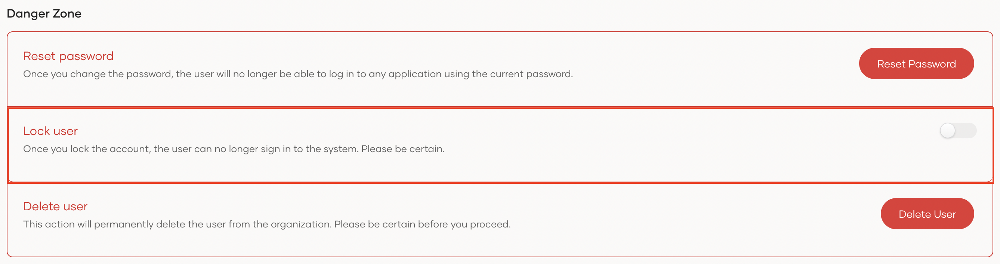

3. Select the checkbox to confirm your action.
4. Click **Confirm**.

:::note

When a user account is locked, the reason for the account lock will be displayed in the user's profile.

:::

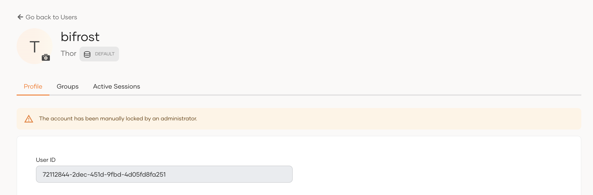

## Disable a user account

Disabling a user's account prevents users from logging into applications or to the self-service My Account portal. It is intended to be a long-term and a more permanent measure than locking a user's account. Therefore, if you simply wish to restrict a user's access temporarily, it is recommended to use [account locking](#lock-a-user-account).

To disable a user account you can use either the Console or the SCIM API.

<Tabs>
<TabItem value="tab-0" label="Use the Console">


:::note[Enable account disabling]


Account disabling is not an option available for a users' accounts by default. If you wish to enable this option for your organization, refer to [account disabling](../account-configurations/account-disabling.md).

:::

1. On the WSO2 Identity Platform Console, go to **User Management** > **Users** and select the user.
2. In the **Danger Zone**, turn the **Disable user** toggle on to disable the user's profile. Turn it off to enable it.

    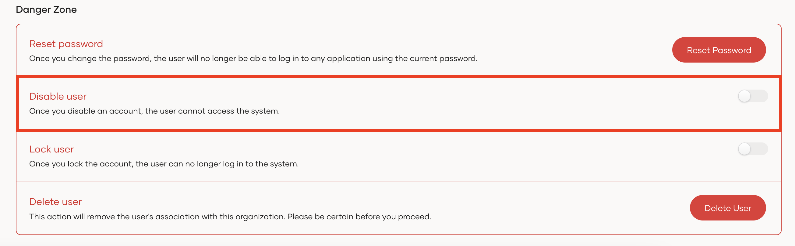

3. Select the checkbox to confirm your action.
4. Click **Confirm**.

When a user account is disabled, the following message will be displayed in the user's profile.

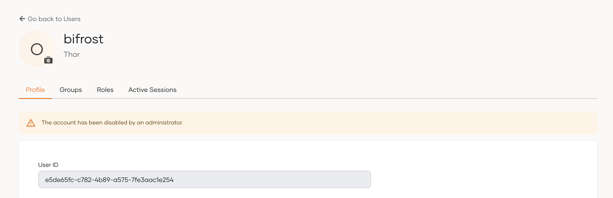

</TabItem>
<TabItem value="tab-1" label="Use the API">


You can use WSO2 Identity Platform's [SCIM API](../../apis/scim2/scim2-users-rest-api.md#tag/Users-Endpoint/operation/patchUser) to disable user accounts. To do so,

1. [Get an access token](../../apis/index.md#oauth-based-authentication) with the `internal_user_mgt_update` scope.

2. Use the obtained access token to execute the following cURL.

    :::note


    Replace `<user_id>` with the ID of the user you want to disable, and `<access_token>` with the access token you obtained in step 1.

    :::

    ```curl
    curl --location --request PATCH 'https://api.asgardeo.io/t/{organization_name}/o/scim2/Users/<user-id>' \
    --header 'Content-Type: application/json' \
    --header 'Authorization: Bearer <access_token>' \
    --data '{
    "schemas": [
        "urn:ietf:params:scim:api:messages:2.0:PatchOp",
        "urn:scim:wso2:schema"
    ],
    "Operations": [
        {
                "op": "replace",
                "value": {
                    "urn:scim:wso2:schema": {
                        "accountDisabled": false
                    }
                }
        }
    ]
    }'
    ```

    After you successfully execute the cURL, the user profile gets disabled.

</TabItem>
</Tabs>

## Delete a user
A user account can be deleted by administrators. Once an account is deleted, the action is irreversible.

To delete a user account:

1. On the WSO2 Identity Platform Console, go to **User Management** > **Users** and select the user.
2. Click **Delete User** at the bottom of the user's profile.

    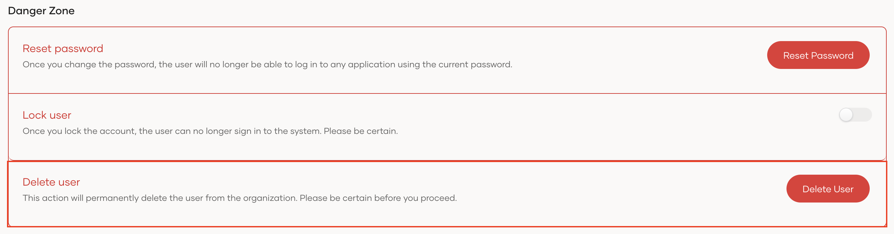

3. Enable the checkbox to confirm your action.
4. Click **Confirm**.

</Applies>


<Applies to="Self-hosted">

# Manage users

This guide walks you through how you can manage user accounts as an administrator.

## Onboard users

WSO2 Identity Server provides multiple ways to onboard users to your organization. You can add users individually or in bulk using a CSV file. You can also allow users to self-register.

To learn more about onboarding users, see [Onboard users](onboard-users.md).

## Filter users

Administrators can filter users based on their account status from the WSO2 Identity Server Console.

To filter users by account status:

1. On the WSO2 Identity Server Console, go to **User Management** > **Users**.
2. Click the **Account Status** dropdown and select the relevant filter criteria:

    - **Locked**: Filters users with locked accounts.
    - **Disabled**: Filters users with deactivated accounts.
    - **Pending password reset**: Filters users for whom the administrator has initiated a forced password reset, but the users haven't yet reset their passwords.
    - **Pending initial password setup**: Filters users an administrator invited to set their own password during initial account creation but who haven't done so yet.
    - **Pending email verification**: Filters users who haven't yet verified their primary email addresses.
    - **Pending mobile verification**: Filters users who haven't yet verified their primary mobile numbers.

        

## Assign groups

Groups are useful when you wish to assign a certain permission level to multiple users. A user can be a member of multiple groups in the organization. Learn how to [manage groups](manage-groups.md).

To assign users to groups:

1. On the WSO2 Identity Server Console, go to **User Management** > **Users**.
2. Click **Edit** for the user.
3. Go to the **Groups** tab and click **+ Assign Group**.
4. Select the relevant groups and click **Save**.

    

## Manage user profiles

A user profile consists of attributes that represent the details of the user such as username, email address, contact information, other custom attributes, etc.

:::note

Administrators can configure the list of attributes that should be available in the user profile. See [Manage attributes](/identity/guides/users/attributes/manage-attributes/) for details.

:::

### View profile details

Administrators can view the user profile of any user as follows:

1. On the WSO2 Identity Server Console, go to **User Management** > **Users**.

    :::note

    If you have connected a remote user store, and want to filter the users in your remote user store, select your user store from the drop-down menu.

    :::

2. Select the user to view the profile.

    

### Update the profile

An administrator can update the profile of a user via the WSO2 Identity Server Console.

To update the user profile:

1. On the WSO2 Identity Server Console, go to **User Management** > **Users**.

2. Find the user's account and click **Edit**.

3. Update the information on the user profile.

4. Click **Update** to save.

## Share user with organizations

An administrator can share a user with an organization (or multiple organizations) via the WSO2 Identity Server Console.

To share a user with organizations:

1. On the WSO2 Identity Server Console, go to **User Management** > **Users**.

2. Find the user's account in the user list and click **Edit**.

3. Navigate to the **Shared Access** tab.

4. Select the appropriate sharing option.

    - **Do not share user with any organization** - user will not be shared with any organizations.

    - **Share user with all organizations** - user is shared with all current and future organizations. When the user is shared, administrators can also configure which roles should be assigned to the user in the shared organizations.

       

    - **Share user with selected organizations** - user is shared with a specific set of existing organizations, but they are not shared with the future children organizations. Administrators can configure which roles should be assigned to the user in the shared organizations.

5. Once selected and configured, click **Save**.

## Resend invitation links and codes

Administrators can resend expired invitation links or verification codes to users. This applies when users need to:

- Complete registration
- Reset passwords through an admin-initiated password reset
- Confirm their account
- Verify their email address

### Use the Console

To resend links or codes through the Console:

1. Navigate to the user's profile in **User Management** > **Users**.

2. Click the **Resend** link in the warning message at the top of the user's profile.

    

    

### Use the API

You can also use the **resend-code API** to resend links or codes programmatically.

:::note


<Tabs>
<TabItem value="tab-0" label="Request format">


```curl
curl -X 'POST' \
'https://localhost:9443/t/{root_organization_handle}/api/identity/user/v1.0/resend-code' \
-H 'accept: application/json' \
-H 'Authorization: Bearer <access_token>' \
-H 'Content-Type: application/json' \
-d '{
    "user": {
        "username": "<username>",
        "realm": "<realm>"
    },
    "properties": [
        {
            "key": "RecoveryScenario",
            "value": "<recovery_scenario>"
        }
    ]
    }'
```

</TabItem>
<TabItem value="tab-1" label="Sample request">


```curl
curl -X 'POST' \
'https://localhost:9443/t/{root_organization_handle}/api/identity/user/v1.0/resend-code' \
-H 'accept: application/json' \
-H 'Authorization: Bearer <access_token>' \
-H 'Content-Type: application/json' \
-d '{
    "user": {
        "username": "jane",
        "realm": "PRIMARY"
    },
    "properties": [
        {
            "key": "RecoveryScenario",
            "value": "ASK_PASSWORD"
        }
    ]
    }'
```

</TabItem>
</Tabs>

:::

#### Recovery scenarios

Specify the **recovery scenario** in the `properties` parameter of the API request:

- **`ASK_PASSWORD`**: User needs to set up their initial password using the setup link.
- **`ASK_PASSWORD_VIA_EMAIL_OTP`**: User needs to complete registration using an email OTP.
- **`ASK_PASSWORD_VIA_SMS_OTP`**: User needs to complete registration using an SMS OTP.
- **`ADMIN_FORCED_PASSWORD_RESET_VIA_EMAIL_LINK`**: User needs to reset password via an admin-forced email link.
- **`ADMIN_FORCED_PASSWORD_RESET_VIA_OTP`**: User needs to reset password via an admin-forced OTP sent through email.
- **`EMAIL_VERIFICATION`**: User needs to verify their email using the setup link.
- **`EMAIL_VERIFICATION_OTP`**: User needs to verify their email using an email OTP.
- **`SELF_SIGN_UP`**: User needs to confirm their account using the email link.

:::note

- Provide the username without the user store domain prefix
- Specify the relevant user store domain name in the `realm` parameter

---
**Response**
```
"HTTP/1.1 201 Created"
```

:::

## Set a user's password

Administrators can set a user's password if the user is unable to set the password via the initial setup email link shared during user creation.

To set the password:

1. Click **Set password** at the bottom of the user's profile.

    

2. Type the new password.

    

3. Click **Set Password**.

    :::note

    Once the administrator set the password, the user's account will get unlocked.

    :::

## Reset the user's password

Administrators can reset a user's password or initiate the password reset process from the WSO2 Identity Server Console.

To reset the password:

1. Click **Reset password** at the bottom of the user's profile.

2. Select a method to reset the user password:

    - **Set a new password for the user:**
        If this option is selected, the owner or an administrator can set a new password for the user.

        :::note

        If the user is in pending admin forced password reset, once the admin resets the password,
        the account will get unlocked.

        :::

    - **Invite user to reset the password:**
        If this option is selected, a password reset request can be sent to the user using one of the password recovery methods you have enabled for the organization.

        :::note

        Enable the relevant password recovery methods by navigating to **Login & Registration** > **Password Recovery**.

        :::

        

3. Click **Reset Password**.

### Using the API

You can also use WSO2 Identity Server's [SCIM API](../../apis/scim2-users-rest-apis.md#tag/Users-Endpoint/operation/patchUser) to initiate the admin initiated password recovery flow.

1. [Get an access token](../../apis/index.md#oauth-based-authentication) with the `internal_user_mgt_update` scope.

2. Use the obtained access token to execute the following cURL.

    ```curl
    curl --location --request PATCH 'https://localhost:9443/scim2/Users/<user_id>' \
    --header 'Content-Type: application/json' \
    --header 'Authorization: Bearer <access_token>' \
    --data '{
       "schemas": [
          "urn:ietf:params:scim:api:messages:2.0:PatchOp",
          "urn:ietf:params:scim:schemas:extension:enterprise:2.0:User"
       ],
       "Operations": [
          {
                "op": "add",
                "value": {
                   "urn:ietf:params:scim:schemas:extension:enterprise:2.0:User": {
                      "forcePasswordReset": true
                   }
                }
          }
       ]
    }'
    ```

Upon successful execution of the cURL the user will receive an email to reset their password.

## Lock a user account

To temporarily prevent a user from logging into applications or the self-service My Account portal, you can lock the user's account.

To lock a user account:

1. On the WSO2 Identity Server Console, go to **User Management** > **Users** and select the user.
2. In the **Danger Zone**, turn the **Lock user** toggle on to lock the user's profile. Turn it off to unlock it.

    

3. Select the checkbox to confirm your action.
4. Click **Confirm**.

:::note

When a user account is locked, the reason for the account lock will be displayed in the user's profile.

:::


## Disable a user account

Disabling a user's account prevents users from logging into applications or to the self-service My Account portal. It is intended to be a long-term and a more permanent measure than locking a user's account. Therefore, if you simply wish to restrict a user's access temporarily, it is recommended to use [account locking](#lock-a-user-account).

To disable a user account you can use either the Console or the SCIM API.

<Tabs>
<TabItem value="tab-0" label="Use the Console">


:::note[Enable account disabling]


Account disabling is not an option available for a users' accounts by default. If you wish to enable this option for your organization, refer to [account disabling](../account-configurations/account-disabling.md).

:::

1. On the WSO2 Identity Server Console, go to **User Management** > **Users** and select the user.
2. In the **Danger Zone**, turn the **Disable user** toggle on to disable the user's profile. Turn it off to enable it.

    

3. Select the checkbox to confirm your action.
4. Click **Confirm**.

When a user account is disabled, the following message will be displayed in the user's profile.


</TabItem>
<TabItem value="tab-1" label="Use the API">


You can use WSO2 Identity Server's [SCIM API](../../apis/scim2-users-rest-apis.md#tag/Users-Endpoint/operation/patchUser) to disable user accounts. To do so,

1. [Get an access token](../../apis/index.md#oauth-based-authentication) with the `internal_user_mgt_update` scope.

2. Use the obtained access token to execute the following cURL.

    :::note


    Replace `<user_id>` with the ID of the user you want to disable, and `<access_token>` with the access token you obtained in step 1.

    :::

    ```curl
    curl --location --request PATCH 'https://localhost:9443/scim2/Users/<user_id>' \
    --header 'Content-Type: application/json' \
    --header 'Authorization: Bearer <access_token>' \
    --data '{
    "schemas": [
        "urn:ietf:params:scim:api:messages:2.0:PatchOp",
        "urn:scim:wso2:schema"
    ],
    "Operations": [
        {
                "op": "replace",
                "value": {
                    "urn:scim:wso2:schema": {
                        "accountDisabled": false
                    }
                }
        }
    ]
    }'
    ```

    After you successfully execute the cURL, the user profile gets disabled.

</TabItem>
</Tabs>

## Delete a user

A user account can be deleted by administrators. Once an account is deleted, the action is irreversible.

To delete a user account:

1. On the WSO2 Identity Server Console, go to **User Management** > **Users** and select the user.
2. Click **Delete User** at the bottom of the user's profile.

    

3. Select the checkbox to confirm your action.
4. Click **Confirm**.

</Applies>
