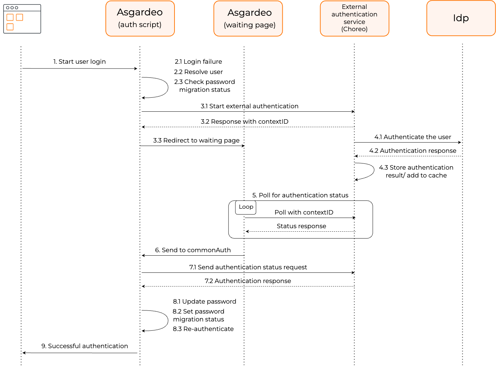
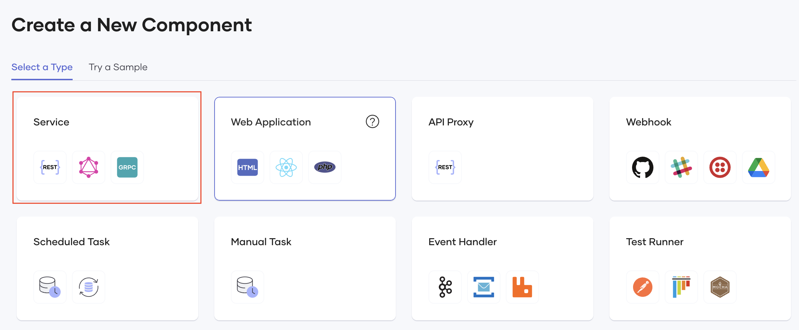
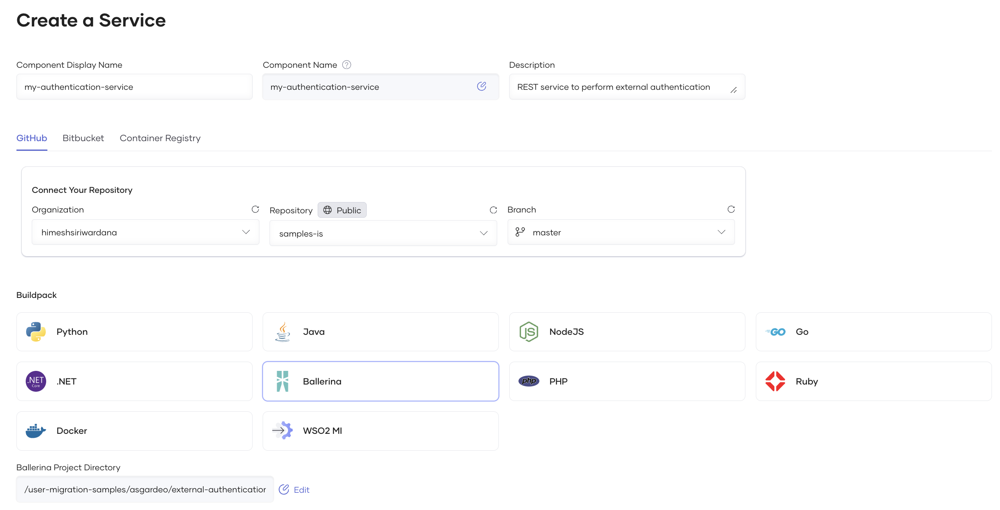
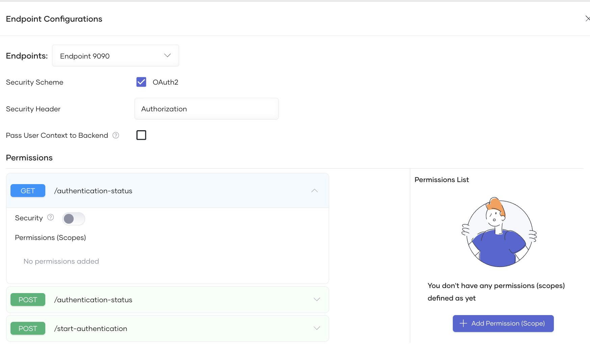
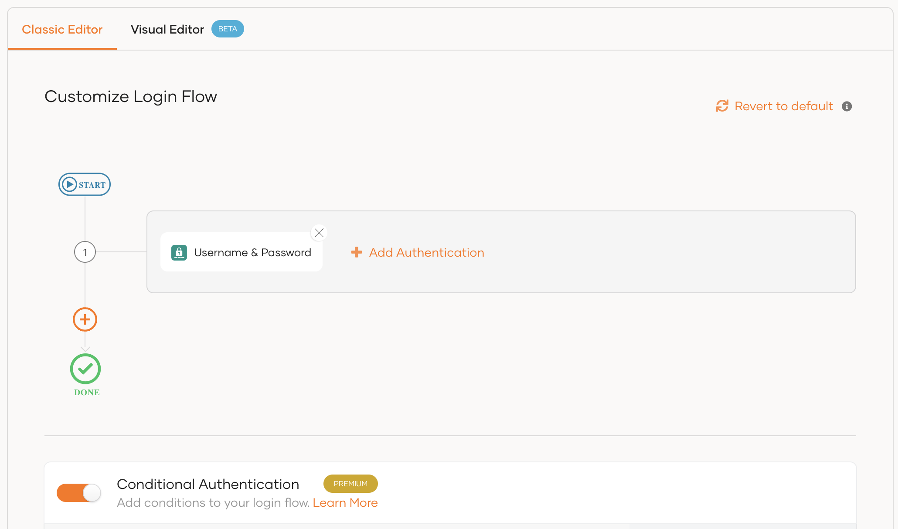
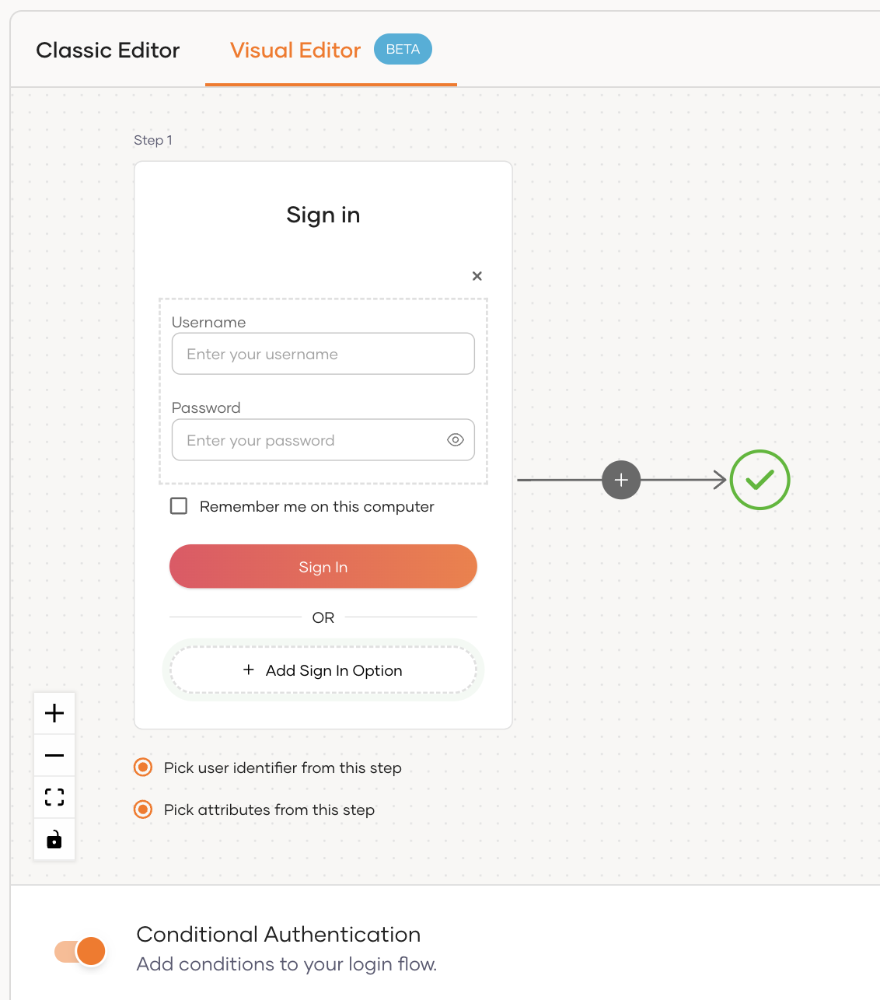
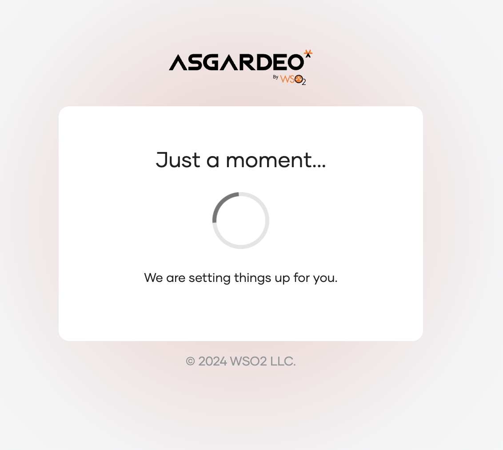

# Migrate passwords to WSO2 Identity Platform

You may use one of the following two ways to migrate user passwords to WSO2 Identity Platform.

## Migrate with password reset

This method involves the least administrative effort but causes the most friction for users. With a password reset, users will receive an email prompting them to set a password for their new WSO2 Identity Platform accounts. Until they set a password, their user accounts will remain locked to prevent unauthorized access. Additionally, this method allows you to immediately terminate operations on your previous IdP once the user accounts are successfully migrated to WSO2 Identity Platform.

<Applies to="WSO2 Cloud">

If you wish to migrate user passwords using this method, inform the WSO2 Identity Platform team along with your request to [migrate users](migrate-users.mdx).

</Applies>

## Migrate with on-demand silent migration

Compared to the password reset method above, on-demand silent password migration involves more effort to set up but provides the user with a seamless password migration experience. The following are the high level steps involved with this method.

1. The user attempts to log in to the application.

2. The application redirects the user to the WSO2 Identity Platform login screen.

3. The user enters the usual credentials for the legacy IdP.

4. If user's password is already migrated, the user is logged in. If not, WSO2 Identity Platform makes an authentication request to the legacy IdP with the user provided credentials.

5. WSO2 Identity Platform redirects the user to a waiting page until the legacy IdP completes the authentication.

6. Once the process is complete, the user is redirected back to the application and WSO2 Identity Platform silently migrates the password for the user.

7. The user is successfully logged in and may now continue using the usual credentials to log in to the application with WSO2 Identity Platform.

:::note

If you wish to migrate users with this method, it is crucial to note the following:

 - The legacy IdP should run for a set period to facilitate user migration.
 - Have a contingency plan to migrate any accounts that were not migrated while the legacy IdP is active.
 - Users who were not migrated must contact the administrators to initiate a password reset process, facilitating a smooth and complete transition.

:::

The following guides go into detail on implementing on-demand silent password migration.

### How it works

The following diagram provides a general idea on the components involved with the on-demand silent password migration.

Let's look at the diagram in detail:

1. The user starts the authentication by entering the credentials used for the legacy IdP.
2. If WSO2 Identity Platform has not already migrated the user account,

    - User's login fails.
    - WSO2 Identity Platform attempts to find a user corresponding to the provided login identifier.
    - If found, WSO2 Identity Platform then checks for the user's migration status value which is stored in a user attribute.

3. If user's migration status is not set to true,
    
    - WSO2 Identity Platform starts authentication with the legacy IdP by invoking the **start authentication API**.
    - This API responds with a unique ID for the process called the `contextID`.
    - The user is redirected to a waiting page until external authentication completes.

<Applies to="WSO2 Cloud">

    :::note

    This API is part of an authentication service deployed in [WSO2 Developer Platform](https://wso2.com/engineering-platform/developer-platform/), WSO2's integration platform. The service is designed to facilitate authentication against the legacy IdP.

    :::

</Applies>

<Applies to="Self-hosted">

    :::note

    This API is part of an authentication service that should be deployed in an external system such as [WSO2 Developer Platform](https://wso2.com/engineering-platform/developer-platform/), WSO2's integration platform. The service is designed to facilitate authentication against the legacy IdP.

    :::

</Applies>

4. The authentication service will then interact with the legacy IdP and attempt to authenticate the user. A result will be returned once authentication is complete.
5. In the meantime, **the polling API**, another API of the authentication service, keeps polling to check if the authentication process is complete. This API uses the `contextID` returned in 3 to track the specific process.
6. Once 4 completes, the polling API in 5 stops and the user is redirected back to the login page.
7. WSO2 Identity Platform then calls the **authentication status endpoint**, the third API of the authentication service, to retrieve the authentication result.
8. If the result is a success, this means the user was successfully authenticated against the external IdP. Hence, WSO2 Identity Platform will

    - migrate the user's password to WSO2 Identity Platform.
    - set the migration status attribute of the user to true.
    - authenticate the user to the application.

9. The user is seamlessly logged into the application without being prompted to enter the credentials again.

<Prerequisites>

### Prerequisites

Before you begin, ensure the following are fulfilled.

- [Migrate user accounts to WSO2 Identity Platform](migrate-users.mdx).
- Ensure your legacy IdP provides means to perform basic user authentication (i.e. username and password authentication). For example, a SCIM2/Me REST API endpoint that could be authenticated with username and password.

<Applies to="WSO2 Cloud">

- You need to have a GitHub repository to host the authentication service.
- Download [Ballerina](https://ballerina.io/downloads/), the programming language used to define the external authentication service.

</Applies>

<Applies to="WSO2 Cloud">

<Steps>

### Develop the authentication service {/* #step-1-develop-the-authentication-service */}

In this section, we will develop an authentication service that will communicate with the legacy IdP to authenticate users.

:::note

You may find a sample Ballerina authentication service [here](https://github.com/wso2/samples-is/tree/master/user-migration-samples/asgardeo/external-authentication-service).

:::

1. Create a new Ballerina package. Learn how to do so in the [Ballerina documentation](https://ballerina.io/learn/get-started/).

2. Write a [RESTful service](https://ballerina.io/learn/write-a-restful-api-with-ballerina/) that communicates with the legacy authentication system to perform user authentication. Your service should expose the following REST API endpoints.

    :::tip

    External authentication may require additional processing time depending on the legacy IdP and network delays. Therefore it is recommended to perform the external authentication asynchronously without holding an active connection until the external authentication completes.

    :::

    - **Start authentication endpoint** - to initiate the authentication process with the legacy system. This endpoint should accept the request, return a response with a unique random identifier (preferably a UUID) and then start the external authentication process.

    - **Authentication status endpoint** - to retrieve and return the completed authentication result.

    - **Polling endpoint** - to return the completion status of the external authentication task. This should be an open endpoint that doesn’t require any authentication.

    :::warning[Adding logs]

    We highly recommend adding sufficient logging when developing the REST service. However, ensure no sensitive information or Personally Identifiable Information (PII) are included in the logs.

    :::

3. Commit your changes and push the code to your remote GitHub repository.

### Create and deploy the RESTful service in WSO2 Developer Platform {/* #step-2-create-and-deploy-the-restful-service-in-wso2-developer-platform */}

We will now deploy the developed authentication service in [WSO2 Developer Platform](https://console.choreo.dev/), WSO2's integration platform. To do so,

1. Go to the [WSO2 Developer Platform Console](https://console.choreo.dev/login) and login with the SAME email address you used to create your WSO2 Identity Platform organization.

    :::note

    An organization with the same name as your WSO2 Identity Platform organization will be created for you in WSO2 Developer Platform.

    :::

2. On the top of the Console, create a new project or select an existing one.

3. On the left panel, select **Components** and click **Create**.

4. On the **Select a type** tab, select **Service**.

    

    :::note

    Learn more about service components in the [WSO2 Developer Platform documentation](https://wso2.com/engineering-platform/developer-platform/docs/develop-components/develop-services/service-component-overview/)

    :::

5. Enter a name and description for your service.

6. Click **Authorize with GitHub** and connect the relevant organization, repository and the branch for the developed authentication service in step 1.

7. Select **Ballerina** to be the buildpack and select the Ballerina project directory from your GitHub repository.

    

8. Click **Create**.

9. Build and deploy the service. See [WSO2 Developer Platform documentation](https://wso2.com/engineering-platform/developer-platform/docs/develop-components/develop-services/develop-a-service/#step-2-build-and-deploy) for instructions.

    :::note

    If you are using the sample authentication service, be sure to provide values for the necessary configurations before you deploy the service.

    :::

10. As discussed earlier, the polling endpoint should be an open endpoint. Follow the steps below to configure this.

    1. Go to **Deployment** and in the **Set up** card, click **Endpoint Configurations**.

    2. In the window that appears, under **Permissions**, expand the polling endpoint and turn the **Security** toggle off. 

        

    3. Click **Apply** to save the changes.

11. On the left navigation, go to **Manage** > **Lifecycle** and click **Publish**.

### Create a WSO2 Developer Platform application to consume the APIs {/* #step-3-create-a-wso2-developer-platform-application-to-consume-the-apis */}

After the RESTful service is deployed, follow the steps below to create an application in WSO2 Developer Platform and subscribe it to the REST API. This application will later be used to integrate the REST APIs with the WSO2 Identity Platform application.

1. Sign in to the [WSO2 Developer Platform Developer Portal](https://devportal.choreo.dev/login) with the same email address you used to log in to the WSO2 Developer Platform Console in step 2.

2. On the top navigation, go to **Applications** and click **Create Application**.

3. Provide a name and a description for the application and click **Create**.

4. On the left navigation, go to **Credentials** and click **Generate Credentials**.

5. Take note of the generated consumer key and consumer secret as you will need it later.

6. On the left navigation, go to **Subscriptions** and click **Add APIs**.

7. Click **Add** corresponding to the API that you created in step 2.

:::note

To learn more about applications in WSO2 Developer Platform, refer to the [WSO2 Developer Platform documentation](https://wso2.com/engineering-platform/developer-platform/docs/consuming-services/manage-application/#create-an-application).

:::

</Steps>

</Applies>

<Applies to="Self-hosted">

### Step 1: Develop and deploy the external authentication service

On-demand silent password migration requires an external authentication service that communicates with the legacy IdP to authenticate users. This service can be developed using any programming language and can be deployed in an external system such as [WSO2 Developer Platform](https://wso2.com/engineering-platform/developer-platform/), WSO2's integration platform.

Your service should expose the following REST API endpoints.

:::tip

External authentication may require additional processing time depending on the legacy IdP and network delays. Therefore it is recommended to perform the external authentication asynchronously without holding an active connection until the external authentication completes.

:::

- **Start authentication endpoint** - to initiate the authentication process with the legacy system. This endpoint should accept the request, return a response with a unique random identifier (preferably a UUID) and then start the external authentication process.

- **Authentication status endpoint** - to retrieve and return the completed authentication result.

- **Polling endpoint** - to return the completion status of the external authentication task. This should be an open endpoint that doesn’t require any authentication.

:::warning[Adding logs]

We highly recommend adding sufficient logging when developing the external authentication service. However, ensure no sensitive information or Personally Identifiable Information (PII) are included in the logs.

:::

:::note

Learn how to [configure the external authentication service in WSO2 Developer Platform](../../../references/tutorials/configure-choreo-for-password-migration.mdx).

:::

</Applies>

<Applies to="WSO2 Cloud">

### Step 4: Configure an attribute in WSO2 Identity Platform to hold the migration status

</Applies>

<Applies to="Self-hosted">

### Step 2: Configure an attribute in WSO2 Identity Server to hold the migration status

</Applies>

WSO2 Identity Platform should have means to check whether a user's password is migrated or not. This can be achieved by creating a user attribute in WSO2 Identity Platform to hold the migration status. To do so,

1. On the WSO2 Identity Platform Console, go to **User Attributes & Stores** > **Attributes** and click on **Attributes**.

2. Click **New Attribute** and enter the following details: 

    <table>
        <tr>
            <td><b>Attribute name</b></td>
            <td>is_migrated</td>
        </tr>
        <tr>
            <td><b>Attribute Display Name</b></td>
            <td>Password migration status</td>
        </tr>
    </table>

3. Click **Finish** to create the attribute.

<Applies to="WSO2 Cloud">

### Step 5: Configure the login flow of the WSO2 Identity Platform application

</Applies>

<Applies to="Self-hosted">

### Step 3: Configure the login flow of the WSO2 Identity Server application

</Applies>

You are now ready to configure your application for on-demand silent password migration. To do so,

1. On the WSO2 Identity Platform Console, click **Applications**.

2. Select the application and go to its **Login Flow** tab.

<Applies to="WSO2 Cloud">

3. Configure the login flow using your preferred editor:

    <Tabs>
    <TabItem value="tab-0" label="Classic Editor">

    To configure the login flow using the classic editor:

    1. Click **Start with default configuration** or add the **Username & Password** authenticator to the first step of the flow.

    2. Turn on Conditional Authentication by switching on the toggle.

        

    3. Replace any existing code with this [conditional authentication script](../../authentication/conditional-auth/on-demand-silent-password-migration-template.mdx).

    </TabItem>
    <TabItem value="tab-1" label="Visual Editor">

    To configure the login flow using the visual editor:

    1. Switch to the Visual Editor tab.

    2. If **Username & Password** authentication is not set, go to **Predefined flows** > **Basic Login Flows** > **Add Basic Login** and select it to add to the login flow.

    3. Turn on Conditional Authentication by switching on the toggle.

         

    4. Replace any existing code with this [conditional authentication script](../../authentication/conditional-auth/on-demand-silent-password-migration-template.mdx).

    </TabItem>
    </Tabs>

</Applies>

<Applies to="Self-hosted">

    1. Go to **Predefined Flows** > **Basic Login Flows** and select **Username & Password** under **Add Basic Login**.

    2. Turn on Conditional Authentication by switching on the toggle.

        

    4. Replace any existing code with this [conditional authentication script](../../authentication/conditional-auth/on-demand-silent-password-migration-template.mdx).

</Applies>

4. Click **Update** to save the changes.

</Prerequisites>

### Try it out

Follow the steps below to try out on-demand silent password migration for a migrated user account.

1. Access the application URL.

2. Log in to WSO2 Identity Platform with the user credentials used for the legacy IdP.

3. If the user's password is not yet migrated, you'll be redirected to a waiting page as follows.

    

4. WSO2 Identity Platform will migrate the password and log the user in once the external authentication is successful.
