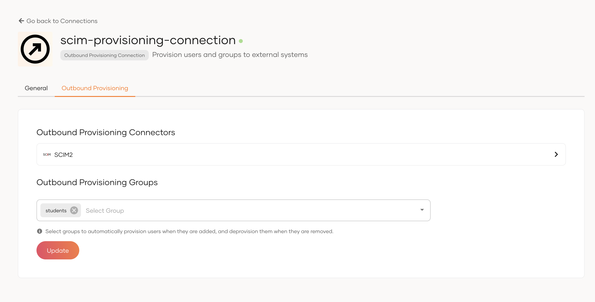

# Configure group-based outbound provisioning

Group-based provisioning allows you to automatically provision users to external systems when they are added to a group and automatically deprovision when they are removed from a group. This guide explains how to configure group-based provisioning in WSO2 Identity Platform.

## Prerequisites

Before you begin, ensure you have [set up outbound provisioning](setup-outbound-provisioning.md) at the organization or application level.

## Enable group-based provisioning

1. On the WSO2 Identity Platform Console, go to **Connections**.
2. Select the connection in which you configured the outbound connector and navigate to its **Outbound Provisioning** tab.
3. Select the required groups from the dropdown. 

    

4. Click **Update** to save the changes.

## Try it out

1. On the WSO2 Identity Platform Console, [create a user](../manage-users.md#onboard-single-user).
2. [Assign the created user to a group](../manage-groups.md#assign-users-to-a-group) that you specified for outbound provisioning. The user will be provisioned to the external system automatically.
3. Remove the user from the group. The user will be deprovisioned from the external system automatically.
