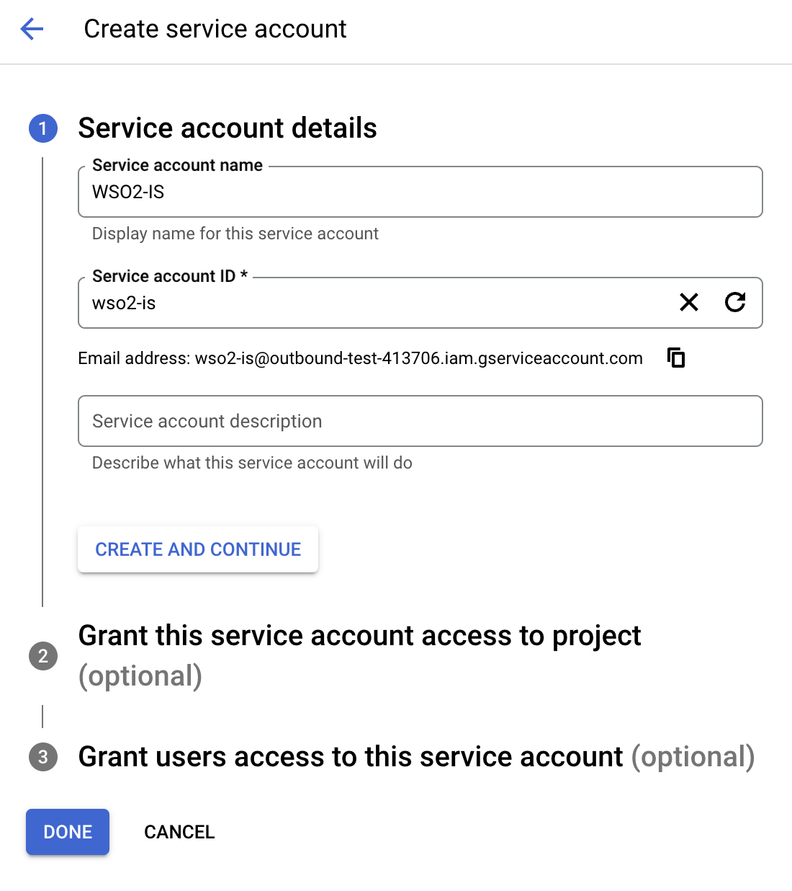
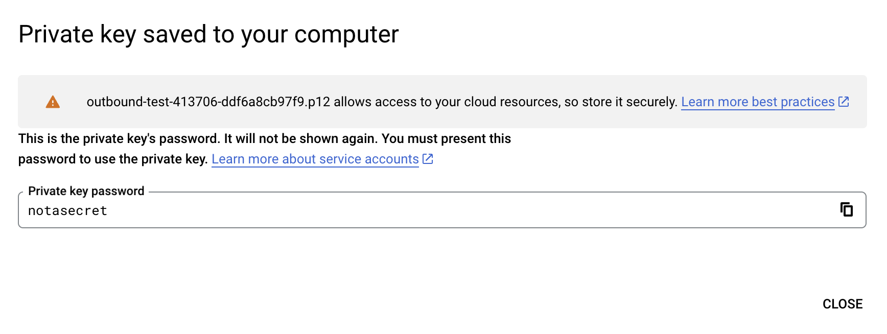

# Configure outbound provisioning with Google

This guide explains how you can configure Google for outbound provisioning in WSO2 Identity Server.

## Configure Google Workspace for provisioning

Follow the steps below to learn how you can configure Google Workspace for provisioning.

<Prerequisites title="Before you begin">

Learn how to subscribe to Google Workspace in the [Google documentation](https://support.google.com/domains/answer/6069226?hl=en).

</Prerequisites>

1. Create a service account in Google.

    1. Open the [Google developers console](https://console.developers.google.com/cloud-resource-manager) and create a new project.

    2. Search for the project you created and click it.

    3. Under **IAM & Admin**, click **Service Accounts**.

    4. Click **CREATE SERVICE ACCOUNT** on the top panel.  

    5. Fill in the form to create the service account:

        

        - Optionally, assign a role from the list of roles given and click **Done** to create the service account.

    6. Select your service account and go to its **KEYS** tab.

    7. From the dropdown, select **ADD KEY** > **Create new key** > **P12** and click **CREATE**. The following message will be displayed.

        :::note

        The service account's `P12` file will be downloaded to your machine. Remember the location and the name of this downloaded file as it is required later on in this guide.

        :::

        

    8. From **IAM & Admin** > **Service accounts**, take note of the client ID of your service account.

2. Delegate domain-wide authority to the service account:

    1. Select your service account and in the **DETAILS** tab, expand **Advanced settings**. Enable domain-wide delegation for the service account.

        :::note

        Learn how to enable domain-wide delegation in the [Google documentation](https://developers.google.com/identity/protocols/oauth2/service-account#delegatingauthority).

        :::

    2. Go to your domain's [admin console](https://admin.google.com).

    3. Navigate to **Security** > **Access and data control** > **API Controls** > **Domain-wide Delegation**.

    4. Do the following:
        1. Click **Add new** and paste the client ID of the service account.

        2. Enter the following as the value for scopes.
            `https://www.googleapis.com/auth/admin.directory.user,https://www.googleapis.com/auth/admin.directory.orgunit,https://www.googleapis.com/auth/admin.directory.group`

        3. Click **Authorize**.

3. Enable the Admin SDK.

    1. Open the [Google developers console](https://console.developers.google.com/cloud-resource-manager).

    2. Click the menu icon, and click **APIs & Services** > **Dashboards**.

    3. Click **Enable APIs & Services**.

    4. Search for Admin SDK and click **Enable**.

## Configure the Google outbound connector

[Set up outbound provisioning](../setup-outbound-provisioning.mdx) and enter the following details to configure the Google outbound connector.

<table>
    <tr>
        <td>Google Domain</td>
        <td>The name of the Google domain to which users will be provisioned. 
            e.g.<code> mygoogledomain.com</code></td>
    </tr>
    <tr>
        <td>Primary Email Claim</td>
        <td>Claim URI that will be used to retrieve the primary email address of the created account. This must be an attribute that is available locally in WSO2 Identity Server. 
            e.g. <code>http://wso2.org/claims/emailaddress</code></td>
    </tr>
    <tr>
        <td>Given Name Claim</td>
        <td>Claim URI which will be used to retrieve the given name attribute of the user. This must be an attribute that is available locally in WSO2 Identity Server. 
            e.g. <code>http://wso2.org/claims/givenname</code></td>
    </tr>
    <tr>
        <td>Family Name Claim</td>
        <td>Claim URI which will be used to retrieve the family name attribute of the user. This must be an attribute that is available locally in WSO2 Identity Server. 
            e.g. <code>http://wso2.org/claims/lastname</code></td>
    </tr>
    <tr>
        <td>Service Account Email</td>
        <td>Email used for authentication. 
        e.g. <code>d343s86gf@developer.gserviceaccount.com</code></td>
    </tr>
    <tr>
        <td>Private Key</td>
        <td>Browse and attach the private key from your local machine. This is the PKCS12 private key generated during service account creation.</td>
    </tr>
    <tr>
        <td>Administrator's Email</td>
        <td>Email of the administrator who owns the service account in the specified Google Domain.</td>
    </tr>
    <tr>
        <td>Application Name</td>
        <td>A name for your application to identify requests made by the Google client.</td>
    </tr>
    <tr>
        <td>Google Outbound Provisioning Pattern</td>
        <td>WSO2 Identity Server uses this pattern to build the user ID of the provisioned user account. Learn more about <a href="/identity/guides/users/outbound-provisioning/provisioning-patterns">provisioning patterns</a>. 
        e.g. <code>\{UD,UN,TD,IDP\}</code></td>
    </tr>
    <tr>
        <td>Google Provisioning Separator </td>
        <td>Used to separate provisioning pattern attributes of the user ID. Learn more about <a href="/identity/guides/users/outbound-provisioning/provisioning-patterns">provisioning patterns</a>. 
        e.g. <code>-</code>(hyphen).</td>
    </tr>
</table>
