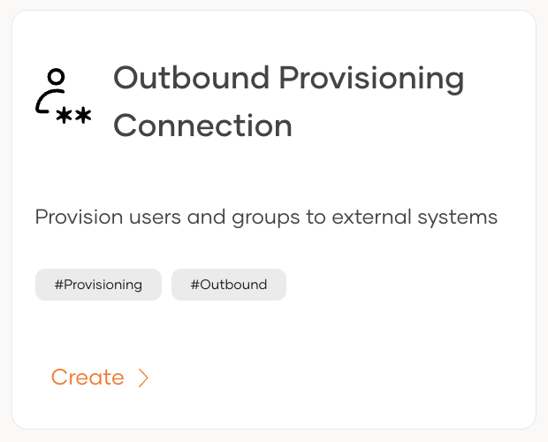
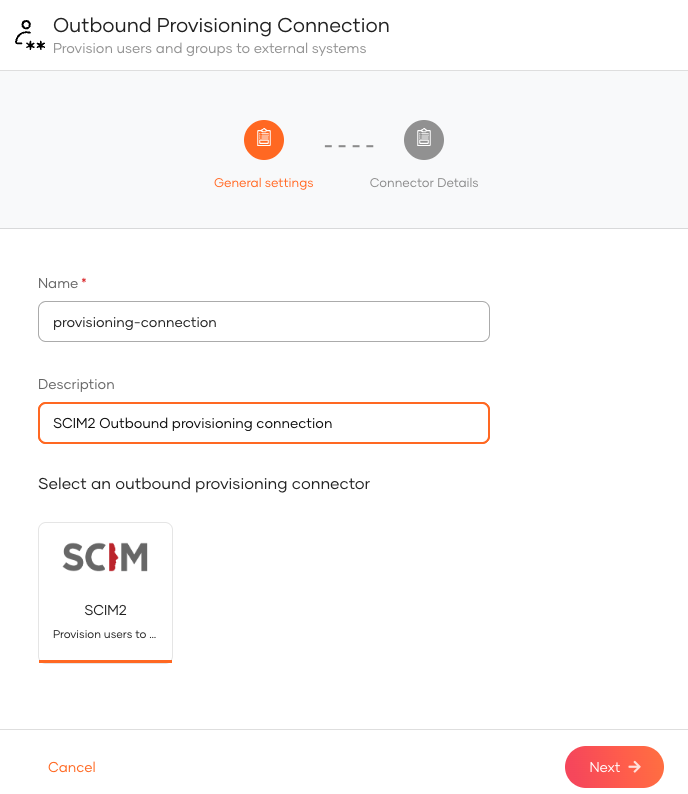
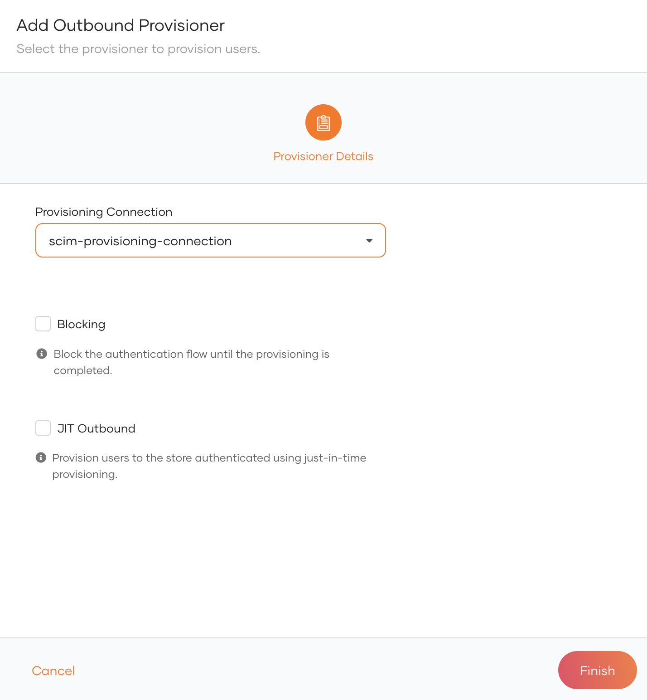
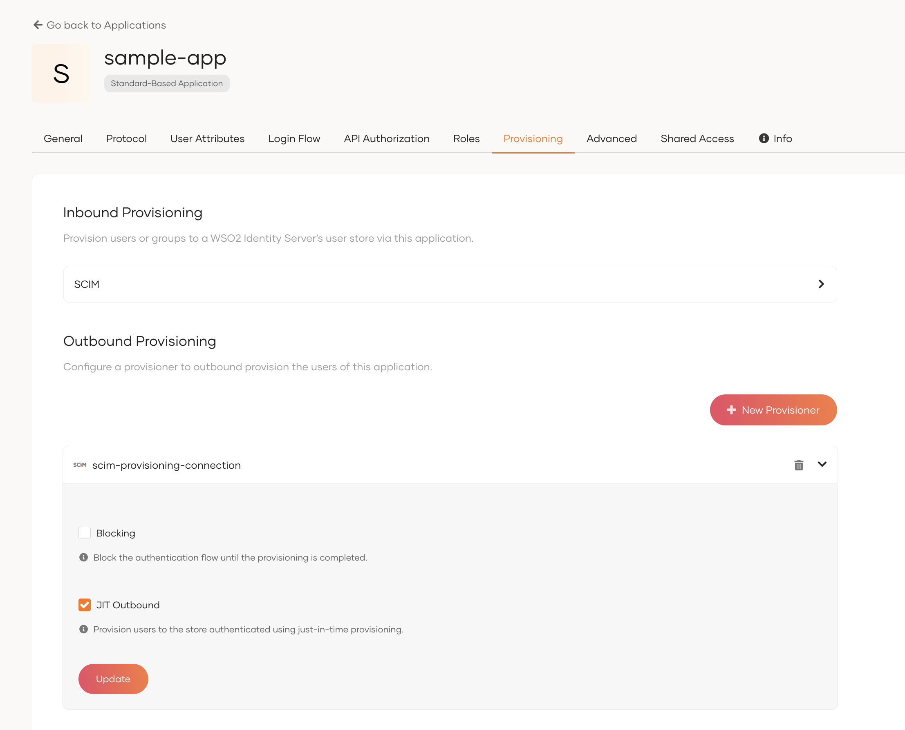

# Set up outbound provisioning

To start provisioning users, you must first create a provisioning connection and configure an outbound connector, then enable it at the organization or application level.

## Step 1: Create a provisioning connection

1. On the WSO2 Identity Platform Console, go to **Connections** and click **New Connection**.

2. Click **Create Connection** and select **Outbound Provisioning Connection**.

    

3. Select a provisioning connector (e.g., 

<Applies to="WSO2 Cloud">

SCIM2

</Applies>

<Applies to="Self-hosted">

Salesforce, Google, or SCIM2

</Applies>

).

    

4. Provide the required properties for the selected connector and click **Finish**.

    :::note

    Learn about the required properties for each connector:
    <ul>

    <Applies to="Self-hosted">

    <li><a href="/identity/guides/users/outbound-provisioning/outbound-connectors/google">Google</a></li>
            <li><a href="/identity/guides/users/outbound-provisioning/outbound-connectors/salesforce">Salesforce</a></li>

    </Applies>

    <li><a href="/identity/guides/users/outbound-provisioning/outbound-connectors/scim2">SCIM2</a></li>
    </ul>

    :::

## Step 2: Enable outbound provisioning

Once the connection is created, enable outbound provisioning at the required level. Organization-level provisioning acts as the default for all applications, while application-level provisioning applies only to a specific application and overrides the organization-level configuration for that application.

<Tabs>
<TabItem value="tab-0" label="Organization-level">

Organization-level outbound provisioning acts as the default provisioner for all applications. Users are automatically provisioned to the external system when:

- a user is provisioned in WSO2 Identity Platform over an API.
- an administrator onboards a user from the WSO2 Identity Platform Console.
- a user self-signs up from a WSO2 Identity Platform sign-in page.
- a user is JIT (Just-In-Time) provisioned in WSO2 Identity Platform.

To enable organization-level outbound provisioning in WSO2 Identity Platform:

1. On the WSO2 Identity Platform Console, go to **Login & Registration**.

2. Under **Provisioning Settings**, click **Outbound Provisioning Configuration** and click **New Provisioner**.

3. Select the connection in which you have configured outbound provisioning as the **Connection** and the relevant outbound connector as the **Provisioning Connector**.

    

4. Enable any of the following.

    

    <Applies to="WSO2 Cloud">

    | Option | Description |
    |---|---|
    | **JIT Outbound** | Enables outbound provisioning for JIT provisioned users during authentication. |

    </Applies>

    

    <Applies to="Self-hosted">

    | Option | Description |
    |---|---|
    | **Blocking** | Makes the user onboarding process synchronous with the outbound provisioning process. WSO2 Identity Server waits for the response from the external system before proceeding with the user creation. |
    | **JIT Outbound** | Enables outbound provisioning for JIT provisioned users during authentication. |

    </Applies>

    

5. Click **Finish**.

### Try it out

1. On the WSO2 Identity Platform Console, do one of the following.
    <ul>
    <li>Use a <a href="/identity/apis/organization-apis/org-user-mgt/#tag/Users-Endpoint/operation/createUser">SCIM API</a> to create a user.</li>
    <li><a href="/identity/guides/users/manage-users/#onboard-single-user">Create a user from the Console</a></li>
    <li><a href="/identity/guides/account-configurations/user-onboarding/self-registration/">Enable self-registration</a> and let a user self-register to WSO2 Identity Platform.</li>
    <li><a href="/identity/guides/authentication/jit-user-provisioning/">Enable JIT-provisioning</a> and let a user sign in with an external identity provider.</li>
    </ul>

    :::note

    Onboarding a user with any of the above methods automatically triggers outbound provisioning to the external system.

    :::

2. [Delete the user](../manage-users.md#delete-a-user). The user will be removed from the external system.

</TabItem>
<TabItem value="tab-1" label="Application-level">

Application-level outbound provisioning is specific to an individual application. If an application does not have its own outbound provisioner configured, it defaults to the organization-level configuration.

To configure an application in WSO2 Identity Platform:

1. On the WSO2 Identity Platform Console, go to **Applications**.

2. Select your application from the list and navigate to its **Provisioning** tab.

3. Under **Outbound Provisioning Configuration**, click **New Provisioner**.

    

4. Select the connection in which you have configured outbound provisioning as the **Connection** and the relevant outbound connector as the **Provisioning Connector**.

5. Optionally, enable any of the following options.

    

    <Applies to="WSO2 Cloud">

    | Option | Description |
    |---|---|
    | **JIT Outbound** | Enables outbound provisioning for JIT-provisioned users during authentication. |

    </Applies>

    

    <Applies to="Self-hosted">

    | Option | Description |
    |---|---|
    | **Blocking** | Makes the user onboarding process synchronous with the outbound provisioning process. WSO2 Identity Server waits for the response from the outbound connector before proceeding with the user creation. |
    | **JIT Outbound** | Enables outbound provisioning for JIT-provisioned users during authentication. |

    </Applies>

    

6. Click **Add**.

### Try it out

Application-level outbound provisioning is triggered when a user is provisioned through the application. This can happen in the following ways:

- **JIT provisioning**: Configure [JIT user provisioning](../../authentication/jit-user-provisioning.md) for the application. When a user signs in through a federated identity provider, the user is JIT provisioned in WSO2 Identity Platform, which triggers outbound provisioning to the external system.

- **User creation via API**: Use a [SCIM API](../../../apis/organization-apis/org-user-mgt.md#tag/Users-Endpoint/operation/createUser) with an access token obtained for the application to create a user. This triggers outbound provisioning to the external system.

</TabItem>
</Tabs>
