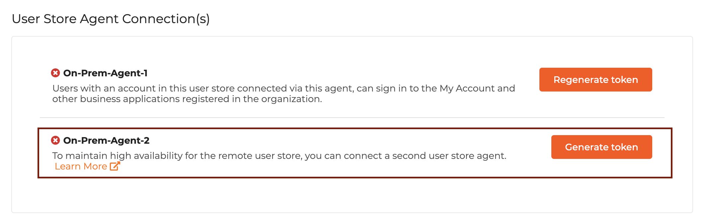

# Configure high availability

Remote user stores must be highly available to ensure continuous access to critical user information. To maintain high availability, we highly recommend you to follow this guide and connect a second user store agent.

<Prerequisites>

## Prerequisites

[Configure and connect a remote user store](configure-a-user-store.mdx) in WSO2 Identity Platform.

</Prerequisites>

## Connect a second user store agent

To connect a second user store agent:

1. On the WSO2 Identity Platform Console, go to **User Attributes & Stores** > **User Stores**.
2. Select your user store from the **User stores** list.
3. In the **General** tab, a second user store agent is listed under **User Store Agent Connection(s)**.
4. Click **Generate token** on the second user store agent.

    

    :::note

    An installation token can only be used to connect to one user store agent. You cannot use the same installation token to run a second agent.

    :::

5. Run a second user store agent by navigating to its root directory. Use one of the commands below.

    <Tabs>
    <TabItem value="tab-0" label="Optimized Agent">


    Run the command corresponding to your operating system. Make sure to configure the installation token similarly to the primary agent.

    <Tabs>
    <TabItem value="tab-0" label="Linux/Unix">


    ```bash
    ./remoteagent
    ```

    </TabItem>
    <TabItem value="tab-1" label="Windows">


    ```bash
    remoteagent
    ```

    </TabItem>
    </Tabs>

    </TabItem>
    </Tabs>
        
        

    <Tabs>
    <TabItem value="tab-0" label="Classic Agent">


    Run the command corresponding to your operating system. When prompted, enter the second installation token generated in the previous step.

    <Tabs>
    <TabItem value="tab-0" label="Linux/Unix">


    ```bash
    sh wso2agent.sh
    ```

    </TabItem>
    <TabItem value="tab-1" label="Windows">


    ```bash
    wso2agent.bat
    ```

    </TabItem>
    </Tabs>

    </TabItem>
    </Tabs>
