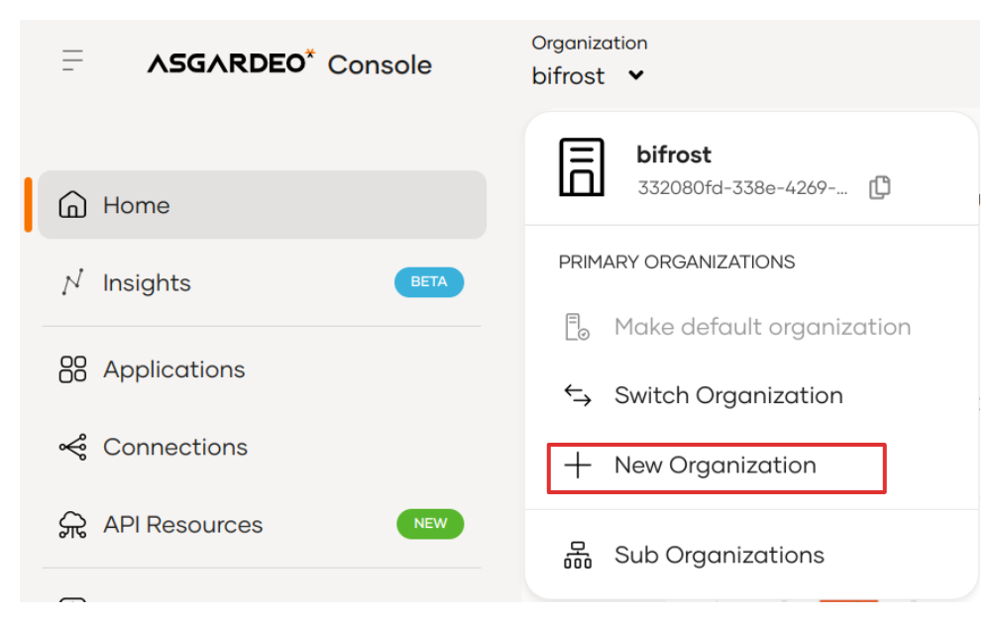
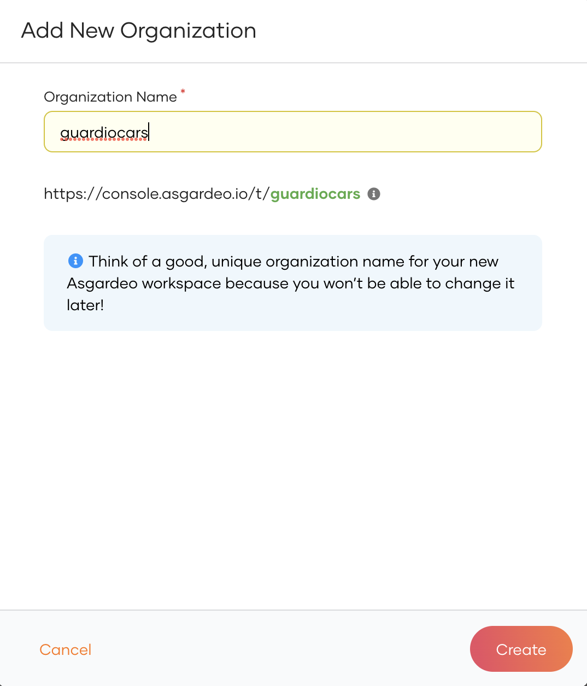
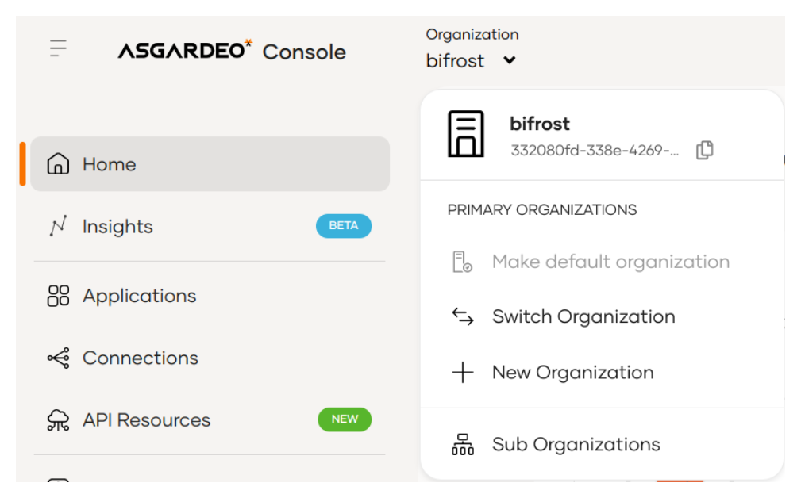
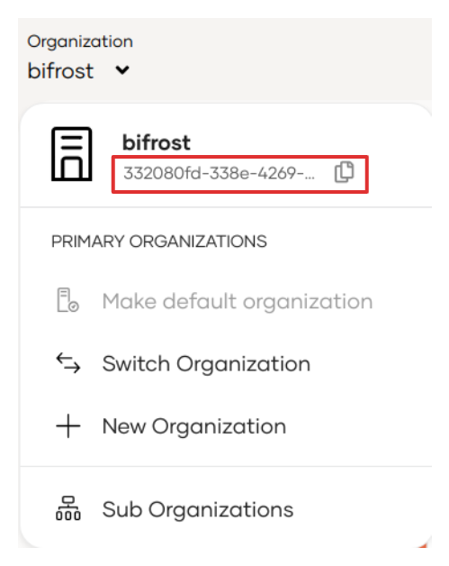

# Manage root organizations

The root organizations you create in WSO2 Identity Platform can be structured according to your business needs as follows:

**B2C organizations**

In a B2C scenario,

- you will create an organization (root) to represent your business.

- the organization (root) manages the identity and access management requirements of your B2C applications and the user identities of your direct consumers.

- You may create separate root organizations to replicate the environments of the application development lifecycle.

**B2B organizations**

In a B2B scenario,

- you will create an organization (root) to represent your business, which functions as your primary organization.

- you will create subordinate organizations to onboard other business organizations (partners, suppliers, customer organizations, etc.) to your platform.

- administrators of each subordinate organization manage the respective organization's user base and define login experiences for applications according to the organization's requirements.

If you have a B2C (Business-to-Consumer) platform offering services to direct consumers, you can use an WSO2 Identity Platform organization (root) to manage the identities and access requirements of your users. Note that your first organization on WSO2 Identity Platform is created when you [sign up to WSO2 Identity Platform](../../get-started/create-identity-platform-account.md).

:::note

If you have a B2B platform, this will also be the organization (root) of your platform. Your root organization will work with other businesses to make your applications available to their users. Such businesses should be defined as [organizations](../organization-management/manage-organizations.md) in your organization (root).

:::

The following guides explain how you can create and manage these root organizations in WSO2 Identity Platform.

## Create a new organization (root)

To create a new organization (root) in WSO2 Identity Platform:

1. Select the organization list and click **New Organization**.

    

2. Enter a name for your organization (root) and click **Create**.
    

The new organization (root) is now available in the root organization list.

:::note

If you a have B2B platform, you can now onboard your organizations. See the instructions on [setting up organizations](../organization-management/manage-organizations.md) and build your B2B organization structure.

:::

## Switch between root organizations

When you have multiple root organizations, you can switch between them on the WSO2 Identity Platform Console by selecting the required organization (root) from the list.

The list of root organizations will show all the root organizations you own or to which you have administrator access.

## Obtain the organization ID

You may need to use the organization ID to execute cURLs when managing root organizations or organizations using APIs.

To obtain the organization ID of your root organization, expand the organization list and copy the provided organization ID.

## Delete root organizations

You cannot remove root organizations using the WSO2 Identity Platform Console. If you have such a requirement, contact the WSO2 Identity Platform team at **asgardeo-help@wso2.com**.
If you are a B2B platform and you want to remove child organizations in your organization, see the instructions on [deleting organizations](../organization-management/manage-organizations.md#delete-organizations).

:::note[Before you begin]

Note the following before you proceed to delete a root organization: 

- A deleted root organization cannot be restored. Proceed with caution.
- Only a root organization owner can request a root organization to be deleted.
- Be sure to use the same email address of your owner user account to send the request.
- If you remove all the root organizations you own in WSO2 Identity Platform, your user account will also be deleted from WSO2 Identity Platform.  

:::

To remove any of your root organizations, send an email to `asgardeo-help@wso2.com` with the following required details.

- The name of the organization (root) you want to delete.
- The first name, last name, and email address of your (owner's) WSO2 Identity Platform user account.

 This information will help the WSO2 Identity Platform team to confirm the authenticity of your request.

## What's next?
- Learn about managing administrators and users of an organization in the [user management](../users/index.md) section.
- Learn about [managing the environments of your SDLC](manage-environments/index.md).
