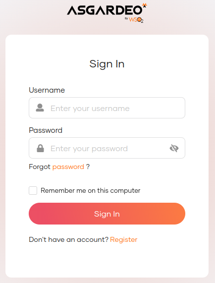
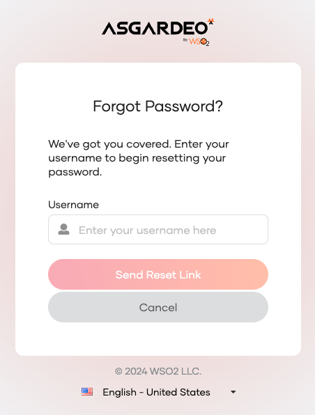
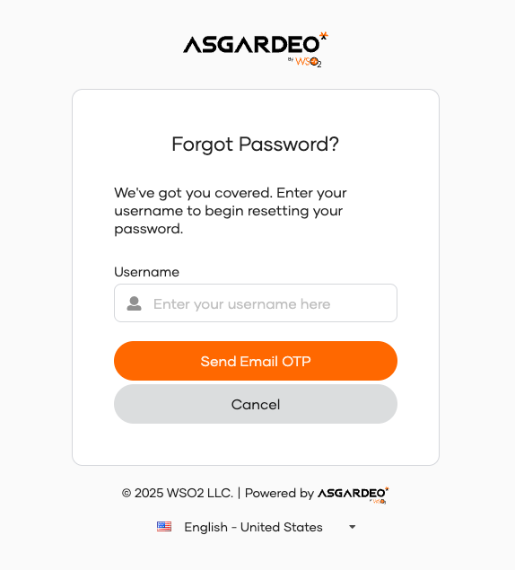
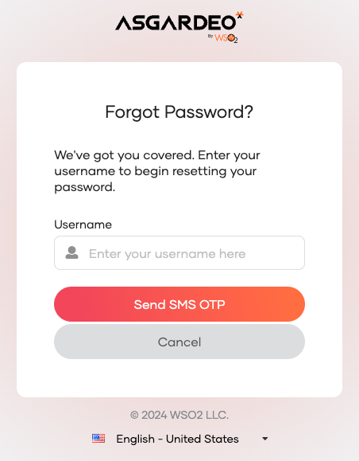
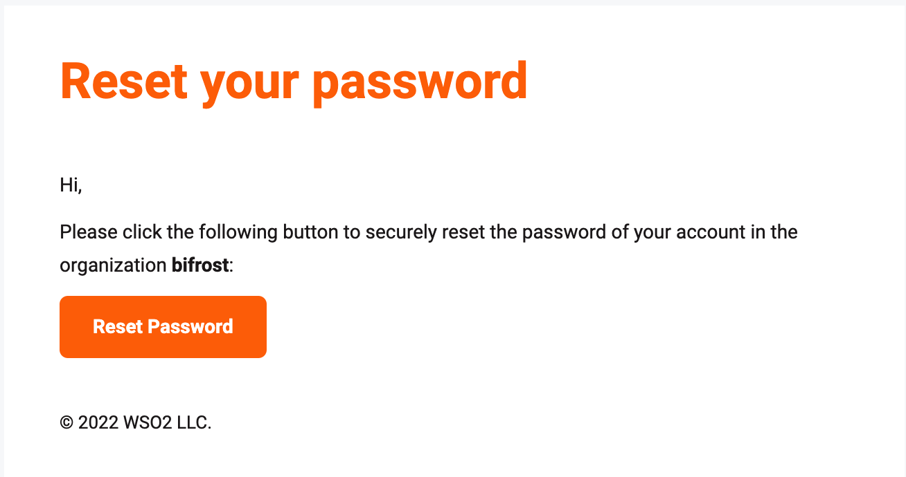
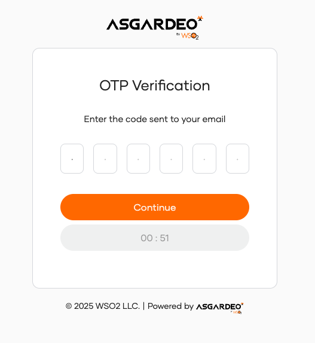
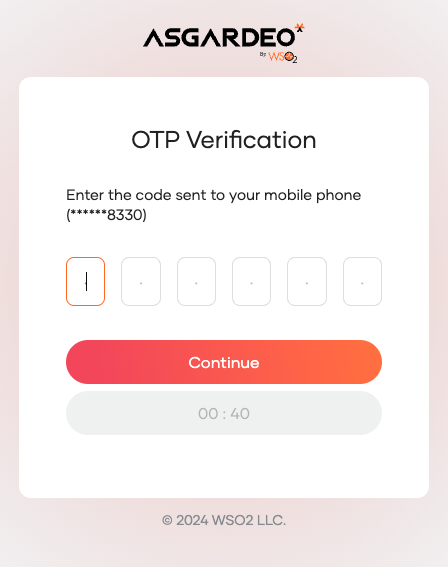

# Recover your password

If you are the owner or an administrator of an WSO2 Identity Server organization, the following guide explains how you can recover a forgotten password.

To recover your password:

1. Go to the sign-in page of the [My Account Portal](is-self-service.md#access-my-account-portal).

    

2. Click **Forgot password?**.

3. Follow one of the following methods that are configured for your organization.

    <Tabs>
    <TabItem value="tab-0" label="Email link">

    Enter your username and click **Send Reset Link**. An email notification will be sent to your email address.
    

    </TabItem>
    <TabItem value="tab-1" label="Email OTP">

    Enter your username and click **Send Email OTP**. An OTP code will be sent to your registered email address.
    

    </TabItem>
    <TabItem value="tab-2" label="SMS OTP">

    Enter your username and click **Send SMS OTP**. An OTP code will be sent to your registered mobile number.
    

    </TabItem>
    </Tabs>

    :::note

    - Setting an email address is required for email link and email OTP recovery methods, while setting a mobile number is required for SMS OTP recovery.

    - If you have configured both options for password recovery, select your preferred method and click **Proceed**.

    :::

4. Confirm password reset request.

    <Tabs>
    <TabItem value="tab-0" label="Email link">

    Open the email you received and click **Reset Password**.
    

    </TabItem>
    <TabItem value="tab-1" label="Email OTP">

    Enter the OTP code sent to your email and click **Continue**.
    

    </TabItem>
    <TabItem value="tab-2" label="SMS OTP">

    Enter the OTP code sent to your mobile and click **Continue**.
    

    </TabItem>
    </Tabs>

5. Enter new password and **Proceed**.
