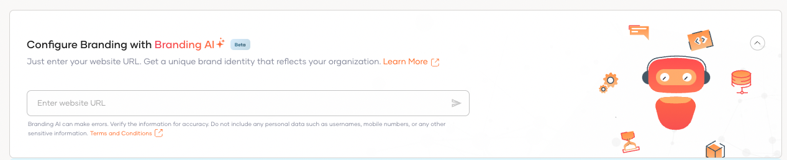
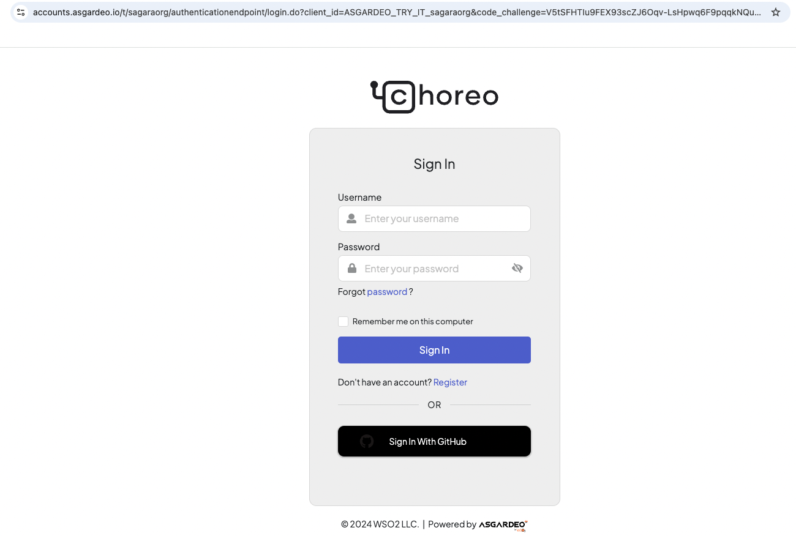
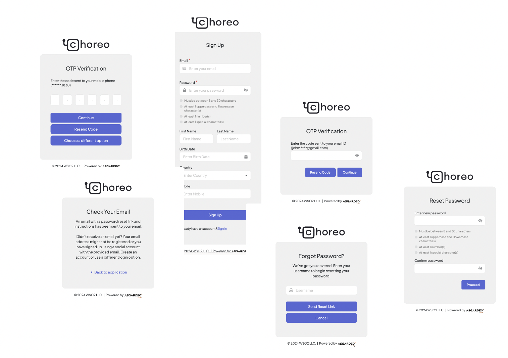

# Branding AI Quickstart

Welcome to the Quickstart Guide for <b>Branding AI</b>! In this guide, you’ll learn how to use Branding AI to effortlessly customize login UIs to align with your organization’s branding. 


## Create and configure a sample app

You can either use the WSO2 Identity Platform [Try-It](../get-started/try-it-application.md) hosted app without setting up a local app or create and run a sample app locally using the WSO2 Identity Platform React template. 

<Tabs>
<TabItem value="tab-0" label="Using WSO2 Identity Platform Try-It hosted app">


1. On the  WSO2 Identity Platform Console, navigate to **Home** and click **Try login with the Try It app**.
2. A dialog box appears prompting you to create a user account. Create a user account or if you already have one, click Continue to proceed.

:::note[Note]

WSO2 Identity Platform provides a hosted sample app called [Try-It](../get-started/try-it-application.md) , which allows you to explore features like passwordless login, Multi-Factor Authentication (MFA), social logins, adaptive authentication, and user provisioning without the need to create or run a local app. Once you enable the WSO2 Identity Platform Try-It app, it will automatically register and configure an application in the WSO2 Identity Platform console, making it ready for you to use.

:::

</TabItem>
<TabItem value="tab-1" label="Using  WSO2 Identity Platform React template ">


- Sign into WSO2 Identity Platform console and navigate to **Applications > New Application**.

- Select **Single Page Application** and complete the wizard popup by providing a suitable name and an authorized redirect URL.

:::note

**name:** asgardeo-react

**Authorized redirect URL:** http://localhost:5173

:::

-  Note down the following values from the Protocol tab of the registered application. You will need them to configure WSO2 Identity Platform React SDK.
    - **`client-id`** from the **Protocol** tab.
    - The **name** of your WSO2 Identity Platform organization


- Use the WSO2 Identity Platform React template to bootstrap your application by running the following command.  

  ```bash

  npx tmplr --dir my-vite-react-app asgardeo/asgardeo-vite-react-template

  ```
  The WSO2 Identity Platform React template generates a ready-made React sample app with pre-configured login and logout capabilities, helping you kick-start your project in just 2 minutes. 

</TabItem>
</Tabs>


## **Try out Branding AI** 

1.  On the WSO2 Identity Platform Console, go to **Applications**, then go to **Branding** 

2.  Go to the **Style & Text** tab of the application and click the **Try Branding AI** button to open the Branding AI prompt. 




First, let's try to rebrand our login UIs as per the branding of [https://choreo.dev/](https://choreo.dev/).  


In the **Branding AI** prompt, enter the following URL. 

```html

https://choreo.dev

```

The **Branding AI** extracts branding information from [https://console.choreo.dev/](https://console.choreo.dev/login) and applies it to the login flow UIs such as login, SMS and Email OTP, TOTP and sign-up pages. 

Make sure to click **Save and Publish** save the generated branding design and apply it. 



When you revisit the **Try It** application, you will notice that the login and user sign-up screens have been updated with [https://console.choreo.dev/](https://console.choreo.dev/login) branding. Try entering your organization's website URL to see how accurately Branding AI can generate the branding for you.


