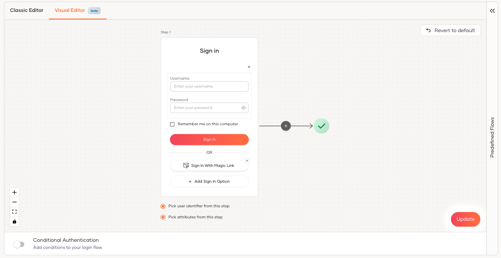
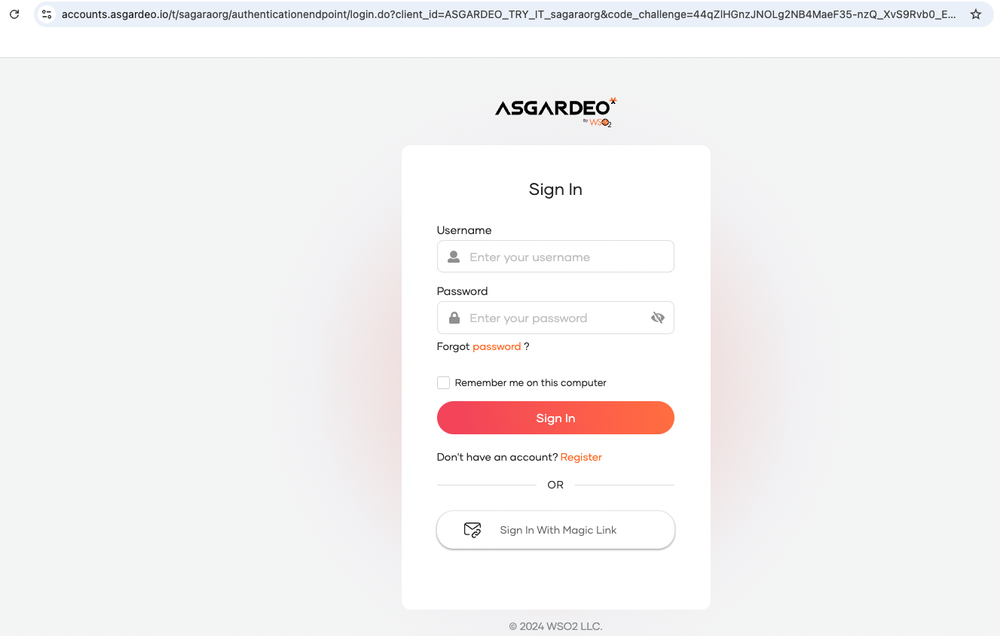
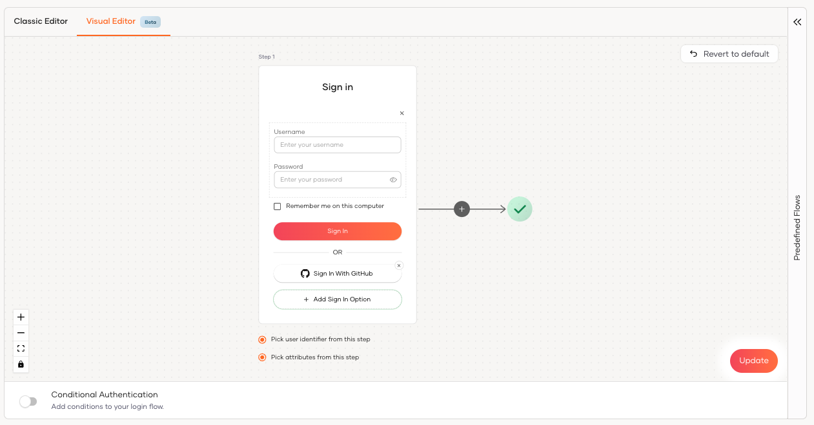
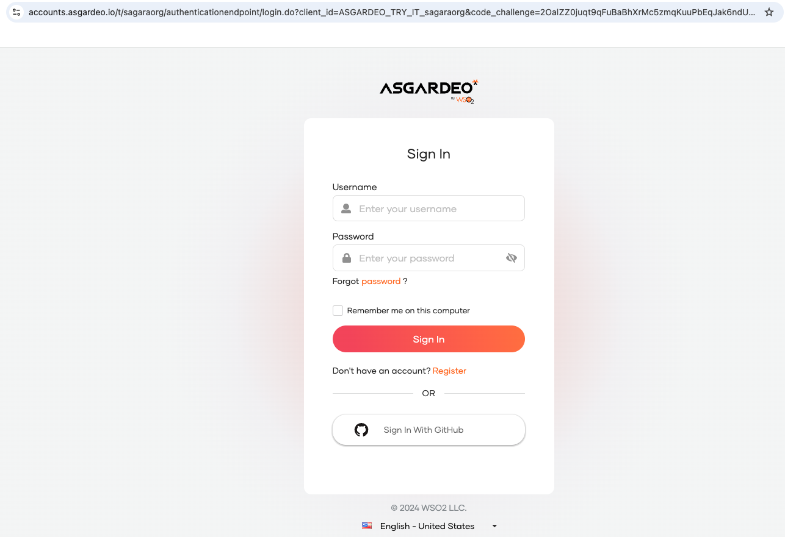
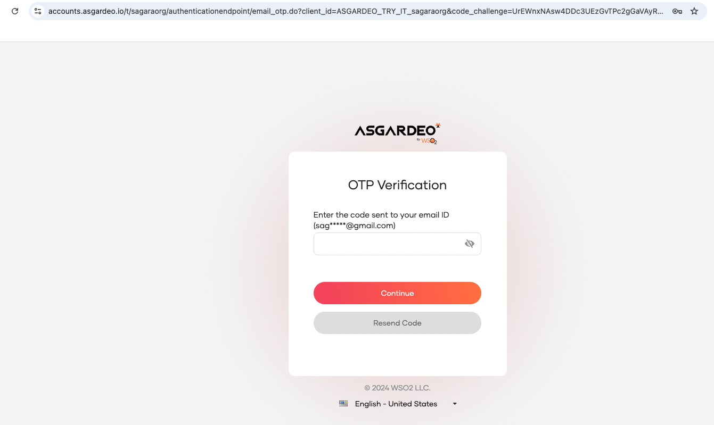

# LoginFlow AI

Welcome to the Quickstart Guide for <b>LoginFlow AI</b>! In this guide, you’ll learn how to use WSO2 Identity Platform LoginFlow AI to generate login flows for your applications, including passwordless login, Multi-Factor Authentication (MFA), social logins, and adaptive authentication logic that’s automatically generated.


## Configure Connections in WSO2 Identity Platform

MFA, passwordless and social providers are configured in WSO2 Identity Platform as **connections**. To start, set up the following **connections** in the WSO2 Identity Platform console. 

- To configure **username and password** login, no additional steps are required. WSO2 Identity Platform is pre-configured to use **username and password** as the default login option for your application. 

- WSO2 Identity Platform pre-configured with **Magic Link** and **Email OTP** as connections, so you can follow this guide without needing to modify the default settings. 

- Configure **GitHub** as a **social login provider** by creating a connection in WSO2 Identity Platform console.  
    1. Register a GitHub OAuth App or a GitHub App by following the [***Register WSO2 Identity Platform on GitHub*** step in this guide](../guides/authentication/social-login/add-github-login.mdx#register-wso2-identity-platform-on-github). Once the GitHub app is registered you need to copy **`Client ID`** and **`Client secret`** for the next step. 
    
    2. Register GitHub connection in  WSO2 Identity Platform console by following the [***Register the GitHub IdP*** step in this guide](../guides/authentication/social-login/add-github-login.mdx#register-the-github-idp). 

## Create and configure a sample app

You can either use the WSO2 Identity Platform [Try-It](../get-started/try-it-application.mdx) hosted app without setting up a local app or create & run a sample app locally using the WSO2 Identity Platform React template. 


<Tabs>
<TabItem value="tab-0" label="Using WSO2 Identity Platform Try-It hosted app">


1. On the  WSO2 Identity Platform Console, go to **Home** and click **Try login with the Try It app**.
2. A dialog box appears prompting you to create a user account. Create a user account or if you already have one, click Continue to proceed.

:::note[Note]

WSO2 Identity Platform provides a hosted sample app called [Try-It](../get-started/try-it-application.mdx) , which allows you to explore features like passwordless login, Multi-Factor Authentication (MFA), social logins, adaptive authentication, and user provisioning without the need to create or run a local app. Once you enable the WSO2 Identity Platform Try-It app, it will automatically register and configure an application in the WSO2 Identity Platform console, making it ready for you to use.

:::

</TabItem>
</Tabs>

    

<Tabs>
<TabItem value="tab-0" label="Using  WSO2 Identity Platform React template ">


- Sign into WSO2 Identity Platform console and navigate to **Applications > New Application**.

- Select **Single Page Application** and complete the wizard popup by providing a suitable name and an authorized redirect URL.

:::note

**name:** asgardeo-react

**Authorized redirect URL:** http://localhost:5173

:::

-  Note down the following values from the Protocol tab of the registered application. You will need them to configure WSO2 Identity Platform React SDK.
    - **`client-id`** from the **Protocol** tab.
    - The **name** of your WSO2 Identity Platform organization


- Use the WSO2 Identity Platform React template to bootstrap your application by running the following command.  

  ```bash

  npx tmplr --dir my-vite-react-app asgardeo/asgardeo-vite-react-template

  ```
  The WSO2 Identity Platform React template generates a ready-made React sample app with pre-configured login and logout capabilities, helping you kick-start your project in just 2 minutes. 

</TabItem>
</Tabs>

## Open the  **Login Flow AI** prompt 

1.  On the WSO2 Identity Platform Console, go to **Applications**, and select the **Try It** application *(or select WSO2 Identity Platform-react app in case if you have created and running an app locally in the previous step)*.

2.  Go to the **Login Flow** tab of the application and click the **Try Login Flow AI** button to open the Login Flow AI prompt. 


## **Try out Login Flow AI** - Password or MagicLink 

Enter the following given natural language instruction and click the run button. 

```text

Password or MagicLink 

```

The following login flow with username & password and Magic Link should be generated in the Login Flow designer. 




Click the **Update** button to save the above login flow configuration. 


Next, click **Try Login** button in the top right corner of your screen. This will open the Try-It application in a new tab. 


Now you can try logging to the **Try It** application using either username & password or Magic Link.   




:::tip


You need to create a test user in WSO2 Identity Platform by following this [guide](../guides/users/manage-users.mdx#onboard-single-user) to tryout login and logout features. Also, make sure you have entered a valid email address in the user profile of the test user to the receive Magic Link login code. 

:::


## **Try out Login Flow AI** - Password or GitHub 

Enter the following given natural language instruction and click the run button. 

```text

Password or GitHub 

```

The following login flow with username & password and GitHub should be generated in the Login Flow designer. 




Click the **Update** button to save the above login flow configuration. 

Next, click the **Try Login** button in the top right corner of your screen. This will open the Try-It application in a new tab. 


Now you can try logging to the **Try It** application using either username & password or GitHub.   



:::warning


When testing with a GitHub user, ensure that the **public email** setting in the **public GitHub profile** is configured to return an email address. For guidance, refer to this [GitHub guide](https://docs.github.com/en/rest/users/emails?apiVersion=2022-11-28#list-email-addresses-for-the-authenticated-user) 

:::


:::tip


You need to create a test user in WSO2 Identity Platform by following this [guide](../guides/users/manage-users.mdx#onboard-single-user) to tryout login and logout features. Also, make sure you have a valid GitHub account to login using GitHub. 

:::


## **Try out Login Flow AI** - Password or GitHub with Email OTP 

Enter the following given natural language instruction and click the run button. 

```text

Password or GitHub then Email OTP 

```

The following login flow with username & password and GitHub should be generated in the Login Flow designer. 


Click the **Update** button to save the above login flow configuration. 

Next, click the **Try Login** button in the top right corner of your screen. This will open the Try-It application in a new tab. 


First the **Try It** application prompt you to login using either username & password or GitHub.   


If it succeeds, the application will ask you to enter the Email OTP that was sent to the email address of the current user. 



:::tip


You need to create a test user in WSO2 Identity Platform by following this [guide](../guides/users/manage-users.mdx#onboard-single-user) to tryout login and logout features. Also, make sure you have entered a valid email address in the user profile of the test user to receive the Email OTP code.

:::
