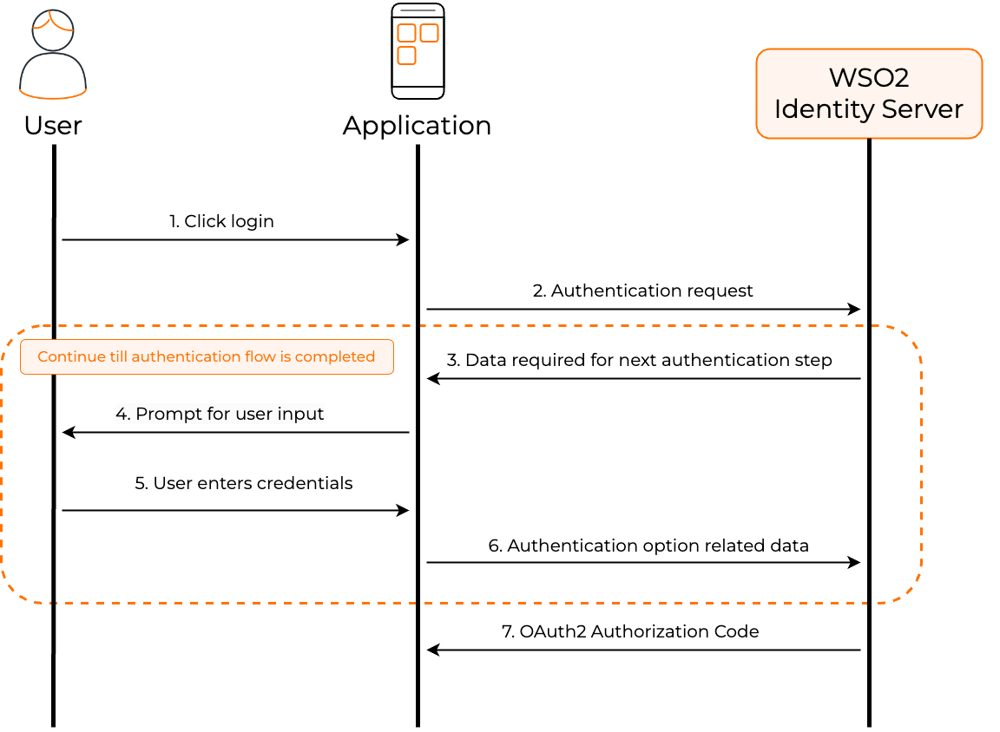

# App-native authentication

Applications usually depend on external web browsers for login. This means that users logging into an application are directed away from the application's environment to a web browser to complete the login process. This is not ideal if your priority is to implement a seamless login experience.

App-native authentication was introduced as a solution to this problem. By adopting an API-based approach, app-native authentication provides developers means to develop a secure login process within the application.

The following diagram illustrates the high-level steps involved with app-native authentication.



:::note

Learn how to [implement app-native authentication in WSO2 Identity Platform](../guides/authentication/app-native-authentication/add-app-native-authentication.mdx)

:::

## How does it work?

This section digs deep into the steps involved in app-native authentication and the associated API calls.

1. Applications initiate app-native authentication using an OAuth 2.0 authorization code request by setting the `response_mode` to `direct` as shown below.

	<Tabs>
	<TabItem value="tab-0" label="Sample request (`/authorize`)">


	</TabItem>
	</Tabs>
	
		```java
		curl --location '<API_BASE_PATH>'
		--header 'Accept: application/json'
		--header 'Content-Type: application/x-www-form-urlencoded'
		--data-urlencode 'client_id=<client_id>'
		--data-urlencode 'response_type=<response_type>'
		--data-urlencode 'redirect_uri=<redirect_url>'
		--data-urlencode 'state=<state>'
		--data-urlencode 'scope=<space separated scopes>'
		--data-urlencode 'response_mode=direct'
		```
	
	<Tabs>
	<TabItem value="tab-0" label="Example (`/authorize`)">


	</TabItem>
	</Tabs>
	
		```java
		curl --location '<API_EXAMPLE_BASE_PATH>'
		--header 'Accept: application/json'
		--header 'Content-Type: application/x-www-form-urlencoded'
		--data-urlencode 'client_id=VTs12Ie26wb8HebnWercWZiAhMMa'
		--data-urlencode 'response_type=code'
		--data-urlencode 'redirect_uri=https://example-app.com/redirect'
		--data-urlencode 'state=logpg'
		--data-urlencode 'scope=openid internal_login'
		--data-urlencode 'response_mode=direct'
		```

    :::note


    :::
	      Learn how to [implement login using the authorization code flow](../guides/authentication/oidc/implement-auth-code.mdx).


2. The application receives the following response that contains key components like the **flowId** parameter that uniquely identifies the login flow and the **authenticators** array that contains the authentication options available for the first step.
    
    ```json
    {
      "flowId": "3bd1f207-e5b5-4b45-8a91-13b0acfb2151",
      "flowStatus": "INCOMPLETE",
      "flowType": "AUTHENTICATION",
      "nextStep": {
        "stepType": "AUTHENTICATOR_PROMPT",
        "authenticators": [
          {
            "authenticatorId": "QmFzaWNBdXRoZW50aWNhdG9yOkxPQ0FM",
            "authenticator": "Username & Password",
            "idp": "LOCAL",
            "metadata": {
              "i18nKey": "authenticator.basic",
              "promptType": "USER_PROMPT",
              "params": [
                {
                  "param": "username",
                  "type": "STRING",
                  "isConfidential": false,
                  "order": 1,
                  "i18nKey": "param.username"
                }
              ]
            },
            "requiredParams": [
              "username",
              "password"
            ]
          }
        ],
        "acceptErrorParams": false,
        "messages": [
          {
            "type": "ERROR",
            "messageId": "msg_invalid_un_pw",
            "message": "Invalid username or password.",
            "i18nKey": "message.msg_invalid_un_pw",
            "context": [
              {
                "key": "remainingAttempts",
                "value": "2"
              }
            ]
          }
        ]
      },
      "links": [
        {
          "name": "authentication",
          "href": "/api/authenticate/v1",
          "method": "POST"
        }
      ]
    }
    ```
  
    <details>
    <summary>Learn about the parameters</summary>


    - **flowId**: A unique identifier for the entire authentication flow.
    - **flowStatus**: Indicates the status of the authentication flow. Possible values are `INCOMPLETE`, `FAILED_INCOMPLETE`, and `SUCCESS_COMPLETED`.
    - **nextStep**: Contains the details of the next step in the authentication flow.
    - **stepType**: The type of the next step. Possible values are `MULTI_OPTIONS_PROMPT` and `AUTHENTICATOR_PROMPT`. 
            MULTI_OPTIONS_PROMPT indicates that the user has multiple options to choose from, while AUTHENTICATOR_PROMPT 
        indicates that the user has to authenticate using a specific authentication option.
    - **authenticators**: The list of authentication options available for the next step. If the stepType is `AUTHENTICATOR_PROMPT`, the list will only contain one authentication option.
    - **authenticatorId**: The unique identifier of the authenticator. This id is mutable and can change based on the authenticator configuration.
    - **authenticator**: The name of the authenticator.
    - **idp**: The Identity Provider of the authenticator. This will be `LOCAL` for local authenticators and will contain the IDP name for federated authenticators.
    - **metadata**: The metadata related to the authentication option.
    - **promptType**: The type of the prompt. Possible values are `USER_PROMPT`, `INTERNAL_PROMPT`, and `REDIRECTION_PROMPT`. 
                Authentication options that require user interaction will have the prompt type as `USER_PROMPT`. 
                Authentication options that require the application to perform an action will have the prompt type 
                as `INTERNAL_PROMPT`. Authentication options that require the application to redirect the user to a 
                different URL will have the prompt type as `REDIRECTION_PROMPT`.
    - **params**: When the prompt type is `USER_PROMPT`, this will contain the list of input parameter metadata to render the UI.
    - **additionalData**: Additional data required to complete the authentication step. Ex: Redirect URL for federated authentication.
    - **requiredParams**: The required parameters for the authentication option. These are the parameters that the application must send to the authentication API in the next request to complete the authentication step.
    - **messages**: The info and error messages related to the authentication option.
    - **i18nKey**: The internationalization key. This key will be available many places of the response and can be used where content localization is required.

    </details>

3. The application then gathers the credentials for one of the presented authentication options from the user.

4. The application makes a POST request to the `/authn` endpoint using the **Authentication API**. The payload of this request includes the **flowId** and the **selectedAuthenticator** object which contains credentials for the user-selected authentication option.

    :::note

    Explore the OpenAPI definition of the [authentication API](../apis/app-native-authentication-api.mdx).

    :::
  
    <Tabs>
    <TabItem value="tab-0" label="Sample payload (`/authn`)">


    ```bash
    {
    "flowId": "{flowId received from the initial response}",
    "selectedAuthenticator": {
        "authenticatorId": "{authenticator id for the selected authenticator}",
        "params": {
            "{requested parameters from the authenticator}"
        }
    }
    }
    ```

    </TabItem>
    <TabItem value="tab-1" label="Example (`/authn`)">


    ```json
    {
    "flowId": "3bd1f207-e5b5-4b45-8a91-13b0acfb2151",
    "selectedAuthenticator": {
        "authenticatorId": "QmFzaWNBdXRoZW50aWNhdG9yOkxPQ0FM",
        "params": {
        "username": "johnd",
        "password": "U$3r"
        }
    }
    }
    ```

    </TabItem>
    </Tabs>
  
    <details>
    <summary>Learn about the parameters</summary>

    - **flowId**: A unique identifier for the entire authentication flow. This is provided in the initial response forthe auth request.
    - **selectedAuthenticator**: The authenticator selected by the user for authentication.
    - **authenticatorId**: The unique identifier of the authenticator.
    - **params**: The values entered by the user for the parameters required for authentication.

    </details>

5. The authentication API responds with a similar payload as step 2 above. This response contains the **authenticators** array that contains the authentication options available for the next step.

6. Steps 3-5 repeats for all the steps of the login flow.

7. The authentication flow completes when the application receives an OAuth 2.0 authorization code with the relevant OAuth 2.0 artifacts in a json format as shown below.
	```json
	{
	   "code": "6ff8b7e1-01fc-39b9-b56d-a1f5826e6d2a",
	   "state": "logpg",
	   "session_state": "43b1ffc92c8d349942e99bd0270fca05f934ad6f612b27f40a5fa60b96bd0iD4RK8Etr4XruxnYMEvcKQ"
	}
	```

8. After receiving the authorization code, the application exchanges it for an access token by making a POST request to the token endpoint.

    <Tabs>
    <TabItem value="tab-0" label="Sample request (`/token`)">


    ```bash
    curl --location 'https://localhost:9443/oauth2/token'
    --header 'Content-Type: application/x-www-form-urlencoded'
    --data-urlencode 'grant_type=authorization_code'
    --data-urlencode 'code=<authorization_code>'
    --data-urlencode 'redirect_uri=<redirect_uri>'
    --data-urlencode 'client_id=<client_id>'
    --data-urlencode 'client_secret=<client_secret>'
    ```

    </TabItem>
    <TabItem value="tab-1" label="Example (`/token`)">


    ```bash
    curl --location 'https://localhost:9443/oauth2/token'
    --header 'Content-Type: application/x-www-form-urlencoded'
    --data-urlencode 'grant_type=authorization_code'
    --data-urlencode 'code=6ff8b7e1-01fc-39b9-b56d-a1f5826e6d2a'
    --data-urlencode 'redirect_uri=https://example-app.com/redirect'
    --data-urlencode 'client_id=VTs12Ie26wb8HebnWercWZiAhMMa'
    --data-urlencode 'client_secret=your_client_secret'
    ```

    </TabItem>
    </Tabs>

    :::note

    The `redirect_uri` must match the value used in the initial authorization request.

    :::

    The token endpoint responds with an access token and other OAuth 2.0 artifacts:

    ```json
    {
        "access_token": "54bd024f-5080-3db5-9422-785f5d610605",
        "refresh_token": "a6c7fc96-2fd0-3905-ae8f-d5419d0dd6a5",
        "scope": "openid internal_login",
        "id_token": "eyJ4NXQiOiJZemM1T1Rnd1pXSTNNR1F6TXpNd1pqUXpaVEU1TmpVMk1EWXpZemd3TldNMll...",
        "token_type": "Bearer",
        "expires_in": 3600
    }
    ```

    <details>
    <summary>Learn about the parameters</summary>


    - **access_token**: The token that can be used to access protected resources.
    - **refresh_token**: The token that can be used to obtain new access tokens when the current one expires.
    - **scope**: The scopes granted by the authorization server.
    - **id_token**: A JSON Web Token (JWT) that contains user identity information.
    - **token_type**: The type of token issued (typically "Bearer").
    - **expires_in**: The lifetime of the access token in seconds.

    </details>

## Sample scenarios

The following are several sample scenarios in which users can be logged in using app-native authentication. Each scenario goes through a single or multiple interactions with the `/authn` endpoint based on the number of steps configured for the application.

### Scenario 1: User logs in with a username & password

The application goes through the following steps to complete app-native authentication for a user logging in with username & password.

<Steps>

#### Initiate the request with the `/authorize` endpoint {/* #step-1-initiate-the-request-with-the-authorize-endpoint */}

:::note

The response contains information on the first authentication step (the only step for this flow).

:::

<Tabs>
<TabItem value="tab-0" label="Request(`/authorize`)">


```bash
curl --location '<API_BASE_PATH>'
--header 'Accept: application/json'
--header 'Content-Type: application/x-www-form-urlencoded'
--data-urlencode 'client_id=XWRkRNkJDeTiR5MwHdXROGiJka'
--data-urlencode 'response_type=code'
--data-urlencode 'redirect_uri=https://example.com/home'
--data-urlencode 'scope=openid profile'
--data-urlencode 'response_mode=direct'
```

</TabItem>
<TabItem value="tab-1" label="Response (`/authorize`)">


```json
{
  "flowId": "bea32017-7124-4b7a-ab31-17633754d04d",
  "flowStatus": "INCOMPLETE",
  "flowType": "AUTHENTICATION",
  "nextStep": {
    "stepType": "AUTHENTICATOR_PROMPT",
    "authenticators": [
      {
        "authenticatorId": "QmFzaWNBdXRoZW50aWNhdG9yOkxPQ0FM",
        "authenticator": "Username & Password",
        "idp": "LOCAL",
        "metadata": {
          "i18nKey": "authenticator.basic",
          "promptType": "USER_PROMPT",
          "params": [
            {
              "param": "username",
              "type": "STRING",
              "order": 0,
              "i18nKey": "username.param",
              "displayName": "Username",
              "confidential": false
            },
            {
              "param": "password",
              "type": "STRING",
              "order": 1,
              "i18nKey": "password.param",
              "displayName": "Password",
              "confidential": true
            }
          ]
        },
        "requiredParams": [
          "username",
          "password"
        ]
      }
    ]
  },
  "links": [
    {
      "name": "authentication",
      "href": "<AUTHN_PATH>",
      "method": "POST"
    }
  ]
}
```

</TabItem>
</Tabs>

#### Carry the `flowId` received in the above response and request the `/authn` endpoint for username & password authentication {/* #step-2-carry-the-flowid-received-in-the-above-response-and-request-the-authn-endpoint-for-username--password-authentication */}

:::note

As this is the only step configured for the application, the `/authn` endpoint returns an authorization code, upon successful authentication.

:::

<Tabs>
<TabItem value="tab-0" label="Request (`/authn`)">


```bash
curl --location '<AUTHN_PATH>'
--header 'Content-Type: application/json'
--data '{
    "flowId": "bea32017-7124-4b7a-ab31-17633754d04d",
    "selectedAuthenticator": {
        "authenticatorId": "QmFzaWNBdXRoZW50aWNhdG9yOkxPQ0FM",
        "params": {
            "username": "johnd",
            "password": "U$3r"
        }
    }
}'
```

</TabItem>
<TabItem value="tab-1" label="Response (`/authn`)">


```json
{
  "flowStatus": "SUCCESS_COMPLETED",
  "authData": {
    "code": "bbb0bsdb-857a-3a80-bfbb-48038380bf79"
  }
}
```

</TabItem>
</Tabs>

</Steps>

### Scenario 2: 2FA with username & password and TOTP

The application goes through the following steps to complete app-native authentication for a user logging in with username & password in the first step and TOTP in the second step.

<Steps>

#### Initiate the request with the `/authorize` endpoint {/* #step-1-initiate-the-request-with-the-authorize-endpoint-1 */}

:::note

The response contains information on the first authentication step.

:::

<Tabs>
<TabItem value="tab-0" label="Request (`/authorize`)">


```bash
curl --location '<API_BASE_PATH>'
--header 'Accept: application/json'
--header 'Content-Type: application/x-www-form-urlencoded'
--data-urlencode 'client_id=XWRkRNkJDeTiR5MwHdXROGiJka'
--data-urlencode 'response_type=code'
--data-urlencode 'redirect_uri=https://example.com/home'
--data-urlencode 'scope=openid profile'
--data-urlencode 'response_mode=direct'
```

</TabItem>
<TabItem value="tab-1" label="Response (`/authorize`)">


```json
{
  "flowId": "162b7547-e057-4c84-9237-1c7e69bdc122",
  "flowStatus": "INCOMPLETE",
  "flowType": "AUTHENTICATION",
  "nextStep": {
    "stepType": "AUTHENTICATOR_PROMPT",
    "authenticators": [
      {
        "authenticatorId": "QmFzaWNBdXRoZW50aWNhdG9yOkxPQ0FM",
        "authenticator": "Username & Password",
        "idp": "LOCAL",
        "metadata": {
          "i18nKey": "authenticator.basic",
          "promptType": "USER_PROMPT",
          "params": [
            {
              "param": "username",
              "type": "STRING",
              "order": 0,
              "i18nKey": "username.param",
              "displayName": "Username",
              "confidential": false
            },
            {
              "param": "password",
              "type": "STRING",
              "order": 1,
              "i18nKey": "password.param",
              "displayName": "Password",
              "confidential": true
            }
          ]
        },
        "requiredParams": [
          "username",
          "password"
        ]
      }
    ]
  },
  "links": [
    {
      "name": "authentication",
      "href": "<AUTHN_PATH>",
      "method": "POST"
    }
  ]
}
```

</TabItem>
</Tabs>

#### Carry the `flowId` received in the above response and request the `/authn` endpoint for username & password authentication {/* #step-2-carry-the-flowid-received-in-the-above-response-and-request-the-authn-endpoint-for-username--password-authentication-1 */}

:::note

Upon successful authentication, the `/authn` endpoint returns information on the next authentication step.

:::

<Tabs>
<TabItem value="tab-0" label="Request 1 (`/authn`)">


```bash
curl --location '<AUTHN_PATH>'
--header 'Content-Type: application/json'
--data '{
  "flowId": "162b7547-e057-4c84-9237-1c7e69bdc122",
  "selectedAuthenticator": {
    "authenticatorId": "QmFzaWNBdXRoZW50aWNhdG9yOkxPQ0FM",
    "params": {
        "username": "johnd",
        "password": "U$3r"
    }
  }
}'
```

</TabItem>
<TabItem value="tab-1" label="Response 1 (`/authn`)">


```json
{
  "flowId": "162b7547-e057-4c84-9237-1c7e69bdc122",
  "flowStatus": "INCOMPLETE",
  "flowType": "AUTHENTICATION",
  "nextStep": {
    "stepType": "AUTHENTICATOR_PROMPT",
    "authenticators": [
      {
        "authenticatorId": "dG90cDpMT0NBTA",
        "authenticator": "TOTP",
        "idp": "LOCAL",
        "metadata": {
          "i18nKey": "authenticator.totp",
          "promptType": "USER_PROMPT",
          "params": [
            {
              "param": "token",
              "type": "STRING",
              "order": 0,
              "i18nKey": "totp.authenticator",
              "displayName": "Token",
              "confidential": false
            }
          ]
        },
        "requiredParams": [
          "token"
        ]
      }
    ]
  },
  "links": [
    {
      "name": "authentication",
      "href": "<AUTHN_PATH>",
      "method": "POST"
    }
  ]
}
```

</TabItem>
</Tabs>

#### Carry the same `flowId` and request the `/authn` endpoint for TOTP authentication {/* #step-3-carry-the-same-flowid-and-request-the-authn-endpoint-for-totp-authentication */}

:::note

As this is the final step configured for the application, the `/authn` endpoint returns an authorization code upon successful authentication.

:::

<Tabs>
<TabItem value="tab-0" label="Request 2 (`/authn`)">


```bash
curl --location '<AUTHN_PATH>'
--header 'Content-Type: application/json'
--data '{
  "flowId": "162b7547-e057-4c84-9237-1c7e69bdc122",
  "selectedAuthenticator": {
    "authenticatorId": "dG90cDpMT0NBTA",
    "params": {
        "token": "609357"
    }
  }
}'
```

</TabItem>
<TabItem value="tab-1" label="Response 2 (`/authn`)">


```json
{
  "flowStatus": "SUCCESS_COMPLETED",
  "authData": {
  "code": "5f1b2c2a-1436-35a5-b8e4-942277313287"
  }
}
```

</TabItem>
</Tabs>

</Steps>

### Scenario 3: User selects passkey login out of multiple options

If a login step has multiple login options, the application goes through the following steps to complete passkey login with app-native authentication.

<Prerequisites title="Before you begin">

To implement app-native authentication with passkeys on a mobile application, you must facilitate the relevant platform (iOS or Android) to validate your mobile application. Refer to the [Passkeys documentation](../guides/authentication/passwordless-login/add-passwordless-login-with-passkey.mdx#use-passkeys-with-app-native-authentication) for instructions.

</Prerequisites>


<Steps>

#### Initiate the request with the `/authorize` endpoint {/* #step-1-initiate-the-request-with-the-authorize-endpoint-2 */}

:::note

The response contains information on the first authentication step (the only step for this flow).

:::

<Tabs>
<TabItem value="tab-0" label="Request (`/authorize`)">


```bash
curl --location '<API_BASE_PATH>'
--header 'Accept: application/json'
--header 'Content-Type: application/x-www-form-urlencoded'
--data-urlencode 'client_id=XWRkRNkJDeTiR5MwHdXROGiJka'
--data-urlencode 'response_type=code'
--data-urlencode 'redirect_uri=https://example.com/home'
--data-urlencode 'scope=openid profile'
--data-urlencode 'response_mode=direct'
```

</TabItem>
<TabItem value="tab-1" label="Response (`/authorize`)">


```json
{
  "flowId": "59b40c8b-4d2f-426f-a3fa-62d4ed28a169",
  "flowStatus": "INCOMPLETE",
  "flowType": "AUTHENTICATION",
  "nextStep": {
      "stepType": "MULTI_OPTIONS_PROMPT",
      "authenticators": [
          {
              "authenticatorId": "QmFzaWNBdXRoZW50aWNhdG9yOkxPQ0FM",
              "authenticator": "Username & Password",
              "idp": "LOCAL",
              "metadata": {
                  "i18nKey": "authenticator.basic",
                  "promptType": "USER_PROMPT",
                  "params": [
                      {
                          "param": "username",
                          "type": "STRING",
                          "order": 0,
                          "i18nKey": "username.param",
                          "displayName": "Username",
                          "confidential": false
                      },
                      {
                          "param": "password",
                          "type": "STRING",
                          "order": 1,
                          "i18nKey": "password.param",
                          "displayName": "Password",
                          "confidential": true
                      }
                  ]
              },
              "requiredParams": [
                  "username",
                  "password"
              ]
          },
          {
              "authenticatorId": "RklET0F1dGhlbnRpY2F0b3I6TE9DQUw",
              "authenticator": "Passkey",
              "idp": "LOCAL",
              "metadata": {
                  "i18nKey": "authenticator.Fido"
              }
          }
      ]
  },
  "links": [
      {
          "name": "authentication",
          "href": "<AUTHN_PATH>",
          "method": "POST"
      }
  ]
}
```

</TabItem>
</Tabs>
  
:::tip

Response for a multi-option login step has some key differences compared to that of a single-option step.

1. **stepType** parameter returns MULTI_OPTIONS_PROMPT to indicate the availability of multiple   login options.

2. For login options that require some form of user initiation (such as email/sms OTP, passkey), the **authenticators** array contains only the ID of the authenticator and not the required metadata.

:::

#### Choose a login option {/* #step-2-choose-a-login-option */}

The response in this example returns two login options for the step: Username & password and passkey. Let's look at how each option works.

- **Username & Password**: As this option does not need user initiation, the response from step 1 already contains the required metadata. Hence, if the user chooses to enter the username and password, the flow continues similar to as it does in *Scenario 1*.

- **Passkey**: If a user initiates passkey login, the application needs to make an additional request to the `/authn` endpoint to initiate the passkey flow and receive the related metadata.
  
As the user continues with the passkey flow, the application makes a request to the `/authn` endpoint to initiate the passkey flow along with the `flowId` and the `authenticatorId` of the passkey authenticator as follows.

<Tabs>
<TabItem value="tab-0" label="Request (`/authn`)">


```bash
curl --location '<AUTHN_PATH>'
--header 'Content-Type: application/json'
--data '{
  "flowId": "59b40c8b-4d2f-426f-a3fa-62d4ed28a169",
  "selectedAuthenticator": {
    "authenticatorId": "RklET0F1dGhlbnRpY2F0b3I6TE9DQUw"
    }
}'
```

</TabItem>
<TabItem value="tab-1" label="Response (`/authn`)">


```json
{
  "flowId": "59b40c8b-4d2f-426f-a3fa-62d4ed28a169",
  "flowStatus": "INCOMPLETE",
  "flowType": "AUTHENTICATION",
  "nextStep": {
    "stepType": "AUTHENTICATOR_PROMPT",
    "authenticators": [
      {
        "authenticatorId": "RklET0F1dGhlbnRpY2F0b3I6TE9DQUw",
        "authenticator": "Passkey",
        "idp": "LOCAL",
        "metadata": {
          "i18nKey": "authenticator.Fido",
          "promptType": "INTERNAL_PROMPT",
          "additionalData": {
              "challengeData": "eyJyZXF1ZXN0SWQiOiJ1b2hBYnRpSE9TaWJKbjN1Y0ZqdzZ4bFJxT
                                zBqSlZ6NWtPdS1oWHRyb3JJIiwicHVibGljS2V5Q3JlZGVudGlhbFJ
                                lcXVlc3RPcHRpb25zIjp7ImNoYWxsZW5nZSI6IjkxTGhoSWFBUFVzb
                                TNERGllRXJpbDBJN2txdnFINVJldzhKcDctaGd3cEEiLCJycElkIjo
                                ibG9jYWxob3N0IiwiZXh0ZW5zaW9ucyI6e319fQ"          
          }
        },
        "requiredParams": [
            "tokenResponse"
        ]
      }
    ]
  },
  "links": [
      {
          "name": "authentication",
          "href": "<AUTHN_PATH>",
          "method": "POST"
      }
  ]
}

```

</TabItem>
</Tabs>

#### The application goes through the following steps to process passkey authentication {/* #step-3-the-application-goes-through-the-following-steps-to-process-passkey-authentication */}
1. First, it extracts the `challengeData` value from the response and base64 decodes it to obtain the json-based challenge payload.
2. Then, it invokes the platform APIs with the decoded challenge data.
3. The user interacts with the application and presents a passkey.
4. Upon successful authentication, the application receives the server response.

#### The application base64 encodes the response and includes it as the **tokenResponse** in the request to the `/authn` endpoint {/* #step-4-the-application-base64-encodes-the-response-and-includes-it-as-the-tokenresponse-in-the-request-to-the-authn-endpoint */}

:::note

As this is the only step configured for the application, the `/authn` endpoint returns an authorization code, upon successful authentication.

:::

<Tabs>
<TabItem value="tab-0" label="Request (`/authn`)">


```bash
curl --location '<AUTHN_PATH>'
--header 'Content-Type: application/json'
--data '{
    "flowId": "59b40c8b-4d2f-426f-a3fa-62d4ed28a169",
    "selectedAuthenticator": {
      "authenticatorId": "RklET0F1dGhlbnRpY2F0b3I6TE9DQUw",
        "params": {
          "tokenResponse":
          "eyJyZXF1ZXN0SWQiOiJ1b2hBYnRpSE9TaWJKbjN1Y0ZqdzZ4bFJxTzBqSlZ6NWtPdS1oWHRyb
          3JJIiwiY3JlZGVudGlhbCI6eyJpZCI6Imc2OGF6eHhWeDZxUnhxQWllbEVwRHotaHVTZyIsInJ
          lc3BvbnNlIjp7ImF1dGhlbnRpY2F0b3JEYXRhIjoiU1pZTjVZZ09qR2gwTkJjUFpIWmdXNF9rc
          nJtaWhqTEhtVnp6dW9NZGwyTWRBQUFBQUEiLCJjbGllbnREYXRhSlNPTiI6ImV5SjBlWEJsSWp
          vaWQyVmlZWFYwYUc0dVoyVjBJaXdpWTJoaGJHeGxibWRsSWpvaU9URk1hR2hKWVVGUVZYTnRNM
          FJFYVdWRmNtbHNNRWszYTNGMmNVZzFVbVYzT0Vwd055MW9aM2R3UVNJc0ltOXlhV2RwYmlJNkl
          taDBkSEJ6T2k4dmJHOWpZV3hvYjNOME9qZzBORE1pTENKamNtOXpjMDl5YVdkcGJpSTZabUZzY
          zJVc0ltOTBhR1Z5WDJ0bGVYTmZZMkZ1WDJKbFgyRmtaR1ZrWDJobGNtVWlPaUprYnlCdWIzUWd
          ZMjl0Y0dGeVpTQmpiR2xsYm5SRVlYUmhTbE5QVGlCaFoyRnBibk4wSUdFZ2RHVnRjR3hoZEdVd
          UlGTmxaU0JvZEhSd2N6b3ZMMmR2Ynk1bmJDOTVZV0pRWlhnaWZRIiwic2lnbmF0dXJlIjoiTUV
          VQ0lRQ0xWSGF2c1FkZHhDVElfQkxFS053WG5rUDZpb3AwcldzRjlEMHJyVFRNdkFJZ0hqM1JhM
          W55UmU5ckdWVWcxd3NhbThudExobW5QbWpLbFRJLTZhaDJzSmMiLCJ1c2VySGFuZGxlIjoiTnp
          EeU5tOWE0NEFmUktjeXJCQVR6M1RtQVFLaHAwNEQwd3B3Y01iYlE3MCJ9LCJjbGllbnRFeHRlb
          nNpb25SZXN1bHRzIjp7fSwidHlwZSI6InB1YmxpYy1rZXkifX0"
        }
    }
}'

```

</TabItem>
<TabItem value="tab-1" label="Response (`/authn`)">


```json
{
  "flowStatus": "SUCCESS_COMPLETED",
  "authData": {
    "code": "7da717f3-b841-32c7-b97f-563a64350090"
  }
}
```

</TabItem>
</Tabs>

</Steps>

### Scenario 4 : User selects federated authentication (Native mode)

The application goes through the following steps to complete app-native authentication for a federated authentication flow configured in the native mode. For this example, let's assume that the user logs in with Google.

<Steps>

#### Initiate the request with the `/authorize` endpoint {/* #step-1-initiate-the-request-with-the-authorize-endpoint-3 */}

:::note

The response contains information on the first authentication step (the only step for this flow).

:::

<Tabs>
<TabItem value="tab-0" label="Request (`/authorize`)">


```bash
curl --location '<API_BASE_PATH>'
--header 'Accept: application/json'
--header 'Content-Type: application/x-www-form-urlencoded'
--data-urlencode 'client_id=XWRkRNkJDeTiR5MwHdXROGiJka'
--data-urlencode 'response_type=code'
--data-urlencode 'redirect_uri=https://example.com/home'
--data-urlencode 'scope=openid profile'
--data-urlencode 'response_mode=direct'

```

</TabItem>
<TabItem value="tab-1" label="Response (`/authorize`)">


```json
{
  "flowId": "f7cab9e5-7a3b-41a9-8e0c-e45d13f22a69",
  "flowStatus": "INCOMPLETE",
  "flowType": "AUTHENTICATION",
  "nextStep": {
    "stepType": "AUTHENTICATOR_PROMPT",
    "authenticators": [
      {
        "authenticatorId": "R29vZ2xlT0lEQ0F1dGhlbnRpY2F0b3I6R29vZ2xlTmF0aXZl",
        "authenticator": "Google",
        "idp": "GoogleNative",
        "metadata": {
          "i18nKey": "authenticator.google",
          "promptType": "INTERNAL_PROMPT",
          "additionalData": {
              "clientId": "237235402223-d8sedg6c3b68kb1j8.apps.googleusercontent.com",
              "nonce": "bbe1a9a4-729d-4293-abb0-6825580efb97",
              "scope": "openid email profile"
          }
        },
        "requiredParams": [
            "accessToken",
            "idToken"
        ]
      }
    ]
  },
  "links": [
    {
      "name": "authentication",
      "href": "<AUTHN_PATH>",
      "method": "POST"
    }
  ]
}
```

</TabItem>
</Tabs>

#### The application should interact with Google, usually through the Google SDK, and authenticate the user {/* #step-2-the-application-should-interact-with-google-usually-through-the-google-sdk-and-authenticate-the-user */}

Upon successful authentication, the application receives an access token and an ID token from Google.

:::tip[Important]

- Pass the scopes received in the initial response to the authorization request made to Google. WSO2 Identity Platform expects the attributes provided by these scopes from Google.
- The application should include the `nonce` value received from the initial response in the authentication request made to Google. WSO2 Identity Platform uses this value to validate the tokens received from Google. 

:::

#### The application does the following when making the authentication request to the `/authn` endpoint {/* #step-3-the-application-does-the-following-when-making-the-authentication-request-to-the-authn-endpoint */}

- Carry the `flowId` received in the initial response to uniquely identify the login flow.
- Use the `clientId` found in the initial response to identify the relevant Google connector.
- Include the ID token and the access token received from Google's response.

:::note

As this is the only step configured for the application, the `/authn` endpoint returns an authorization code, upon successful authentication.

:::

<Tabs>
<TabItem value="tab-0" label="Request (`/authn`)">


```bash
curl --location '<AUTHN_PATH>' \
--header 'Content-Type: application/json' \
--data '{
  "flowId": "f7cab9e5-7a3b-41a9-8e0c-e45d13f22a69",
  "selectedAuthenticator": {
    "authenticatorId": "R29vZ2xlT0lEQ0F1dGhlbnRpY2F0b3I6R29vZ2xlTmF0aXZl",
    "params": {
    "accessToken": 
    "ya29.a0wedf9e3_Mbj1U3JiGTDmJMbfeaYKdGZbxy-G-MAwefjJiScaJHpZ9kSAC0w
    X1F5Lhg269dssQtV1kv1LsedzvweasvJgAulsAV8_qFss-fEcCoGqJAVwesdvfQnrQ0171",
    "idToken":
    "eyJhbGciOiJSUzI1NiIsImtpZCI6ImUxYjkzYzY0MDE0NGI4NGJkMDViZjI5NmQ2NzI2MmI
    2YmM2MWE0ODciLCJ0eXAiOiJKV1QifQ.sdgn023ewklsxm  calsdkalskfnmcoakslasjlkxncoealksnfcolaksnfcmoiasklnfcmoalksdfnvcmeoasdlk
    fjcmoeaskdfjcmoieaskfjcmieaskfmasfje09wr230ewfnmio23jewr0f92p3oewurjf0239e
    owrjf.T-vCBKhQbGC8-5ig3_9g3MoRvqHsOYRbSxXD3XLMtwuKw0pzkK9OW3vyV1m79SBvXLU5Z6ZvXp
    ml_3NjTgqJTAUvIV-Dw7HTjkjabdnfc98oi23khwnrfwdss5gsifH_VDIk_-ub7nbYfkP11UBoKFtah
    9eK8aUnaa4ZFG9-gYS0tgUeDNUm-8X4a6S_577tOlPekvE19oUVgBLZD1w7t7HMmHuBGMzPkfPEDmY2
    0UVo3GdoKXB4r0tXwRHUQ3rbqhMMf_HqByNnx40w"
    }
  }
}'
```

</TabItem>
<TabItem value="tab-1" label="Response (`/authn`)">


```json
{
  "flowStatus": "SUCCESS_COMPLETED",
  "authData": {
  "code": "4d34r89f3-c081-4427-94ea-745a6fc9ae21"
  }
}
```

</TabItem>
</Tabs>

</Steps>

### Scenario 5: User selects federated authentication (Redirect mode)

The application goes through the following steps to complete app-native authentication for a federated authentication flow configured in the redirect mode. For this example, let's assume that the user logs in with Google.

<Steps>

#### Initiate the request with the `/authorize` endpoint {/* #step-1-initiate-the-request-with-the-authorize-endpoint-4 */}

:::note

The response contains information on the first authentication step (the only step for this flow).

:::

<Tabs>
<TabItem value="tab-0" label="Request (`/authorize`)">


```bash
curl --location '<API_BASE_PATH>'
--header 'Accept: application/json'
--header 'Content-Type: application/x-www-form-urlencoded'
--data-urlencode 'client_id=XWRkRNkJDeTiR5MwHdXROGiJka'
--data-urlencode 'response_type=code'
--data-urlencode 'redirect_uri=https://example.com/home'
--data-urlencode 'scope=openid profile'
--data-urlencode 'response_mode=direct'
```

</TabItem>
<TabItem value="tab-1" label="Response (`/authorize`)">


```json
{
  "flowId": "0ad36d10-56c3-496b-a326-2e3ba4ff5cd1",
  "flowStatus": "INCOMPLETE",
  "flowType": "AUTHENTICATION",
  "nextStep": {
    "stepType": "AUTHENTICATOR_PROMPT",
    "authenticators": [
      {
        "authenticatorId": "R29vZ2xlT0lEQ0F1dGhlbnRpY2F0b3I6R29vZ2xl",
        "authenticator": "Google",
        "idp": "Google",
        "metadata": {
          "i18nKey": "authenticator.google",
          "promptType": "REDIRECTION_PROMPT",
          "additionalData": {
            "state": "b4764a2c-a445-4d52-a2eb-609991fe5b84,OIDC",
              "redirectUrl": "https://accounts.google.com/o/oauth2/auth?response_type=code&
                              redirect_uri=https%3A%2F%2Fexample-app.com%2Fredirect&state=b4764a2c-a445-4d52-a2eb-609991fe5b84%2COIDC&nonce=ad656495-011c-4fc5-9928-7e5207d869cd&client_id=230622702223-d86c3b0ahu68kg74as23592jtvomb1j8.apps.googleusercontent.com&scope=email+openid+profile"
          }
        },
        "requiredParams": [
            "code",
            "state"
        ]
      }
    ]
  },
  "links": [
    {
      "name": "authentication",
      "href": "<AUTHN_PATH>",
      "method": "POST"
    }
  ]
}
```

</TabItem>
</Tabs>

#### The application redirects the user to the URL received in the `redirectUrl` parameter of the response {/* #step-2-the-application-redirects-the-user-to-the-url-received-in-the-redirecturl-parameter-of-the-response */}

The user will then interact with Google to complete the authentication. After it's complete, Google redirects the user back to the application.

:::tip

The app can make use of the `state` parameter received in the initial response to correlate Google's response coming back to the app.

:::

#### Carry the `flowId` and `state` parameters received in the initial response and the `code` parameter received in Google's response and request the `/authn` endpoint for authentication {/* #step-3-carry-the-flowid-and-state-parameters-received-in-the-initial-response-and-the-code-parameter-received-in-googles-response-and-request-the-authn-endpoint-for-authentication */}

:::note

As this is the only step configured for the application, the `/authn` endpoint returns an authorization code, upon successful authentication.

:::

<Tabs>
<TabItem value="tab-0" label="Request (`/authn`)">


```bash
curl --location '<AUTHN_PATH>'
--header 'Content-Type: application/json'
--data '{
    "flowId": "0ad36d10-56c3-496b-a326-2e3ba4ff5cd1",
    "selectedAuthenticator": {
    "authenticatorId": "R29vZ2xlT0lEQ0F1dGhlbnRpY2F0b3I6R29vZ2xl",
    "params": {
      "code": "4/0cZFSWx-2d0MReJMLIt8EQW4kor8d53ZQNMX3eLWtwog",
      "state": "b4764a2c-a445-4d52-a2eb-609991fe5b84,OIDC"
    }
  }
}'
```

</TabItem>
</Tabs>


<Tabs>
<TabItem value="tab-0" label="Response (`/authn`)">


```json
{
  "flowStatus": "SUCCESS_COMPLETED",
  "authData": {
    "code": "4dae99f3-b981-3527-237f-903a6fc92340"
  }
}
```

</TabItem>
</Tabs>

</Steps>


### Scenario 6: 2FA with username & password and Push Notification

The application goes through the following steps to complete app-native authentication for a user logging in with username & password in the first step and Push Notification in the second step.

<Steps>

#### Initiate the request with the `/authorize` endpoint {/* #step-1-initiate-the-request-with-the-authorize-endpoint-5 */}

:::note

The response contains information on the first authentication step.

:::

<Tabs>
<TabItem value="tab-0" label="Request (`/authorize`)">


```bash
curl --location '<API_BASE_PATH>'
--header 'Accept: application/json'
--header 'Content-Type: application/x-www-form-urlencoded'
--data-urlencode 'client_id=XWRkRNkJDeTiR5MwHdXROGiJka'
--data-urlencode 'response_type=code'
--data-urlencode 'redirect_uri=https://example.com/home'
--data-urlencode 'scope=openid profile'
--data-urlencode 'response_mode=direct'
```

</TabItem>
<TabItem value="tab-1" label="Response (`/authorize`)">


```json
{
  "flowId": "162b7547-e057-4c84-9237-1c7e69bdc122",
  "flowStatus": "INCOMPLETE",
  "flowType": "AUTHENTICATION",
  "nextStep": {
    "stepType": "AUTHENTICATOR_PROMPT",
    "authenticators": [
      {
        "authenticatorId": "QmFzaWNBdXRoZW50aWNhdG9yOkxPQ0FM",
        "authenticator": "Username & Password",
        "idp": "LOCAL",
        "metadata": {
          "i18nKey": "authenticator.basic",
          "promptType": "USER_PROMPT",
          "params": [
            {
              "param": "username",
              "type": "STRING",
              "order": 0,
              "i18nKey": "username.param",
              "displayName": "Username",
              "confidential": false
            },
            {
              "param": "password",
              "type": "STRING",
              "order": 1,
              "i18nKey": "password.param",
              "displayName": "Password",
              "confidential": true
            }
          ]
        },
        "requiredParams": [
          "username",
          "password"
        ]
      }
    ]
  },
  "links": [
    {
      "name": "authentication",
      "href": "<AUTHN_PATH>",
      "method": "POST"
    }
  ]
}
```

</TabItem>
</Tabs>

#### Carry the `flowId` received in the above response and request the `/authn` endpoint for username & password authentication {/* #step-2-carry-the-flowid-received-in-the-above-response-and-request-the-authn-endpoint-for-username--password-authentication-2 */}

:::note

Upon successful authentication, the `/authn` endpoint returns information on the next authentication step.

:::

<Tabs>
<TabItem value="tab-0" label="Request 1 (`/authn`)">


```bash
curl --location '<AUTHN_PATH>'
--header 'Content-Type: application/json'
--data '{
  "flowId": "162b7547-e057-4c84-9237-1c7e69bdc122",
  "selectedAuthenticator": {
    "authenticatorId": "QmFzaWNBdXRoZW50aWNhdG9yOkxPQ0FM",
    "params": {
        "username": "johnd",
        "password": "U$3r"
    }
  }
}'
```

</TabItem>
<TabItem value="tab-1" label="Response 1 (`/authn`)">


```json
{
  "flowId": "162b7547-e057-4c84-9237-1c7e69bdc122",
  "flowStatus": "INCOMPLETE",
  "flowType": "AUTHENTICATION",
  "nextStep": {
    "stepType": "AUTHENTICATOR_PROMPT",
    "authenticators": [
      {
        "authenticatorId": "cHVzaC1ub3RpZmljYXRpb24tYXV0aGVudGljYXRvcg",
        "authenticator": "Push Notification Authenticator",
        "idp": "LOCAL",
        "metadata": {
          "i18nKey": "authenticator.push.notification",
          "promptType": "INTERNAL_PROMPT",
          "additionalData": {
            "statusEndpoint": "https://localhost:3000/push-auth/check-status?pushAuthId=2dbcf154-dcc0-4497-a087-6db477ff818e"
          }
        },
        "requiredParams": [
          "scenario"
        ]
      }
    ]
  },
  "links": [
    {
      "name": "authentication",
      "href": "<AUTHN_PATH>",
      "method": "POST"
    }
  ]
}
```

</TabItem>
</Tabs>

:::warning

Push notification based authentication does not require any user input like other authenticators do. If the user
has a device registered to receive push notifications, the notification will be sent during the execution of the
authenticator. Hence, If you are getting the above response for the first step, it means that the push authenticator
has been executed and the notification has been already sent.

:::

#### Ping to the status endpoint to check the status of the ongoing push authentication request {/* #step-3-ping-to-the-status-endpoint-to-check-the-status-of-the-ongoing-push-authentication-request */}

To complete push-based authentication, the authentication response must be sent from the registered device. The registered device will initiate a push authentication request directly to WSO2 Identity Platform.

To verify the status of the push authentication request, poll the status endpoint provided in the previous response. The possible status values are:

  1. **PENDING**: The push authentication request has not yet been initiated by the registered device.
  2. **COMPLETED**: The push authentication request has been received and successfully processed by WSO2 Identity Platform.

:::note

This step is only applicable for the push notification based authenticator and not part of the default app native authentication flow.

:::

Once the status changes to **COMPLETED**, proceed with the next /authn request as outlined in the subsequent step.

<Tabs>
<TabItem value="tab-0" label="Request">


```bash
curl --location '<CHECK_STATUS_ENDPOINT>push-auth/check-status?pushAuthId=92e0d286-e24b-471e-a2cf-6ba3a969a982' 
```

</TabItem>
<TabItem value="tab-1" label="Response">


```json
{
  "status": "PENDING"
}
```

</TabItem>
</Tabs>

#### Carry the same `flowId` and request the `/authn` endpoint for Push Notification authentication {/* #step-4-carry-the-same-flowid-and-request-the-authn-endpoint-for-push-notification-authentication */}

In order to continue the push notification based authentication flow, the `scenario` has to be set to **PROCEED_PUSH_AUTHENTICATION** as shown in the request below.

:::note

As this is the final step configured for the application, the `/authn` endpoint returns an authorization code upon successful authentication.

:::

<Tabs>
<TabItem value="tab-0" label="Request 2 (`/authn`)">


```bash
curl --location '<AUTHN_PATH>'
--header 'Content-Type: application/json'
--data '{
  "flowId": "162b7547-e057-4c84-9237-1c7e69bdc122",
  "selectedAuthenticator": {
    "authenticatorId": "cHVzaC1ub3RpZmljYXRpb24tYXV0aGVudGljYXRvcg",
    "params": {
        "scenario": "PROCEED_PUSH_AUTHENTICATION"
    }
  }
}'
```

</TabItem>
<TabItem value="tab-1" label="Response 2 (`/authn`)">


```json
{
  "flowStatus": "SUCCESS_COMPLETED",
  "authData": {
  "code": "5f1b2c2a-1436-35a5-b8e4-942277313287"
  }
}
```

</TabItem>
</Tabs>

</Steps>

  
  


### Scenario 7: Application is configured with concurrent-sessions based access control

The application goes through the following steps to complete app-native authentication for a user logging in with username & password in the first step and engages the Active Sessions Limited in the second step.

<Steps>

#### Initiate the request with the `/authorize` endpoint {/* #step-1-initiate-the-request-with-the-authorize-endpoint-6 */}

:::note

The response contains information on the first authentication step.

:::

<Tabs>
<TabItem value="tab-0" label="Request (`/authorize`)">


```bash
curl --location '<API_BASE_PATH>'
--header 'Accept: application/json'
--header 'Content-Type: application/x-www-form-urlencoded'
--data-urlencode 'client_id=XWRkRNkJDeTiR5MwHdXROGiJka'
--data-urlencode 'response_type=code'
--data-urlencode 'redirect_uri=https://example.com/home'
--data-urlencode 'scope=openid profile'
--data-urlencode 'response_mode=direct'
```

</TabItem>
<TabItem value="tab-1" label="Response (`/authorize`)">


```json
{
  "flowId": "162b7547-e057-4c84-9237-1c7e69bdc122",
  "flowStatus": "INCOMPLETE",
  "flowType": "AUTHENTICATION",
  "nextStep": {
    "stepType": "AUTHENTICATOR_PROMPT",
    "authenticators": [
      {
        "authenticatorId": "QmFzaWNBdXRoZW50aWNhdG9yOkxPQ0FM",
        "authenticator": "Username & Password",
        "idp": "LOCAL",
        "metadata": {
          "i18nKey": "authenticator.basic",
          "promptType": "USER_PROMPT",
          "params": [
            {
              "param": "username",
              "type": "STRING",
              "order": 0,
              "i18nKey": "username.param",
              "displayName": "Username",
              "confidential": false
            },
            {
              "param": "password",
              "type": "STRING",
              "order": 1,
              "i18nKey": "password.param",
              "displayName": "Password",
              "confidential": true
            }
          ]
        },
        "requiredParams": [
          "username",
          "password"
        ]
      }
    ]
  },
  "links": [
    {
      "name": "authentication",
      "href": "<AUTHN_PATH>",
      "method": "POST"
    }
  ]
}
```

</TabItem>
</Tabs>

#### Carry the `flowId` received in the above response and request the `/authn` endpoint for username & password authentication {/* #step-2-carry-the-flowid-received-in-the-above-response-and-request-the-authn-endpoint-for-username--password-authentication-3 */}

:::note

Upon successful authentication, the `/authn` endpoint returns information on the next authentication step.

:::

<Tabs>
<TabItem value="tab-0" label="Request (`/authn`)">


```bash
curl --location '<AUTHN_PATH>'
--header 'Content-Type: application/json'
--data '{
  "flowId": "162b7547-e057-4c84-9237-1c7e69bdc122",
  "selectedAuthenticator": {
    "authenticatorId": "QmFzaWNBdXRoZW50aWNhdG9yOkxPQ0FM",
    "params": {
        "username": "johnd",
        "password": "U$3r"
    }
  }
}'
```

</TabItem>
<TabItem value="tab-1" label="Response (`/authn`)">


```json
{
    "flowId": "e4d31f92-1ffe-4dea-80ac-8a1b665bb399",
    "flowStatus": "INCOMPLETE",
    "flowType": "AUTHENTICATION",
    "nextStep": {
        "stepType": "AUTHENTICATOR_PROMPT",
        "authenticators": [
            {
                "authenticatorId": "U2Vzc2lvbkV4ZWN1dG9yOkxPQ0FM",
                "authenticator": "Active Sessions Limit",
                "idp": "LOCAL",
                "metadata": {
                    "promptType": "USER_PROMPT",
                    "params": [
                        {
                            "param": "promptResp",
                            "type": "STRING",
                            "order": 1,
                            "i18nKey": "promptResp.param",
                            "displayName": "Prompt Response",
                            "confidential": false
                        },
                        {
                            "param": "promptId",
                            "type": "STRING",
                            "order": 2,
                            "i18nKey": "promptId.param",
                            "displayName": "Prompt ID",
                            "confidential": false
                        },
                        {
                            "param": "ActiveSessionsLimitAction",
                            "type": "STRING",
                            "order": 3,
                            "i18nKey": "activeSessionsLimitAction.param",
                            "displayName": "Active Sessions Limit Action",
                            "confidential": false
                        },
                        {
                            "param": "sessionsToTerminate",
                            "type": "MULTI_VALUED",
                            "order": 4,
                            "i18nKey": "sessionsToTerminate.param",
                            "displayName": "Sessions to Terminate",
                            "confidential": false
                        }
                    ],
                    "additionalData": {
                        "sessions": "[{\"lastAccessTime\":\"1741513176234\",\"browser\":\"PostmanRuntime\",\"sessionId\":\"027b638ed0388c49d1d943b914d9e1833ffb5af0a83116f225903cc91fb43727\",\"device\":\"Other\",\"platform\":\"Other\"},{\"lastAccessTime\":\"1741513261190\",\"browser\":\"Firefox\",\"sessionId\":\"2d932c1ac04c0c365ab929bb30397f64a850c1acc37db87bb24c2a686b8b9b1b\",\"device\":\"Mac\",\"platform\":\"Mac OS X\"},{\"lastAccessTime\":\"1741513275913\",\"browser\":\"Chrome\",\"sessionId\":\"d2ce34b45408e14b57578d36852bda7d5e275b1eaf3a600677d19c8e034f6fdd\",\"device\":\"Mac\",\"platform\":\"Mac OS X\"}]",
                        "MaxSessionCount": "1",
                        "promptId": "e4d31f92-1ffe-4dea-80ac-8a1b665bb399"
                    }
                },
                "requiredParams": [
                    "promptResp",
                    "promptId",
                    "ActiveSessionsLimitAction"
                ]
            }
        ]
    },
    "links": [
        {
            "name": "authentication",
            "href": "<AUTHN_PATH>",
            "method": "POST"
        }
    ]
}
```

</TabItem>
</Tabs>

#### Carry the same `flowId` and request the `/authn` endpoint for active sessions limiting {/* #step-3-carry-the-same-flowid-and-request-the-authn-endpoint-for-active-sessions-limiting */}

:::note

As this is the final step configured for the application, the `/authn` endpoint returns an authorization code upon successful authentication.

:::


| Variable  | Description   | Sample values  |
|-----------|---------------|---------------|
| `promptResp` | The response to the prompt | `yes` |
| `promptId` | The ID of the prompt. This can be retrieved from Step 2 response. | `e4d31f92-1ffe-4dea-80ac-8a1b665bb399` |
| `ActiveSessionsLimitAction` | The action to be taken when the active sessions limit is reached. | `denyLimitActiveSessionsAction`, `refreshActiveSessionsAction`, `terminateActiveSessionsAction` |
| `sessionsToTerminate` | The session IDs to be terminated. This parameter needs to be sent when `terminateActiveSessionsAction` is selected for `ActiveSessionsLimitAction` | `["027b638ed0388c49d1d943b914d9e1833ffb5af0a83116f225903cc91fb43727", "d2ce34b45408e14b57578d36852bda7d5e275b1eaf3a600677d19c8e034f6fdd"]` |

<Tabs>
<TabItem value="tab-0" label="Request (`/authn`)">


```bash
curl --location '<AUTHN_PATH>'
--header 'Content-Type: application/json'
--data '{
  "flowId": "e4d31f92-1ffe-4dea-80ac-8a1b665bb399",
  "selectedAuthenticator": {
    "authenticatorId": "U2Vzc2lvbkV4ZWN1dG9yOkxPQ0FM",
    "params": {
        "promptResp": "yes",
        "promptId": "e4d31f92-1ffe-4dea-80ac-8a1b665bb399",
        "ActiveSessionsLimitAction": "terminateActiveSessionsAction",
        "sessionsToTerminate": ["027b638ed0388c49d1d943b914d9e1833ffb5af0a83116f225903cc91fb43727", "d2ce34b45408e14b57578d36852bda7d5e275b1eaf3a600677d19c8e034f6fdd", "2d932c1ac04c0c365ab929bb30397f64a850c1acc37db87bb24c2a686b8b9b1b"]}]
    }
  }
}'
```

</TabItem>
<TabItem value="tab-1" label="Response (`/authn`)">


```json
{
  "flowStatus": "SUCCESS_COMPLETED",
  "authData": {
    "code": "4dae99f3-b981-3527-237f-903a6fc92340"
  }
}
```

</TabItem>
</Tabs>

</Steps>

### Scenario 8: Device authorization flow

The application goes through the following steps to complete app-native authentication using the device authorization flow.

<Steps>

#### Get the required codes {/* #step-1-get-the-required-codes */}

The app initiates a login request to the device authorization endpoint.

:::note

The response contains the `user_code` and `device_code` required for the client device.

:::

<Tabs>
<TabItem value="tab-0" label="Request (`/device_authorize`)">


```bash
curl --location '<API_OAUTH2_PATH>/device_authorize/'
--header 'Accept: application/json'
--header 'Content-Type: application/x-www-form-urlencoded'
--data-urlencode 'client_id=XWRkRNkJDeTiR5MwHdXROGiJka'
--data-urlencode 'scope=openid profile'
```

</TabItem>
<TabItem value="tab-1" label="Response (`/device_authorize`)">


```json
{
    "user_code": "s2DqSNK",
    "device_code": "d3fe0db1-2334-48fa-b7d9-821ecfad10d5",
    "interval": 5,
    "verification_uri": "<API_OAUTH2_PATH>/authenticationendpoint/device.do",
    "verification_uri_complete": "<API_OAUTH2_PATH>/authenticationendpoint/device.do?user_code=s2DqSNK",
    "expires_in": 600
}
```

</TabItem>
</Tabs>

#### Authorize the client device {/* #step-2-authorize-the-client-device */}

The app on the client device calls the device endpoint with the `user_code` to initiate authentication.

:::note

Set `response_mode=direct` to initiate app-native authentication.

:::

<Tabs>
<TabItem value="tab-0" label="Request (`/device`)">


```bash
curl --location '<API_OAUTH2_PATH>/device/'
--header 'Accept: application/json'
--header 'Content-Type: application/x-www-form-urlencoded'
--data-urlencode 'user_code=s2DqSNK'
--data-urlencode 'response_mode=direct'
```

</TabItem>
<TabItem value="tab-1" label="Response (`/device`)">


```json
{
    "flowId": "95339089-72d1-4825-80fe-ab7864f4943b",
    "flowStatus": "INCOMPLETE",
    "flowType": "AUTHENTICATION",
    "nextStep": {
        "stepType": "AUTHENTICATOR_PROMPT",
        "authenticators": [
            {
                "authenticatorId": "QmFzaWNBdXRoZW50aWNhdG9yOkxPQ0FM",
                "authenticator": "Username & Password",
                "idp": "LOCAL",
                "metadata": {
                    "i18nKey": "authenticator.basic",
                    "promptType": "USER_PROMPT",
                    "params": [
                        {
                            "param": "username",
                            "type": "STRING",
                            "order": 0,
                            "i18nKey": "username.param",
                            "displayName": "Username",
                            "confidential": false
                        },
                        {
                            "param": "password",
                            "type": "STRING",
                            "order": 1,
                            "i18nKey": "password.param",
                            "displayName": "Password",
                            "confidential": true
                        }
                    ]
                },
                "requiredParams": [
                    "username",
                    "password"
                ]
            }
        ]
    },
    "links": [
            {
        "name": "authentication",
        "href": "<AUTHN_PATH>",
        "method": "POST"
        }
    ]
}
```

</TabItem>
</Tabs>

#### Carry the `flowId` received in the above response and request the `/authn` endpoint for username & password authentication {/* #step-3-carry-the-flowid-received-in-the-above-response-and-request-the-authn-endpoint-for-username--password-authentication */}

<Tabs>
<TabItem value="tab-0" label="Request (`/authn`)">


```bash
curl --location '<AUTHN_PATH>'
--header 'Content-Type: application/json'
--data '{
    "flowId": "95339089-72d1-4825-80fe-ab7864f4943b",
    "selectedAuthenticator": {
        "authenticatorId": "QmFzaWNBdXRoZW50aWNhdG9yOkxPQ0FM",
        "params": {
            "username": "username",
            "password": "password"
        }
    }
}'
```

</TabItem>
<TabItem value="tab-1" label="Response (`/authn`)">


```json
{
    "flowStatus": "SUCCESS_COMPLETED",
    "authData": {
        "app_name": "Mobile App"
    }
}
```

</TabItem>
</Tabs>

#### Once the user completes authentication, the app on the client device polls the token endpoint with the `device_code` to obtain the access token {/* #step-4-once-the-user-completes-authentication-the-app-on-the-client-device-polls-the-token-endpoint-with-the-device_code-to-obtain-the-access-token */}

<Tabs>
<TabItem value="tab-0" label="Request (`/token`)">


```bash
curl --location '<API_OAUTH2_PATH>/token/'
--header 'Content-Type: application/x-www-form-urlencoded'
--data-urlencode 'grant_type=urn:ietf:params:oauth:grant-type:device_code'
--data-urlencode 'device_code=d3fe0db1-2334-48fa-b7d9-821ecfad10d5'
--data-urlencode 'client_id=XWRkRNkJDeTiR5MwHdXROGiJka'
```

</TabItem>
<TabItem value="tab-1" label="Response (`/token`)">


```json
{
    "access_token": "74d610ab-7f4a-3b11-90e8-279d76644fc7",
    "refresh_token": "fdb58069-ecc7-3803-9b8b-6f2ed85eff19",
    "token_type": "Bearer",
    "expires_in": 3600
}
```

</TabItem>
</Tabs>

</Steps>

### Scenario 9: User logs in with service based custom authentication

:::note

Learn more about [custom authentication](../guides/service-extensions/in-flow-extensions/custom-authentication.mdx)

:::

The application goes through the following steps to complete app-native authentication for a user logging in with service based custom authentication.

<Steps>

#### Initiate the request with the `/authorize` endpoint {/* #step-1-initiate-the-request-with-the-authorize-endpoint-7 */}

:::note

The response contains information on the first authentication step (the only step for this flow).

:::

<Tabs>
<TabItem value="tab-0" label="Request (`/authorize`)">


```bash
curl --location '<API_BASE_PATH>'
--header 'Accept: application/json'
--header 'Content-Type: application/x-www-form-urlencoded'
--data-urlencode 'client_id=XWRkRNkJDeTiR5MwHdXROGiJka'
--data-urlencode 'response_type=code'
--data-urlencode 'redirect_uri=https://example.com/home'
--data-urlencode 'scope=openid profile'
--data-urlencode 'response_mode=direct'
```

</TabItem>
<TabItem value="tab-1" label="Response (`/authorize`)">


```json
{
  "flowId": "162b7547-e057-4c84-9237-1c7e69bdc122",
  "flowStatus": "INCOMPLETE",
  "flowType": "AUTHENTICATION",
  "nextStep": {
    "stepType": "AUTHENTICATOR_PROMPT",
    "authenticators": [
      {
        "authenticatorId": "Y3VzdG9tLWFiY19hdXRoZW50aWNhdG9y",
        "authenticator": "custom-abc_authenticator",
        "idp": "ABC Authenticator",
        "metadata": {
            "i18nKey": "AbstractAuthenticatorAdapter",
            "promptType": "INTERNAL_PROMPT",
            "additionalData": {
                "endpointUrl": "https://externalservice/authentication/userinput",
                "state": "ec159061-2a93-415d-8786-652d4f344241"
            }
        }
      }
    ]
  },
  "links": [
    {
      "name": "authentication",
      "href": "<AUTHN_PATH>",
      "method": "POST"
    }
  ]
}
```

</TabItem>
</Tabs>
#### The application should interact with the external service, and authenticate the user {/* #step-2-the-application-should-interact-with-the-external-service-and-authenticate-the-user */}

After it's complete, proceed with the next /authn request as outlined in the subsequent step.

:::warning

Service-based custom authentication is categorized under the `INTERNAL_PROMPT` prompt type authenticator, which requires the application to explicitly trigger the authentication option for the user. The application is responsible for handling and processing the data received and invoking the external authenticator accordingly.

:::

#### Carry the same `flowId` and request the `/authn` endpoint for custom authentication {/* #step-3-carry-the-same-flowid-and-request-the-authn-endpoint-for-custom-authentication */}

:::note

The application is not required to return the state or parameters with the /authn request.

:::

<Tabs>
<TabItem value="tab-0" label="Request 2 (`/authn`)">


```bash
curl --location '<AUTHN_PATH>'
--header 'Content-Type: application/json'
--data '{
  "flowId": "162b7547-e057-4c84-9237-1c7e69bdc122",
  "selectedAuthenticator": {
    "authenticatorId": "Y3VzdG9tLWFiY19hdXRoZW50aWNhdG9y"
  }
}'
```

</TabItem>
<TabItem value="tab-1" label="Response 2 (`/authn`)">


```json
{
  "flowStatus": "SUCCESS_COMPLETED",
  "authData": {
  "code": "5f1b2c2a-1436-35a5-b8e4-942277313287"
  }
}
```

</TabItem>
</Tabs>

:::note

As this is the only step configured for the application, the `/authn` endpoint returns an authorization code, upon successful authentication.

:::

</Steps>
