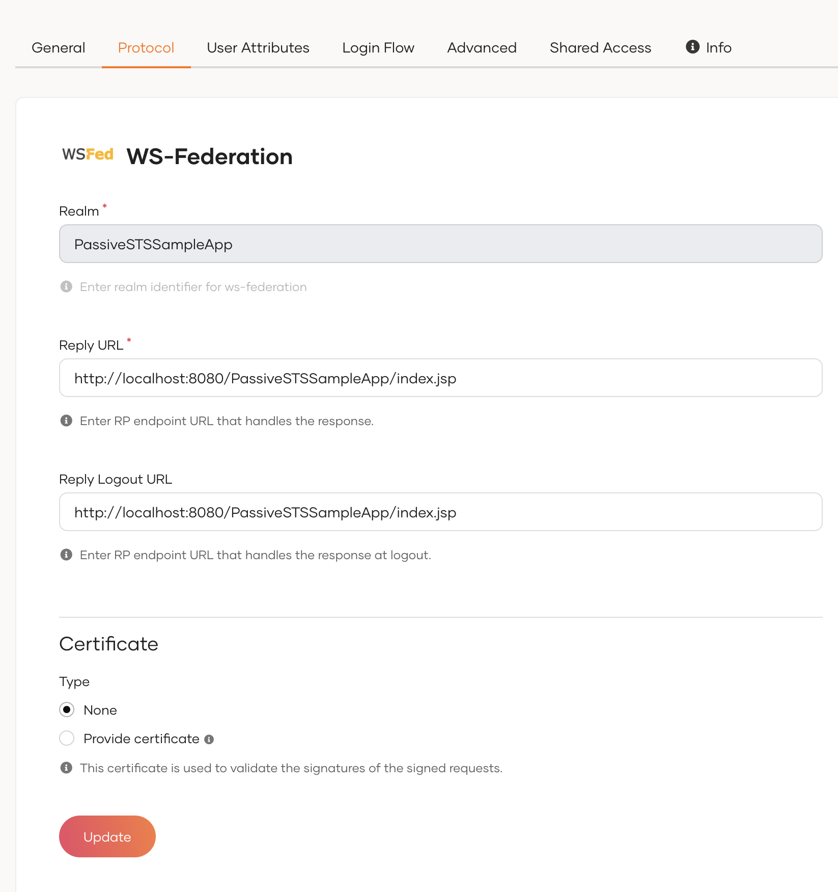
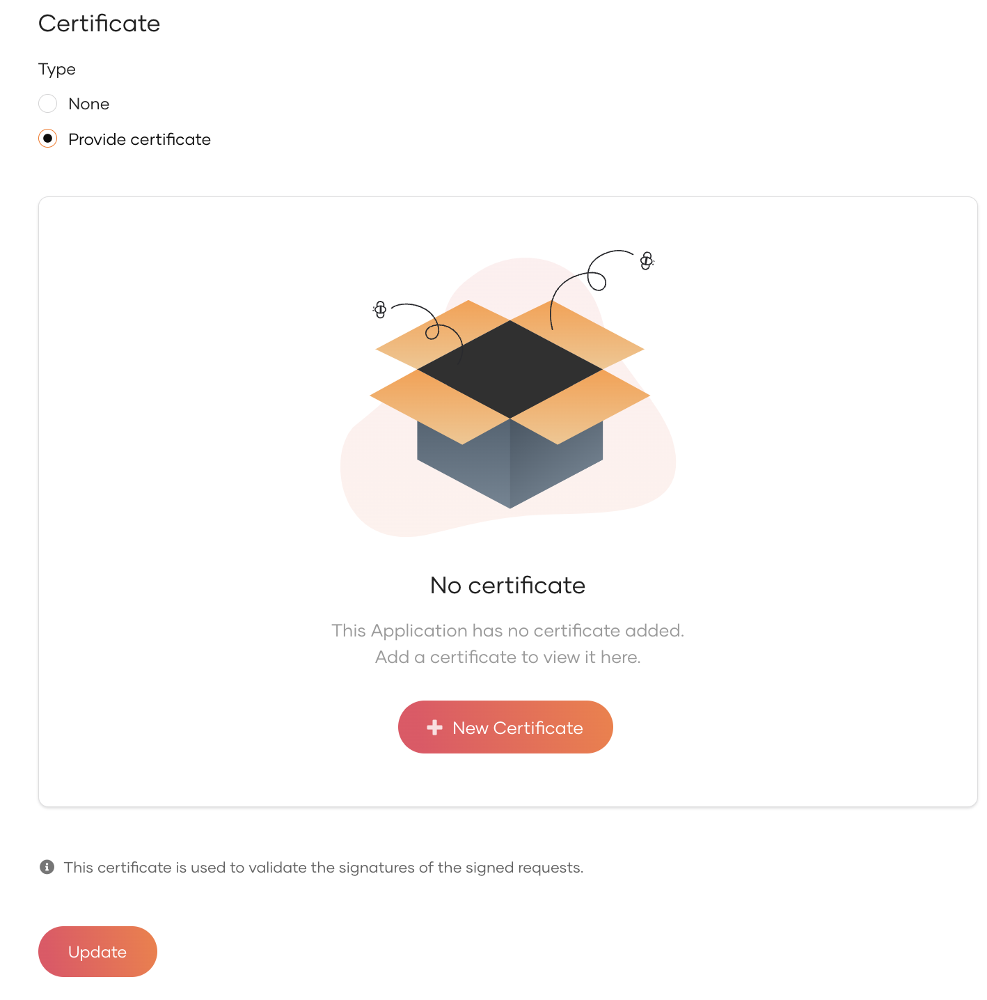

# WS-Federation settings for apps

You can find the WS-Federation protocol related settings under **Protocol** section of the selected WS-Federation application.
  


## Basic settings

To enable WS-Federation-based single sign-on (SSO), you need to configure the following key identifiers and endpoints.

### Realm

The Realm is a unique identifier for your application. It tells WSO2 Identity Platform which application is requesting authentication. This must match the `wtrealm` parameter in the WS-Federation request.

### Reply URL

The Reply URL is the endpoint in your application where WSO2 Identity Platform sends the authentication response after a successful login. This should match the `wreply` parameter in the WS-Federation request and must be configured to handle the security token.

### Reply Logout URL

The Reply Logout URL is the endpoint in your application that receives the logout response from WSO2 Identity Platform.

## Advanced settings

Use the following advanced settings to enhance the security and behavior of your WS-Federation integration.

### Certificate

If your application signs authentication or logout requests, WSO2 Identity Platform uses this certificate to verify their authenticity.

You can either upload a certificate or use a JWKS endpoint to add a certificate.

To upload a certificate:

1. Select <b>Provide Certificate</b> and click <b>New Certificate</b>.

    

    ??? note "Convert `.crt`, `.cer` or `.der` certificates to `.pen` using [OpenSSL](https://www.openssl.org/)"

        WSO2 Identity Platform only accepts certificates in the `.pem` format. To convert other certificates to `pem`, use one of the following commands.

        - Convert CRT to PEM
        
            ```
            openssl x509 -in cert.crt -out cert.pem
            ```
        
        - Convert CER to PEM:
        
            ```
            openssl x509 -in cert.cer -out cert.pem
            ```
        
        - Convert DER to PEM:
        
            ```
            openssl x509 -in cert.der -out cert.pem
            ```

2. Upload the certificate file or copy the certificate contents.
