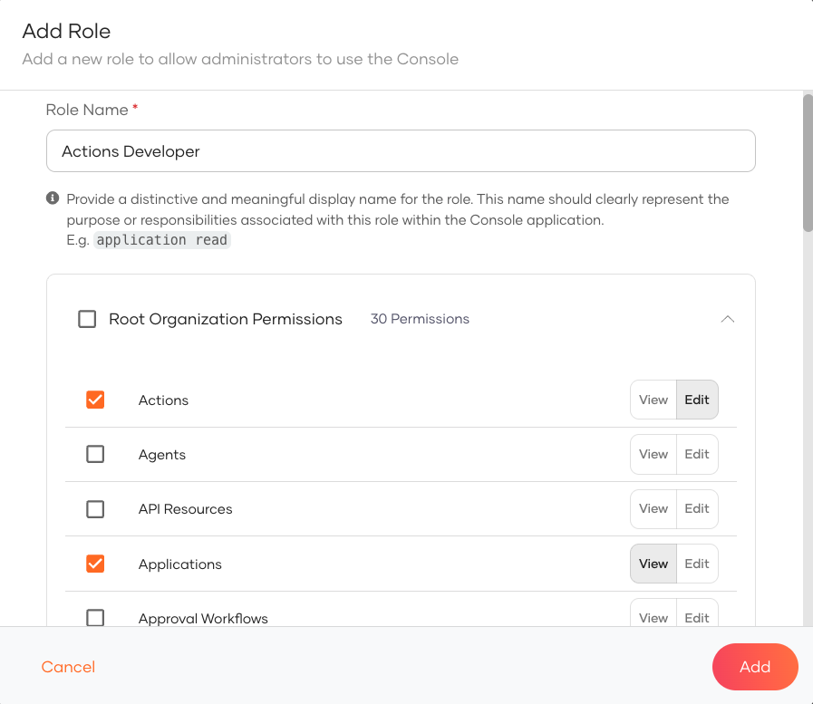
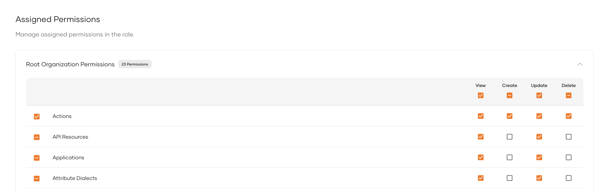
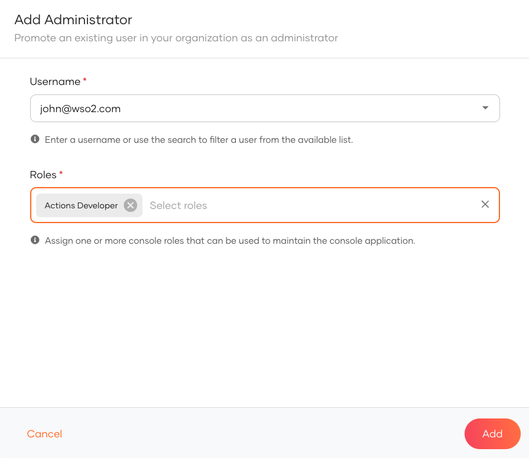
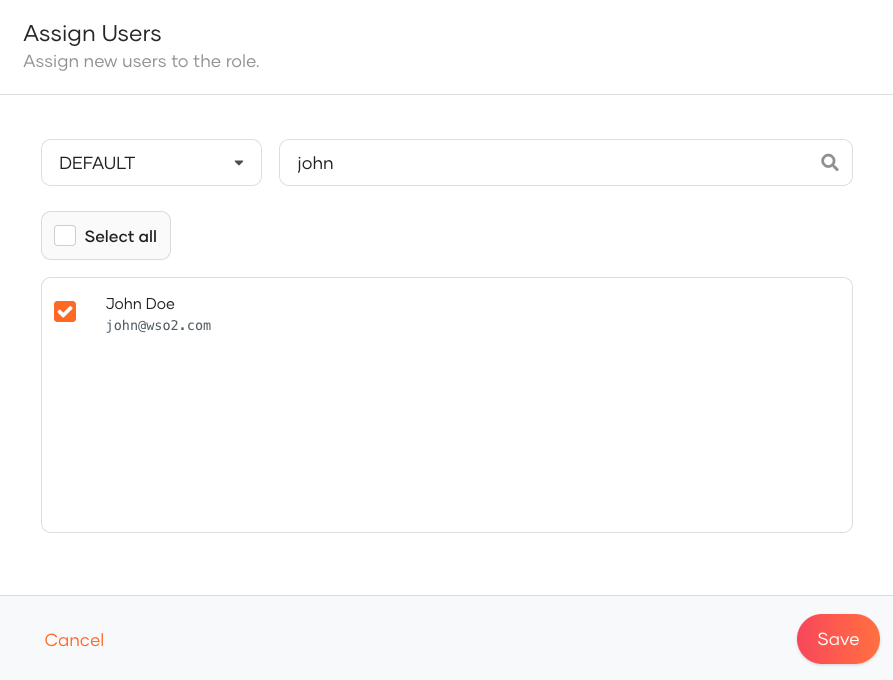

# WSO2 Identity Platform user roles

Roles define the permissions required for the users to access the WSO2 Identity Platform resources such as functions available on the WSO2 Identity Platform Console, REST APIs, etc.

When you assign a role to a user, you control what the user can do in WSO2 Identity Platform.

By default, WSO2 Identity Platform has the **<DeploymentValue cloud="" selfHosted="admin" />** user role. This role includes all administrative permissions in the organization. An organization can have many users with the
<DeploymentValue cloud="" selfHosted="admin" /> role. An <DeploymentValue cloud="" selfHosted="admin" /> represents a privileged user who has full access to the organization.

The following list contains the permissions enabled for an <DeploymentValue cloud="" selfHosted="admin" />:

## User management

- View users
- Onboard users
- Update user profiles
- Delete users
- Terminate sessions
- View groups
- Create groups
- Update and delete groups
- View assigned users to groups
- Assign users to groups
- View roles
- Create roles
- Update and delete roles
- Assign users to roles
- Assign groups to roles

## Application management

- View apps and app settings
- Register apps
- Update and delete apps
- Update Sign-in methods
- Update protocol settings

## Connections management

- View connections and connection settings
- Create new connection
- Update and delete connections

## Organization management

- Create new organizations
- View all the organizations created
- As the organization creator, update and delete organizations that you created
- Switch to the organizations that you created
- Share applications from the organization (root) to its organizations

## Managing attributes and scopes

- View attributes
- Create new attributes
- Update and delete attributes
- View scopes
- Add new attributes to scopes
- Update and delete scopes

## Managing organization settings

- View account recovery scenario and settings
- Configure account recovery scenarios
- View self registration related settings
- Configure self registration for users
- View account security related settings and configurations
- Configure account security related settings

 

## Create custom console roles

WSO2 Identity Platform allows you to create custom roles with specific permissions to tailor the Console experience to privileged users in your organization.

Follow the steps below to configure a custom console role in WSO2 Identity Platform.

1. On the WSO2 Identity Platform Console, go to **Console Settings** > **Roles**.
2. Click on **New Role** and provide the following details:

    - **Role Name**: Provide a name for the role.
    - **Permissions**: Select the required permissions for the role.

    :::note

    You can select either **View** or **Edit** permission for each resource. Selecting **Edit** will automatically inherit the **View** permission for that resource.

    :::

    
3. Click **Add** to create the custom role.

<Applies to="WSO2 Cloud">

### Granular console permissions

WSO2 Identity Platform lets you assign **Create**, **Update**, and **Delete** permissions to roles, independently for each feature component. For example, you can allow a role to create users without allowing it to update or delete existing users.

You can assign each Console component the following permission levels: **View**, **Create**, **Update**, and **Delete**.

:::note

**View** is required whenever **Create**, **Update**, or **Delete** is selected for a component, and it cannot be turned off while any of those write permissions remain active.

:::

</Applies>

### Assign users to console role

You can assign users to roles using either of the following methods:

1. On the **Console Settings** > **Administrators** tab, click **Add Administrator**, then select the user and the role to assign.
   
2. On the **Console Settings** > **Roles** tab, click on the role you want to assign. In the **Role Settings** page, go to the **Users** tab and click **Assign User** to assign users to the role.
   

<Applies to="WSO2 Cloud">

:::note

To assign users within the organization, enable the **Enable users to manage the organization** from **Console Settings** > **Administrators** tab by clicking on the **Settings** icon.

:::

</Applies>

### Try it out

1. Copy the Console URL from the **Console Settings** page.
2. Share it with the assigned users to log in to the WSO2 Identity Platform Console.
