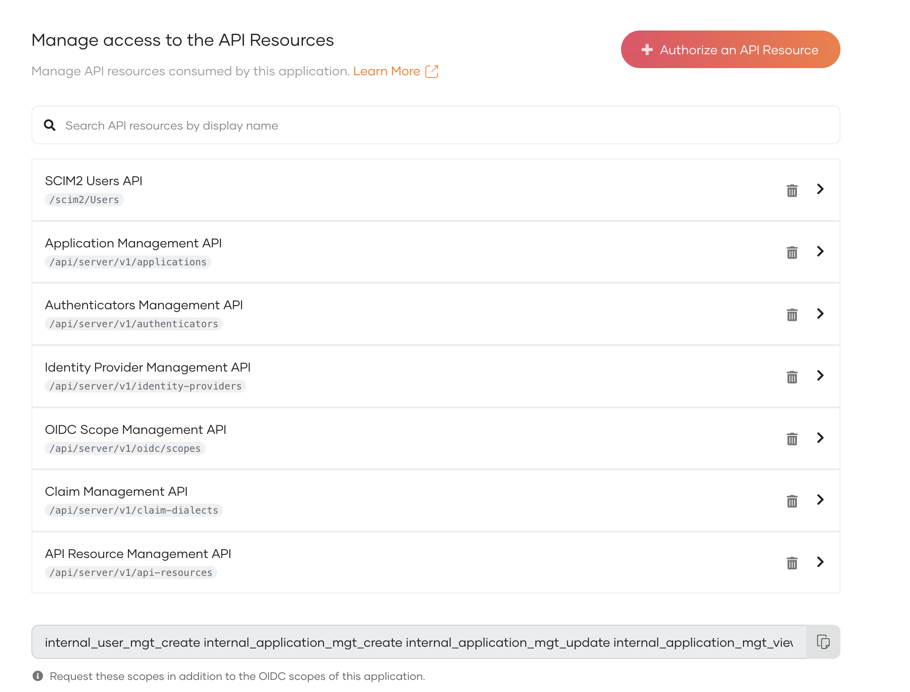
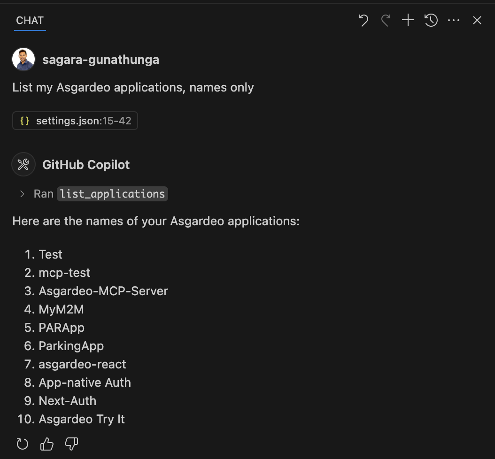
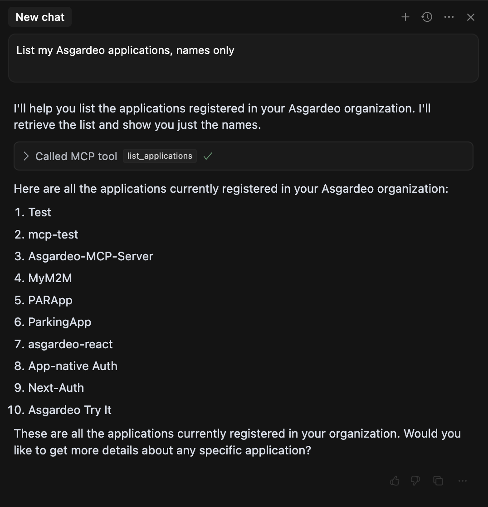
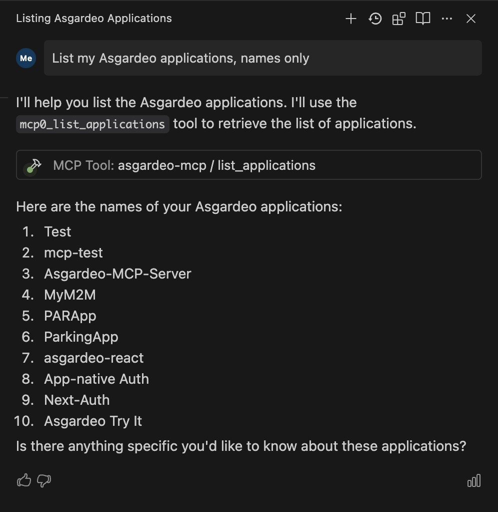
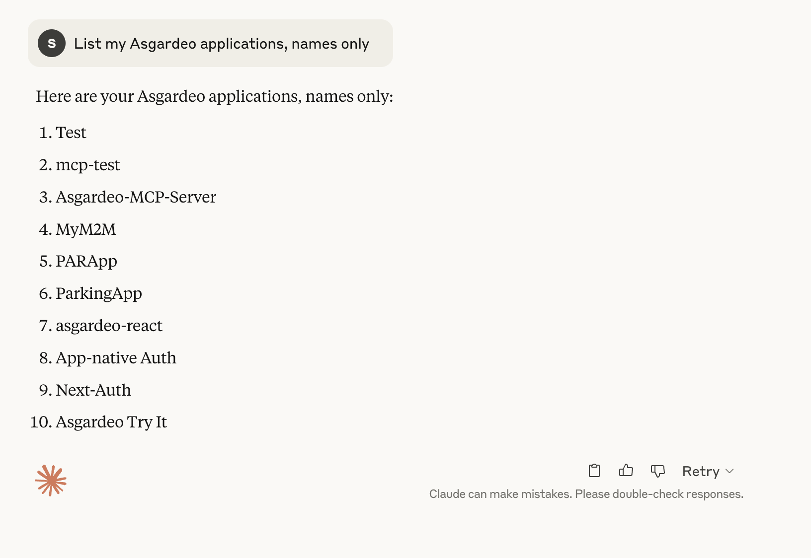

# WSO2 Identity Platform MCP Server

The **WSO2 Identity Platform MCP Server** helps you manage identity and access management tasks using natural language prompts. It connects your code editor or AI tool to WSO2 Identity Platform’s Management APIs, letting you automate common identity management operations—such as listing applications, updating application settings, or managing users—without going through UI interfaces or needing to write API calls.

You can use the WSO2 Identity Platform MCP Server with popular editors and tools like **VS Code, Claude Desktop, Cursor, Windsurf**, and others. The MCP server acts as a bridge between your editor and WSO2 Identity Platform, handling authentication and API requests for you. This quickstart explains how to set up the server, connect it to your WSO2 Identity Platform organization, and verify your setup.

## On WSO2 Identity Platform

The WSO2 Identity Platform MCP Server communicates with the WSO2 Identity Platform Management APIs to perform the actions required by each MCP tool. To make this work, it must first get an access token with the appropriate scopes. This requires configuring access to your WSO2 Identity Platform organization by creating a Machine-to-Machine (M2M) application and authorizing API Resources and Scopes to access the necessary APIs.

1. Sign into WSO2 Identity Platform console and navigate to **Applications > New Application**. Then, select **M2M Application** and complete the wizard popup by providing a suitable name.

    :::note

    **name:** WSO2 Identity Platform-MCP-Server

    :::

    Note down the following values from the **Protocol** tab of the registered application. You will need them in **step-3**.

    - **`client-id`** from the **Protocol** tab.
    - **`client-secret`** from the **Protocol** tab.
    - **The name of your WSO2 Identity Platform organization**

2. Authorize the API resources and corresponding scopes required for the actions performed by the MCP tools. The following table includes the required API resources and scopes for all currently supported tools.

| **WSO2 Identity Platform Management API** | **Required scopes** |
|--------|---------|
| **Application Management API** (`/api/server/v1/applications`) | `internal_application_mgt_view`, `internal_application_mgt_update`, `internal_application_mgt_create`, `internal_application_internal_api_update`, `internal_application_business_api_update` |
| **API Resource Management API** (`/api/server/v1/api-resources`) | `internal_api_resource_create`, `internal_api_resource_view` |
| **Identity Provider Management API** (`/api/server/v1/identity-providers`) | `internal_idp_view` |
| **Authenticators Management API** (`/api/server/v1/authenticators`) | `internal_authenticator_view` |
| **Claim Management API** (`/api/server/v1/claim-dialects`) | `internal_claim_meta_view` |
| **SCIM2 Users API** (`/scim2/Users`) | `internal_user_mgt_create` |
| **OIDC Scope Management API** (`/api/server/v1/oidc/scopes`) | `internal_oidc_scope_mgt_view` |

To authorize API resources, navigate to the **API Authorization** tab within your WSO2 Identity Platform application settings and click the **Authorize an API Resource** button. In the pop-up window that appears, use the dropdown to search and select the necessary API Resources from the Management APIs and authorize necessary scopes.

:::note


You can selectively authorize API Resources and scopes based on the specific MCP tools you plan to use.
For detailed guidance on which API Resources and Scopes are needed by each tool, see the [API resources and scopes required for MCP tools](../references/mcp-tool-api-resource-access.md) section.

:::

Once completed, your API Authorization configuration should look as follows.



## Build the WSO2 Identity Platform MCP Server

Before configuring your code editor, you need to build the WSO2 Identity Platform MCP Server executable locally.

1. Clone the repository:

    ```bash
    git clone https://github.com/asgardeo/asgardeo-mcp-server.git
    ```

2. Navigate to the cloned directory and install dependencies:

    ```bash
    cd asgardeo-mcp-server
    go mod tidy
    ```

3. Build the executable:

    ```bash
    go build -o asgardeo-mcp
    ```

This creates the `asgardeo-mcp` binary in the current directory. The absolute path to this binary (e.g., `/Users/<username>/asgardeo-mcp-server/asgardeo-mcp`) is what you will use as `<ABSOLUTE-PATH>` in the next step.

## Configure your code editor

<Tabs>
<TabItem value="tab-0" label=" VS Code ">

1. Open **VS Code**.
2. Press `Ctrl` + `Shift` + `P` (or `Cmd` + `Shift` + `P` on Mac).
3. Type **"MCP: Open User Configuration"** and select it.

Add the following server configuration to `mcp.json` file. Replace the `<ABSOLUTE-PATH>`, `<client-id>`,  `<client-secret>` and `<organization>` values from the values you copied from the previous steps. 

```json title="mcp.json"
{
    "servers": {
        "asgardeo-mcp": {
            "command": "<ABSOLUTE-PATH>/asgardeo-mcp",
            "args": [],
            "env": {
                "ASGARDEO_BASE_URL": "https://api.asgardeo.io/t/<organization>",
                "ASGARDEO_CLIENT_ID": "<client-id>",
                "ASGARDEO_CLIENT_SECRET": "<client-secret>"
            }
        }
    }
}
```

</TabItem>
<TabItem value="tab-1" label=" Cursor ">

1. Open **Cursor**.
2. Click on **Cursor > Settings > Cursor Settings**.
3. Switch to **MCP** tab.
4. Click on **Add new global MCP server** button. This will open `mcp.json` file in the editor itself.

Append the following configuration to `settings.json` file. Replace the `<ABSOLUTE-PATH>`, `<client-id>`,  `<client-secret>` and `<organization>` values from the values you copied from the previous steps. 

```json title="mcp.json"
{
    "mcpServers": {
        "asgardeo-mcp": {
            "command": "<ABSOLUTE-PATH>/asgardeo-mcp",
            "args": [],
            "env": {
                "ASGARDEO_BASE_URL": "https://api.asgardeo.io/t/<organization>",
                "ASGARDEO_CLIENT_ID": "<client-id>",
                "ASGARDEO_CLIENT_SECRET": "<client-secret>"
            }
        }
    }
}
```

</TabItem>
<TabItem value="tab-2" label=" Windsurf ">

1. Open **Windsurf**.
2. Click on **Windsurf > Windsurf Settings > Cursor Cascade**.
3. Switch to **MCP** tab.
4. Click on **Add Server** button next to **Model Context Protocol (MCP) Servers**. Then click the **Add custom Server** button will open `mcp_config.json` file in the editor itself.

Append the following configuration to `mcp_config.json` file. Replace the `<ABSOLUTE-PATH>`, `<client-id>`,  `<client-secret>` and `<organization>` values from the values you copied from the previous steps. 

```json title="`mcp_config.json.json"
"{
    "servers": {
        "asgardeo-mcp": {
            "command": "<ABSOLUTE-PATH>/asgardeo-mcp",
            "args": [],
            "env": {
                "ASGARDEO_BASE_URL": "https://api.asgardeo.io/t/<organization>",
                "ASGARDEO_CLIENT_ID": "<client-id>",
                "ASGARDEO_CLIENT_SECRET": "<client-secret>"
            }
        }
    }
}
```

</TabItem>
<TabItem value="tab-3" label=" Claude Desktop ">

1. Open **Claude Desktop**.
2. Click on **Claude Desktop > Settings > Developer**.
4. Click on **Edit Config** button. This will open `claude_desktop_config.json` file location and you can open this file using an text editor.

Append the following configuration to `claude_desktop_config.json` file. Replace the `<ABSOLUTE-PATH>`, `<client-id>`,  `<client-secret>` and `<organization>` values from the values you copied from the previous steps. 

```json title="claude_desktop_config.json"
{
    "mcpServers": {
        "asgardeo-mcp": {
            "command": "<ABSOLUTE-PATH>/asgardeo-mcp",
            "args": [],
            "env": {
                "ASGARDEO_BASE_URL": "https://api.asgardeo.io/t/<organization>",
                "ASGARDEO_CLIENT_ID": "<client-id>",
                "ASGARDEO_CLIENT_SECRET": "<client-secret>"
            }
        }
    }
}
```

</TabItem>
<TabItem value="tab-4" label=" Other ">

Use the following settings to configure your MCP-compatible client application.

Make sure to replace the `<ABSOLUTE-PATH>`, `<client-id>`,  `<client-secret>` and `<organization>` values from the values you copied from the previous steps. 

```json
{
    "mcpServers": {
        "asgardeo-mcp": {
            "command": "<ABSOLUTE-PATH>/asgardeo-mcp",
            "args": [],
            "env": {
                "ASGARDEO_BASE_URL": "https://api.asgardeo.io/t/<organization>",
                "ASGARDEO_CLIENT_ID": "<client-id>",
                "ASGARDEO_CLIENT_SECRET": "<client-secret>"
            }
        }
    }
}
```

</TabItem>
</Tabs>

## Verify WSO2 Identity Platform MCP server setup

Use the following simple prompt to verify whether you have configured WSO2 Identity Platform MCP Server successfully.

```text
List my WSO2 Identity Platform applications, names only

```

Depending on the code editor you're using, you should see a list of results. The output may vary based on the number of applications you've created in WSO2 Identity Platform, but you should see at least one application name listed.

<Tabs>
<TabItem value="tab-0" label=" VS Code  ">

WSO2 Identity Platform application list displayed in VS Code.



</TabItem>
<TabItem value="tab-1" label=" Cursor  ">

WSO2 Identity Platform application list displayed in Cursor.



</TabItem>
<TabItem value="tab-2" label=" Windsurf  ">

WSO2 Identity Platform application list displayed in Windsurf.



</TabItem>
<TabItem value="tab-3" label=" Claude Desktop ">

WSO2 Identity Platform application list displayed in Claude Desktop.



</TabItem>
</Tabs>

## Build a real-world sample

Now that you’ve configured and verified the WSO2 Identity Platform MCP Server with your preferred code editor, it’s time to build a real-world example. The following quickstarts are great starting points to try out the WSO2 Identity Platform MCP Server alongside your AI toolkit:

- [WSO2 Identity Platform React Quickstart](../quick-starts/react.md)
- [WSO2 Identity Platform Angular Quickstart](../quick-starts/angular.md)
- [WSO2 Identity Platform React Spring Quickstart](../quick-starts/springboot.md)

Explore these guides to put your setup into action and see how natural-language-powered identity management can accelerate your development workflow.

:::note


During tool execution, you will be prompted to give **explicit consent** for the action. It’s recommended to 
approve actions with "Approve Once" option rather than selecting "Approve Always" option so you retain full control and visibility
over the operations performed in your WSO2 Identity Platform organization.

:::
