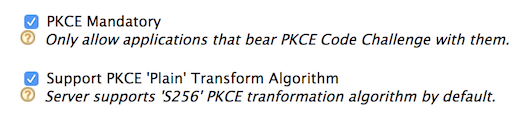

# Authorization Code Grant With PKCE

PKCE is a recommended security measure used to mitigate a [code interception attack](../../deploy/mitigate-attacks/mitigate-authorization-code-interception-attacks.md). 
This page guides you through using [Authorization Code Grant](../../references/concepts/authorization/authorization-code-grant.md) with PKCE 
to configure authentication for native mobile applications.

----

## Register a service provider

To register your application as a service provider in the WSO2 Identity Server:

1. Log in to the WSO2 Identity Server Management Console using administrator credentials.

2. Go to **Main** > **Identity** > **Service Providers** > **Add**.
     
    

3. Enter a **Service Provider Name**. Optionally, enter a **Description**.
    
    

4. Click **Register**.

---

## Configure the service provider

Make the following changes to the created service provider.

1. Expand **Inbound Authentication Configuration > OAuth/OpenID Connect Configuration** and click **Configure**.

2. Make sure **Code** is selected from the **Allowed Grant Types** list.
        
3. Enter the **Callback Url**.

    :::tip

    The **Callback Url** is the exact location in the service provider's application to which an access token will 
    be sent. This URL should be the URL of the page that the user is redirected to after successful authentication.

    :::

4. Select **PKCE Mandatory** in order to enable PKCE. 

    
           
5. Click **Add**. 

    :::note

    - Note the generated **OAuth Client Key** and **OAuth Client Secret**. You will need these values later on when sending 
    the requesting the code and the access token.

    - To configure more advanced configurations, see [OAuth/OpenID Connect Configurations](../login/oauth-app-config-advanced.md).

    :::

## Authorization code grant type

Make the following requests via your application to connect your application to WSO2 IS. 

1. Obtain the `authorization_code` by sending an authorization request to the authorization endpoint. 

    :::tip

    You can use this [online tool](https://tonyxu-io.github.io/pkce-generator/) to generate PKCE code challenges to include the `code challenge` and `code_challenge_method` parameters. 
    First click **Generate Code Verifier**. 
    Now click **Generate Code Challenge**. 
    Make note of the two values. The code challenge you get here is the base64 URL encoded value of the SHA256 hashed code_verifier so the code challenge method will be `S256`.

    :::

    :::note

    **Request Format**
    ```
    https://<host>/oauth2/authorize?response_type=code
    &redirect_uri=<redirect_uri>
    &client_id=<OAuth Client Key>
    &code_challenge=<PKCE_code_challenge>
    &code_challenge_method=<PKCE_code_challenge_method>
    ```
    ---
    **Sample Request**
    ```curl
    https://localhost:9443/oauth2/authorize?response_type=code
    &redirect_uri=https://localhost/callback
    &client_id=YYVdAL3lLcmrubZ2IkflCAuLwk0a
    &code_challenge=5vEtIy2T-G65yXHc8g5zcJDQXICBzZMrtERq0zhx7hM
    &code_challenge_method=S256
    ```

    :::
    
    You will receive an authorization code. 
    
    :::note

    **Response Format**
    ```
    <callback_url>?code=<code>
    ```
    ---
    **Sample Response**
    ```curl
    http://wso2is.local:8080/playground2/oauth2client?code=9142d4cad58c66d0a5edfad8952192
    ```

    :::
    
2. Obtain the access token by sending a token request to the token endpoint using the `authorization_code` received in step 1, and the `<OAuth Client Key>` and `<OAuth Client Secret>` obtained when configuring the service provider.

    :::note

    **Request Format**
    ```
    curl -i -X POST -u <OAuth Client Key>:<Client Secret> -k -d 
    'grant_type=authorization_code&redirect_uri=<redirect_uri>
    &code=<authorization_code>&code_verifier=<PKCE_code_verifier>' 
    https://localhost:9443/oauth2/token
    ```
    ---
    **Sample Request**
    ```curl
    curl -i -X POST -u YYVdAL3lLcmrubZ2IkflCAuLwk0a:azd39swy3Krt59fLjewYuD_EylIa -k -d 
    'grant_type=authorization_code
    &redirect_uri=https://localhost/callback&code=d827ec7e-1b8e-3d81-a4c0-2f7ff67ce844
    &code_verifier=aYr1jbrAHhZDC5WBi8wQPdraATAvvKy93S22rkPDkkRTHzzaAMVOJ5MHgRPgoKf8xDBJPE08'
    https://localhost:9443/oauth2/token
    ```

    :::
    
3. You will receive the following response with the access token and refresh token.

    ```
    {
        "access_token":"35c52563-f46b-3364-8d3d-007e526e0ab3",
        "refresh_token":"52569186-163f-3c9c-b2f4-539a0e8529ce",
        "token_type":"Bearer",
        "expires_in":3600
    }
    ```
    
:::info[Related topics]

- [Deploy: Mitigate Authorization Code Interception Attacks](../../deploy/mitigate-attacks/mitigate-authorization-code-interception-attacks.md)
- [Guide: Advanced OpenID Connect Configurations](../login/oauth-app-config-advanced.md)

:::
