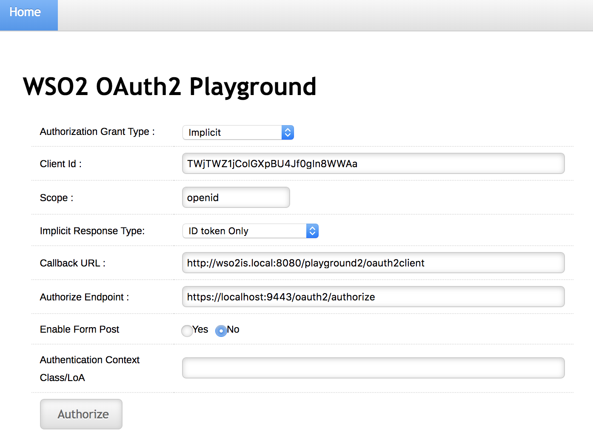

# Implicit Grant with OAuth 2.0 Playground

This page guides you through using a sample Playground application to try out authentication to an OAuth 2.0/OpenID Connect web application using the [Implicit](../../references/concepts/authorization/implicit-grant.mdx) grant type.

----

## Set up the sample application

<Prerequisites>

### Prerequisites

- Download [Apache Tomcat 8.x](https://tomcat.apache.org/download-80.cgi) and install it. Tomcat server installation location will later be referred to as `<TOMCAT_HOME>` in this guide.

- It is recommended that you use a hostname that is not `localhost` to avoid browser errors. Modify your machine's `/etc/hosts` entry to reflect this.

    :::info

    Note that `wso2is.local` is used in this documentation as an example, but you must modify this when configuring the authenticators or connectors with this sample application.

    :::

</Prerequisites>


### Download the sample

To deploy a WSO2 Identity Server sample application, you need [download the `playground2.war`](https://github.com/wso2/samples-is/releases/download/v4.5.2/playground2.war) file from the latest release assets.

### Deploy the sample web app

To deploy the sample web app on a web container:

1. Copy the downloaded `playground2.war` file into the `<TOMCAT_HOME>/apache-tomcat-<version>/webapps` folder.

2. Start the Tomcat server.

3. Access the applcation through this URL: `http://wso2is.local:8080/playground2/oauth2.jsp`

    :::info

    By default, Tomcat runs on port 8080. If you have configured it to run on a different port, update the URL and access the playground application.  

    :::


You will now be redirected to the landing page of the sample application.

:::tip[Troubleshooting tip]


:::
	If you are getting the following error, the sample applications do not have a keystore in them. Therefore, you may get this error after changing the tomcat hostname because the public key of the WSO2 Identity Server does not exist in the Java certificate store.

	```java
	javax.net.ssl.SSLHandshakeException: sun.security.validator.ValidatorException: PKIX path building failed: 			sun.security.provider.certpath.SunCertPathBuilderException: unable to find valid certification path to requested target
	```

---

## Register a service provider

1. On WSO2 Identity Server Management Console, go to **Main** > **Identity** > **Service Providers** and click **Add**.

2. Enter `playground2` as the **Service Provider Name** text box, and click **Register**.

3. Expand the **Inbound Authentication Configuration > OAuth/OpenID Connect Configuration** and click **Configure**.

4. Fill in the form that appears. By default, all **Allowed Grant Types** are selected; you can disable the grant types that are not required.

    :::note

    The **custom** grant type will only appear on the UI if you have configured the JWT grant type. The value specified as the `name` of the `oauth.custom_grant_type` in the `deployment.toml` file when creating the custom grant type is the value that will appear on the UI. For more information on writing a custom grant type, see [Write a Custom OAuth 2.0 Grant Type](../../references/extend/oauth2/write-a-custom-oauth-2.0-grant-type.mdx).

    :::

5. Enter the **Callback Url** as `http://wso2is.local:8080/playground2/oauth2client`.

    :::tip

    For more information on other advanced configurations refer, [Advanced OpenID Connect](../login/oidc-parameters-in-auth-request.mdx).

    :::

7. Click **Add**. Note that `client key` and `client secret` are generated.

8. Click **Update**.

----

## Try Implicit grant 

1.  Enter the following details.

    - **Authorization Grant Type**: Implicit
    
    - **Client ID**: The OAuth Client Key received when registering the service provider.
    
    - **Callback URL**: `http://<TOMCAT_HOST>:<TOMCAT_PORT>/playground2/oauth2client`

	- **Authorize Endpoint**: `https://<IS_HOST>:<IS_PORT>/oauth2/authorize`
    
    
	
2. Click **Authorize**. 

	The playground application will send an
	[authorization request](https://tools.ietf.org/html/rfc6749#section-4.1.1)
	to the **authorize** endpoint of the WSO2 Identity Server using the
	following format.
	
	:::note


	:::
		**Request Format**
		```java
		https://<host>:<port>/oauth2/authorize?response_type=token
		&client_id=<client-ID>
		&redirect_uri=<callback-url>
		&scope=<scope>
		```
		---
		**Sample Request**
		```java
		https://localhost:9443/oauth2/authorize?response_type=id_token+token
		&client_id=Cx4LKFNObeuXocx7xgOpz5vfzFoa
		&redirect_uri=http://wso2is.local:8080/playground2/oauth2client
		&scope=openid
		``` 

3. Log in with user credentials (e.g., admin/admin). At this point, the application receives the ID token. 

	
