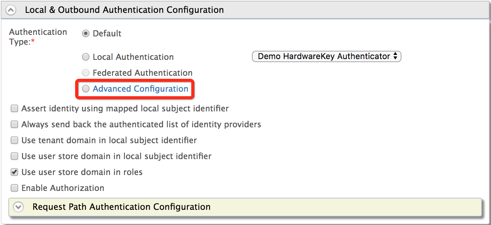

# Adaptive Authentication - Overview

This page guides you through setting up [adaptive authentication](../../references/concepts/authentication/adaptive-authentication.md) for an application.

## Prerequisites

You need to [register a service provider](../applications/register-sp.md) on the Management Console.

:::warning[Before you proceed]


For JDK 17 runtime - Adaptive Authentication is disabled by default.
You need to run **adaptive.sh** (**adaptive.bat** for Windows) in `[IS-HOME]/bin`

To enable adaptive authentication please proceed following instructions.

1.   Stop the server if running
2.   Run adaptive.sh (adaptive.bat for Windows) (eg: `sh adaptive.sh`)
3.   Restart the server

To disable adaptive authentication please proceed following instructions.

1.   Stop the server if running
2.   Run adaptive.sh (adaptive.bat for Windows) with DISABLE parameter (eg: `sh adaptive.sh DISABLE`)
3.   Restart the server

:::

## Add an adaptive authentication script

Make the following changes to the created service provider.

To add an authentication script to the service provider:

1. On the Management Console, go to **Main > Identity > Service Providers**.
2. Click **List**, select the service provider you want to configure, and click on the corresponding **Edit** link.
3. Expand **Local and Outbound Authentication Configuration** and click
    **Advanced Configuration**.  
    

4. You can add authentication steps or use a template to configure
    adaptive authentication depending on your requirement.

    If required, you can also use the script editor to introduce new functions and fields to an authentication script based on your requirement, and then engage the script to the service provider’s authentication step configuration. 

    :::note


    - To learn about the functions and fields related to authentication scripts, see [Adaptive Authentication JS API Reference](../../references/adaptive-authentication-js-api-reference.md).

    - To learn about the guidelines on writing custom functions for adaptive authentication, see [Write Custom Functions for Adaptive Authentication](../../references/extend/write-custom-functions-for-adaptive-authentication.md).

    :::

    A sample authentication script is shown below. 

    ```java
    var onLoginRequest = function(context) {
        // Some possible initializations...
        executeStep(1, {
            onSuccess: function (context) {
                // Logic to execute if step 1 succeeded
                executeStep(2, {
                    onSuccess: function (context){
                        // Logic to execute if step 2 succeeded
                    },
                    onFail: function (context){
                        // Logic to execute if step 2 failed
                    }
                });
            }
            onFail: function(context){
                // Logic to execute if step 1 failed
                executeStep(3);
            }
        });
    }
    
    function someCommonFunction(context) {
        // Do some common things
    }
    ```

5. Click **Update** to save changes.

:::info[Related topics]

- [Concept: Adaptive-Authentication](../../references/concepts/authentication/adaptive-authentication.md)
- [Guide: Ensure Assurance with ACR and AMR](work-with-acr-amr.md)
- [Guide: Adaptive Authentication Using Function Library](adaptive-auth-with-function-lib.md)

:::
