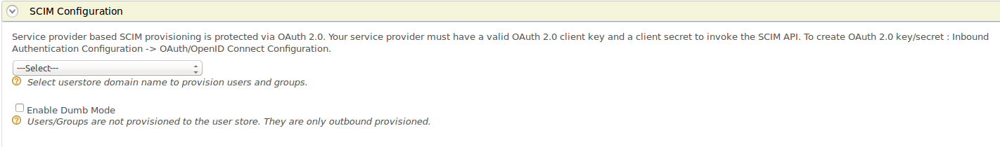

# Configurng inbound provisioning for a service provider

Inbound provisioning involves provisioning users or groups to the WSO2 Identity Server’s user store via an external application. For more information, see [inbound provisioning](../../references/concepts/provisioning-framework.md).

## Prerequisites

You need to [register a service provider](register-sp.md) on the Management Console.

## Configure inbound provisioning

To configure inbound provisioning.

1. On the Management Console, go to **Main > Identity > Service Providers**.
2. Click **List**, select the service provider you want to configure, and click on the corresponding **Edit** link.
3. Expand the **Inbound Provisioning Configuration** section.
4. Under **SCIM Configurations**, select the user store domain name from the drop-down list to provision users and groups.
    
5. Click **Update** to save your configurations.

:::info[Related Topics]

-   See [Configuring User Stores](../../deploy/configure-user-stores.md) for more information.
-   See [Inbound Provisioning](../../references/concepts/provisioning-framework.md) for configuring user stores and service providers for inbound provisioning.

:::
