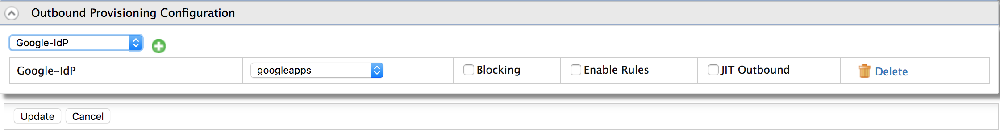

# Configurng outbound provisioning for a service provider

You might want to outbound provision users that self-register to your
applications to other entities, such as Google or Salesforce. This section guides you on configuring [outbound provisioning](/identity/6.0.0/learn/outbound-provisioning) for a service provider.

:::info[Scenario]

For example, your organization has a registration portal to add new employees and a registration portal to add customers to your system. WSO2 Identity Server acts as your Identity Provider. You want the newly added users to be provisioned to Google and Salesforce because Gmail and Salesforce are used for day-to-day activities in the organization. 
The customer details only need to be stored in the WSO2 Identity Server's user store. Therefore, you also configure the Service Provider you created for the employees' registration application to handle outbound provisioning.

:::

<Prerequisites>

## Prerequisites

- You need to [register a service provider](register-sp.mdx) on the Management Console.
- You need to [add an identity provider](../identity-federation/add-idp.mdx) and [enable an outbound povisioning connector](../identity-federation/outbound-provisioing-idp.mdx).

</Prerequisites>

## Configure outbound provisioning

To configure outbound provisioning:

1. On the Management Console, go to **Main > Identity > Service Providers**.
2. Click **List**, select the service provider you want to configure, and click on the corresponding **Edit** link.
3. Expand the **Outbound Provisioning Configuration**.

    :::note

    This section will be configurable only if outbound provisioning connectors are configured for the IdP.

    :::

4. Choose the identity provider from the drop-down and click the `+` icon to add the IdP.

5. Enable the following options based on the requirements of your service provider:

    | Option    | Definition    |
    |-----------|---------------|
    | Blocking  | Select this if you want to block the authentication flow during provisioning. In the default non-blocking mode, provisioning and authentication happen in two different threads. Enable this if you want to allow users to access your application only if the user is both authenticated and provisioned. |
    | Enable Rules  | Select this to provision users based on a set of pre-defined XACML rules. For more information, see [rule based provisioning](../identity-lifecycles/rule-based-provisioning.mdx)    |
    | JIT Outbound  | Select this to enable user provisioning during authentication. To enable this you need to [configure jit provisioning for your idp](../identity-federation/jit-workflow.mdx).  |

    

6. Click **Update** to save your changes.  

:::info[Related Topics]

- See [outbound Provisioning](../identity-lifecycles/outbound-provisioning.mdx) for more information on configuring user stores and service providers for outbound provisioning.

:::
