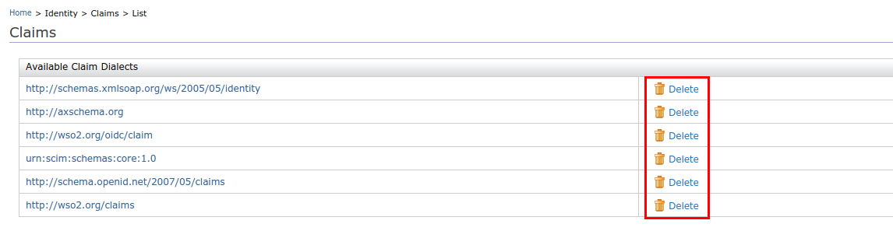
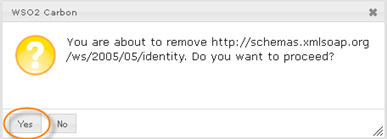

# Delete Claim Dialects

There are two ways to delete [claim dialects](add-claim-dialects.mdx) in WSO2 Identity Server.

## Use the management console

Follow the steps given below to remove claim dialects using the
management console.

1.  Access the Management Console (`https://<IS_HOST>:<PORT>/carbon`).
2.  Go to **Main** > **Claims** and click **List**.
3.  Locate the claim dialect you want to delete and
    **Delete** next to the dialect.  

    

4.  Confirm your action in the dialog box by clicking **Yes**.  

    

---

## Use the configuration file

Alternatively, you can delete the claim dialect by deleting the relevant claim configuration in the `claim-config.xml` configuration file (found in the `<IS_HOME>/repository/conf` folder. 

:::note


    The dialects configured in the `<IS_HOME>/repository/conf/claim-config.xml` file get applied only **when you start the product** for the first time or for any newly created tenants.
    
With the first startup, dialects and claims are loaded from the file and persisted in the database. Any consecutive updates to the file will not be picked up.  

:::

A sample claim dialect is given below.

```xml
<Dialect dialectURI="http://wso2.org/SampleAppClaims">
    <Claim>
        <ClaimURI>http://wso2.org/SampleAppClaims/givenname</ClaimURI>
        <DisplayName>First Name</DisplayName>
        <MappedLocalClaim>http://wso2.org/claims/givenname</MappedLocalClaim>
    </Claim>
    <Claim>
        <ClaimURI>http://wso2.org/SampleAppClaims/nickName</ClaimURI>
        <DisplayName>Nick Name</DisplayName>
        <MappedLocalClaim>http://wso2.org/claims/nickname</MappedLocalClaim>
    </Claim>
</Dialect>
```  
    
:::info[Related topics]


[Concepts: Claim Management](../../references/concepts/claim-management.mdx)

:::
