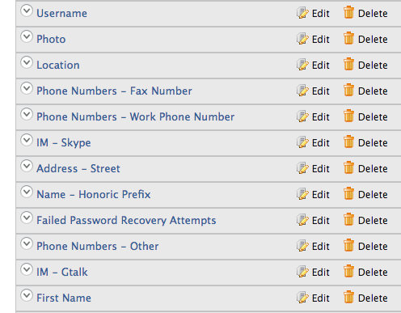

# Delete Claim Mapping

There are two ways to delete a claim mapping.

## Use the management console

Follow the steps given below to delete a claim mapping.

1. Access the Management Console (`https://<IS_HOST>:<PORT>/carbon`).
2. Go to **Main** > **Identity** > **Claims** and click **List**.
3. Click on any available dialect.  
    
4. From the **Claim Dialect** view, you can view the claims defined for
    that particular dialect.  
    
5. Click **Delete** to remove the appropriate claim mapping.

## Use the configuration file
    
Alternatively, you can do this by deleting claim mappings from the `claim-config.xml` file (located in the `<IS_HOME>/repository/conf/` folder).

:::note


    The dialects configured in the `<IS_HOME>/repository/conf/claim-config.xml` file get applied only **when you start the product** for the first time or for any newly created tenants.
    
With the first startup, dialects and claims are loaded from the file and persisted in the database. Any consecutive updates to the file will not be picked up.

:::

A sample claim mapping is given below.

```xml
<Claim>
    <ClaimURI>country</ClaimURI>
    <DisplayName>Country</DisplayName>
    <AttributeID>country</AttributeID>
    <Description>Country name component</Description>
    <MappedLocalClaim>http://wso2.org/claims/country</MappedLocalClaim>
</Claim>
```
    
:::info[Related topics]

[Concepts: Claim Management](../../references/concepts/claim-management.mdx)

:::
