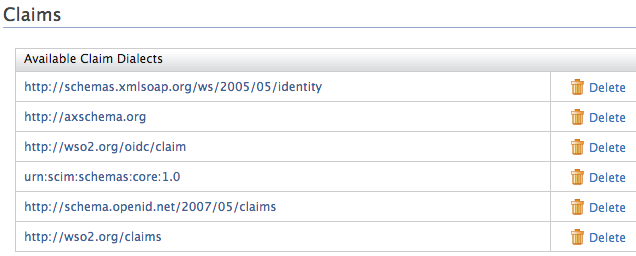
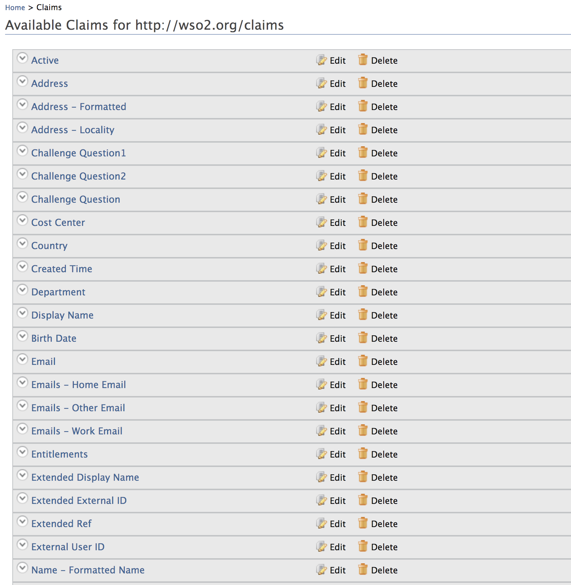
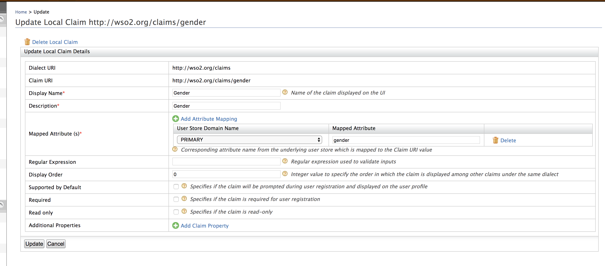

# Edit Claim Dialects

There are two ways to edit [claim dialects](add-claim-dialects.mdx) in WSO2 Identity Server.

## Use the management console

Follow the steps given below to edit claim dialects using the
management console.

1.  Access the Management Console (`https://<IS_HOST>:<PORT>/carbon`).
2.  Go to **Main** > **Claims** and click **List**.
3.  Click the dialect that you want to edit.
  
    

4.  On the **Claim Dialect** page, locate the claim you want to edit and click **Edit**.  

    

5.  Enter the new claim information in the required fields and click **Update**.
  
     

    | Attribute            | Description                                                                | Sample value                                                                                                                       |
    |----------------------|----------------------------------------------------------------------------|------------------------------------------------------------------------------------------------------------------------------------|
    | Display Name         | The name of the claim value, which is displayed to the user.                  | Street Address                                                                                                                     |
    | Description           | A small description of the claim to help the user understand it easily. | Address of the street.                                                                                                            |
    | Claim Uri            | The URI that defines the claim.                                           | `                               http://schemas.xmlsoap.org/ws/2005/05//identity/claims/streetaddress                             ` |
    | Mapped Attribute     | The attribute that is mapped to the claim.                                   | streetAddress                                                                                                                      |
    | Regular Expression   | A regular expression that helps to verify the input.                       | A street address can be an integer or a string, therefore the regex can be like " ****^ \\d \{ 1, 45 \} $**** "                         |
    | Display Order        | Order to display claims.                                                   | 1                                                                                                                                  |
    | Supported by Default | Whether the claim is displayed in the profile of the user.                 | Enabled                                                                                                                            |
    | Required             | Whether the claim is mandatory.                                            | Enabled                                                                                                                            |
    | Read-only            | Whether the claim cannot be updated later (read only).                     | Enabled                                                                                                                            |
    
---

## Use the configuration file

Alternatively, you can modify the claim dialects by editing the
`         claim-config.xml        ` configuration file (found in the
`         <IS_HOME>/repository/conf        ` folder). 

:::note


    The dialects configured in the `<IS_HOME>/repository/conf/claim-config.xml` file get applied only **when you start the product** for the first time or for any newly created tenants.
    
With the first startup, dialects and claims are loaded from the file and persisted in the database. Any consecutive updates to the file will not be picked up.

:::

A sample claim dialect is given below.

```xml
<Dialect dialectURI="http://wso2.org/SampleAppClaims">    
    <Claim>
        <ClaimURI>http://wso2.org/SampleAppClaims/givenname</ClaimURI>
        <DisplayName>First Name</DisplayName>
        <MappedLocalClaim>http://wso2.org/claims/givenname</MappedLocalClaim>
    </Claim>
    <Claim>
        <ClaimURI>http://wso2.org/SampleAppClaims/nickName</ClaimURI>
        <DisplayName>Nick Name</DisplayName>
        <MappedLocalClaim>http://wso2.org/claims/nickname</MappedLocalClaim>
    </Claim>
</Dialect>
```
    
:::info[Relqted Topics]


- [Guides: Add Claim Dialects](add-claim-dialects.mdx)
- [Concepts: Claim Management](../../references/concepts/claim-management.mdx)

:::
